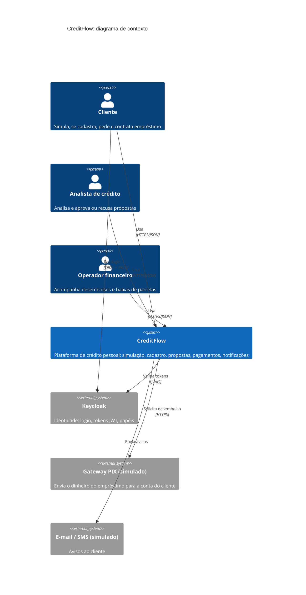
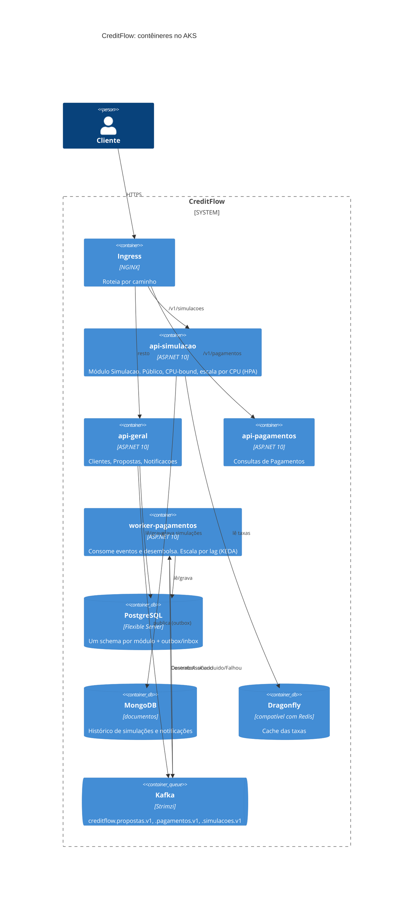

# CreditFlow

Curso de projeto que constrói, do primeiro `dotnet new` até o AKS, uma **plataforma de crédito pessoal** em **ASP.NET 10**: simulação de empréstimo (Price e SAC, IOF, CET), cadastro com consentimento LGPD, propostas com análise e contratação, desembolso por PIX simulado e notificações.

Não é um CRUD com nome de banco. O domínio tem conta de verdade (juros compostos, TIR por Newton-Raphson, arredondamento ao centavo), regra de verdade (consentimento por finalidade, validade da simulação, alçada de aprovação) e problema de produção de verdade: um módulo público que precisa escalar por CPU, um worker que precisa acompanhar uma fila, dinheiro que não pode sair duas vezes.

A arquitetura é um **monolito modular com DDD**: um repositório, um build, **uma imagem**, que sobe em **quatro deployments** diferentes no Kubernetes só mudando duas variáveis de ambiente. É a resposta a uma pergunta que aparece em toda entrevista sênior: *como escalar partes do sistema sem pagar o preço de microsserviços cedo demais?*

## Os repositórios

| Repositório | Papel |
|---|---|
| **learnFlow** (este site) | A aula: conceitos, porquês, previsões, labs de quebra, desafios e perguntas de entrevista |
| [lending-plataform](https://github.com/JandersonSR/lending-plataform) | O código do CreditFlow: aplicação, testes, Docker, Helm, Terraform, GitOps. Uma tag por módulo (`modulo-01`, `modulo-02`…) |
| [Plataforma .NET em Produção](../plataforma-dotnet/README.md) | A teoria de cada peça da plataforma numa API simples. Quando uma lição disser "visto a fundo na Plataforma", vá lá |
| [OrderFlow](../orderflow/README.md) | Um sistema poliglota (.NET + Java) por eventos, para comparar com o monolito modular daqui |

## O sistema no contexto (C4, nível 1)

Quem usa o CreditFlow e com quem ele conversa:

## Por dentro (C4, nível 2: contêineres)

Os quatro processos da aplicação são a **mesma imagem** com perfis diferentes:

## O que você leva no fim

- Um projeto de portfólio completo, com ADRs que explicam cada decisão
- A habilidade de defender, numa entrevista, monolito modular × microsserviços com números e custos
- Domínio de crédito suficiente para conversar com o negócio de uma fintech (Price, SAC, IOF, CET)
- Kafka com outbox, inbox e saga; Keycloak com PKCE e M2M; Helm, Argo CD, Terraform e Harbor funcionando juntos
- Um roteiro de estudo em [docs/README.md](docs/README.md) e uma visão geral em [docs/00-visao-geral.md](docs/00-visao-geral.md)

> Valores, alíquotas e fórmulas de IOF e CET do projeto são **didáticos**. Antes de usar em qualquer coisa real, confira a regulação vigente (Banco Central e Receita Federal).
