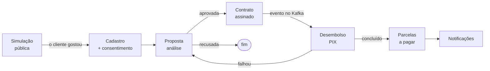
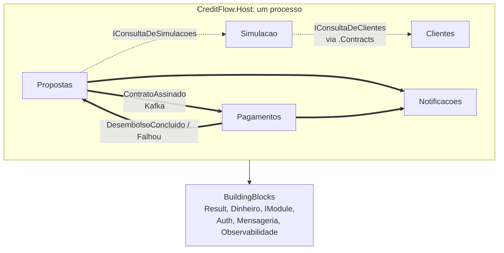
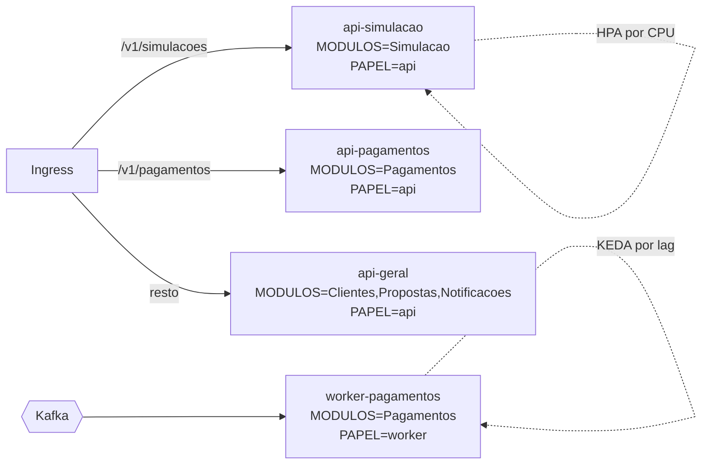

# Módulo 0: visão geral, o domínio de crédito e como estudar

**Objetivo:** antes de abrir o editor, entender o que o CreditFlow faz para o negócio, como ele é montado por dentro, por que a arquitetura é esta e como estudar o curso para sair dele sabendo explicar, e não só repetir.

## 1. Como estudar este curso

Você já é sênior em Node e TypeScript. O risco num curso de .NET para quem já sabe programar é ler rápido, achar tudo óbvio e, três semanas depois, travar no primeiro erro diferente do tutorial. O formato das lições existe para impedir isso:

| Bloco | O que fazer com ele |
|---|---|
| `previsao` | **Escreva o palpite antes de abrir.** Errar a previsão é o momento em que você aprende; acertar sem ter escrito não conta |
| `quebra` | Quebre de propósito, leia o erro inteiro, só então conserte. Em produção o erro chega sem aviso |
| `porque` | É a parte que vira resposta de entrevista. Leia em voz alta |
| `armadilha` | Coisas que já derrubaram sistemas reais |
| `desafio` | Sem roteiro, com critérios de aceite. Tente uma hora antes da primeira dica |
| `entrevista` | Responda em voz alta, em menos de dois minutos: decisão, motivo, custo |

Três regras:

1. **Digite o código.** Copiar e colar pula exatamente a parte em que você percebe que não entendeu uma linha.
2. **Um módulo por vez, com a tag.** O repositório tem uma tag por módulo (`git checkout modulo-02`). Compare o seu código com a tag só depois de terminar.
3. **Explique para alguém.** Você coordena um time de júniores e plenos: cada módulo rende uma apresentação de 20 minutos. Ensinar é o teste mais duro de entendimento.

::: dica Ritmo sugerido
Uma lição por dia útil (45 a 90 minutos) e o desafio no fim de semana. São 13 módulos; com esse ritmo, o curso cabe em três a quatro meses sem atropelar o trabalho.
:::

## 2. O negócio, explicado para quem nunca trabalhou com crédito

Uma financeira empresta dinheiro e cobra por isso. Tudo no CreditFlow gira em torno de quatro perguntas:

1. **Quanto custa?** A **simulação** responde antes de qualquer cadastro: "R$ 10.000 em 12 meses ficam em 12 parcelas de R$ 945,60, com custo efetivo de 2,34% ao mês".
2. **Quem é você?** O **cadastro** guarda CPF, renda e um score (uma nota de risco), e o **consentimento** do cliente para usar esses dados (exigência da LGPD).
3. **Vamos emprestar?** A **proposta** nasce de uma simulação, passa por regras de análise (renda, score, comprometimento) e é aprovada ou recusada. Aprovada, o cliente **contrata** (assina).
4. **O dinheiro chegou? As parcelas foram pagas?** **Pagamentos** faz o desembolso (o PIX para a conta do cliente) e dá baixa nas parcelas.

O vocabulário que você vai ouvir em todas as lições:

| Termo | O que é | Exemplo |
|---|---|---|
| **Principal** | O valor emprestado | R$ 10.000 |
| **Taxa de juros** | Quanto o dinheiro "rende" para quem emprestou, por mês | 2% a.m. |
| **Juros compostos** | Juros do mês calculados sobre o saldo que ainda se deve | No mês 1, 2% de 10.000; no mês 2, 2% do que sobrou |
| **Amortização** | A parte da parcela que abate a dívida (o resto da parcela é juro) | 745,60 dos 945,60 da 1ª parcela |
| **Price × SAC** | Dois jeitos de montar as parcelas: iguais (Price) ou decrescentes (SAC) | Módulo 2 |
| **IOF** | Imposto sobre a operação de crédito, cobrado na contratação | R$ 205,37 nos 10.000 |
| **CET** | Custo Efetivo Total: a taxa que inclui juros, IOF e tarifas. É o "preço real" | 2,34% a.m. contra 2% de juros |
| **Score** | Nota de risco do cliente. Score alto, taxa menor | 820 → faixa A |
| **Desembolso** | O dinheiro saindo da financeira para o cliente | PIX de R$ 9.794,63 |
| **Saga** | Uma sequência de passos em módulos diferentes que precisa terminar coerente, mesmo com falha no meio | Contrato → desembolso → (falhou) → proposta volta |

::: previsao
O cliente pede R$ 10.000 em 12 parcelas e a taxa de juros é 2% ao mês. Sem fazer conta: o **CET** vai ser maior, igual ou menor que 2%? E o valor que cai na conta do cliente é 10.000, mais ou menos?
???
**O CET é maior** (2,34% a.m. no exemplo do curso) e **o cliente recebe menos de 10.000** (9.794,63).

O IOF é cobrado na contratação. No CreditFlow ele é descontado do valor liberado: o cliente deve 10.000 (e paga parcelas calculadas sobre 10.000), mas recebe 10.000 − IOF. Pagar as mesmas parcelas tendo recebido menos é, na prática, pagar uma taxa maior. O CET é exatamente essa taxa: a que iguala o que o cliente recebeu ao que ele vai pagar. É por isso que o Banco Central obriga a informar o CET, e não só a taxa de juros, antes da contratação.
:::

## 3. A arquitetura-alvo

O CreditFlow é um **monolito modular**: um processo com cinco módulos de negócio de fronteiras fortes.

- Seta pontilhada: chamada **síncrona, em memória**, através de uma interface publicada no projeto `.Contracts` do módulo.
- Seta grossa: **evento** publicado no Kafka (com outbox, para não se perder).
- Nenhum módulo enxerga as classes internas de outro. Quem garante isso não é a boa vontade: é um teste que quebra o build (módulo 1, lição 1.4).

E no Kubernetes, o mesmo processo vira quatro:

## 4. O mapa dos perfis de execução

| Perfil | `CREDITFLOW__MODULOS` | `CREDITFLOW__PAPEL` | Por que separado | Escala por | Módulo do curso |
|---|---|---|---|---|---|
| `api-geral` | Clientes, Propostas, Notificacoes | `api` | Carga baixa e estável | réplicas fixas (2–3) | 7 |
| `api-simulacao` | Simulacao | `api` | Pública, CPU-bound, pico em campanha | CPU (HPA) | 8 |
| `api-pagamentos` | Pagamentos | `api` | Consultas; isolada do worker | réplicas fixas | 7 |
| `worker-pagamentos` | Pagamentos | `worker` | Acompanha o Kafka; não atende HTTP de negócio | lag do consumidor (KEDA) | 6 e 8 |
| local (vazio) | todos | `api` | Desenvolvimento: um processo só | — | 1 |

::: porque Por que não microsserviços desde o início
Microsserviços resolvem três problemas: **times** que não podem esperar uns pelos outros, **escala** muito diferente entre partes e **tecnologia** diferente por parte. O CreditFlow tem só o segundo, e os perfis de execução resolvem o segundo sem pagar o custo dos outros: rede entre módulos, consistência eventual em tudo, N pipelines, N versões de biblioteca, rastreamento distribuído como requisito para depurar qualquer coisa. Quando (e se) um módulo precisar sair, a fronteira já existe e já é testada. A decisão está registrada no [ADR 0001](https://github.com/JandersonSR/lending-plataform/blob/main/docs/adr/0001-monolito-modular.md) e no [ADR 0002](https://github.com/JandersonSR/lending-plataform/blob/main/docs/adr/0002-perfis-de-execucao.md).
:::

## 5. Os blocos do curso

| Bloco | Módulos | Você sai sabendo |
|---|---|---|
| **Fundação** | 0, 1, 2 | Montar uma solução .NET do zero com fronteiras testadas; modelar um domínio com conta de verdade |
| **Integração** | 3, 4, 5, 6 | Identidade, dois bancos com papéis diferentes, cache sem servir dado errado, eventos que não se perdem nem se repetem |
| **Entrega** | 7, 8, 9, 10, 11 | Imagem, Kubernetes, Helm, escala por perfil, Azure com Terraform, cadeia de suprimentos, GitOps |
| **Operação** | 12 | Observabilidade, SLOs, game day, post-mortem, ADRs |

## 6. Onde você está hoje

Dê uma nota de 0 a 3 para cada item e refaça no fim do curso. 0: só conheço o nome. 1: sigo um tutorial. 2: explico o porquê e resolvo o erro comum. 3: escolho entre alternativas, defendo e ensino.

| Item | Hoje | No fim |
|---|---|---|
| C# e o ecossistema .NET (SDK, csproj, NuGet) | | |
| Monolito modular e DDD tático | | |
| Matemática financeira (juros compostos, Price, SAC, CET) | | |
| OAuth 2.0 / OIDC com Keycloak | | |
| EF Core + PostgreSQL; MongoDB | | |
| Kafka (outbox, inbox, saga) | | |
| Docker, Kubernetes, Helm | | |
| Terraform e Azure | | |
| GitOps (Argo CD) e cadeia de suprimentos (Harbor) | | |
| Observabilidade e SLOs | | |

## 7. Vídeos para a primeira visão

::: video Modular Monoliths • Simon Brown • GOTO 2018 (em inglês)
https://www.youtube.com/watch?v=5OjqD-ow8GE
A palestra clássica sobre monolito modular. Assista antes do módulo 1: é o argumento inteiro da arquitetura do CreditFlow.
:::

::: video Modular Monoliths: How To Build One & Lessons Learned (Milan Jovanović, em inglês)
https://www.youtube.com/watch?v=Xo3rsiZYsJQ
A mesma ideia em .NET, com lições de um sistema real: como os módulos conversam e como isolar os dados.
:::

::: video Kafka in 100 Seconds (Fireship, em inglês)
https://www.youtube.com/watch?v=uvb00oaa3k8
Tópico, partição e consumidor em dois minutos. Base para o módulo 6.
:::

::: video Kubernetes explained in 15 mins (TechWorld with Nana, em inglês)
https://www.youtube.com/watch?v=VnvRFRk_51k
Os objetos principais do Kubernetes. Base para os módulos 7 e 8.
:::

## 8. Perguntas para responder sem olhar

::: pergunta
Qual a diferença entre a taxa de juros e o CET? Por que o cliente deveria olhar o CET?
???
A taxa de juros remunera só o dinheiro emprestado. O CET é a taxa que iguala tudo o que o cliente recebe ao tudo o que ele paga, incluindo IOF e tarifas. Duas ofertas com a mesma taxa de juros podem ter CETs diferentes; o CET é o que permite comparar.
:::

::: pergunta
O CreditFlow roda como quatro deployments no Kubernetes. Quantas imagens de contêiner existem? Por quê?
???
Uma. Os deployments mudam só `CREDITFLOW__MODULOS` e `CREDITFLOW__PAPEL`. Um build, uma tag, um scan; e a escala de cada parte é independente.
:::

::: pergunta
Simulação chama Clientes de forma síncrona e Propostas avisa Pagamentos por evento. Por que não o contrário, ou tudo por evento?
???
Simular precisa da resposta agora (o score define a taxa), e ler um dado de outro módulo em memória é barato e consistente. Desembolsar é um passo demorado, que depende de um sistema externo e pode falhar: por evento, Propostas não fica esperando, e o pedido não se perde se Pagamentos estiver fora (outbox + Kafka). A regra prática: síncrono para consulta que precisa da resposta; evento para avisar que algo aconteceu.
:::

**Próximo:** [Módulo 1: do zero](modulo-01/README.md).
