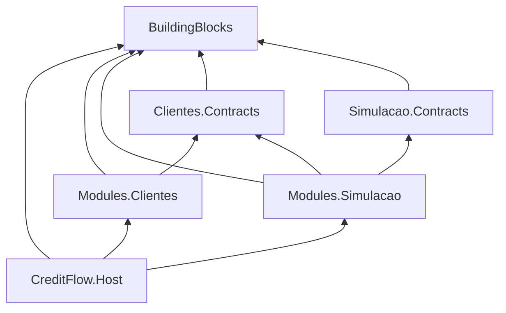

# 1.1 Do zero: `dotnet new`, slnx e gestão central de pacotes

Em Node, um projeto é uma pasta com `package.json`; um monorepo junta várias com workspaces. No .NET, as peças equivalentes são o **projeto** (`.csproj`), a **solução** (`.slnx`) e dois arquivos que todo projeto lê sem ninguém pedir: `Directory.Build.props` e `Directory.Packages.props`. Esta lição monta os quatro e explica o que cada um faz por dentro.

## O que vamos criar

```text
creditflow/
  CreditFlow.slnx
  Directory.Build.props        regras de build de TODOS os projetos
  Directory.Packages.props     versões de TODOS os pacotes NuGet
  .editorconfig  .gitignore
  src/
    Host/CreditFlow.Host/                          o processo (Web SDK)
    BuildingBlocks/CreditFlow.BuildingBlocks/      blocos compartilhados (biblioteca)
    Modules/Clientes/CreditFlow.Modules.Clientes/            o módulo
    Modules/Clientes/CreditFlow.Modules.Clientes.Contracts/  a vitrine do módulo
    Modules/Simulacao/...
  tests/
    CreditFlow.ArchitectureTests/
    CreditFlow.Modules.Simulacao.Tests/  ...
```



Leia as setas como "referencia". Repare no que **não** existe: nenhuma seta de `Simulacao` para `Clientes` (só para `Clientes.Contracts`), e nenhuma seta saindo de `BuildingBlocks`.

## Os comandos, e por que cada opção

```bash
mkdir creditflow && cd creditflow
dotnet new sln --name CreditFlow --format slnx
dotnet new gitignore
dotnet new editorconfig
dotnet new buildprops        # cria Directory.Build.props
dotnet new packagesprops     # cria Directory.Packages.props com ManagePackageVersionsCentrally=true

dotnet new web       -o src/Host/CreditFlow.Host
dotnet new classlib  -o src/BuildingBlocks/CreditFlow.BuildingBlocks
dotnet new classlib  -o src/Modules/Clientes/CreditFlow.Modules.Clientes
dotnet new classlib  -o src/Modules/Clientes/CreditFlow.Modules.Clientes.Contracts
dotnet new classlib  -o src/Modules/Simulacao/CreditFlow.Modules.Simulacao
dotnet new classlib  -o src/Modules/Simulacao/CreditFlow.Modules.Simulacao.Contracts

dotnet sln add src/Host/CreditFlow.Host src/BuildingBlocks/CreditFlow.BuildingBlocks \
  src/Modules/Clientes/* src/Modules/Simulacao/*
```

| Comando / opção | Por quê |
|---|---|
| `--format slnx` | O formato novo de solução, em XML legível. No .NET 10 ele já é o padrão, mas deixar explícito evita surpresa com SDK antigo na máquina de alguém |
| `dotnet new web` no Host | Usa o **Web SDK** (`Microsoft.NET.Sdk.Web`): Kestrel, Minimal APIs, `appsettings.json` e `launchSettings.json` vêm junto. É o único executável |
| `classlib` nos módulos | Módulo não é processo: é biblioteca que o Host carrega. Isso é o que permite a mesma imagem rodar qualquer combinação de módulos |
| `-o` com o caminho inteiro | O nome da pasta vira o nome do projeto e o namespace raiz. Nome de projeto = nome do assembly = prefixo do namespace: os testes de arquitetura dependem dessa convenção |

Depois, as referências (o equivalente a `"dependencies": { "pacote-local": "workspace:*" }`):

```bash
dotnet add src/Modules/Simulacao/CreditFlow.Modules.Simulacao reference \
  src/BuildingBlocks/CreditFlow.BuildingBlocks \
  src/Modules/Simulacao/CreditFlow.Modules.Simulacao.Contracts \
  src/Modules/Clientes/CreditFlow.Modules.Clientes.Contracts
```

::: armadilha
`dotnet add reference` aceita qualquer projeto. Nada no SDK impede `Simulacao` de referenciar `CreditFlow.Modules.Clientes` (o módulo, não o Contracts). Em seis meses, alguém faz isso para "ganhar tempo" e o monolito modular vira um monolito comum. Quem impede é o teste da lição 1.4.
:::

## O `.slnx` por dentro

Abra o [`CreditFlow.slnx`](https://github.com/JandersonSR/lending-plataform/blob/main/CreditFlow.slnx):

```xml
<Solution>
  <Folder Name="/src/Modules/Simulacao/">
    <Project Path="src/Modules/Simulacao/CreditFlow.Modules.Simulacao/CreditFlow.Modules.Simulacao.csproj" />
    <Project Path="src/Modules/Simulacao/CreditFlow.Modules.Simulacao.Contracts/CreditFlow.Modules.Simulacao.Contracts.csproj" />
  </Folder>
  ...
</Solution>
```

::: conceito Solução
Uma lista de projetos (e pastas virtuais para organizá-los na IDE). A solução **não** define dependências nem regras de build: isso mora nos `.csproj`. `dotnet build CreditFlow.slnx` compila cada projeto listado, na ordem do grafo de referências.
:::

::: porque Por que `.slnx` e não `.sln`
O `.sln` clássico é um formato de texto proprietário com GUIDs por projeto e seções de configuração repetidas. Conflito de merge num `.sln` é rotina em time grande, e resolver à mão é adivinhação. O `.slnx` é XML enxuto: uma linha por projeto, sem GUID. Um diff de "adicionei um projeto" é uma linha.
:::

## `Directory.Build.props`: regras num lugar só

O MSBuild (o motor de build do .NET), ao avaliar qualquer `.csproj`, sobe as pastas procurando um arquivo chamado `Directory.Build.props` e o importa **antes** do conteúdo do projeto. É herança implícita: o `tsconfig.base.json` sem precisar de `extends`.

```xml
<PropertyGroup>
  <TargetFramework>net10.0</TargetFramework>
  <LangVersion>14</LangVersion>
  <Nullable>enable</Nullable>
  <ImplicitUsings>enable</ImplicitUsings>
  <TreatWarningsAsErrors>true</TreatWarningsAsErrors>
  <WarningsNotAsErrors>$(WarningsNotAsErrors);NU1901;NU1902;NU1903;NU1904</WarningsNotAsErrors>
  <AnalysisLevel>latest</AnalysisLevel>
</PropertyGroup>

<PropertyGroup Condition="$(MSBuildProjectName.EndsWith('Tests'))">
  <IsTestProject>true</IsTestProject>
  <TreatWarningsAsErrors>false</TreatWarningsAsErrors>
</PropertyGroup>
```

| Propriedade | O que faz | Equivalente no TS |
|---|---|---|
| `Nullable` | O compilador rastreia o que pode ser `null` e avisa antes de você desreferenciar | `strictNullChecks` |
| `ImplicitUsings` | `System`, `System.Linq`, `System.Threading.Tasks`... já importados em todo arquivo | — |
| `TreatWarningsAsErrors` | Aviso quebra o build | `"noEmitOnError"` + lint em CI |
| `WarningsNotAsErrors` NU190x | Aviso de pacote vulnerável aparece, mas não quebra o build local | `npm audit` sem `--audit-level` |
| `AnalysisLevel` | Liga os analisadores de código da Microsoft (regras CA) na versão mais nova | ESLint embutido |
| `Condition` com `MSBuildProjectName` | Regras diferentes para projetos de teste, decididas pelo nome | `overrides` do ESLint |

::: porque Por que os avisos de vulnerabilidade não quebram o build
Desde o .NET 8, o restore audita os pacotes contra a base de vulnerabilidades do GitHub. Com `TreatWarningsAsErrors`, uma vulnerabilidade publicada hoje num pacote **transitivo** quebraria o build de todo mundo amanhã de manhã, sem ninguém ter mudado uma linha. Quem deve barrar imagem vulnerável é o pipeline e o Harbor (módulo 10), com política e exceção documentada, não o `dotnet build` do desenvolvedor.
:::

::: previsao
Você coloca `<TargetFramework>net9.0</TargetFramework>` direto no `.csproj` do módulo Clientes. Qual vale: o do projeto ou o do `Directory.Build.props`?
???
**O do projeto.** O `Directory.Build.props` é importado no **início** da avaliação, e o `.csproj` vem depois: a última atribuição de uma propriedade ganha. É o que permite exceções locais (como o `NoWarn` do Host). Se você quisesse forçar um valor que nenhum projeto consegue sobrescrever, usaria `Directory.Build.targets`, importado no **fim**.

Diagnóstico quando você não sabe de onde veio um valor: `dotnet msbuild src/Modules/Clientes/CreditFlow.Modules.Clientes -getProperty:TargetFramework`.
:::

## `Directory.Packages.props`: uma versão por pacote

Sem gestão central, cada `.csproj` tem `<PackageReference Include="Confluent.Kafka" Version="2.16.0" />`. Com 15 projetos, em três meses existem três versões do mesmo pacote na solução, e o erro aparece em tempo de execução (`MissingMethodException`) no projeto que carregou a versão errada.

Com **Central Package Management (CPM)**:

```xml
<!-- Directory.Packages.props: a versão mora aqui, uma vez -->
<PropertyGroup>
  <ManagePackageVersionsCentrally>true</ManagePackageVersionsCentrally>
  <CentralPackageTransitivePinningEnabled>true</CentralPackageTransitivePinningEnabled>
</PropertyGroup>
<ItemGroup>
  <PackageVersion Include="Confluent.Kafka" Version="2.16.0" />
  <PackageVersion Include="MongoDB.Driver" Version="3.13.0" />
</ItemGroup>
```

```xml
<!-- no .csproj: só o nome -->
<PackageReference Include="Confluent.Kafka" />
```

::: conceito Pinagem transitiva
`CentralPackageTransitivePinningEnabled` faz as versões centrais valerem também para dependências **transitivas**. Se o `Npgsql.EntityFrameworkCore.PostgreSQL` puxa `Microsoft.EntityFrameworkCore 10.0.3` e você declarou `10.0.14`, todo o grafo usa `10.0.14`. É o `overrides` do npm, aplicado a tudo que está listado.
:::

::: armadilha
Com CPM ligado, um `Version="..."` no `.csproj` dá erro **NU1008**. É proposital: a versão só pode morar num lugar. Se um projeto precisar mesmo de outra versão, existe `VersionOverride`, e ele deve vir com um comentário explicando o porquê, porque vai ser perguntado no code review.
:::

::: dica Versões do projeto
As versões do `Directory.Packages.props` foram conferidas no nuget.org em outubro de 2026. Uma exceção consciente: xUnit na linha **3.x** (`xunit.v3` 3.2.2), porque a 4.0 passou a usar o Microsoft Testing Platform v2 por padrão, o que muda o `dotnet test`. Migrar é um exercício do módulo 12.
:::

## O que ficou de fora de propósito

- **Sem `global.json`** por enquanto: ele fixa a versão do SDK. Vale a pena quando o time tem SDKs diferentes instalados; o CI do módulo 10 adiciona.
- **Analisadores em `latest-recommended`**: liga dezenas de regras CA como erro. Bom alvo depois que tudo compila (e um bom desafio: suba o nível e corrija o que aparecer).

::: checkpoint
```bash
dotnet build CreditFlow.slnx
dotnet msbuild src/Modules/Simulacao/CreditFlow.Modules.Simulacao -getProperty:Nullable   # enable
dotnet list src/Host/CreditFlow.Host package --include-transitive | grep -i entityframework
```
O último mostra uma só versão de EF Core em todo o grafo do Host.
:::

## Perguntas para responder sem olhar

::: pergunta
Onde mora a versão de um pacote NuGet no CreditFlow, e o que acontece se alguém colocar `Version` no `.csproj`?
???
No `Directory.Packages.props`. Com CPM ligado, `Version` no `PackageReference` é erro NU1008; a exceção explícita é `VersionOverride`.
:::

::: pergunta
`Directory.Build.props` ou `Directory.Build.targets`: qual usar para uma regra que nenhum projeto pode sobrescrever?
???
`.targets`, importado depois do conteúdo do projeto. O `.props` é importado antes, então o projeto pode sobrescrever.
:::

**Próxima:** [1.2 O Host e o `IModule`](02-host-e-imodule.md).
