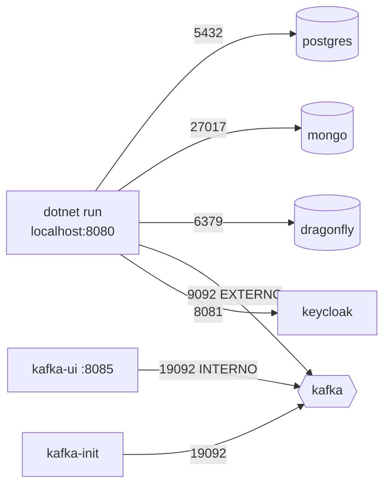

# 1.5 O ambiente local: cada serviço do compose explicado

O [`deploy/local/docker-compose.yml`](https://github.com/JandersonSR/lending-plataform/blob/main/deploy/local/docker-compose.yml) sobe tudo de que a API precisa. A API em si roda fora do Docker, no seu `dotnet run` (depura com breakpoint, recompila em segundos). Esta lição passa serviço por serviço: o que é, por que esta imagem, e o detalhe de configuração que costuma quebrar.

```bash
docker compose -f deploy/local/docker-compose.yml up -d
docker compose -f deploy/local/docker-compose.yml ps        # todos "healthy" (kafka-init: "exited (0)")
dotnet run --project src/Host/CreditFlow.Host
```



| Serviço | Imagem | Porta | Papel no CreditFlow | Módulo |
|---|---|---|---|---|
| postgres | `postgres:17-alpine` | 5432 | Clientes, Propostas, Pagamentos (um schema cada) + outbox/inbox | 4 |
| mongo | `mongo:8.0` | 27017 | Histórico de simulações, notificações | 4 |
| dragonfly | `dragonflydb/dragonfly:v2.0.2` | 6379 | Cache das taxas (protocolo Redis) | 5 |
| kafka | `apache/kafka:4.3.2` | 9092 | Eventos entre módulos | 6 |
| kafka-init | `apache/kafka:4.3.2` | — | Cria os tópicos e sai | 6 |
| kafka-ui | `ghcr.io/kafbat/kafka-ui:v1.5.0` | 8085 | Ver tópicos, mensagens e lag | 6 |
| keycloak | `quay.io/keycloak/keycloak:26.8.1` | 8081 | Login e tokens | 3 |

::: porque Por que versões fixas e não `latest`
`latest` é "a versão de hoje". Em três meses, um colega clona o repositório, o Docker baixa outra versão, e o que funcionava para você quebra para ele, sem nenhum commit no meio. Tag fixa faz o ambiente ser parte do código: mudar versão é um commit revisável.
:::

## postgres

```yaml
environment:
  POSTGRES_DB: creditflow
  POSTGRES_USER: creditflow
  POSTGRES_PASSWORD: creditflow
volumes:
  - postgres-dados:/var/lib/postgresql/data
healthcheck:
  test: ["CMD-SHELL", "pg_isready -U creditflow -d creditflow"]
```

Um banco só, com um **schema por módulo** (`clientes`, `propostas`, `pagamentos`). No ambiente local, o schema de Clientes é criado na subida da API porque o `appsettings.Development.json` liga `Clientes:CriarSchemaAoIniciar`; em produção, o schema muda por migração, num passo próprio do deploy (módulo 4).

::: conceito Volume nomeado
`postgres-dados` é um volume gerenciado pelo Docker: sobrevive a `docker compose down` e só some com `down -v`. Sem volume, os dados viveriam na camada gravável do contêiner e sumiriam ao recriá-lo.
:::

## mongo

Sem autenticação no local, de propósito: o módulo 4 liga usuário e senha e explica por que o driver precisa de `authSource`. O healthcheck usa o `mongosh`, que vem na imagem oficial.

## dragonfly

```yaml
command: ["--maxmemory=512mb", "--proactor_threads=2", "--version_check=false"]
ulimits:
  memlock: -1
```

| Opção | Por quê |
|---|---|
| `--maxmemory=512mb` | Sem limite, ele assume a memória da máquina; no seu notebook isso briga com o resto |
| `--proactor_threads=2` | O Dragonfly usa uma thread por núcleo; dois bastam localmente |
| `--version_check=false` | A partir da 2.0.2 a checagem diária de versão envia dados anônimos de uso; no local, desligado |
| `memlock: -1` | Ele trava páginas de memória para I/O (io_uring); sem isso, pode recusar subir em alguns kernels |

## kafka: um nó em modo KRaft

O Kafka 4.x **não tem mais ZooKeeper**: o próprio Kafka guarda os metadados do cluster num quórum de controllers (KRaft). Localmente, um nó faz os dois papéis.

```yaml
KAFKA_PROCESS_ROLES: broker,controller
KAFKA_LISTENERS: INTERNO://:19092,EXTERNO://:9092,CONTROLLER://:9093
KAFKA_ADVERTISED_LISTENERS: INTERNO://kafka:19092,EXTERNO://localhost:9092
KAFKA_CONTROLLER_QUORUM_VOTERS: 1@kafka:9093
CLUSTER_ID: 4L6g3nShT-eMCtK--X86sw
KAFKA_AUTO_CREATE_TOPICS_ENABLE: "false"
```

::: conceito Listener e advertised listener
O cliente do Kafka conecta num endereço inicial, pergunta "onde ficam as partições?" e o broker responde com o **advertised listener**. O cliente passa a usar **esse** endereço. Por isso há dois: quem está na rede do compose (kafka-ui, kafka-init, a API em contêiner) recebe `kafka:19092`; quem está na sua máquina (o `dotnet run`) recebe `localhost:9092`.
:::

::: quebra Lab: um listener só
Troque os anunciados para só `EXTERNO://localhost:9092` (e ajuste `KAFKA_LISTENERS` e `KAFKA_INTER_BROKER_LISTENER_NAME`). Recrie o kafka e abra o Kafka UI em http://localhost:8085.

O Kafka UI conecta? Lista os tópicos?
:::

::: solucao
O Kafka UI conecta no endereço inicial `kafka:19092`... que não existe mais. Se você apontar para `kafka:9092`, ele conecta, pede os metadados e recebe `localhost:9092`, que **dentro do contêiner do Kafka UI** é o próprio Kafka UI. O sintoma clássico: "conectou mas dá timeout ao listar". É o erro mais comum de Kafka em Docker, e a pista está nos logs do cliente: ele tenta `localhost:9092` depois de ter conectado em outro endereço.
:::

::: porque Por que `AUTO_CREATE_TOPICS_ENABLE=false` e um kafka-init
Com criação automática, um erro de digitação no nome do tópico (`creditflow.propostas.v1` × `creditflow.proposta.v1`) cria um tópico novo em silêncio: o produtor publica lá, o consumidor espera no outro e nada acontece, sem erro. Desligado, o produtor falha com "tópico desconhecido". O `kafka-init` cria os tópicos do contrato (6 partições) e as DLTs, uma vez, e sai.
:::

O `CLUSTER_ID` é um UUID de 16 bytes em base64 (22 caracteres). Ele precisa ser fixo: o volume `kafka-dados` guarda o id do cluster, e um id diferente na próxima subida faz o broker recusar os próprios dados.

## keycloak

```yaml
command: ["start-dev", "--import-realm", "--http-port=8081"]
environment:
  KC_BOOTSTRAP_ADMIN_USERNAME: admin
  KC_HOSTNAME: http://localhost:8081
  KC_HOSTNAME_BACKCHANNEL_DYNAMIC: "true"
volumes:
  - ./keycloak:/opt/keycloak/data/import:ro
```

- `start-dev`: sem TLS e com banco embutido. Nunca em produção.
- `--import-realm`: na subida, importa o realm `creditflow` do JSON versionado (realm como código, módulo 3).
- `KC_HOSTNAME` fixa o emissor (`iss`) dos tokens em `http://localhost:8081/...`, venha o pedido do navegador ou de um contêiner; `KC_HOSTNAME_BACKCHANNEL_DYNAMIC` deixa as URLs internas (como a das chaves, o JWKS) seguirem o endereço de quem pergunta. Sem isso, um token pego no navegador seria recusado pela API em contêiner por emissor diferente. O módulo 3 desmonta esse problema.
- O healthcheck faz HTTP "na mão" pela porta de gerenciamento 9000, porque a imagem do Keycloak não tem `curl`.

## A API em contêiner (opcional)

```bash
docker compose -f deploy/local/docker-compose.yml --profile app up -d --build
```

O serviço `api` só sobe com `--profile app`. Ele usa a mesma imagem de produção (`deploy/docker/Dockerfile`, módulo 7) e espera todo mundo ficar `healthy` (`depends_on` com `condition: service_healthy`).

::: armadilha `depends_on` sem condição
`depends_on: [postgres]` só espera o contêiner **iniciar**, não o Postgres aceitar conexão. A API sobe, tenta criar o schema, falha. Com `condition: service_healthy`, o Compose espera o healthcheck passar. E mesmo assim a API precisa saber tentar de novo: no Kubernetes não existe `depends_on`.
:::

::: checkpoint
```bash
docker compose -f deploy/local/docker-compose.yml ps
docker compose -f deploy/local/docker-compose.yml logs kafka-init | tail -5    # os 5 tópicos
docker compose -f deploy/local/docker-compose.yml exec dragonfly redis-cli ping # PONG
curl -s localhost:8081/realms/creditflow/.well-known/openid-configuration | head -c 200
```
:::

::: video Docker in 100 Seconds (Fireship, em inglês)
https://www.youtube.com/watch?v=Gjnup-PuquQ
Imagem, contêiner e camadas, para quem quer revisar a base antes do compose.
:::

**Próxima:** [1.6 Primeiro endpoint, OpenAPI e ProblemDetails](06-primeiro-endpoint.md).
