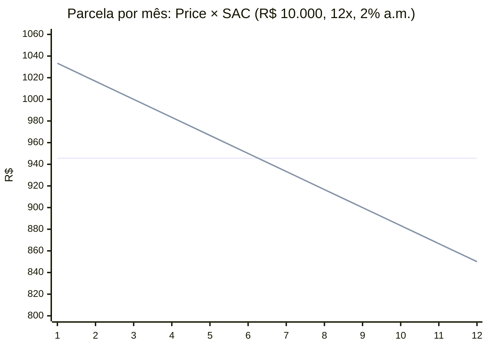

# 2.2 Price × SAC, com uma tabela de verdade

Os dois sistemas de amortização mais usados no Brasil respondem de jeitos diferentes à mesma pergunta: **qual é a parcela de cada mês?** O exemplo do curso inteiro: **R$ 10.000, 12 meses, 2% ao mês, contratado em 15/01/2026.**

## Tabela Price (sistema francês): parcelas iguais

A Price escolhe a parcela **constante** que zera a dívida em *n* meses:

```
PMT = P × i × (1+i)^n / ((1+i)^n − 1)
    = 10.000 × 0,02 × 1,02^12 / (1,02^12 − 1)
    = 10.000 × 0,02 × 1,268242 / 0,268242
    = 945,5960 → 945,60
```

::: conceito De onde vem a fórmula
O valor presente das *n* parcelas, descontadas à taxa *i*, tem de ser igual ao principal: `P = PMT/(1+i) + PMT/(1+i)² + ... + PMT/(1+i)^n`. É uma soma de progressão geométrica; isolando PMT, sai a fórmula acima. Guarde esta ideia, "o valor presente das parcelas é igual ao que foi emprestado", porque é exatamente o CET da próxima lição.
:::

| Nº | Vencimento | Parcela | Juros | Amortização | Saldo |
|---:|---|---:|---:|---:|---:|
| 1 | 15/02/2026 | 945,60 | 200,00 | 745,60 | 9.254,40 |
| 2 | 15/03/2026 | 945,60 | 185,09 | 760,51 | 8.493,89 |
| 3 | 15/04/2026 | 945,60 | 169,88 | 775,72 | 7.718,17 |
| 4 | 15/05/2026 | 945,60 | 154,36 | 791,24 | 6.926,93 |
| 5 | 15/06/2026 | 945,60 | 138,54 | 807,06 | 6.119,87 |
| 6 | 15/07/2026 | 945,60 | 122,40 | 823,20 | 5.296,67 |
| 7 | 15/08/2026 | 945,60 | 105,93 | 839,67 | 4.457,00 |
| 8 | 15/09/2026 | 945,60 | 89,14 | 856,46 | 3.600,54 |
| 9 | 15/10/2026 | 945,60 | 72,01 | 873,59 | 2.726,95 |
| 10 | 15/11/2026 | 945,60 | 54,54 | 891,06 | 1.835,89 |
| 11 | 15/12/2026 | 945,60 | 36,72 | 908,88 | 927,01 |
| 12 | 15/01/2027 | **945,55** | 18,54 | 927,01 | 0,00 |
| | | **11.347,15** | **1.347,15** | **10.000,00** | |

Leia a primeira linha com a mecânica da lição anterior: juros = 10.000 × 2% = 200,00; amortização = 945,60 − 200,00 = 745,60; saldo = 9.254,40. Os juros caem (o saldo cai), a amortização sobe, a parcela fica igual.

::: previsao
Por que a última parcela é 945,55 e não 945,60?
???
Porque a parcela "certa" é 945,5960..., e cobramos 945,60. São 0,4 centavo a mais por mês que amortizam um pouquinho a mais do que a conta exata. Na 12ª parcela sobra um saldo de 927,01 em vez de 927,06, e a última parcela **amortiza exatamente o que sobrou** (927,01) mais os juros (18,54). É o "ajuste na última parcela": garante saldo final zero e soma das amortizações igual ao principal, ao centavo. A lição 2.4 explica por que não dá para evitar.
:::

## SAC: amortização constante

O SAC (Sistema de Amortização Constante) divide o principal em partes iguais e soma os juros do mês:

```
amortização = 10.000 / 12 = 833,33 (arredondado)
parcela_k   = 833,33 + saldo_k × 2%
```

| Nº | Parcela | Juros | Amortização | Saldo |
|---:|---:|---:|---:|---:|
| 1 | 1.033,33 | 200,00 | 833,33 | 9.166,67 |
| 2 | 1.016,66 | 183,33 | 833,33 | 8.333,34 |
| 3 | 1.000,00 | 166,67 | 833,33 | 7.500,01 |
| ... | | | | |
| 11 | 866,66 | 33,33 | 833,33 | 833,37 |
| 12 | **850,04** | 16,67 | **833,37** | 0,00 |
| | **11.300,00** | **1.300,00** | **10.000,00** | |

## Comparando



| | Price | SAC |
|---|---|---|
| Parcela | constante (945,60) | começa maior (1.033,33) e cai |
| Total de juros | 1.347,15 | **1.300,00** |
| Por que | amortiza devagar no começo; o saldo fica alto por mais tempo | amortiza mais cedo; saldo cai mais rápido |
| Bom para | quem precisa de parcela previsível e menor no início | quem aguenta parcela maior no começo e quer pagar menos juros |

::: porque A SAC paga menos juros, e isso não é "mais barata"
Os juros são menores porque o cliente **devolve o dinheiro mais cedo**. Usar menos dinheiro por menos tempo custa menos. Para comparar as duas de verdade, olha-se a taxa, e as duas têm a mesma taxa de juros (2%). O CET das duas fica quase igual (2,3395% × 2,3411% no próximo capítulo); a diferença vem só de como o IOF incide. "SAC é mais barata" é uma meia-verdade que vale explicar ao PO com esta tabela.
:::

## No código

O [`TabelaDeAmortizacao.Gerar`](https://github.com/JandersonSR/lending-plataform/blob/main/src/Modules/Simulacao/CreditFlow.Modules.Simulacao/Domain/Calculo/TabelaDeAmortizacao.cs) é um laço só para os dois sistemas; a diferença é uma linha:

```csharp
for (var k = 1; k <= prazoMeses; k++)
{
    var juros = MatematicaDecimal.Centavos(saldo * i);
    var ultima = k == prazoMeses;
    var amortizacao = ultima
        ? saldo                                                     // ajuste: zera o saldo
        : sistema == SistemaDeAmortizacao.Price ? parcelaPrice - juros : amortizacaoSac;
    saldo -= amortizacao;
    linhas.Add(new ParcelaCalculada(k, dataContratacao.AddMonths(k), new Dinheiro(amortizacao + juros), ...));
}
```

::: armadilha Taxa zero
Com `i = 0`, a fórmula da Price divide por zero (`1^n − 1 = 0`). "Ninguém empresta a juro zero"? Promoção de varejo empresta. O código trata o limite: com taxa zero, a parcela é `P/n`. Há um teste para isso.
:::

::: armadilha `AddMonths` e o fim do mês
Contratado em 31/01, a primeira parcela vence em... 28/02 (ou 29). `DateOnly.AddMonths` **limita o dia ao fim do mês**; a segunda vence em 31/03 (`31/01 + 2 meses`), não em 28/03, porque cada vencimento é calculado a partir da data de contratação, não do vencimento anterior. Se calculasse "vencimento anterior + 1 mês", o dia 31 virava 28 para sempre depois de fevereiro.
:::

## Perguntas para responder sem olhar

::: pergunta
Na Price, por que a parcela é constante mas a amortização cresce?
???
Os juros incidem sobre o saldo, que cai a cada mês. Com a parcela fixa, juros menores deixam mais espaço para a amortização.
:::

::: pergunta
Um cliente pergunta: "SAC é mais barata?". O que você responde?
???
Paga menos juros em reais porque devolve o dinheiro mais cedo, mas a taxa é a mesma. Se ele pode pagar a parcela inicial maior, sai mais barato no total; se não pode, a Price distribui melhor. Para comparar ofertas, olhe o CET.
:::

**Próxima:** [2.3 IOF e CET](03-iof-e-cet.md).
