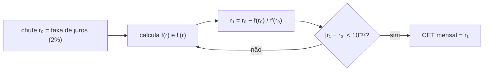

# 2.3 IOF e CET: a TIR por Newton-Raphson

A taxa de juros diz quanto o dinheiro custa. O **CET** diz quanto a **operação** custa: juros, imposto e tarifas, tudo numa taxa só. É a informação que o Banco Central obriga a mostrar antes da contratação, e é a parte matematicamente mais interessante do módulo.

## IOF: o imposto da operação

O IOF de crédito para pessoa física tem duas partes (valores didáticos; confira o Decreto 6.306/2007 e alterações):

```
IOF diário    = Σ amortização_k × 0,0082% × min(dias até o vencimento k, 365)
IOF adicional = principal × 0,38%
```

O diário incide sobre **cada pedaço do principal pelo tempo que ele fica com o cliente**: a amortização da parcela 1 fica 31 dias, a da parcela 12 fica 365.

| Parcela | Amortização | Dias | IOF diário da parcela |
|---:|---:|---:|---:|
| 1 | 745,60 | 31 | 745,60 × 0,000082 × 31 = 1,8953 |
| 2 | 760,51 | 59 | 3,6793 |
| 3 | 775,72 | 90 | 5,7248 |
| ... | | | |
| **soma** | | | **167,3652 → 167,37** |

Adicional: 10.000 × 0,38% = 38,00. **IOF total: 205,37.**

::: porque Por que somar sem arredondar e arredondar só no fim
Arredondar cada parcela (1,90 + 3,68 + 5,72 + ...) e somar acumula até meio centavo de erro por parcela: em 48 parcelas, pode virar mais de 10 centavos de diferença em relação à conta exata. O [`CalculadoraDeIof`](https://github.com/JandersonSR/lending-plataform/blob/main/src/Modules/Simulacao/CreditFlow.Modules.Simulacao/Domain/Calculo/CalculadoraDeIof.cs) soma em `decimal` com todas as casas e arredonda uma vez. A regra de arredondamento é uma decisão de negócio: escrita, testada, e igual em todo lugar.
:::

::: previsao
Num empréstimo de 24 meses, a 13ª parcela vence 396 dias depois da contratação. Quantos dias entram no IOF dela?
???
**365.** O IOF diário é limitado a 365 dias por parcela. Por isso, em prazos longos, o IOF cresce menos que proporcionalmente ao prazo. Há um teste específico ([`IOF_diario_conta_no_maximo_365_dias_por_parcela`](https://github.com/JandersonSR/lending-plataform/blob/main/tests/CreditFlow.Modules.Simulacao.Tests/MotorDeCalculoTests.cs)) com uma parcela de 700 dias: entra 365.
:::

No CreditFlow, o IOF é **descontado do valor liberado**: o contrato é de 10.000 (as parcelas são calculadas sobre 10.000), mas cai na conta do cliente `10.000 − 205,37 = 9.794,63`. (Outra prática comum é financiar o IOF, somando-o ao principal; isso cria uma conta circular, e é uma boa extensão do desafio.)

## CET: a taxa que iguala o que se recebe ao que se paga

Do ponto de vista do cliente, o fluxo de caixa é:

```
mês 0:  +9.794,63   (recebeu)
mês 1:  −945,60
...
mês 12: −945,55
```

::: conceito TIR (taxa interna de retorno)
A taxa *r* que faz o valor presente de todos os pagamentos ser igual ao valor recebido:

```
f(r) = Σ parcela_k / (1+r)^k  −  liberado  = 0
```

Para o fluxo acima, *r* é o **CET mensal**. Repare que é a mesma ideia da fórmula da Price ("o valor presente das parcelas é igual ao principal"), só que agora o lado esquerdo é o que o cliente **realmente** recebeu.
:::

Se o cliente tivesse recebido os 10.000 inteiros, *r* seria a própria taxa, 2%. Como recebeu menos e paga o mesmo, *r* é maior.

::: porque Por que não existe fórmula
`f(r) = 0` é um polinômio de grau 12 em `1/(1+r)` (de grau 48 num empréstimo de 48 meses). Polinômios de grau 5 ou mais não têm fórmula geral de raízes (é um teorema, de Abel e Galois). Então a TIR é sempre calculada **numericamente**: chuta-se um valor e melhora-se o chute até a precisão desejada. A planilha faz isso na função `TIR`/`IRR`, e o CreditFlow também.
:::

## Newton-Raphson

A ideia: no ponto do chute atual, trace a reta tangente à curva `f(r)` e veja onde ela cruza o zero. Esse cruzamento é o próximo chute.



A derivada de `f`:

```
f'(r) = − Σ k × parcela_k / (1+r)^(k+1)
```

Para o nosso empréstimo (Price, liberado 9.794,63):

| Iteração | r | f(r) | f'(r) | próximo r |
|---:|---|---:|---:|---|
| 1 | 0,0200000000 | 205,373234 | −61.413,94 | 0,0233440820 |
| 2 | 0,0233440820 | 3,047076 | −59.602,55 | 0,0233952052 |
| 3 | 0,0233952052 | 0,000695 | −59.575,36 | 0,0233952169 |
| 4 | 0,0233952169 | 0,000000 | | convergiu |

**CET = 2,3395% ao mês = 31,98% ao ano** (`1,023395^12 − 1`), contra 2% de juros (26,82% ao ano).

::: conceito Por que converge tão rápido
Perto da raiz, o Newton-Raphson tem **convergência quadrática**: o número de casas certas mais ou menos **dobra** a cada passo. Veja a coluna `f(r)`: 205 → 3 → 0,0007 → 0. Repare também que `f(r₀)` = 205,37 é exatamente o IOF: no chute inicial (a própria taxa de juros), o valor presente das parcelas é 10.000, e a diferença para o liberado é o IOF.
:::

::: porque Por que o chute inicial é a taxa de juros
Newton-Raphson pode divergir se o chute estiver longe da raiz ou numa região onde a curva é quase plana. A taxa de juros é um chute excelente: o CET é sempre um pouco maior que ela. Mesmo assim, o código se protege: no máximo 100 iterações, erro se a derivada zerar, erro se a taxa cair abaixo de −100% (fluxo inválido). Sem essas guardas, um dado estranho vira um laço infinito ocupando uma CPU do pod.
:::

O código, em [`CalculadoraDeCet.cs`](https://github.com/JandersonSR/lending-plataform/blob/main/src/Modules/Simulacao/CreditFlow.Modules.Simulacao/Domain/Calculo/CalculadoraDeCet.cs):

```csharp
var r = chuteInicial;
for (var iteracao = 1; iteracao <= MaximoDeIteracoes; iteracao++)
{
    var v = 1m / (1m + r);   // fator de desconto de um mês
    var vk = 1m;             // v^k, acumulado no laço
    var f = -valorLiberado;
    var derivada = 0m;
    for (var k = 1; k <= parcelas.Count; k++)
    {
        vk *= v;
        f += parcelas[k - 1] * vk;
        derivada -= k * parcelas[k - 1] * vk * v;
    }
    var proximo = r - f / derivada;
    if (Math.Abs(proximo - r) < Tolerancia)
        return (proximo, iteracao);
    r = proximo;
}
```

::: dica Um detalhe de desempenho
`vk *= v` acumula a potência dentro do laço, em vez de calcular `(1+r)^k` do zero para cada *k*. Com 48 parcelas e 4 iterações, são ~200 multiplicações de `decimal` por simulação, contra mais de 4.000 com potência recalculada. Simulação é o módulo CPU-bound que escala sozinho no módulo 8: cada multiplicação conta.
:::

::: armadilha O CET real usa dias, não meses
A norma do Banco Central (Resolução CMN 3.517/2007 e alterações) calcula o CET com o expoente em **dias corridos / 365**, não em meses inteiros. O CreditFlow usa meses inteiros para a matemática ficar legível. A diferença é pequena (alguns centésimos de ponto percentual) e é um bom exercício: troque `k` por `(vencimento_k − contratação).Days / 365` e calcule o CET anual diretamente.
:::

## Perguntas para responder sem olhar

::: pergunta
Por que o CET é maior que a taxa de juros no CreditFlow?
???
Porque o IOF é descontado do valor liberado: o cliente recebe menos do que o principal e paga parcelas calculadas sobre o principal. A taxa que iguala o recebido ao pago é maior.
:::

::: pergunta
O que o Newton-Raphson faz a cada iteração, em uma frase?
???
Troca a curva pela reta tangente no chute atual e usa o ponto onde a reta cruza zero como próximo chute.
:::

::: pergunta
Sem IOF, o CET deveria ser exatamente a taxa de juros. No teste, ele dá 2,0000053%. Por quê?
???
Por causa do arredondamento das parcelas para centavos: o cliente paga 945,60 em vez de 945,5960... Os centavos a mais fazem a TIR ficar um fio acima de 2%. O teste confere esse valor exato (vindo da implementação de referência), e não 2%.
:::

**Próxima:** [2.4 `decimal` e arredondamento](04-decimal-e-arredondamento.md).
