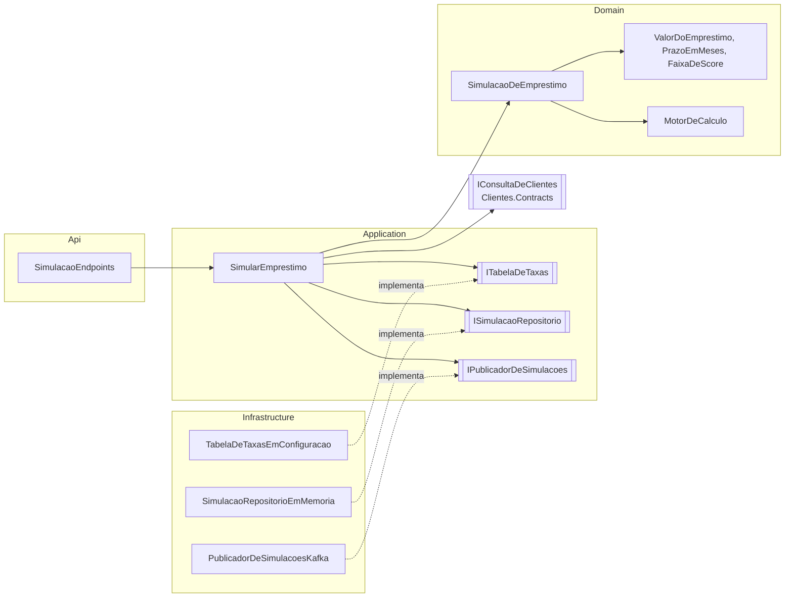

# 2.5 Value objects, o agregado e o caso de uso

Com a matemática resolvida, falta o modelo: onde ficam as regras de valor e prazo, quem escolhe a taxa, quem chama o motor, quem grava. Esta lição percorre o módulo de dentro para fora, como as setas da arquitetura hexagonal.



## Value objects: valor e prazo

```csharp
public readonly record struct ValorDoEmprestimo
{
    public const decimal Minimo = 1_000m;
    public const decimal Maximo = 50_000m;
    private ValorDoEmprestimo(Dinheiro valor) => Valor = valor;
    public Dinheiro Valor { get; }

    public static Result<ValorDoEmprestimo> Criar(decimal valor)
    {
        var dinheiro = Dinheiro.Criar(valor, "valor");
        if (dinheiro.Falhou) return dinheiro.Erro;
        if (valor is < Minimo or > Maximo) return SimulacaoErros.ValorForaDaFaixa;
        return new ValorDoEmprestimo(dinheiro.Valor);
    }
}
```

::: porque Por que um tipo para "valor do empréstimo" e não um `decimal` validado no endpoint
Validação no endpoint protege **um** caminho de entrada. Amanhã a simulação também nasce de um consumidor Kafka, de um job de ofertas, de um teste. Com o tipo, a regra mora num lugar só e o compilador garante: o agregado só aceita `ValorDoEmprestimo`, e o único jeito de obter um é passando pela regra. Visto a fundo em [Plataforma, lição 1.4](../../../plataforma-dotnet/docs/modulo-01/04-ddd-tatico.md).
:::

## O agregado: imutável

[`SimulacaoDeEmprestimo`](https://github.com/JandersonSR/lending-plataform/blob/main/src/Modules/Simulacao/CreditFlow.Modules.Simulacao/Domain/SimulacaoDeEmprestimo.cs) não tem nenhum método que mude estado. Só `Criar` (valida e calcula) e `Reconstituir` (remonta do banco).

```csharp
public static Result<SimulacaoDeEmprestimo> Criar(decimal valor, int prazoMeses, SistemaDeAmortizacao sistema,
    FaixaDeScore faixa, Guid? clienteId, DateOnly dataContratacao, DateTimeOffset agora, RegrasDeIof? iof = null)
{
    var v = ValorDoEmprestimo.Criar(valor);
    var p = PrazoEmMeses.Criar(prazoMeses);
    if (v.Falhou || p.Falhou)
        return Erro.JuntarValidacoes(new[] { v.Erro, p.Erro }.OfType<Erro>());
    // ...
    var resultado = MotorDeCalculo.Calcular(new ParametrosDoCalculo(...));
    return new SimulacaoDeEmprestimo(SimulacaoId.Novo(), clienteId, v.Valor, p.Valor, sistema, faixa, dataContratacao, agora, resultado);
}
```

::: porque Por que imutável
Uma simulação é uma **foto**: "nestas condições, nesta data, a oferta foi esta". Se o cliente muda o prazo, é **outra** simulação. Mutável, ela poderia ter a tabela recalculada com taxa nova depois de mostrada ao cliente, e a proposta (módulo 4) nasceria de números que o cliente nunca viu. A invariante "a tabela é sempre a do motor para estes parâmetros" fica garantida porque não existe caminho para editá-la.
:::

::: porque Por que `Reconstituir` não recalcula
O motor vai mudar (uma regra de IOF nova, um bug corrigido). Uma simulação gravada antes da mudança precisa voltar **exatamente** como foi mostrada. Por isso o MongoDB (módulo 4) guarda o documento com a tabela inteira, e `Reconstituir` só remonta. Recalcular na leitura reescreveria o passado.
:::

::: conceito O nome `SimulacaoDeEmprestimo`
Não é `Simulacao` porque o namespace do módulo é `CreditFlow.Modules.Simulacao`. Dentro de `CreditFlow.Modules.Simulacao.Application`, o compilador procura o nome `Simulacao` subindo os namespaces e encontra **o namespace** antes de olhar os `using`. O erro (`'Simulacao' is a namespace but is used like a type`) é um clássico do C#. Nome de agregado igual ao nome do módulo: evite.
:::

O agregado não lê relógio: recebe `dataContratacao` e `agora`. O caso de uso pega a data com `Brasilia.Hoje(relogio)`, porque às 22h de Brasília já é o dia seguinte em UTC, e a data de contratação conta os dias do IOF. Há um teste que congela o relógio em `2026-01-15T02:00Z` e confere que a contratação é 14/01.

## A faixa de score e o consentimento

```csharp
int? score = null;
if (comando.ClienteId is { } clienteId)
{
    var perfil = await clientes.ObterPerfilDeCreditoAsync(clienteId, ct);
    if (perfil is null)
        return SimulacaoErros.ClienteNaoEncontrado;
    score = perfil.ConsentimentoAnaliseDeCredito ? perfil.Score : null;
}
var faixa = SeletorDeFaixa.Escolher(await tabelaDeTaxas.ObterFaixasAsync(ct), score);
```

::: porque Por que o score é descartado sem consentimento
A LGPD exige base legal para tratar dado pessoal, e o CreditFlow usa consentimento por finalidade (módulo 1, Clientes). Revogou o de "análise de crédito"? O dado ainda existe, mas não pode ser usado **para isso**. A simulação continua possível, como anônima, na faixa de maior risco. A regra mora no caso de uso de Simulação; o fato ("consentiu ou não") vem de Clientes.
:::

## As portas

| Porta | Hoje | Depois |
|---|---|---|
| `ITabelaDeTaxas` | `TabelaDeTaxasEmConfiguracao` (appsettings, `IOptionsMonitor`) | + decorador com HybridCache e Dragonfly (módulo 5) |
| `ISimulacaoRepositorio` | `SimulacaoRepositorioEmMemoria`, com limite de 10.000 | MongoDB, coleção `simulacoes` (módulo 4) |
| `IPublicadorDeSimulacoes` | Kafka direto (`PublicarSemEsperar`) ou nulo sem Kafka | — |

::: armadilha Repositório em memória num endpoint público
Sem limite, qualquer um encheria a memória do pod chamando o `POST` em loop: o rate limit **atrasa**, não impede (é por IP, e IPs são baratos). O repositório em memória descarta as mais antigas ao passar de 10.000. Há um teste com capacidade 3.
:::

::: porque Por que o evento sai sem outbox
`SimulacaoRealizada` alimenta estatística (o funil: quantos simulam, quantos viram proposta). Perder um evento de vez em quando não fere nenhuma regra, e a Simulação não tem transação relacional onde uma outbox morar. Então ela publica direto e **sem esperar** o broker (`PublicarSemEsperar`), e a falha só vira log: o Kafka fora não pode virar 500 na simulação. Compare com `ContratoAssinado` (módulo 6), que move dinheiro e vai pela outbox.
:::

## Perguntas para responder sem olhar

::: pergunta
Por que `SimulacaoDeEmprestimo` não tem método `AlterarPrazo`?
???
Porque é imutável: uma simulação é a foto de uma oferta. Mudar o prazo é criar outra. Isso garante que a tabela gravada é a que o cliente viu.
:::

::: pergunta
Onde mora a regra "sem consentimento, simula como anônimo"? E por que não em Clientes?
???
No caso de uso de Simulação. Clientes informa o fato (consentiu ou não); a decisão do que fazer com isso numa simulação é de Simulação.
:::

**Próxima:** [2.6 Endpoint público, rate limit e testes](06-endpoint-e-testes.md).
