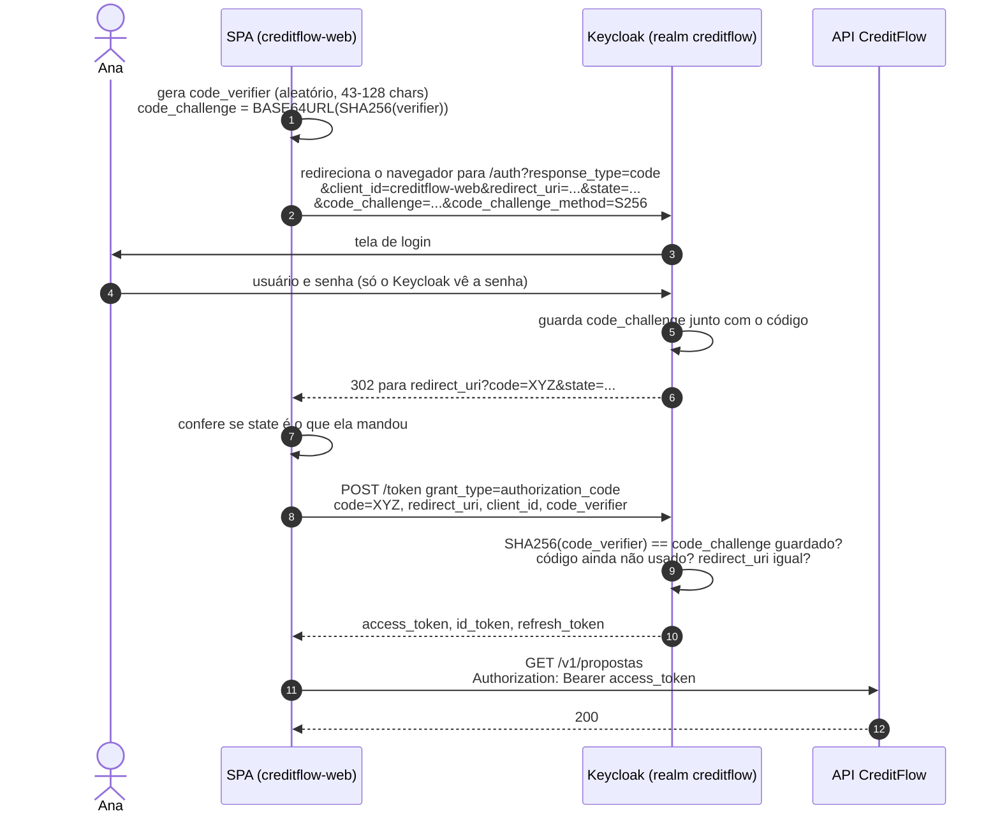

# 3.3 Authorization Code + PKCE, passo a passo

O fluxo que a SPA usa tem nove passos. Você vai vê-los num diagrama, entender o que cada um protege, e depois fazê-los **à mão** com `curl`, sem biblioteca nenhuma escondendo nada.

## O diagrama



## O que cada peça impede

| Peça | O ataque que ela barra |
|---|---|
| **Código, e não token, na URL** (passo 6) | A URL vaza (histórico, extensões, logs de proxy). Um código vazado sozinho não serve: falta o `code_verifier` |
| **`state`** (passos 2 e 7) | CSRF de login: um atacante faz o seu navegador concluir **o login dele** e você passa a usar a conta do atacante (e digitar seus dados nela). A SPA só aceita o retorno com o `state` que ela gerou |
| **`redirect_uri` registrada** (passo 2) | O Keycloak só manda o código para endereços cadastrados no client |
| **PKCE** (passos 1, 5, 9) | **Interceptação do código**: um app malicioso no mesmo celular registra o mesmo esquema de URL, ou uma extensão lê o código. Sem o `code_verifier`, que nunca saiu da memória da SPA, o código não vira token |
| **Código de uso único, 60 s** (passo 9) | Reuso de um código antigo |

::: conceito PKCE (*Proof Key for Code Exchange*, RFC 7636)
O client gera um segredo **por login** (o `code_verifier`), manda ao Keycloak só o **hash** dele no início (o `code_challenge`), e revela o segredo só no fim, num POST direto ao Keycloak. Quem interceptou o código no meio do caminho viu o hash, e de um SHA-256 não se volta ao original. É um "segredo de client" descartável, que funciona até para quem não pode guardar segredo nenhum.
:::

::: porque Por que `S256` e não `plain`
Com `plain`, o `code_challenge` **é** o `code_verifier`. Quem vê o pedido inicial (passo 2, que passa pelo navegador) já tem o segredo inteiro. O `plain` só existe para clients que não conseguem calcular SHA-256, o que hoje não existe. O realm força `S256` no `creditflow-web`.
:::

## Lab: o fluxo inteiro com `curl`

Suba o ambiente (`docker compose up -d`) e siga. O passo do navegador é inevitável: é ali que a senha é digitada, e esse é o ponto do OIDC.

**Passo 1: verifier e challenge.**

```bash
VERIFIER=$(openssl rand -base64 48 | tr -d '=+/\n' | cut -c1-64)
CHALLENGE=$(printf '%s' "$VERIFIER" | openssl dgst -sha256 -binary | base64 | tr '+/' '-_' | tr -d '=')
STATE=$(openssl rand -hex 8)
echo "verifier=$VERIFIER"; echo "challenge=$CHALLENGE"
```

::: porque Por que `tr '+/' '-_' | tr -d '='`
O PKCE usa **BASE64URL sem preenchimento**: `+` vira `-`, `/` vira `_`, e os `=` do final somem, porque esses três caracteres têm significado em URL. Esquecer a conversão é o erro mais comum de quem implementa PKCE à mão: o Keycloak responde `invalid_grant` com `PKCE verification failed`, e o hash "parece certo".

Para conferir sua conta, o RFC traz um vetor de teste: o verifier `dBjftJeZ4CVP-mB92K27uhbUJU1p1r_wW1gFWFOEjXk` tem que dar o challenge `E9Melhoa2OwvFrEMTJguCHaoeK1t8URWbuGJSstw-cM`.
:::

**Passo 2: abra no navegador** a URL que este comando imprime:

```bash
echo "http://localhost:8081/realms/creditflow/protocol/openid-connect/auth?client_id=creditflow-web&response_type=code&scope=openid&redirect_uri=http://localhost:5173/callback&state=$STATE&code_challenge=$CHALLENGE&code_challenge_method=S256"
```

Entre como `ana.cliente` / `Senha@123`. O navegador vai para `http://localhost:5173/callback?state=...&code=...` e mostra erro de conexão (não há SPA rodando). Tudo bem: o que importa está na barra de endereço. Confira que o `state` é o seu e copie o `code`.

**Passo 3: troque o código. Rápido**, ele vale 60 segundos:

```bash
CODE='cole-aqui'
curl -s localhost:8081/realms/creditflow/protocol/openid-connect/token \
  -d grant_type=authorization_code -d client_id=creditflow-web \
  -d redirect_uri=http://localhost:5173/callback \
  -d code="$CODE" -d code_verifier="$VERIFIER" | tee /tmp/tokens.json | jq '{token_type, expires_in, refresh_expires_in, scope}'
```

Repare: **nenhum segredo** de client foi enviado. Quem prova que você é quem começou o fluxo é o `code_verifier`.

**Passo 4: use o token.**

```bash
TOKEN=$(jq -r .access_token /tmp/tokens.json)
curl -si localhost:8080/v1/propostas -H "Authorization: Bearer $TOKEN" | head -1
```

::: previsao
Antes de rodar, preveja o resultado de cada variação:

1. Repetir o passo 3 com o **mesmo** código.
2. Fazer o fluxo de novo, mas no passo 3 mandar outro `code_verifier` (gere um novo).
3. Fazer o fluxo de novo e esperar 2 minutos antes do passo 3.
4. Fazer o passo 2 sem `code_challenge` nem `code_challenge_method`.
???
1. `invalid_grant` (*Code not valid*). O código é de uso único. A RFC 6749 vai além: um código reutilizado indica ataque, e o servidor *deveria* revogar os tokens emitidos com ele. No Keycloak, o evento `CODE_TO_TOKEN_ERROR` aparece em **Realm settings → Events** (o realm grava eventos de login por 24 h); confira lá o que a sua versão faz com a sessão.
2. `invalid_grant` com *PKCE verification failed: Code mismatch*. O hash do verifier novo não bate com o challenge guardado.
3. `invalid_grant` (*Code not valid*): os 60 s do `accessCodeLifespan` passaram.
4. O Keycloak nem mostra a tela de login: redireciona para o `redirect_uri` com `error=invalid_request` e a descrição *Missing parameter: code_challenge_method*. É o `pkce.code.challenge.method: S256` do client funcionando.

Rodamos uma simulação desse fluxo em Node (com a biblioteca `jose` fazendo o papel do Keycloak e da API) para conferir o vetor do RFC e os casos 1 e 2. A mensagem exata do Keycloak pode variar entre versões; o código de erro (`invalid_grant`, `invalid_request`) é o que é estável.
:::

## O refresh

```bash
REFRESH=$(jq -r .refresh_token /tmp/tokens.json)
curl -s localhost:8081/realms/creditflow/protocol/openid-connect/token \
  -d grant_type=refresh_token -d client_id=creditflow-web -d refresh_token="$REFRESH" | jq -r '.access_token | length'
# rode o MESMO comando de novo
```

A segunda vez falha com `invalid_grant`: é a rotação (`revokeRefreshToken: true`, `refreshTokenMaxReuse: 0`). Cada refresh devolve um refresh token **novo**, e o velho morre.

## Onde guardar o token na SPA

Esta é uma discussão de sênior, e não tem resposta perfeita:

| Onde | Risco |
|---|---|
| `localStorage` | Qualquer XSS lê e manda para fora. Sobrevive a fechar a aba |
| Memória (variável JS) | XSS ainda pode **usar** o token enquanto a página está aberta, mas não o leva fácil; some no F5 (o refresh resolve, com o refresh token ou com a sessão do Keycloak) |
| **BFF** (*Backend for Frontend*) | O token nunca vai ao navegador: um servidor do próprio front faz o fluxo como client **confidencial** e entrega à SPA um cookie `HttpOnly`, `Secure`, `SameSite`. É o que o *OAuth 2.0 for Browser-Based Applications* (rascunho da IETF) recomenda para dados sensíveis |

::: porque Por que o CreditFlow fica com SPA + PKCE, e o que mudaria em produção
O curso trata o front como fora de escopo, e SPA + PKCE + token em memória é o mínimo correto e o mais comum no mercado. Para uma fintech de verdade, eu defenderia o BFF: crédito é dado sensível, e tirar o token do navegador elimina uma classe inteira de ataque. A API **não muda nada** com isso: ela continua recebendo `Authorization: Bearer`, só que agora do BFF.
:::

## Perguntas para responder sem olhar

::: pergunta
O que o PKCE protege, e por que ele permite um client sem segredo?
???
Protege contra interceptação do código de autorização: quem pega o código não tem o `code_verifier`, que só a SPA conhece e só revela no POST ao token endpoint. O verifier funciona como um segredo descartável, criado a cada login, então dispensa um segredo fixo que o navegador não conseguiria guardar.
:::

::: pergunta
Para que serve o `state`, se já existe PKCE?
???
São ataques diferentes. O PKCE impede que outro use **o seu** código. O `state` impede que você aceite **o código de outro** (CSRF de login, em que o atacante faz você entrar na conta dele). A SPA gera o `state`, guarda e confere no retorno.
:::

::: pergunta
Por que o refresh token falhou na segunda vez?
???
Rotação: o realm emite um refresh token novo a cada uso e invalida o anterior (`revokeRefreshToken: true`, `refreshTokenMaxReuse: 0`). Reuso de um refresh token velho é sinal de que ele foi copiado.
:::

**Próxima:** [3.4 JWT por dentro](04-jwt-por-dentro.md).
