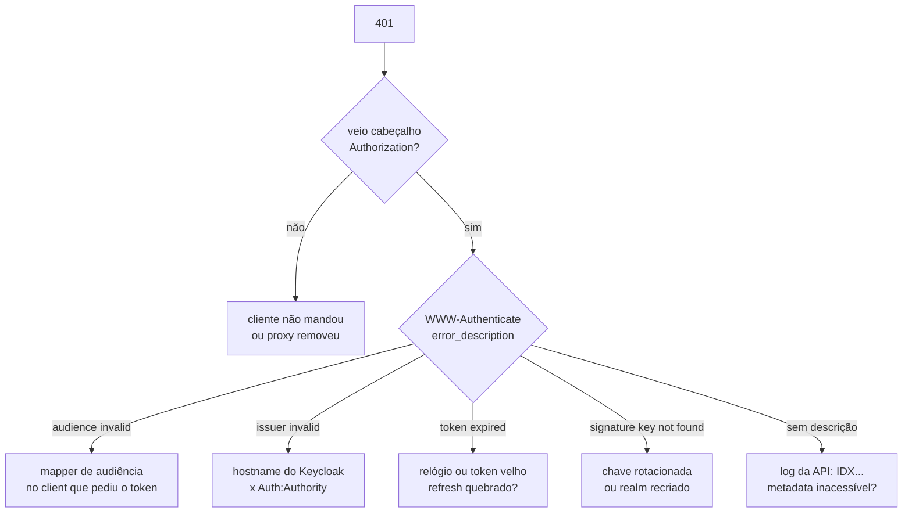

# 3.6 Armadilhas e lab de quebra

Autenticação funciona ou não funciona, e quando não funciona a resposta é sempre a mesma: **401**, sem corpo. Esta lição quebra o sistema de cinco jeitos diferentes, de propósito, para você reconhecer cada um pelo sintoma e saber onde olhar.

Para todos os labs, rode a API **em contêiner** (`docker compose --profile app up -d --build`, que sobe o serviço `api` junto com a infraestrutura), deixe um terminal com o log dela aberto (`docker compose logs -f api`) e use esta função para pegar token de usuário (o client `creditflow-testes` existe para isso):

```bash
token() { curl -s localhost:8081/realms/creditflow/protocol/openid-connect/token \
  -d grant_type=password -d client_id=creditflow-testes -d client_secret=testes-segredo-so-para-dev-local \
  -d username="$1" -d password='Senha@123' -d scope=openid | jq -r .access_token; }
TOKEN=$(token ana.cliente)
curl -si localhost:8080/v1/propostas -H "Authorization: Bearer $TOKEN" | head -1   # 200
```

O console do Keycloak fica em `http://localhost:8081/admin` (`admin`/`admin`, das variáveis `KC_BOOTSTRAP_ADMIN_*` do `docker-compose.yml`). Repare que, no compose, o Keycloak escuta na **8081 também dentro do contêiner** (`--http-port=8081`): por dentro da rede do compose ele é `keycloak:8081`; por fora, `localhost:8081`.

## Roteiro de diagnóstico de um 401



## Quebra 1: a audiência

::: quebra Remover o mapper de audiência
No console: **Clients → creditflow-testes → Client scopes → creditflow-testes-dedicated → Mappers**, apague `audience-creditflow-api`. Pegue um token novo e chame a API.

Antes de rodar: o que volta? O que o `jwt "$TOKEN"` da lição 3.4 mostra no `aud`?
???
`401` com `WWW-Authenticate: Bearer error="invalid_token", error_description="The audience 'account' is invalid"` (o texto exato pode listar os valores do `aud`). O `aud` agora só tem `account`.

A tentação, que você vai ver em muito projeto: "desliga o `ValidateAudience`, que funciona". Funciona, e passa a aceitar token de **qualquer** client do realm. Se amanhã o realm tiver um client para um parceiro chamar a API de cobrança dele, os tokens desse parceiro valem na sua API de crédito. A correção é sempre no Keycloak: recrie o mapper (ou `docker compose up -d --force-recreate keycloak`, que reimporta o realm).
:::

## Quebra 2: o issuer atrás de um proxy (ou dentro de um contêiner)

Esta é a mais traiçoeira, porque **funciona no seu notebook** e quebra no compose ou no cluster.

O `iss` do token é montado pelo Keycloak a partir do endereço **pelo qual ele foi chamado**, a menos que o hostname esteja fixo. O navegador chama `localhost:8081`; a API, dentro da rede do compose, chama `keycloak:8081`. Se cada um usa o seu endereço:

| Quem | Chama | `iss` que vê |
|---|---|---|
| Navegador (pega o token) | `http://localhost:8081` | `http://localhost:8081/realms/creditflow` |
| API (baixa a descoberta) | `http://keycloak:8081` | `http://keycloak:8081/realms/creditflow` |

O token diz um, a API espera outro: `The issuer 'http://localhost:8081/realms/creditflow' is invalid`.

::: quebra Authority pelo nome interno
No `docker-compose.yml`, no serviço `api`, mude a variável para `Auth__Authority: http://keycloak:8081/realms/creditflow` e recrie só a API. Pegue o token pelo `localhost:8081` e chame.
???
`401`, *The issuer 'http://localhost:8081/realms/creditflow' is invalid*. A assinatura até confere (a chave é a mesma); o que falha é a comparação exata de texto do `iss`.
:::

O [`docker-compose.yml`](https://github.com/JandersonSR/lending-plataform/blob/main/deploy/local/docker-compose.yml) já vem com a correção, e ela tem duas partes, uma em cada lado:

**No Keycloak**, fixe o hostname público e deixe as chamadas internas usarem o nome interno:

```yaml
KC_HOSTNAME: http://localhost:8081          # o iss será sempre este
KC_HOSTNAME_BACKCHANNEL_DYNAMIC: "true"     # quem chama por keycloak:8081 recebe jwks_uri com keycloak:8081
```

**Na API**, o `Authority` é o endereço **público** (o que está no `iss`), e o lugar de onde baixar a descoberta é o interno:

```yaml
Auth__Authority: http://localhost:8081/realms/creditflow
Auth__MetadataAddress: http://keycloak:8081/realms/creditflow/.well-known/openid-configuration
```

::: porque Por que `KC_HOSTNAME_BACKCHANNEL_DYNAMIC`
Sem ele, a descoberta baixada por `keycloak:8081` diria `jwks_uri: http://localhost:8081/...`, e `localhost`, **dentro do contêiner da API**, é o próprio contêiner da API. A API não acharia as chaves. Com o *backchannel* dinâmico, as URLs de servidor para servidor (token, JWKS) seguem o endereço da requisição, enquanto o `iss` e as URLs de navegador ficam com o hostname fixo.
:::

::: armadilha Atrás de um ingress com TLS
No cluster, o ingress termina o TLS e fala HTTP com o Keycloak. Se o Keycloak não souber disso, monta URLs `http://` e o `iss` sai `http://login.creditflow...` enquanto a API espera `https://`. A solução é `KC_HOSTNAME=https://login.creditflow...` mais `KC_PROXY_HEADERS=xforwarded` (ou `forwarded`), para o Keycloak confiar nos cabeçalhos `X-Forwarded-*` do ingress. Confiar nesses cabeçalhos **só** é seguro se o Keycloak não for alcançável sem passar pelo ingress (módulo 7).
:::

## Quebra 3: o relógio

A API confere `exp` contra o **relógio dela**. Relógios de servidores com NTP erram por milissegundos; relógios de VM sem NTP, de contêiner em notebook que hibernou, ou de um nó com problema podem errar por minutos.

::: quebra Simular relógio adiantado
Mudar o relógio de um contêiner é chato. Use o `valida.mjs` da lição 3.4 com a opção `currentDate` do `jose`, que faz o validador "achar" que é outra hora:

```js
// no jwtVerify, acrescente:
currentDate: new Date(Date.now() + Number(process.argv[3] ?? 0) * 1000),
```

Rode com o mesmo token novo e `0`, `-120`, `280`, `320`, `400` (segundos de diferença).
???
- `0` e `-120` (relógio da API **atrasado** 2 min): **válido**. O token do Keycloak não tem `nbf`, e nem o `jose` nem o .NET recusam `iat` no futuro por padrão. Um relógio atrasado só faz o token durar mais.
- `280`: válido (300 s de vida).
- `320`: válido por causa da folga de 30 s.
- `400`: `ERR_JWT_EXPIRED`.

Moral: relógio **adiantado** na API (ou atrasado no Keycloak) faz tokens recém-emitidos chegarem "velhos". Com o `ClockSkew` padrão de 5 min do .NET, você **não perceberia** um erro de 4 minutos, e é por isso que o padrão esconde problema. Com 30 s, o problema aparece, e a correção é NTP no nó, não aumentar a folga.
:::

## Quebra 4: o token que não morre

Alguém do front reclama que "o usuário é deslogado toda hora" e a solução proposta é `accessTokenLifespan: 86400` (um dia).

::: quebra Desabilitar um usuário com token na mão
1. `TOKEN=$(token bruno.cliente)` e chame a API: 200.
2. No console, **Users → bruno.cliente → Enabled: off**.
3. Chame a API de novo com o **mesmo** token.
4. Tente pegar um token novo para o Bruno.
???
3. **200.** A API não pergunta ao Keycloak; o token é válido até o `exp`. Com 5 min, o Bruno desabilitado ainda age por até 5 min. Com 1 dia, por até 1 dia.
4. `invalid_grant` (*Account disabled*). O Keycloak recusa novos tokens imediatamente.

A reclamação do front era real, mas a causa é outra: o refresh não está acontecendo (ou o `ssoSessionIdleTimeout` está curto demais para o uso). O access token curto é o mecanismo de revogação da arquitetura; aumentá-lo troca um incômodo de UX por um buraco de segurança. Se o negócio precisa de revogação **imediata** (bloqueio por fraude), as saídas são introspecção (a API pergunta ao Keycloak a cada chamada, pagando latência e criando dependência) ou uma lista de `sid`/`sub` bloqueados distribuída por evento, consultada pela API. As duas têm custo; escolha com o risco na mesa.
:::

## Quebra 5: a chave rotacionada

::: quebra Rotação de chave do jeito errado
1. `TOKEN=$(token ana.cliente)`, chame: 200.
2. No console, **Realm settings → Keys → Add provider → rsa-generated**, prioridade `200` (maior que a atual), salve.
3. Pegue um token novo e veja o `kid` (`jwt "$NOVO"`): é o da chave nova. Chame a API com ele.
4. Chame a API com o token **antigo** (passo 1).
5. Agora, na lista de providers, **desabilite** (`Enabled: off`) o provider antigo e chame de novo com o token antigo.
???
3. **200.** A API recebeu um `kid` desconhecido, baixou o JWKS de novo e achou a chave nova. Rotação sem reiniciar nada.
4. **200.** A chave antiga continua publicada no JWKS, então tokens antigos ainda conferem.
5. **401**, *The signature key was not found*. A chave saiu do JWKS, e tokens ainda dentro da validade morreram.

O jeito certo: no passo 5, deixe a chave antiga **ativa: off, habilitada: on** (passiva). Uma chave passiva **não assina** tokens novos, mas continua **publicada** para conferir os antigos. Depois do maior tempo de vida de token (5 min de access token; o refresh token é validado pelo próprio Keycloak), remova. É o mesmo raciocínio de expand/contract de banco: nunca tire algo que a versão anterior ainda usa.
:::

## E se o Keycloak cair?

::: previsao
A API está no ar há uma hora, atendendo normalmente. O Keycloak cai (`docker compose stop keycloak`). O que acontece com: (a) a Ana, que tem um token válido por mais 3 minutos; (b) o Bruno, que quer fazer login agora; (c) uma réplica nova da API que sobe neste momento?
???
(a) **Continua funcionando** por 3 minutos. A API já tem a descoberta e o JWKS em memória e não precisa do Keycloak para validar. Quando o token vencer, o refresh falha e ela cai para a tela de login.

(b) **Não loga.** O login é no Keycloak.

(c) **Sobe**, mas responde 401 para todo mundo: na primeira requisição autenticada ela tenta baixar a descoberta, não consegue, e o log mostra `IDX20803: Unable to obtain configuration from...`. Quando o Keycloak volta, ela se recupera sozinha (o JwtBearer tenta de novo).

Conclusão: o Keycloak é **dependência crítica de login**, não de cada requisição. Em produção ele roda com 2+ réplicas e banco próprio, e a API não deveria ter *readiness probe* dependente dele (senão uma queda do Keycloak tira todas as réplicas novas do balanceador, inclusive para as rotas públicas da Simulação).
:::

## Perguntas para responder sem olhar

::: pergunta
A API funciona no `dotnet run` e dá 401 "issuer invalid" no compose. Qual a causa provável e a correção?
???
O `iss` depende do hostname pelo qual o Keycloak foi chamado: o navegador usa `localhost:8081`, a API usa `keycloak:8081`. Corrige-se fixando o hostname público no Keycloak (`KC_HOSTNAME`), ligando o backchannel dinâmico, e configurando na API `Authority` = endereço público e `MetadataAddress` = endereço interno.
:::

::: pergunta
Como rotacionar a chave de assinatura sem derrubar ninguém?
???
Criar a chave nova com prioridade maior (passa a assinar), deixar a antiga passiva (não assina, mas continua no JWKS) até expirarem os tokens assinados por ela, e só então removê-la. A API acha a chave nova sozinha pelo `kid`.
:::

**Próximo:** [Desafio do módulo](desafio.md).
