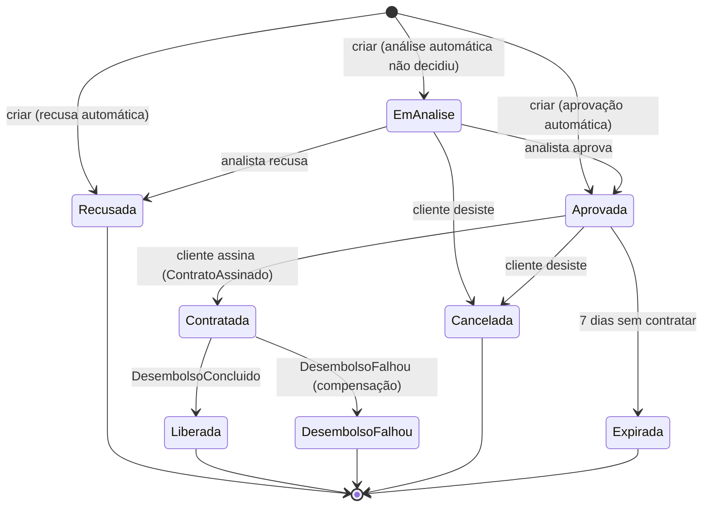

# 4.3 Concorrência com `xmin`, `ETag` e índice parcial

Duas analistas, Carla e Alice, abrem a fila às 9h. A mesma proposta está no topo das duas telas. Carla aprova às 9h02. Alice, que leu a tela às 9h01, recusa às 9h03. O que fica gravado?

Sem nenhum cuidado: **recusada**, com a aprovação da Carla apagada sem rastro. A [lição 3.4 do Plataforma .NET](../../../plataforma-dotnet/docs/modulo-03/04-concorrencia-e-conexoes.md) chama isso de **atualização perdida** e mostra o comando atômico para contadores. Aqui a regra depende do valor lido ("só decide se ainda está `EmAnalise`"), e a ferramenta é outra: concorrência otimista.

## A máquina de estados



Todas as transições são métodos do [`Proposta.cs`](https://github.com/JandersonSR/lending-plataform/blob/main/src/Modules/Propostas/CreditFlow.Modules.Propostas/Domain/Proposta.cs), que conferem o estado atual e registram o evento. Isso protege a regra **dentro de um processo**. Entre duas réplicas, cada uma tem seu objeto em memória, e as duas veem `EmAnalise`. Quem desempata é o banco.

## O que é `xmin`

::: conceito `xmin`
Toda linha do PostgreSQL tem colunas de sistema, invisíveis no `SELECT *`. A `xmin` guarda o **id da transação que gravou aquela versão da linha**. O Postgres não altera linhas no lugar: um `UPDATE` cria uma versão nova da linha (MVCC), e a versão nova tem o `xmin` da transação que a criou. Resultado: **toda vez que a linha muda, o `xmin` muda**, sem você criar coluna nem trigger.
:::

No EF Core com Npgsql, basta uma propriedade `uint` marcada como versão:

```csharp
public uint Versao { get; private set; }          // no agregado
p.Property(x => x.Versao).IsRowVersion();         // no DbContext: o Npgsql mapeia para xmin
```

E o `UPDATE` gerado passa a ser:

```sql
UPDATE propostas.propostas SET status = @p0, analisado_por = @p1, ...
WHERE id = @p2 AND xmin = @p3      -- @p3 = o xmin que ESTA requisição leu
RETURNING xmin;                    -- o EF guarda o xmin novo
```

Se o `UPDATE` afetar **zero** linhas, alguém mudou a linha depois da leitura, e o EF lança `DbUpdateConcurrencyException`. O repositório transforma isso em `false`, e o caso de uso em `409 Conflict` com o código `propostas.alterada-por-outro`.

::: porque `xmin` e não uma coluna `versao integer`
Uma coluna de versão funciona igual (o módulo Pagamentos usa uma), mas exige que **todo** caminho de escrita a incremente: um `UPDATE` feito à mão no `psql`, por um script de correção, esquece o `versao = versao + 1` e a proteção some sem ninguém perceber. O `xmin` muda em qualquer escrita, de qualquer origem. O custo: é específico do PostgreSQL, e o valor dá a volta depois de ~4 bilhões de transações (o `VACUUM` congela linhas antigas; para comparar "mudou desde que eu li", em janelas de minutos, isso não importa).
:::

## Lab: ver o banco desempatar

Isto foi executado num PostgreSQL 16 durante a escrita do curso; os números de transação do seu vão ser outros.

::: quebra Duas analistas ao mesmo tempo
Com o compose rodando e uma proposta `EmAnalise` criada (use o `requests.http` do Host ou crie via API com o token da Ana), abra **dois** `psql`:

```bash
docker compose exec postgres psql -U creditflow -d creditflow
```

Nos dois, leia a versão (as duas "telas" leem ao mesmo tempo):

```sql
SELECT id, status, xmin FROM propostas.propostas WHERE status = 'EmAnalise' LIMIT 1;
```

Terminal A (Carla), **sem** dar `COMMIT`:

```sql
BEGIN;
UPDATE propostas.propostas SET status = 'Aprovada', analisado_por = 'carla'
 WHERE id = '<id>' AND xmin = '<xmin lido>' RETURNING xmin;
```

Terminal B (Alice), com o **mesmo** `xmin` lido:

```sql
UPDATE propostas.propostas SET status = 'Recusada', analisado_por = 'alice'
 WHERE id = '<id>' AND xmin = '<xmin lido>' RETURNING xmin;
```

Antes de olhar: o terminal B responde na hora? Quando você der `COMMIT;` no A, o que o B mostra?
???
O B **trava**: a linha está bloqueada pela transação aberta de A. No `COMMIT` de A, o B acorda e **reavalia o `WHERE` contra a versão nova da linha** (no nível *read committed*, o padrão). O `xmin` agora é outro, a condição falha, e o B responde `UPDATE 0`, com `RETURNING` vazio.

No nosso teste: B esperou 2 s (o `pg_sleep` de A) e afetou 0 linhas; a linha final ficou `Aprovada | carla`. É exatamente o que o EF transforma em `DbUpdateConcurrencyException`.

Repare no que **não** aconteceu: nenhum erro de banco, nenhum deadlock, nenhuma trava longa. A concorrência otimista não impede ninguém de ler; ela só recusa a segunda escrita.
:::

## A tela velha: `ETag` e `If-Match`

O `xmin` protege contra duas **requisições** simultâneas. Mas a Alice leu a tela às 9h01 e decidiu às 9h03. A requisição dela às 9h03 lê a proposta de novo, e, se a proposta tivesse mudado de um jeito que a regra ainda aceita (uma anotação nova, uma renda atualizada), ela decidiria sobre dados **que não viu**.

Por isso o `GET /v1/propostas/{id}` devolve a versão no cabeçalho `ETag`, e as decisões aceitam `If-Match`:

```http
GET /v1/propostas/0192f1c2-...      →  200, ETag: "13907"
POST /v1/propostas/0192f1c2-.../aprovar
If-Match: "13907"
```

No repositório, a versão da tela vira a condição do `UPDATE`:

```csharp
if (versaoEsperada is { } v)
    db.Entry(proposta).Property(p => p.Versao).OriginalValue = v;   // WHERE xmin = <versão da TELA>
```

::: porque Trocar o `OriginalValue`
O EF usa o `OriginalValue` da propriedade de concorrência no `WHERE`. Por padrão, é o valor lido **nesta** requisição. Trocando pelo valor que veio no `If-Match`, a pergunta deixa de ser "mudou desde que eu li agora?" e passa a ser "mudou desde que **a pessoa** viu?". É o padrão HTTP para isso (RFC 9110, requisições condicionais); o status certo para falha de pré-condição seria `412 Precondition Failed`. O CreditFlow responde `409` com um código estável, porque o front trata os dois casos do mesmo jeito: recarregar e mostrar o que mudou. Os dois são defensáveis; documente o que escolher.
:::

O teste [`If_match_com_versao_velha_e_conflito_mesmo_lendo_a_versao_nova`](https://github.com/JandersonSR/lending-plataform/blob/main/tests/CreditFlow.IntegrationTests/Propostas/RepositorioDePropostasTests.cs) prova o cenário com um Postgres de verdade.

## A outra regra: uma proposta ativa por cliente

"Um cliente não pode ter duas propostas em andamento" é uma regra **entre linhas**. Conferir com um `SELECT` antes do `INSERT` não resolve: entre os dois comandos, outra requisição (o duplo clique no "Pedir crédito") insere. Quem resolve é um índice único **parcial**:

```sql
CREATE UNIQUE INDEX ux_propostas_cliente_ativa
    ON propostas.propostas (cliente_id)
    WHERE status IN ('EmAnalise', 'Aprovada', 'Contratada');
```

::: conceito Índice parcial
Um índice que só contém as linhas que satisfazem o `WHERE`. Aqui, só as propostas ativas. A unicidade vale **entre as linhas do índice**: o cliente pode ter dez propostas recusadas ou liberadas no histórico, mas só uma ativa. E o índice fica pequeno, porque o histórico não entra nele.
:::

::: previsao
O Bruno tem uma proposta `Aprovada`. Ele a cancela e, no mesmo segundo, pede outra. As duas requisições caem em réplicas diferentes. Cenário 1: o cancelamento grava primeiro. Cenário 2: o pedido novo grava primeiro. O que acontece em cada um?
???
**Cenário 1:** o `UPDATE` para `Cancelada` tira a linha antiga do índice parcial; o `INSERT` da nova entra. `201`.

**Cenário 2:** o `INSERT` esbarra na linha antiga, ainda `Aprovada` no índice. Violação de `ux_propostas_cliente_ativa`, o repositório devolve `false`, e o cliente recebe `409 propostas.ja-existe-ativa`. Se as duas transações estiverem abertas ao mesmo tempo, o `INSERT` **espera** a outra terminar para saber se a chave ainda conflita (é assim que índices únicos funcionam no Postgres), e só então decide.

Nos dois casos o banco fica consistente. No 2, o Bruno tenta de novo e passa. Testamos o índice no Postgres 16: a segunda proposta ativa do mesmo cliente é recusada; depois que a primeira vira final, a nova entra.
:::

## Retry: quando tentar de novo sozinho

| Situação | Tentar de novo automaticamente? |
|---|---|
| Conflito numa decisão de **pessoa** (aprovar, recusar, contratar) | **Não.** A pessoa precisa ver o que mudou. `409`, e o front recarrega |
| Conflito num passo da **saga** (`DesembolsoConcluido` chegando enquanto alguém mexe na proposta) | **Sim**, relendo: `RegistrarResultadoDoDesembolso` tenta até 3 vezes, e o passo é idempotente |
| Falha transitória de conexão (failover do Flexible Server) | Sim, pelo `EnableRetryOnFailure` ([lição 3.1 do Plataforma .NET](../../../plataforma-dotnet/docs/modulo-03/01-postgres-e-dbcontext.md)) |

::: armadilha Repetir com o objeto velho
Depois de um `DbUpdateConcurrencyException`, a entidade rastreada pelo `DbContext` tem os valores antigos. Reler com o mesmo contexto devolve **o mesmo objeto velho** (o EF não vai ao banco por uma entidade que já rastreia, se você usar `Find`, e mesmo com `FirstOrDefault` ele mantém os valores rastreados). Por isso o `SalvarAsync` chama `db.ChangeTracker.Clear()` no conflito: a próxima leitura vem do banco.
:::

## Perguntas para responder sem olhar

::: pergunta
O que é `xmin` e por que ele serve como versão?
???
Coluna de sistema do PostgreSQL com o id da transação que gravou a versão atual da linha. Como o MVCC cria uma versão nova a cada `UPDATE`, o `xmin` muda em toda escrita, de qualquer origem, sem coluna nem trigger. O EF/Npgsql o usa no `WHERE` do `UPDATE` com `IsRowVersion()` numa propriedade `uint`.
:::

::: pergunta
A concorrência otimista já protege contra duas requisições simultâneas. Para que serve o `If-Match`?
???
Para proteger contra a decisão tomada sobre uma tela antiga. Sem ele, a requisição lê a versão atual e compara com ela mesma; com ele, compara com a versão que a pessoa viu. Requisições condicionais do HTTP.
:::

::: pergunta
Por que um índice único parcial, e não um `SELECT` antes do `INSERT`, para "uma proposta ativa por cliente"?
???
Porque entre o `SELECT` e o `INSERT` outra transação pode inserir; conferir antes não fecha a janela. O índice é verificado pelo banco no momento da escrita, com as travas certas, em qualquer número de réplicas. O parcial restringe a regra às linhas ativas e mantém o índice pequeno.
:::

**Próxima:** [4.4 Documentos, índices e TTL no MongoDB](04-documentos-no-mongo.md).
