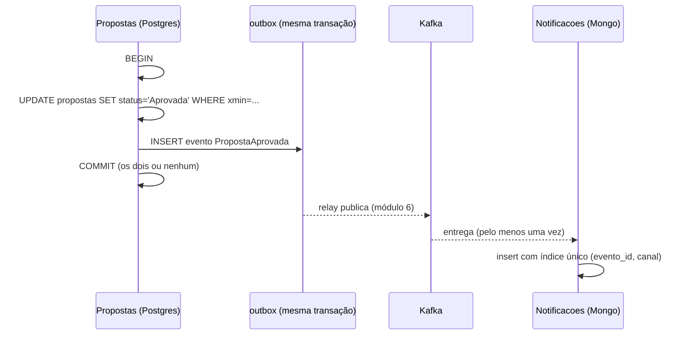

# 4.5 Consistência entre os dois bancos

Com dois bancos, uma pergunta aparece cedo ou tarde numa revisão de código: "e se gravar no Postgres e falhar no Mongo?". A resposta curta é que o CreditFlow **nunca** precisa gravar nos dois na mesma operação. Esta lição mostra por que isso é desenho, e não sorte.

## A escrita dupla (*dual write*)

```csharp
// O código que NÃO existe no CreditFlow
await db.SaveChangesAsync(ct);                       // 1. proposta aprovada no Postgres
await notificacoes.InsertOneAsync(aviso, ct);        // 2. aviso no Mongo
```

::: previsao
O passo 1 grava. O pod morre (ou o Mongo está fora) antes do passo 2. O que fica? E se você inverter a ordem?
???
Na ordem acima: proposta aprovada, cliente **nunca avisado**, e nada no sistema sabe que falta algo.

Invertida: aviso de "aprovada" enviado, e o `SaveChanges` falha (conflito de `xmin`, porque outra analista recusou). O cliente recebeu a notícia de uma aprovação **que não existe**. Em crédito, isso vira reclamação no Banco Central.

Não existe ordem certa. Dois sistemas sem uma transação comum não gravam "os dois ou nenhum". Retry ajuda no passo que falhou, mas não quando o processo morre entre os dois.
:::

::: porque Por que não uma transação distribuída
Postgres e Mongo não participam juntos de um *two-phase commit* gerenciado pela aplicação (e o .NET em Linux não tem um coordenador como o antigo MSDTC). Mesmo onde existe, o 2PC trava recursos nos dois lados enquanto o coordenador decide, e se o coordenador cair no meio, as transações ficam presas. É a ferramenta errada para um sistema que quer escalar réplicas.
:::

## O desenho: um dono por dado, eventos entre donos



1. **Cada operação grava num banco só.** Propostas grava no Postgres; Notificacoes, no Mongo; Simulação, no Mongo.
2. **O que precisa chegar no outro lado vira evento**, gravado na outbox **na mesma transação** da mudança (módulo 6). Ou os dois existem, ou nenhum.
3. **O consumidor é idempotente** (índice único `(evento_id, canal)`, lição 4.4). Repetir não duplica efeito.

O resultado é **consistência eventual**: por alguns milissegundos (ou minutos, se o Kafka ou o Mongo estiverem fora), a proposta está aprovada e o aviso ainda não existe. A pergunta de desenho certa é: **quem sofre se a inconsistência durar 1 minuto? E 1 hora?** Para o aviso, ninguém sofre muito. Para "proposta contratada sem desembolso", a saga do módulo 6 tem prazo e compensação.

## E a leitura entre bancos?

Criar uma proposta **lê** a simulação (Mongo) e **grava** a proposta (Postgres). Não há escrita dupla, mas há uma dependência:

| Se... | Então... |
|---|---|
| O Mongo está fora | `POST /v1/propostas` falha (não acha a simulação). Correto: sem as condições, não há proposta. O erro precisa ser `503`, não `500` |
| A simulação foi apagada pelo TTL | `404 propostas.simulacao-nao-encontrada`. Também correto: ela já estava vencida (7 dias) muito antes dos 90 |
| A simulação muda depois | Não muda: é imutável. É isso que torna seguro ler de um banco e gravar uma cópia no outro |

::: armadilha A cópia só é segura porque a origem é imutável
Se a simulação pudesse ser editada, a proposta teria uma cópia desatualizada e ninguém saberia qual é a verdadeira. Copiar dado entre donos funciona quando a cópia é um **retrato de um momento** (as condições aceitas) e todo mundo sabe disso. Se você precisar de "sempre o valor atual", não copie: consulte o dono, ou assine os eventos de mudança dele.
:::

## Backup e restauração: a inconsistência que ninguém testa

Postgres e Mongo têm backups independentes, feitos em horários diferentes. Restaurar os dois "para ontem às 3h" devolve cada um num instante um pouco diferente. No CreditFlow isso é aceitável porque:

- as simulações perdidas na restauração só fazem falta a quem está **criando** proposta naquele minuto (refaz a simulação);
- as notificações perdidas podem ser **reprocessadas** a partir dos eventos retidos no Kafka (7 dias) ou da outbox.

Um sistema em que os dois bancos precisassem estar exatamente no mesmo instante para fazer sentido teria um problema sério de recuperação de desastre. Vale escrever isso no runbook (módulo 12).

## Perguntas para responder sem olhar

::: pergunta
O que é o problema da escrita dupla, e como o CreditFlow o evita?
???
Gravar em dois sistemas sem transação comum: se o processo morrer entre as duas gravações, um tem o dado e o outro não, em qualquer ordem. O CreditFlow evita gravando cada operação num banco só; o que precisa chegar ao outro vira evento na outbox, na mesma transação da mudança, e o consumidor do outro lado é idempotente.
:::

::: pergunta
Quando é seguro copiar dado de outro módulo, em vez de consultá-lo?
???
Quando a cópia é um retrato de um momento que tem significado de negócio (as condições aceitas) ou quando a origem é imutável. Se o que se precisa é sempre o valor atual, consulta-se o dono ou assina-se os eventos de mudança.
:::

**Próximo:** [Desafio do módulo](desafio.md).
