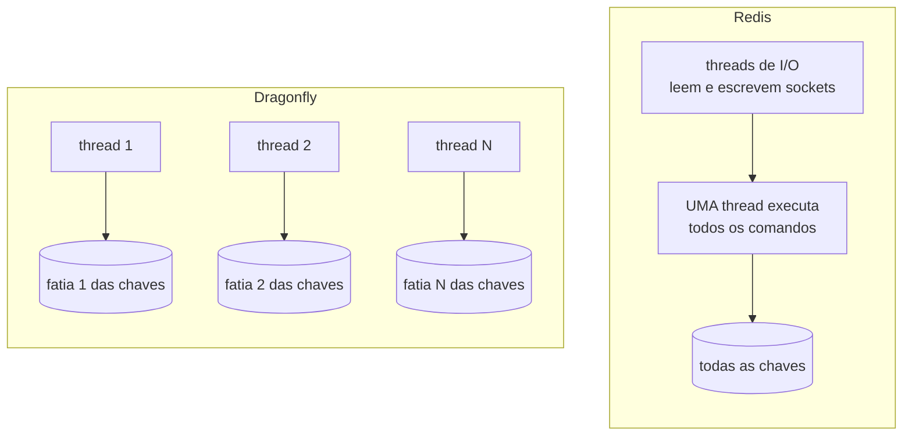

# 5.1 Dragonfly: o que é e por que no lugar do Redis

No `docker-compose.yml` não tem Redis. Tem isto:

```yaml
dragonfly:
  image: docker.dragonflydb.io/dragonflydb/dragonfly:v2.0.2
  command: ["--maxmemory=512mb", "--proactor_threads=2", "--version_check=false"]
```

E o código conversa com ele pelo `StackExchange.Redis`, o cliente de Redis do .NET. Esta lição explica como isso funciona e o que você está trocando.

::: conceito Dragonfly
Um banco em memória que implementa o **protocolo** do Redis (RESP) e a maior parte dos seus comandos (strings, hashes, listas, sets, sorted sets, expiração, pub/sub, transações `MULTI/EXEC`, Lua). Foi escrito do zero em C++, com outra arquitetura por dentro. Para o cliente, é um Redis: mesma porta 6379, mesmos comandos, mesmo `redis-cli`.
:::

## A diferença por dentro



| | Redis | Dragonfly |
|---|---|---|
| Execução de comandos | Uma thread (desde o 6, I/O de rede em threads auxiliares) | Várias threads, cada uma **dona** de uma fatia das chaves (*shared-nothing*): sem trava global |
| Escalar | Vertical até o limite de uma thread; depois, **Redis Cluster** (várias instâncias, *slots*, clientes que entendem cluster) | Vertical: mais núcleos na mesma instância. Cluster raramente necessário |
| Snapshot | `fork()` do processo: a memória pode quase dobrar durante o `BGSAVE` | Snapshot sem `fork`, sem o pico de memória |
| Licença | Redis 7.4+: RSALv2/SSPLv1; o Redis 8 voltou a oferecer AGPLv3 | BSL 1.1 (vira Apache 2.0 depois do prazo da licença) |

::: analogia O caixa único e os caixas por fila
O Redis é um banco com **um** caixa muito rápido: a fila anda, mas é uma fila. Para atender mais gente, você abre outra agência (cluster) e precisa dizer a cada cliente em qual agência é a conta dele. O Dragonfly é uma agência com vários caixas, cada um responsável por um grupo de contas: mais caixas na mesma agência, e o cliente nem percebe.
:::

::: porque Por que Dragonfly no CreditFlow
O cache do CreditFlow é pequeno em dados e grande em leituras (a simulação pública). O que pesa é operar: um nó que aguenta crescer em núcleos, sem cluster para administrar e sem pico de memória no snapshot, é menos coisa para dar errado num cluster AKS pequeno. E não custa nada no código: o cliente é o mesmo. A decisão, com as alternativas (Redis, Valkey), está no [ADR 0005](https://github.com/JandersonSR/lending-plataform/blob/main/docs/adr/0005-dragonfly.md).
:::

::: armadilha "Compatível" não é "idêntico"
O Dragonfly implementa a maioria dos comandos, não todos, e algumas semânticas diferem (scripts Lua que acessam chaves não declaradas, por exemplo, são recusados por padrão). O CreditFlow só usa o que o `Microsoft.Extensions.Caching.StackExchangeRedis` e o pub/sub usam, e os **testes de integração rodam contra a imagem do Dragonfly**, não contra Redis. Se alguém trocar a imagem, os mesmos testes dizem se continua funcionando. Mesma regra do Cosmos/Mongo na lição 4.1.
:::

## Os parâmetros do compose

| Parâmetro | O que faz | Por que aqui |
|---|---|---|
| `--maxmemory=512mb` | Teto de memória | Cache sem teto cresce até o contêiner ser morto por falta de memória (`OOMKilled`). Com teto, ele despeja chaves |
| `--proactor_threads=2` | Quantas threads (fatias) | No notebook, 2 bastam e não brigam com o resto. No cluster, acompanha os núcleos do pod |
| `--version_check=false` | Não consulta a internet por versão nova | Ambiente de dev e CI sem saída para a internet não fica esperando |

::: checkpoint Converse com ele como se fosse Redis
```bash
docker compose exec dragonfly redis-cli ping                      # PONG
docker compose exec dragonfly redis-cli info server | head -5     # repare: dragonfly_version
docker compose exec dragonfly redis-cli set teste ola EX 30
docker compose exec dragonfly redis-cli ttl teste
```

Se a imagem do Dragonfly da sua versão não trouxer o `redis-cli`, use um contêiner descartável na mesma rede: `docker run --rm -it --network <rede-do-compose> redis:7-alpine redis-cli -h dragonfly ping`.
:::

::: video Redis in 100 Seconds (Fireship, em inglês)
https://www.youtube.com/watch?v=G1rOthIU-uo
O modelo de dados e os comandos do Redis em dois minutos. Tudo vale para o Dragonfly, que fala o mesmo protocolo.
:::

Documentação: [Dragonfly](https://www.dragonflydb.io/docs) (procure a página de compatibilidade de comandos antes de usar um comando menos comum).

## Perguntas para responder sem olhar

::: pergunta
Como uma aplicação .NET fala com o Dragonfly se não existe "cliente do Dragonfly"?
???
O Dragonfly implementa o protocolo do Redis (RESP) e seus comandos. Qualquer cliente de Redis, como o `StackExchange.Redis`, conecta sem saber a diferença.
:::

::: pergunta
Qual a principal diferença de arquitetura entre Redis e Dragonfly, e o que ela muda na operação?
???
O Redis executa comandos numa thread; para passar disso, cluster. O Dragonfly divide as chaves entre threads, cada uma dona da sua fatia, sem trava global; escala verticalmente com mais núcleos e evita cluster na maioria dos casos. Também faz snapshot sem `fork`, sem o pico de memória.
:::

**Próxima:** [5.2 HybridCache na tabela de taxas](02-hybridcache-nas-taxas.md).
