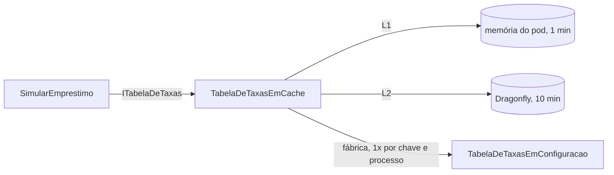

# 5.2 HybridCache na tabela de taxas

Cada simulação escolhe a taxa pela faixa de score. A tabela de faixas é lida em **toda** simulação. Hoje ela vem da configuração, o que é barato; amanhã virá de um serviço de precificação ou de uma tabela que o comitê de crédito edita. É aí que o cache passa a valer, e é por isso que ele entra agora, como **decorador**, sem mexer em quem simula.

::: dica Se HybridCache for novidade
L1 e L2, `GetOrCreateAsync`, a debandada e o desenho que contorna a proteção sem querer: [lição 4.2 do Plataforma .NET](../../../plataforma-dotnet/docs/modulo-04/02-hybridcache-e-debandada.md). Aqui aplicamos ao caso de crédito e olhamos o que é diferente.
:::

## O decorador



```csharp
internal sealed class TabelaDeTaxasEmCache(ITabelaDeTaxas origem, HybridCache cache) : ITabelaDeTaxas
{
    public const string Chave = "simulacao:taxas:v1";
    public const string Tag = "taxas";

    internal static readonly HybridCacheEntryOptions Validade = new()
    {
        Expiration = TimeSpan.FromMinutes(10),
        LocalCacheExpiration = TimeSpan.FromMinutes(1),
    };

    public async Task<IReadOnlyList<FaixaDeScore>> ObterFaixasAsync(CancellationToken ct)
    {
        var emCache = await cache.GetOrCreateAsync(
            Chave, origem,
            static async (o, token) => (await o.ObterFaixasAsync(token)).Select(FaixaEmCache.De).ToArray(),
            Validade, Tags, ct);
        return [.. emCache.Select(f => f.ParaDominio())];
    }
}
```

::: porque Decorador, e não um `if (cache...)` dentro do caso de uso
`SimularEmprestimo` depende de `ITabelaDeTaxas` e continua sem saber que existe cache. O registro decide: com `AddCacheDeTaxas`, `ITabelaDeTaxas` é o decorador, que embrulha a tabela da configuração. Testar o cálculo não exige Dragonfly; testar o cache não exige o cálculo. Em Node, é o mesmo que envolver uma função `getTaxas` numa `withCache(getTaxas)`.
:::

## Cada detalhe da chamada

| Detalhe | Por quê |
|---|---|
| Chave `simulacao:taxas:v1` | Prefixo do módulo (o Dragonfly é compartilhado) e **versão do formato**. Se `FaixaEmCache` ganhar um campo obrigatório, a chave vira `v2`: durante o rolling update, pods velhos leem `v1` e pods novos, `v2`, sem um desserializar o formato do outro |
| `InstanceName = "creditflow:"` | O `RedisCache` põe esse prefixo em toda chave: no Dragonfly você verá `creditflow:simulacao:taxas:v1` |
| L2 10 min, L1 1 min | O L2 poupa a origem; o L1 poupa a **rede** (toda simulação pagaria ~1 ms de ida ao Dragonfly). O L1 curto é o limite de quanto tempo uma réplica fica com taxa velha se a invalidação não chegar a ela (lição 5.4) |
| Sobrecarga com estado (`origem`) e lambda `static` | A fábrica não captura variáveis: sem alocação de closure a cada simulação, num caminho que roda milhares de vezes por minuto |
| Tag `taxas` | Para invalidar o grupo inteiro (`RemoveByTagAsync`) se um dia houver chaves por produto ou por canal |
| `FaixaEmCache` (record só de números) | O L2 serializa com System.Text.Json. O `Percentual` do domínio não tem construtor público; em vez de ensinar o JSON a criá-lo, o cache guarda `decimal` e o domínio fica intocado |

::: armadilha Serializar o tipo do domínio "porque funcionou no teste"
Com o Dragonfly fora (só L1), o HybridCache guarda a **instância** em memória e nunca serializa: tudo funciona. No dia em que o L2 liga, a primeira leitura do Dragonfly tenta desserializar um `FaixaDeScore` com `Percentual`, e falha (ou, pior, desserializa com `Fracao = 0`: taxa zero). Por isso o teste de integração roda **com** Dragonfly, e o tipo em cache é um DTO simples.
:::

## A debandada, medida

::: previsao
A `api-simulacao` tem 4 réplicas. A chave `simulacao:taxas:v1` vence às 10h00m00s. Nesse segundo chegam 800 simulações, 200 em cada réplica. Quantas vezes a origem (a tabela de taxas) é consultada? E se, em vez de `GetOrCreateAsync`, o código fizesse `GetAsync` → se nulo, busca na origem → `SetAsync`?
???
**Com `GetOrCreateAsync`: até 4**, uma por réplica. Dentro de cada processo, as 200 chamadas para a mesma chave esperam a **mesma** execução da fábrica. Entre processos não há coordenação: cada réplica vê o L2 vazio e vai à origem uma vez.

**Com "lê, se nulo busca, grava": até 800.** Todas veem "não tem", todas vão à origem. É a debandada.

O teste [`Debandada_200_chamadas_juntas_uma_ida_a_origem`](https://github.com/JandersonSR/lending-plataform/blob/main/tests/CreditFlow.IntegrationTests/Cache/CacheDeTaxasTests.cs) dispara 200 chamadas com uma origem que demora 200 ms e confere que ela foi chamada **uma** vez. A origem lenta é de propósito: alarga a janela em que as chamadas se sobrepõem.
:::

::: porque Por que 4 idas é aceitável aqui
A origem é uma leitura de configuração (ou, no futuro, uma consulta pequena), e 4 é um número limitado pelo de réplicas, não pelo tráfego. Para eliminar até isso, seria preciso uma trava distribuída no Dragonfly (com o problema de "e se o pod que pegou a trava morrer?") ou renovar a chave **antes** de vencer. Complexidade que este dado não justifica.
:::

## Quando o L2 falha, o que o HybridCache faz

Lido no código-fonte do `Microsoft.Extensions.Caching.Hybrid` (o `DefaultHybridCache`):

- **Falha ao ler do L2**: a exceção é capturada, registrada no log (`CacheUnderlyingDataQueryFailure`) e tratada como **"não achei"**. A fábrica roda e a resposta sai.
- **Falha ao gravar no L2**: capturada e registrada (`CacheBackendWriteFailure`); o comentário no fonte diz que "L1 sem L2 é melhor do que falhar sempre". O L1 é preenchido mesmo assim.
- **Falha na fábrica** (a origem): **propaga**. Cache não esconde erro da fonte da verdade.
- **Remover/invalidar** com o L2 fora: a exceção chega a quem chamou. Por isso o `InvalidadorDeTaxas` tem o próprio `try/catch` (lição 5.4).

Isso é a metade da resiliência. A outra metade é não **esperar** demais por um Dragonfly que não responde, e está na connection string:

```csharp
o.AbortOnConnectFail = false;   // sobe mesmo com o Dragonfly fora
o.ConnectTimeout = 1000;        // ms
o.SyncTimeout = 500;            // ms
o.AsyncTimeout = 500;           // ms: o RedisCache usa a API assíncrona
```

A tabela completa de parâmetros está na [lição 4.3 do Plataforma .NET](../../../plataforma-dotnet/docs/modulo-04/03-quando-o-cache-falha.md). A novidade aqui é o `AsyncTimeout`: o `RedisCache` chama métodos `...Async`, e é este timeout, não o `SyncTimeout`, que limita a espera deles.

::: video Introducing HybridCache in ASP.NET Core (dotnet, em inglês)
https://www.youtube.com/watch?v=rjMfDUP4-eQ
O time do .NET mostrando as duas camadas, a proteção contra debandada, tags e serialização.
:::

Documentação: [HybridCache no ASP.NET Core](https://learn.microsoft.com/aspnet/core/performance/caching/hybrid).

## Perguntas para responder sem olhar

::: pergunta
Por que a chave tem `:v1` no final?
???
É a versão do formato do valor. Se o formato mudar, a chave muda, e durante o rolling update pods velhos e novos não tentam desserializar o formato um do outro.
:::

::: pergunta
O que o HybridCache faz se o Dragonfly falhar numa leitura? E numa gravação?
???
Leitura: registra no log e trata como ausência; a fábrica roda. Gravação: registra e segue, com o L1 preenchido. Falhas da fábrica (a origem) propagam.
:::

::: pergunta
Com N réplicas, quantas idas à origem uma chave fria gera no pior caso com `GetOrCreateAsync`?
???
Até N: a coalescência é por processo. Dentro de cada réplica, uma só.
:::

**Próxima:** [5.3 O que cachear em crédito, e o que nunca](03-o-que-cachear.md).
