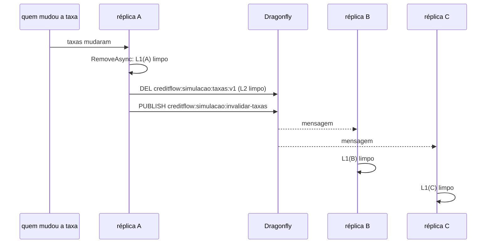

# 5.4 Invalidação por evento e cache fora do ar

Duas propriedades fecham o desenho do cache: **quando a taxa muda, todas as réplicas param de usar a velha em segundos**, e **quando o Dragonfly cai, a simulação continua respondendo**. Esta lição mostra o código das duas e quebra as duas no lab.

## Invalidar: o problema das N memórias

`HybridCache.RemoveAsync(chave)` apaga a chave do L2 (Dragonfly) e do L1 **da réplica que chamou**. As outras réplicas têm a tabela no próprio L1 e continuam usando até ele vencer.



O [`InvalidacaoDeTaxas.cs`](https://github.com/JandersonSR/lending-plataform/blob/main/src/Modules/Simulacao/CreditFlow.Modules.Simulacao/Infrastructure/Cache/InvalidacaoDeTaxas.cs) faz as duas pontas:

```csharp
// quem invalida
await cache.RemoveByTagAsync(TabelaDeTaxasEmCache.Tag, ct);
await cache.RemoveAsync(TabelaDeTaxasEmCache.Chave, ct);
await redis.GetSubscriber().PublishAsync(Canal, motivo);

// cada réplica, na subida (OuvinteDeInvalidacaoDeTaxas)
await redis.GetSubscriber().SubscribeAsync(InvalidadorDeTaxas.Canal, (_, _) =>
    _ = invalidador.ApagarLocalAsync(CancellationToken.None).AsTask());
```

E o que dispara a invalidação? Hoje, a configuração recarregada (`IOptionsMonitor.OnChange`: mudou o ConfigMap, o arquivo é relido, a tabela é invalidada). Quando as taxas vierem de um serviço de precificação, o gatilho será um evento `TaxasAlteradas` no Kafka chamando o mesmo `IInvalidadorDeTaxas`. O cache não sabe de onde veio a ordem.

::: conceito Pub/sub do Redis (e do Dragonfly)
`PUBLISH canal mensagem` entrega a mensagem a quem estiver **conectado e inscrito** no canal naquele instante. Não há fila, não há persistência, não há confirmação: entrega "no máximo uma vez". Réplica desconectada no momento do `PUBLISH` simplesmente não recebe.
:::

::: porque Pub/sub e não Kafka para o aviso entre réplicas
O aviso é "apague o seu L1", e só interessa a quem está vivo **agora**. Uma réplica que sobe depois começa com o L1 vazio; uma que estava desconectada fica com o L1 velho por no máximo 1 minuto. Para isso, a perda ocasional é aceitável, e o pub/sub já vem no Dragonfly que o cache usa. Com o Kafka, cada réplica precisaria de um grupo de consumidores próprio (para **todas** receberem a mensagem, e não só uma do grupo), o que é desajeitado para pods que nascem e morrem. O evento de negócio `TaxasAlteradas`, esse sim, vai no Kafka: ele não pode se perder.
:::

::: armadilha O limite que sobra
Com invalidação por evento, o pior caso deixa de ser "L2 + L1" e passa a ser "L1 de quem não recebeu o aviso": 1 minuto. Para o caso de crédito do CreditFlow, aceitável (lição 5.3). Se não fosse, a resposta **não** é baixar o L1 para 1 segundo (a simulação passaria a ir ao Dragonfly quase sempre): é tirar o dado do cache.
:::

## Cache fora: mais lento, nunca fora do ar

O registro em [`CacheDeTaxasExtensions.cs`](https://github.com/JandersonSR/lending-plataform/blob/main/src/Modules/Simulacao/CreditFlow.Modules.Simulacao/Infrastructure/Cache/CacheDeTaxasExtensions.cs) junta as peças:

| Peça | Efeito com o Dragonfly fora |
|---|---|
| `AbortOnConnectFail = false` | A API **sobe** e reconecta em segundo plano |
| `ConnectTimeout` 1 s, `SyncTimeout`/`AsyncTimeout` 500 ms | Cada tentativa espera pouco; o cliente marca a conexão como caída e passa a falhar rápido |
| HybridCache: leitura do L2 falha = "não achei" | A fábrica roda; a simulação sai com a taxa da origem |
| HybridCache: gravação no L2 falha = só log | O L1 é preenchido; as próximas simulações daquela réplica nem tentam o L2 por 1 min |
| `try/catch` no `InvalidadorDeTaxas` | Mudar a taxa não falha por causa do cache |
| Dragonfly **fora** da readiness | O Kubernetes não tira os pods do balanceador por causa de uma dependência opcional |

::: porque Por que o Dragonfly não entra na readiness
A readiness diz "este pod pode receber tráfego". Com o Dragonfly fora, o pod **pode**: só fica um pouco mais lento. Se o check do Dragonfly estivesse na readiness, uma queda dele tiraria **todas** as réplicas do balanceador ao mesmo tempo, e o cache, que existia para ajudar, derrubaria a simulação inteira. Compare com o `mongo` e o `postgres-propostas`, que estão na readiness: sem eles, o módulo realmente não funciona.
:::

## Lab: quebrar o cache de propósito

::: quebra Derrubar o Dragonfly com a API rodando
Suba com a API em contêiner (`docker compose --profile app up -d --build`) e, em outro terminal, acompanhe o log: `docker compose logs -f api`.

```bash
simular() { curl -s -o /dev/null -w "%{http_code} %{time_total}s\n" -X POST localhost:8080/v1/simulacoes \
  -H 'content-type: application/json' -d '{"valor":10000,"prazoMeses":12,"sistema":"price"}'; }

# 1. Aqueça e veja a chave
simular; simular
docker compose exec dragonfly redis-cli keys 'creditflow:*'

# 2. Derrube
docker compose stop dragonfly

# 3. Simule de novo, várias vezes
for i in $(seq 5); do simular; done

# 4. Espere 70 s (o L1 vence) e simule
sleep 70; simular

# 5. Volte com ele e simule
docker compose start dragonfly; sleep 3; simular; simular
```

Antes de rodar, escreva: qual o status HTTP em cada passo? Em qual passo o tempo sobe, e quanto? O que aparece no log?
???
- **Passo 1:** `200` rápido; a chave `creditflow:simulacao:taxas:v1` aparece.
- **Passo 3:** `200`, **sem diferença de tempo**: a tabela está no L1 da réplica, e o Dragonfly nem é consultado.
- **Passo 4:** `200`. O L1 venceu; o HybridCache tenta o L2, falha rápido (conexão marcada como caída, ou timeout de 500 ms na primeira vez), registra `CacheUnderlyingDataQueryFailure` no log, vai à origem, tenta gravar no L2, falha, registra `CacheBackendWriteFailure`, e responde. A **primeira** chamada depois do L1 vencer pode levar uns centésimos a mais; as seguintes, não (L1 de novo).
- **Passo 5:** `200`; o `StackExchange.Redis` reconecta sozinho e o L2 volta a ser preenchido. O ouvinte de invalidação refaz a assinatura do canal sem código extra.

A propriedade que importa: **nenhuma resposta diferente de 200**. Simulamos o equivalente no teste `Dragonfly_fora_fica_mais_lento_nao_fora_do_ar`, apontando para uma porta sem nada: a tabela volta e a invalidação não lança.
:::

::: quebra Agora, do jeito errado
Edite o registro (só localmente, para ver) e troque `o.AbortOnConnectFail = false` por `true`. Derrube o Dragonfly **antes** de subir a API e suba.
???
A API **não sobe**: o `ConnectionMultiplexer.Connect` lança na primeira resolução do multiplexador, e um componente opcional virou obrigatório. Em Kubernetes, isso vira `CrashLoopBackOff` em todas as réplicas novas enquanto o Dragonfly estiver fora, inclusive durante um deploy. Desfaça a mudança.
:::

::: quebra A invalidação que não chega
Com duas réplicas da API (`docker compose --profile app up -d --scale api=2` não funciona com a porta fixa; use dois `dotnet run` em portas diferentes apontando para o mesmo Dragonfly), aqueça as duas e, no `redis-cli`, simule outra réplica publicando:

```bash
docker compose exec dragonfly redis-cli publish creditflow:simulacao:invalidar-taxas teste
```

Depois, pare uma das duas (`Ctrl+Z`, que suspende o processo), publique de novo, e retome (`fg`). Quanto tempo a réplica suspensa usa a tabela velha?
???
Na primeira publicação, as duas apagam o L1 (o `PUBLISH` responde `(integer) 2`: dois inscritos). Na segunda, a suspensa não está lendo o socket: o `PUBLISH` ainda conta a conexão (ela não caiu), mas a mensagem fica no buffer e é processada quando o processo volta, **ou** se perde se a conexão tiver caído nesse meio tempo. No pior caso, a réplica usa a tabela velha até o L1 vencer: 1 minuto. É o limite que o desenho aceita, e é por isso que o L1 é curto.
:::

## Perguntas para responder sem olhar

::: pergunta
Por que `RemoveAsync` não basta para invalidar um cache em duas camadas com várias réplicas?
???
Porque limpa o L2 e só o L1 da réplica que chamou. As outras continuam com a cópia em memória até o L1 vencer. É preciso avisar as réplicas (pub/sub) e aceitar o L1 curto como limite quando o aviso se perde.
:::

::: pergunta
O cache distribuído deve fazer parte da readiness do pod?
???
Não, se for opcional: com ele fora, o pod continua podendo atender, só mais devagar. Na readiness, uma queda do cache tiraria todas as réplicas do balanceador. Dependências sem as quais o pod não funciona (o banco do módulo) entram.
:::

**Próximo:** [Desafio do módulo](desafio.md).
