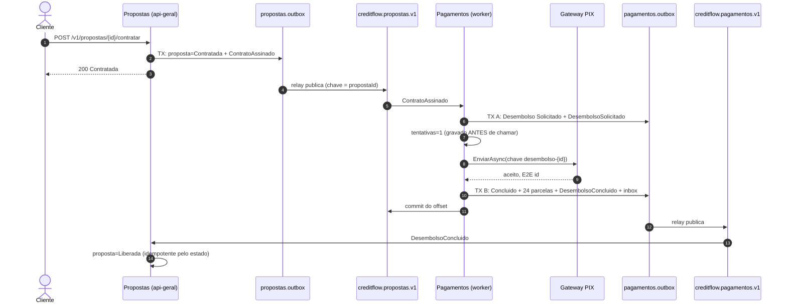
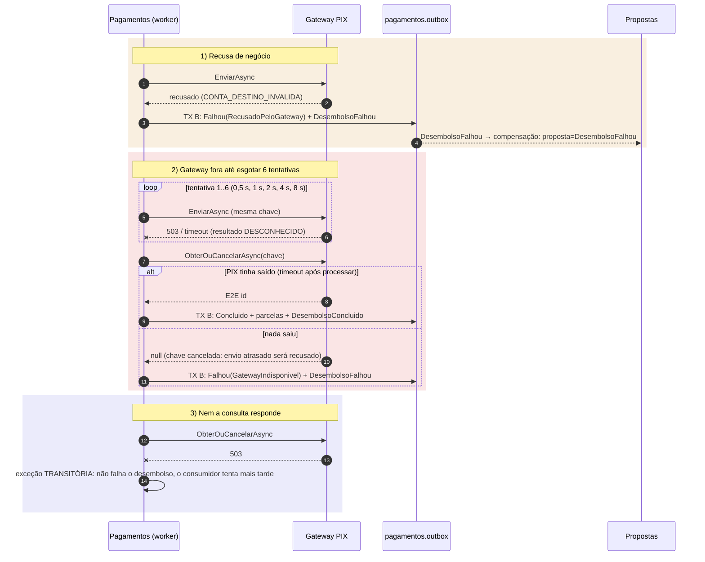

# 6.5 A saga de desembolso: coreografia, gateway e compensação

Contratar envolve Propostas (assinatura), Pagamentos (PIX e parcelas) e um gateway externo. Não há transação que cubra os três. Uma **saga** é a resposta: uma sequência de transações locais, cada uma publicando o fato que dispara a próxima, com **compensações** para desfazer o que já foi feito quando um passo falha de vez.

::: conceito Saga
Uma transação de negócio longa quebrada em passos locais T1, T2, ... Tn. Cada passo commita sozinho. Se Tk falha de forma definitiva, executam-se compensações C(k-1), ..., C1 que desfazem **semanticamente** os passos anteriores (não é rollback: o passo aconteceu e foi visto; a compensação é um novo fato, como "contratação desfeita").
:::

## Orquestrada ou coreografada

| | Orquestrada | Coreografada |
|---|---|---|
| Quem decide o próximo passo | Um orquestrador (máquina de estados persistida) manda comandos | Cada participante reage a eventos e publica os seus |
| Onde o fluxo está escrito | Num lugar só, legível | Espalhado pelos participantes |
| Peças a mais | O orquestrador (e seu banco, sua escala, seu deploy) | Nenhuma |
| Prazos ("se não concluir em 2 h, cancele") | Natural (timers do orquestrador) | Cada participante cuida do seu |
| Bom para | 4+ passos, compensações cruzadas, prazos, visibilidade de negócio | 2 ou 3 participantes, fluxo linear |
| Exemplos de ferramenta | MassTransit state machine, NServiceBus Saga, Temporal | Kafka + outbox + consumidores |

::: porque Por que coreografia no CreditFlow
São dois participantes e uma compensação: `ContratoAssinado` → Pagamentos → `DesembolsoConcluido` ou `DesembolsoFalhou` → Propostas. Um orquestrador seria mais um componente com estado para operar, escalar e fazer cair, para coordenar uma decisão que cabe num `if`. A conta muda quando entrar, por exemplo, "registrar a operação no SCR do Bacen" e "emitir CCB assinada digitalmente" com prazos e compensações entre eles: aí o fluxo espalhado vira o problema, e o ADR 0006 diz que a evolução natural é um orquestrador.

O custo da coreografia é que **o fluxo não está escrito em lugar nenhum do código**. Ele está nos diagramas abaixo e no trace (o `traceparent` atravessa outbox e Kafka). Se você não mantém os diagramas, ninguém consegue responder "o que acontece depois do contrato assinado?" em menos de uma hora de leitura.
:::

## O caminho feliz



## Três momentos, porque o pod pode morrer entre quaisquer dois

O manipulador [`AoContratoAssinado.cs`](https://github.com/JandersonSR/lending-plataform/blob/main/src/Modules/Pagamentos/CreditFlow.Modules.Pagamentos/Application/Desembolsos/AoContratoAssinado.cs) tem três partes, e cada uma é idempotente por si só:

| Momento | O que faz | Se o pod morrer logo depois |
|---|---|---|
| **TX A** | Obtém ou cria o `Desembolso` da proposta (índice único `proposta_id`) + outbox `DesembolsoSolicitado` | A reentrega encontra o desembolso existente e segue dele |
| **Gateway** | Fora de transação. Conta a tentativa no banco **antes**, chama com a chave `desembolso-{id}` | A reentrega chama de novo com a **mesma chave**: o gateway devolve a mesma transação |
| **TX B** | `Concluir`/`Falhar` + parcelas + outbox do desfecho + **inbox**, juntos | Commitou: a reentrega é duplicata pela inbox. Não commitou: refaz B |

::: porque Por que a inbox só na TX B
Se a inbox fosse registrada na TX A, um crash entre A e B faria a reentrega ser descartada como duplicata, e o desembolso ficaria `Solicitado` para sempre. Registrando no último passo, a inbox significa "este evento **terminou** de ser processado", e todo o caminho até lá é seguro para repetir.
:::

::: porque Por que chamar o gateway fora de transação
Uma transação aberta esperando um HTTP de 400 ms (ou 30 s num timeout) segura uma conexão do pool e as travas das linhas. Com 6 réplicas do worker e o gateway lento, o pool do Postgres esgota e **Propostas** para de responder, embora não tenha nada a ver com o gateway. A regra: transação curta, só banco; rede externa entre transações, protegida por idempotência.
:::

## O gateway: idempotência do lado de lá

O [`IGatewayPix`](https://github.com/JandersonSR/lending-plataform/blob/main/src/Modules/Pagamentos/CreditFlow.Modules.Pagamentos/Application/Gateway/IGatewayPix.cs) copia o que PSPs reais oferecem: toda ordem leva uma **chave de idempotência**; repetir a chave devolve a mesma transação. O [`GatewayPixSimulado`](https://github.com/JandersonSR/lending-plataform/blob/main/src/Modules/Pagamentos/CreditFlow.Modules.Pagamentos/Infrastructure/Gateway/GatewayPixSimulado.cs) tem os defeitos configuráveis de um gateway real (`Pagamentos:GatewayPix:*`):

| Opção | Padrão | O que simula |
|---|---|---|
| `LatenciaMinimaMs` / `LatenciaMaximaMs` | 80 / 400 | Rede e processamento do PSP |
| `TaxaDeIndisponibilidade` | 5% | 503 **antes** de processar |
| `TaxaDeTimeoutAposProcessar` | 2% | **Processa** (o dinheiro sai) e a resposta se perde |
| `TaxaDeRecusa` | 1% | Recusa de negócio (conta inexistente) |
| `ChavesSempreRecusadas` / `ChavesSempreIndisponiveis` | `recusar@creditflow.dev` / `indisponivel@creditflow.dev` | Falhas determinísticas para os labs |

::: previsao
O gateway processou o PIX e a resposta se perdeu (timeout). O worker tenta de novo, mas **em outro pod** (o primeiro foi reiniciado). Se o simulador guardasse as chaves num `Dictionary` em memória, o que aconteceria?
???
O pod novo tem um dicionário vazio, não reconhece a chave, e manda o PIX **de novo**: o cliente recebe duas vezes. Por isso a memória de idempotência do simulador fica no Postgres (`pagamentos.pix_simulado`, chave primária na chave de idempotência, `INSERT ... ON CONFLICT DO NOTHING`), como num PSP de verdade, onde ela fica no banco **deles**. O teste `Timeout_depois_de_processar_e_retry_com_a_mesma_chave_nao_paga_duas_vezes` prova com um Postgres real (Testcontainers).
:::

## Os caminhos de falha



::: porque "Consultar e cancelar" antes de declarar falha
Depois de 6 timeouts, "não sei se o dinheiro saiu" é a verdade. Publicar `DesembolsoFalhou` com base num palpite tem dois finais ruins: se o PIX saiu, o cliente recebeu e a proposta diz que a contratação foi desfeita (dinheiro fora sem contrato); se não saiu e um envio atrasado ainda vai chegar ao PSP, idem. `ObterOuCancelarAsync` transforma o palpite em fato: se a chave foi processada, conclui; se não, **grava uma lápide** que faz o PSP recusar qualquer envio futuro com ela. Só então "não saiu e não vai sair" é verdade, e a compensação é segura.

Se nem a consulta responde, o manipulador lança uma exceção transitória e o consumidor repete mais tarde. **Melhor atrasar do que mentir**: o custo é lag, não dinheiro.
:::

::: armadilha A tentativa contada depois da chamada
Se a tentativa fosse gravada **depois** de chamar o gateway, um pod que morre no meio da chamada não a contaria, e uma mensagem "venenosa" para o gateway (sempre timeout) seria tentada infinitamente, uma vez por reinício. Gravando antes (`RegistrarTentativaAsync`), o limite de 6 vale entre pods e reentregas.
:::

## A compensação em Propostas

```csharp
public Result RegistrarDesembolsoFalhou(string motivo, DateTimeOffset agora)
{
    if (Status == StatusProposta.DesembolsoFalhou) return Result.Ok();   // reentrega: no-op
    if (Status != StatusProposta.Contratada)
        return PropostasErros.TransicaoInvalida(Status, "desfazer a contratação de");
    Status = StatusProposta.DesembolsoFalhou;
    ...
    _eventos.Add(new ContratacaoDesfeita(Id, ClienteId, motivo, agora));
```

O handler em [`ReacoesAoDesembolso.cs`](https://github.com/JandersonSR/lending-plataform/blob/main/src/Modules/Propostas/CreditFlow.Modules.Propostas/Application/Integracao/ReacoesAoDesembolso.cs) traduz o `Result` para a política do consumidor: conflito de concorrência (`propostas.alterada-por-outro`) vira transitória; **transição inválida** vira permanente e vai para a DLT.

::: previsao
Uma `DesembolsoConcluido` chega para uma proposta que está `Cancelada`. Por que isso vai para a DLT em vez de ser ignorado, e o que alguém deveria fazer?
???
Porque é um estado que o desenho da saga diz que não existe: a proposta só pode ser cancelada antes de contratar, e o desembolso só começa depois. Se aconteceu, há um bug ou uma operação manual errada, e **dinheiro saiu** para uma proposta cancelada. Ignorar esconderia o problema. Na DLT, com o motivo `propostas.transicao-invalida` e o offset de origem, alguém do financeiro decide (estornar, reativar o contrato) e a engenharia investiga como o estado chegou lá.

Atenção ao detalhe do código: `TransicaoInvalida` também é `TipoErro.Conflito`. Classificar só pelo **tipo** mandaria repetir para sempre. Por isso o handler olha o **código** do erro.
:::

## Perguntas para responder sem olhar

::: pergunta
Qual a diferença entre compensação e rollback?
???
Rollback desfaz algo que nunca foi visto (a transação não commitou). Compensação é um novo fato que desfaz semanticamente um passo que já commitou e foi observado ("contratação desfeita"), e fica no histórico.
:::

::: pergunta
Por que o manipulador de Pagamentos usa três momentos e não uma transação só?
???
Porque a chamada ao gateway é rede externa: dentro de uma transação, seguraria conexão e travas pelo tempo da chamada, esgotando o pool. Separado em TX A, gateway e TX B, cada parte é idempotente (índice único, chave de idempotência, inbox), e o pod pode morrer entre quaisquer duas.
:::

::: pergunta
O gateway deu timeout 6 vezes. Por que não publicar DesembolsoFalhou direto?
???
Porque timeout é resultado desconhecido: o PIX pode ter saído. Antes de compensar, consulta o gateway pela chave e, se nada foi processado, cancela a chave para que um envio atrasado seja recusado. Só com isso "não saiu" é fato. Se a consulta falha, tenta mais tarde em vez de falhar.
:::

**Próxima:** [6.6 Lab de quebra](06-lab-de-quebra.md).
