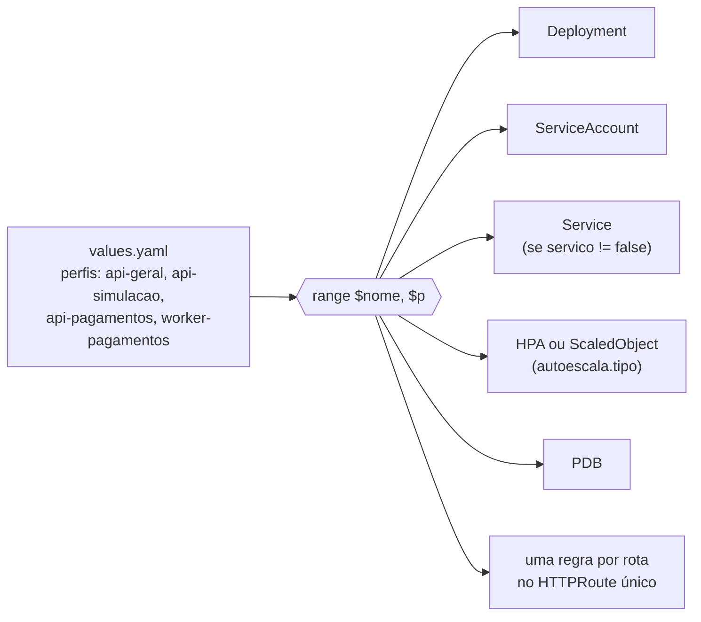

# 7.2 Um chart, quatro perfis

A [ADR 0002](https://github.com/JandersonSR/lending-plataform/blob/main/docs/adr/0002-perfis-de-execucao.md) decidiu: a **mesma imagem** sobe com `CREDITFLOW__MODULOS` e `CREDITFLOW__PAPEL` diferentes, e cada combinação é um Deployment com escala própria. O que fica para o Helm é transformar isso em YAML sem copiar quatro vezes o mesmo Deployment.

Se `Chart.yaml`, `values.yaml`, `{{ .Values }}` e precedência de `-f`/`--set` ainda não estão firmes, a base está na lição [7.2 da Plataforma](../../plataforma-dotnet/docs/modulo-07/02-anatomia-do-chart.md) e na [7.3](../../plataforma-dotnet/docs/modulo-07/03-comandos-e-porques.md).

::: video What is Helm in Kubernetes? Helm and Helm Charts explained (TechWorld with Nana, em inglês)
https://www.youtube.com/watch?v=-zuxi1a0LIC
Revisão de chart, values e release.
:::

## A ideia: um mapa de perfis no values

```yaml
perfis:
  api-simulacao:
    habilitado: true
    papel: api
    modulos: [Simulacao]
    segredos: [mongo, cache, kafka-simulacao]
    recursos:
      requests: { cpu: 500m, memory: 256Mi }
      limits: { memory: 512Mi }
    sondas: { startup: {...}, readiness: {...}, liveness: {...} }
    autoescala: { tipo: hpa, minimo: 2, maximo: 12, cpuAlvo: 60 }
    pdb: { minAvailable: 1 }
    rotas:
      - caminho: /v1/simulacoes
```

Cada chave de `perfis` vira **Deployment + ServiceAccount**, e conforme o perfil, **Service**, **HPA** ou **ScaledObject**, **PodDisruptionBudget** e uma regra na rota HTTP. O [`deployment.yaml`](https://github.com/JandersonSR/lending-plataform/blob/main/deploy/helm/creditflow/templates/deployment.yaml) faz isso com um `range`:

```yaml
{{- range $nome, $p := .Values.perfis }}
{{- if $p.habilitado }}
{{- $ctx := dict "raiz" $ "perfil" $nome "cfg" $p }}
---
apiVersion: apps/v1
kind: Deployment
metadata:
  name: {{ include "creditflow.nomePerfil" $ctx }}
```



::: conceito O contexto dentro do range
Dentro de `range`, o ponto (`.`) passa a ser o item da iteração. Para alcançar `.Values` ou `.Release` é preciso o `$`, que sempre aponta para a raiz. O chart monta um dicionário `$ctx` com `raiz`, `perfil` e `cfg` e passa para os `define` do [`_helpers.tpl`](https://github.com/JandersonSR/lending-plataform/blob/main/deploy/helm/creditflow/templates/_helpers.tpl), que usam `.raiz.Release.Name`, `.perfil` etc.
:::

## O que vira variável de ambiente

```yaml
env:
  - name: CREDITFLOW__MODULOS
    value: {{ include "creditflow.modulos" $p.modulos | quote }}   # "Clientes,Propostas,Notificacoes"
  - name: CREDITFLOW__PAPEL
    value: {{ $p.papel | quote }}
  - name: OTEL_SERVICE_NAME
    value: {{ printf "creditflow-%s" $nome | quote }}
envFrom:
  - configMapRef: { name: creditflow-config }
  {{- range $p.segredos }}
  - secretRef: { name: {{ include "creditflow.nomeSegredo" (dict "raiz" $ "item" .) }} }
  {{- end }}
```

O `PerfilDeExecucao.Ler` do Host (módulo 1) aceita a lista separada por vírgula e **derruba a subida** se um nome não existir. Isso é intencional: um erro de digitação no values (`Simulaçao`) não vira um pod saudável que não atende nada. E o chart pega antes: o [`values.schema.json`](https://github.com/JandersonSR/lending-plataform/blob/main/deploy/helm/creditflow/values.schema.json) só aceita os cinco nomes de módulo, e o `helm template` falha na hora.

::: porque Segredos por perfil
O `api-simulacao` não toca no Postgres. Então ele **não recebe** `ConnectionStrings__Postgres`. Se alguém achar uma injeção de comando no endpoint público de simulação, a senha do banco das propostas não está naquele processo. É o menor privilégio aplicado a variáveis de ambiente, e só é possível porque cada perfil lista os segredos que usa (`segredos: [mongo, cache, kafka-simulacao]`).
:::

## Os segredos: ExternalSecret, não Secret

O chart nunca recebe senha. Para cada item usado por algum perfil, ele gera um `ExternalSecret`, e o **External Secrets Operator** (ESO) cria o Secret de verdade a partir do Key Vault (módulo 9) ou dos Secrets que o Strimzi cria para cada usuário Kafka:

```yaml
postgres:
  loja: azure
  dados:
    host: postgres-host
    senha: postgres-app-senha
  template:
    ConnectionStrings__Postgres: "Host={{ .host }};Database=creditflow;Username=creditflow_app;Password={{ .senha }};SSL Mode=Require;..."
```

::: armadilha Dois motores de template no mesmo arquivo
`{{ .host }}` acima é template do **ESO**, não do Helm. Funciona porque está em `values.yaml`: o Helm só interpreta templates dentro de `templates/`, e copia valores como texto. Se você escrever `{{ .host }}` direto num arquivo de `templates/`, o Helm tenta resolver, não acha `.host` e o resultado sai vazio. Nesses casos, escape: `{{ "{{" }} .host {{ "}}" }}` (é o que o chart do Keycloak faz).
:::

No kind não há Key Vault: com `segredos.habilitado: false`, o chart cria Secrets comuns a partir de `segredosLocais` no [`values-local.yaml`](https://github.com/JandersonSR/lending-plataform/blob/main/deploy/helm/creditflow/values-local.yaml). Mesmo nome de Secret, mesma variável de ambiente: o Deployment não sabe de onde o segredo veio.

## A armadilha do `mergeOverwrite` e por que o chart usa `hasKey`

O `padrao` do values tem `preStopSegundos: 5`. O worker quer `0` (ele não recebe tráfego de Service; esperar não serve para nada). A tentação é mesclar:

```yaml
{{- $cfg := mergeOverwrite (deepCopy $.Values.padrao) $p }}
preStop: {{ $cfg.preStopSegundos }}
```

::: previsao
Com o worker declarando `preStopSegundos: 0`, quanto vale `$cfg.preStopSegundos`?
???
**5.** O `mergeOverwrite` usa a biblioteca `mergo` com sobrescrita, e ela **não sobrescreve com valor vazio**: `0`, `false` e `""` são tratados como "não informado". O worker ficaria com 5 segundos de pausa sem ninguém entender por quê, e um `habilitado: false` num perfil herdaria `true` do padrão.

Por isso o chart lê esses campos com `hasKey`:

```yaml
{{- $preStop := $padrao.preStopSegundos }}
{{- if hasKey $p "preStopSegundos" }}{{ $preStop = $p.preStopSegundos }}{{ end }}
```
:::

## Rotas: um HTTPRoute, prefixo mais longo ganha

O [`rotas.yaml`](https://github.com/JandersonSR/lending-plataform/blob/main/deploy/helm/creditflow/templates/rotas.yaml) junta as rotas de todos os perfis num `HTTPRoute` só (Gateway API, assunto do módulo 9):

```yaml
rules:
  - matches: [{ path: { type: PathPrefix, value: / } }]               # api-geral
  - matches: [{ path: { type: PathPrefix, value: /v1/pagamentos } }]  # api-pagamentos
  - matches: [{ path: { type: PathPrefix, value: /v1/simulacoes } }]  # api-simulacao
```

A ordem no YAML não importa: a especificação da Gateway API manda escolher o **prefixo mais longo** que casa. `/v1/simulacoes/123` casa com `/` e com `/v1/simulacoes`; ganha o segundo. O chart também sabe gerar um `Ingress` clássico (`rotas.tipo: ingress`) para quem ainda usa um controlador de Ingress.

## Rodar sem cluster

```bash
helm lint deploy/helm/creditflow
helm template creditflow deploy/helm/creditflow -n creditflow | less
helm template creditflow deploy/helm/creditflow -f deploy/helm/creditflow/values-local.yaml \
  --show-only templates/deployment.yaml | grep -A2 CREDITFLOW__
helm template x deploy/helm/creditflow --set 'perfis.api-geral.modulos={Simulaçao}'   # o schema recusa
```

::: checkpoint
Antes de seguir: rode o `helm template` e conte os objetos por tipo. Com os valores padrão devem sair 4 Deployments, 4 ServiceAccounts, 3 Services (o worker não tem), 2 HPAs, 1 ScaledObject + 1 TriggerAuthentication, 4 PDBs, 1 HTTPRoute, 1 ConfigMap de configuração e os ExternalSecrets. Se o seu número for diferente, descubra qual condição do template explica.
:::

## Perguntas para responder sem olhar

::: pergunta
Por que o chart não tem um Deployment por arquivo (`deployment-api-geral.yaml`, ...)?
???
Porque os quatro são iguais em estrutura e só mudam em dados. Um `range` sobre `perfis` garante que uma correção (um `securityContext`, uma sonda) vale para todos, e que um perfil novo é só uma entrada no values.
:::

::: pergunta
Qual o problema de usar `mergeOverwrite` para combinar padrão e perfil?
???
Ele não sobrescreve com valores vazios (0, false, ""). Um perfil não consegue zerar um número nem desligar um booleano herdado do padrão. Campos que podem ser zerados precisam ser lidos com `hasKey`.
:::

::: pergunta
Como `{{ .senha }}` aparece no ExternalSecret renderizado sem o Helm tentar resolver?
???
O texto está em `values.yaml`, e o Helm não interpreta valores como template; o chart copia a string com `quote`. Dentro de `templates/` seria preciso escapar as chaves.
:::

**Próxima:** [7.3 Sondas, recursos e escala por perfil](03-sondas-recursos-e-escala.md).
