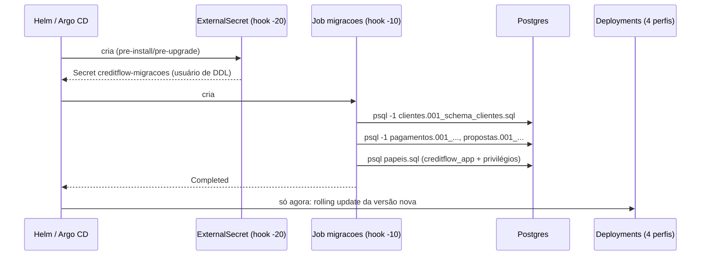
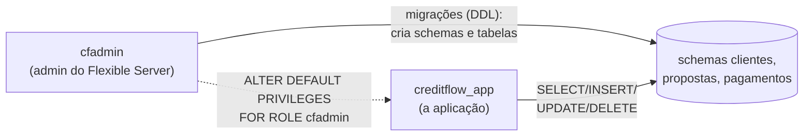

# 7.4 Migrações como Job

Quatro perfis com várias réplicas cada. Se cada pod criasse o schema ao subir (o `CriarSchemaAoIniciar=true` que os módulos usam no `docker compose`), oito processos tentariam alterar o mesmo schema ao mesmo tempo, e todos precisariam de permissão de DDL. O CreditFlow faz diferente: **um Job** aplica as migrações **antes** da versão nova subir, com um usuário que pode alterar o schema, e a aplicação roda com outro, que só lê e grava dados.

O DDL de cada módulo mora no próprio módulo (`src/Modules/<Modulo>/.../Sql/001_schema_<modulo>.sql`, módulos 1 e 4), escrito para ser **idempotente** (`CREATE ... IF NOT EXISTS`). O mesmo arquivo serve ao `docker compose` (aplicado na subida, só no ambiente local) e ao cluster (aplicado por este Job).

A versão curta disso (hook `pre-upgrade` simples) e o padrão **expandir/contrair** estão na lição [3.2 da Plataforma](../../plataforma-dotnet/docs/modulo-03/02-migracoes.md) e na [7.3](../../plataforma-dotnet/docs/modulo-07/03-comandos-e-porques.md). Aqui está a versão de produção, e os três problemas que aparecem nela.

## O desenho



O [`migracoes.yaml`](https://github.com/JandersonSR/lending-plataform/blob/main/deploy/helm/creditflow/templates/migracoes.yaml) põe tudo em **hooks** com `helm.sh/hook: pre-install,pre-upgrade`. O Helm cria os hooks em ordem de `hook-weight`, espera o Job terminar e só então aplica o resto. Se o Job falhar, o `upgrade` falha e **os pods antigos continuam rodando**.

::: conceito O Argo CD e os hooks do Helm
O Argo CD não roda `helm install`: ele renderiza o chart e aplica o YAML. Mas ele entende as anotações de hook: `pre-install` e `pre-upgrade` viram a fase **PreSync**, executada antes de qualquer recurso normal. O mesmo chart funciona com Helm puro (kind, lição 7.6) e com GitOps (módulo 11).
:::

## Problema 1: o hook que espera um recurso que ainda não existe

::: previsao
A primeira versão do Job usava `envFrom: configMapRef: creditflow-config` para herdar a configuração comum (OTel, Kafka). Funcionou em todos os `helm upgrade`. No **primeiro** `helm install` num namespace vazio, o deploy ficou parado até estourar o timeout. Por quê?
???
O hook `pre-install` roda **antes** de qualquer recurso normal ser criado, e o ConfigMap `creditflow-config` é um recurso normal. O pod do Job ficou em `CreateContainerConfigError` ("configmap not found") esperando um ConfigMap que só seria criado **depois** que o Job terminasse. Deadlock. Nos upgrades funcionava porque o ConfigMap da versão anterior já existia.

A correção no chart: o Job não referencia nada que não seja hook. O Secret de DDL também é hook (peso -20, antes do Job), e o Job só usa ele.
:::

A mesma lógica vale para o ExternalSecret: ele é criado como hook de peso `-20`, e o Argo CD espera ele ficar **saudável** (o ESO criou o Secret) antes de seguir para o Job de peso `-10`.

## De onde o Job tira o SQL

O Helm só lê arquivos de **dentro** do chart, e o Argo CD lê o chart do Git. O script [`deploy/scripts/copiar-artefatos.sh`](https://github.com/JandersonSR/lending-plataform/blob/main/deploy/scripts/copiar-artefatos.sh) copia cada `Sql/*.sql` dos módulos para `deploy/helm/creditflow/sql/<modulo>.<arquivo>.sql`; o template coloca todos num ConfigMap com `.Files.Glob "sql/*.sql"`, e o container roda:

```sh
for f in /sql/*.sql; do
  case "$(basename "$f")" in papeis.sql) continue ;; esac
  psql -v ON_ERROR_STOP=1 -1 -f "$f"     # -1: o arquivo inteiro numa transação
done
psql -v ON_ERROR_STOP=1 -v senha_app="$SENHA_APP" -v admin="$PGUSER" -f /sql/papeis.sql
```

::: armadilha Cópia que envelhece
Cópia de arquivo é dívida: alguém muda o DDL no módulo e esquece de rodar o script. O CI roda `copiar-artefatos.sh --verificar` e **falha** se alguma cópia divergir do original. É o mesmo truque usado para o realm do Keycloak (lição 7.5).
:::

::: porque Por que psql e não a imagem da aplicação
A imagem chiseled não tem shell nem cliente de banco, e rodar a API inteira só para executar três arquivos SQL acoplaria o Job ao `Program.cs`. O `postgres:17-alpine` é pequeno, tem o `psql` da mesma versão do servidor, e o Job não depende de nada do código além dos arquivos SQL. Se um dia o projeto adotar migrações do EF Core, o container passa a ser a imagem da aplicação com um comando `migrar`; o resto do desenho (hook, usuário de DDL, timeouts) não muda.
:::

## Problema 2: quem pode o quê no banco



Depois do DDL, o mesmo container roda o `papeis.sql`:

```sql
SELECT format('CREATE ROLE creditflow_app LOGIN PASSWORD %L', :'senha_app')
 WHERE NOT EXISTS (SELECT 1 FROM pg_roles WHERE rolname = 'creditflow_app') \gexec
ALTER ROLE creditflow_app PASSWORD :'senha_app';
ALTER DEFAULT PRIVILEGES FOR ROLE :"admin" GRANT USAGE ON SCHEMAS TO creditflow_app;
ALTER DEFAULT PRIVILEGES FOR ROLE :"admin" GRANT SELECT, INSERT, UPDATE, DELETE ON TABLES TO creditflow_app;
```

| Trecho | Por quê |
|---|---|
| `SELECT format(...) \gexec` | O Postgres não tem `CREATE ROLE IF NOT EXISTS`. O `\gexec` do psql executa o texto gerado pelo `SELECT`; se a linha não existe, não executa nada. Idempotente |
| `ALTER ROLE ... PASSWORD` sempre | Rotação: trocou a senha no Key Vault, o próximo deploy aplica |
| `ALTER DEFAULT PRIVILEGES FOR ROLE admin` | Vale para objetos que o **admin criar depois** (o `002_` do próximo deploy, uma tabela criada à mão num incidente): o `creditflow_app` já nasce com acesso |
| `GRANT ... ON ALL TABLES IN SCHEMA` no fim | Cobre o que o DDL **deste** deploy acabou de criar e tudo que já existia |
| `:'senha_app'` e `:"admin"` | Variáveis do psql, escapadas como literal e como identificador. Nada de concatenar senha em SQL |

::: armadilha
`ALTER DEFAULT PRIVILEGES` só vale para objetos criados pelo papel indicado em `FOR ROLE`. Se um dia as migrações rodarem com outro usuário, as tabelas novas nascem sem permissão para a aplicação, e o erro só aparece em produção como `permission denied for table ...`. Por isso o último bloco do SQL concede explicitamente sobre o que já existe, a cada deploy.
:::

## Problema 3: migração que trava

Um `002_` que faz `ALTER TABLE propostas.propostas ADD COLUMN ...` precisa de um lock `ACCESS EXCLUSIVE` na tabela. Se uma transação longa estiver aberta, o `ALTER` espera, e **todas as consultas seguintes** àquela tabela entram na fila atrás dele. A aplicação antiga para de responder enquanto o deploy "só está migrando".

O chart se protege em três lugares:

- `PGOPTIONS=-c lock_timeout=30s -c statement_timeout=300s`: esperou 30 s por um lock, ou um comando passou de 5 minutos, falha em vez de pendurar a fila;
- `-1` no psql: o arquivo falhou no meio, nada dele fica aplicado;
- `activeDeadlineSeconds: 600` no Job: no pior caso, o Kubernetes mata o Job em 10 minutos e o deploy falha de forma visível.

O que fazer quando isso acontece está no runbook [`migracao-travada.md`](https://github.com/JandersonSR/lending-plataform/blob/main/docs/runbooks/migracao-travada.md), e é um dos incidentes do game day do módulo 12.

::: porque Por que o Job não apaga a si mesmo no sucesso
`hook-delete-policy: before-hook-creation`, sem `hook-succeeded`. O Job e os logs ficam no cluster até o próximo deploy. Quando alguém perguntar "a migração da versão 0.1.87 rodou?", `kubectl logs job/creditflow-migracoes -c migrar` responde.
:::

## Idempotência é a regra que segura tudo

O Job roda **em todo deploy**, aplicando todos os arquivos de novo. Isso só funciona porque cada comando de DDL é idempotente (`CREATE TABLE IF NOT EXISTS`, `CREATE INDEX IF NOT EXISTS`, `ADD COLUMN IF NOT EXISTS`). Um `ALTER TABLE ... ADD COLUMN x` sem `IF NOT EXISTS` passa no primeiro deploy e **quebra todos os seguintes**. Duas regras a mais: nada de `CREATE INDEX CONCURRENTLY` (não roda dentro de transação, e o `-1` abre uma; índice em tabela grande vira tarefa à parte), e todo arquivo novo precisa ser compatível com a versão **anterior** do código, porque o rollback volta o código e não o banco.

## Perguntas para responder sem olhar

::: pergunta
Por que o DDL roda num Job em hook e não na subida de cada pod?
???
Para rodar uma vez (não N réplicas em paralelo), antes da versão nova receber tráfego, com um usuário de DDL que a aplicação não tem, e para que uma falha impeça o deploy em vez de deixar pods quebrados.
:::

::: pergunta
O que causa o deadlock no primeiro `helm install` quando o Job usa o ConfigMap do chart?
???
Hooks pre-install rodam antes dos recursos normais. O ConfigMap ainda não existe; o pod do Job fica em `CreateContainerConfigError`; o Helm espera o Job, que espera o ConfigMap, que só seria criado depois.
:::

::: pergunta
O que `ALTER DEFAULT PRIVILEGES FOR ROLE cfadmin` garante, e o que ele não garante?
???
Garante que objetos criados **depois**, **pelo cfadmin**, recebam os privilégios para o `creditflow_app`. Não altera objetos que já existem, nem objetos criados por outro usuário.
:::

**Próxima:** [7.5 A plataforma dentro do cluster](05-plataforma-no-cluster.md).
