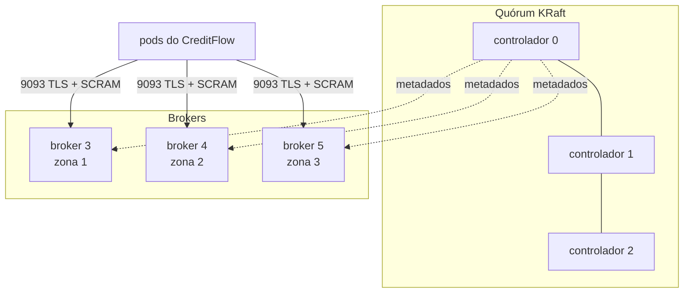

# 7.5 A plataforma dentro do cluster: Strimzi, Dragonfly e Keycloak

No `docker compose` do módulo 1, Kafka, Dragonfly e Keycloak eram contêineres soltos. No Kubernetes, cada um deles é um sistema com estado, réplicas, eleição de líder e atualização em ordem. Escrever StatefulSets na mão para isso é reinventar o que os **operadores** já fazem.

::: conceito Operador
Um controlador que estende a API do Kubernetes com um recurso novo (uma CRD, como `Kafka`) e mantém o mundo igual ao que esse recurso descreve. Você declara "quero um Kafka 4.3.1 com 3 brokers"; o operador cria os pods, os certificados, os Services, e faz o rolling restart **na ordem certa** quando você muda a versão. É o mesmo laço de reconciliação do Deployment, com o conhecimento de um especialista naquele sistema.
:::

Os operadores (Strimzi, Dragonfly, KEDA, ESO) são instalados pelo Terraform no AKS (módulo 9) e pelo `subir.sh` no kind (lição 7.6). Esta lição lê os **recursos** que o CreditFlow cria para eles: os charts [`deploy/k8s/dados`](https://github.com/JandersonSR/lending-plataform/blob/main/deploy/k8s/dados/values.yaml) e [`deploy/k8s/keycloak`](https://github.com/JandersonSR/lending-plataform/blob/main/deploy/k8s/keycloak/values.yaml).

## Kafka com Strimzi 1.x: KRaft e KafkaNodePool

O Kafka 4 removeu o ZooKeeper: os metadados do cluster (tópicos, partições, quem é líder) ficam num **quórum Raft** dentro do próprio Kafka, o **KRaft**. O Strimzi 1.0 acompanhou e mudou a API para `kafka.strimzi.io/v1` (a `v1beta2` foi removida). Os nós agora são declarados em **pools**:

```yaml
apiVersion: kafka.strimzi.io/v1
kind: KafkaNodePool
metadata:
  name: controladores
  labels: { strimzi.io/cluster: creditflow }
spec:
  replicas: 3
  roles: [controller]
  storage:
    type: jbod
    volumes:
      - { id: 0, type: persistent-claim, size: 10Gi, kraftMetadata: shared, deleteClaim: false }
---
# brokers: roles [broker], replicas 3, 100Gi
```



| Decisão | Por quê |
|---|---|
| Controladores separados dos brokers em prod | Um broker sobrecarregado (GC, disco) não atrasa o quórum de metadados. Em dev, um pool `unico` com os dois papéis economiza dois terços dos nós |
| 3 controladores | Raft precisa de maioria: com 3, tolera 1 fora. Com 2, perder 1 já para tudo |
| `rack.topologyKey: topology.kubernetes.io/zone` | O Strimzi passa a zona como `broker.rack`, e o Kafka espalha as réplicas de cada partição por zonas diferentes |
| `replication.factor 3`, `min.insync.replicas 2` | Com `acks=all` no produtor, uma escrita só é confirmada quando 2 réplicas têm o dado. Perder uma zona não perde mensagem nem para a escrita |
| `auto.create.topics.enable: false` | Tópico nasce de `KafkaTopic` revisado em PR, não de um erro de digitação no código |
| `deleteClaim: false` | Apagar o recurso Kafka por engano não apaga os discos |

## Tópicos e usuários como código

```yaml
apiVersion: kafka.strimzi.io/v1
kind: KafkaTopic
metadata:
  name: creditflow-propostas-v1
  labels: { strimzi.io/cluster: creditflow }
spec:
  topicName: creditflow.propostas.v1
  partitions: 6
  replicas: 3
  config: { retention.ms: 604800000, min.insync.replicas: 2 }
```

O **Topic Operator** reconcilia nos dois sentidos de mudança permitidos: aumentar partições funciona, diminuir não existe no Kafka, e o `KafkaTopic` fica `NotReady` com a mensagem de erro.

Cada perfil tem um **`KafkaUser`** com ACLs mínimas ([`usuarios.yaml`](https://github.com/JandersonSR/lending-plataform/blob/main/deploy/k8s/dados/templates/usuarios.yaml)):

| Usuário | Pode | Não pode |
|---|---|---|
| `creditflow-simulacao` | escrever em `creditflow.simulacoes.v1` | ler qualquer coisa |
| `creditflow-pagamentos` | ler `propostas.v1` no grupo `creditflow-pagamentos`, escrever `pagamentos.v1` e a DLT | escrever em `propostas.v1` (forjar contrato) |
| `creditflow-geral` | escrever `propostas.v1`, ler `pagamentos.v1` e `simulacoes.v1` | escrever em `pagamentos.v1` (forjar desembolso) |
| `creditflow-keda` | `Describe` no tópico e no grupo | ler mensagens |

::: porque ACL em monolito modular
"É tudo o mesmo código, para que separar usuário?" Porque o código é o mesmo, mas o **processo** não. Se o api-simulacao, que é público, for comprometido, o atacante tem as credenciais Kafka daquele pod. Com a ACL, o pior que ele faz é publicar simulações falsas. Sem ela, publicaria `DesembolsoConcluido` e a saga marcaria contratos como pagos.
:::

O **User Operator** gera a senha SCRAM e grava num Secret com o nome do usuário, **no namespace do Kafka** (`creditflow-dados`). A aplicação roda em `creditflow`. A [`loja-kafka.yaml`](https://github.com/JandersonSR/lending-plataform/blob/main/deploy/k8s/dados/templates/loja-kafka.yaml) resolve isso sem dar à aplicação acesso a Secrets de outro namespace: uma `SecretStore` do ESO no namespace `creditflow`, com provedor `kubernetes`, usa uma ServiceAccount cuja Role em `creditflow-dados` lê **só** os Secrets listados em `resourceNames`. O chart da aplicação monta `Kafka__SaslPassword` e `Kafka__SslCaPem` a partir deles.

## Dragonfly pelo operador

```yaml
apiVersion: dragonflydb.io/v1alpha1
kind: Dragonfly
metadata: { name: creditflow-cache }
spec:
  replicas: 2
  args: [--cache_mode=true, --maxmemory=1gb, --proactor_threads=2]
  authentication:
    passwordFromSecret: { name: creditflow-cache-senha, key: senha }
  resources:
    requests: { cpu: 250m, memory: 1280Mi }
    limits: { memory: 1280Mi }
```

O operador sobe um primário e réplicas, e mantém o Service `creditflow-cache` apontando **sempre para o primário**; se ele cai, promove uma réplica e move o Service. O `cache_mode` faz o Dragonfly despejar chaves perto do limite em vez de recusar escritas, que é o comportamento certo para um cache (módulo 5).

::: armadilha
`--maxmemory=1gb` com `limits.memory: 1Gi` parece certo e é um `OOMKilled` esperando acontecer: o processo usa memória além dos dados (buffers de conexão, replicação). Deixe uma folga de 20 a 30% entre `maxmemory` e o limite do contêiner.
:::

## Keycloak pelo operador oficial

O Keycloak tem operador oficial, com CRDs `k8s.keycloak.org/v2beta1`, mas **não** tem chart Helm oficial do operador: ele é instalado por kustomize (`keycloak/keycloak-k8s-resources`). O [`keycloak.yaml`](https://github.com/JandersonSR/lending-plataform/blob/main/deploy/k8s/keycloak/templates/keycloak.yaml) declara a instância:

```yaml
apiVersion: k8s.keycloak.org/v2beta1
kind: Keycloak
spec:
  instances: 2
  db:
    vendor: postgres
    host: <fqdn do Postgres Flexible>
    database: keycloak
    usernameSecret: { name: keycloak-banco, key: username }
    passwordSecret: { name: keycloak-banco, key: password }
  http: { httpEnabled: true }
  hostname:
    hostname: https://auth.<dominio>
    backchannelDynamic: true
  proxy: { headers: xforwarded }
```

| Campo | Por quê |
|---|---|
| `httpEnabled` + `proxy.headers: xforwarded` | O TLS termina no Gateway. O Keycloak confia nos cabeçalhos `X-Forwarded-*` para saber que a requisição original era HTTPS |
| `hostname` | É o `iss` de todo token. Precisa ser o endereço **público**, igual ao `Auth:Authority` da API |
| `backchannelDynamic: true` | Quem chama pelo endereço interno (`keycloak-service.keycloak.svc:8080`) recebe endpoints internos no discovery. A API baixa as chaves por dentro do cluster, mas o `iss` continua público. É o problema "issuer atrás de proxy" do [módulo 3](../modulo-03/README.md), resolvido no servidor |

O realm vem de um **`KeycloakRealmImport`** gerado a partir do mesmo `creditflow-realm.json` do módulo 3, com três transformações por ambiente no template ([`realm.yaml`](https://github.com/JandersonSR/lending-plataform/blob/main/deploy/k8s/keycloak/templates/realm.yaml)): fora de dev, sem usuários de teste e sem o client `creditflow-testes`; o segredo do client `creditflow-backoffice` vira o placeholder `${BACKOFFICE_CLIENT_SECRET}`, que o operador preenche a partir de um Secret do Key Vault.

::: armadilha O import não atualiza
O `KeycloakRealmImport` **cria** o realm se ele não existir. Se o realm já existe, nada muda. Adicionar um client no JSON e fazer deploy não cria o client em produção. Mudanças depois do primeiro import são feitas por migração de realm (Admin API, `keycloak-config-cli`) ou recriando o realm em ambientes descartáveis. Esta é uma das perguntas de entrevista do módulo.
:::

O banco do Keycloak precisa de um papel próprio. Um Job com `argocd.argoproj.io/hook: Sync` na onda `-1` ([`banco-bootstrap.yaml`](https://github.com/JandersonSR/lending-plataform/blob/main/deploy/k8s/keycloak/templates/banco-bootstrap.yaml)) cria o papel `keycloak` e transfere a posse do banco, **depois** do ExternalSecret (onda `-2`) e **antes** do CR `Keycloak` (onda `0`). Ondas e hooks são o assunto do módulo 11.

## Perguntas para responder sem olhar

::: pergunta
O que é KRaft e por que separar controladores de brokers em produção?
???
É o modo do Kafka em que os metadados ficam num quórum Raft dentro do próprio Kafka, sem ZooKeeper (removido no Kafka 4). Separar evita que a carga dos brokers (GC, disco, rede) atrase o quórum, que precisa responder rápido para eleições de líder.
:::

::: pergunta
Por que um KafkaUser por perfil num monolito modular?
???
O código é o mesmo, mas os processos têm exposições diferentes. A ACL limita o estrago de um processo comprometido: o api-simulacao, público, não consegue publicar eventos de desembolso.
:::

::: pergunta
Para que serve `backchannelDynamic` no Keycloak?
???
Faz o discovery responder endpoints internos para quem chama pelo endereço interno, mantendo o `iss` público. A API baixa as chaves pela rede do cluster e valida tokens emitidos com o hostname público.
:::

**Próxima:** [7.6 Tudo num kind, e quatro quebras](06-laboratorio-kind.md).
