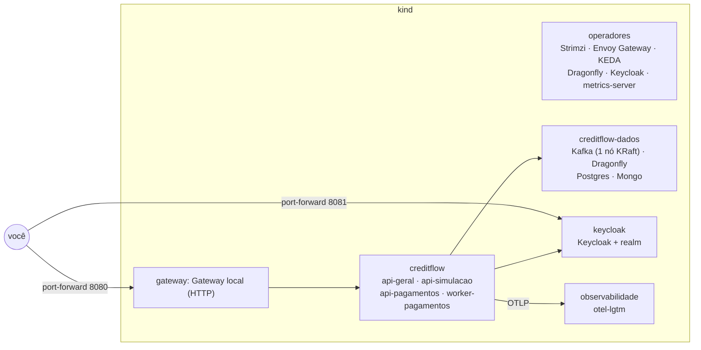

# 7.6 Tudo num kind, e quatro quebras

O [`subir.sh`](https://github.com/JandersonSR/lending-plataform/blob/main/deploy/k8s/local/subir.sh) monta, num kind de três nós, o que o AKS terá no módulo 9: operadores, Kafka em KRaft, Dragonfly, Keycloak com Postgres, observabilidade e os quatro perfis. Leia o script antes de rodar: cada bloco corresponde a uma lição deste módulo.



## Subir

```bash
kind version && kubectl version --client && helm version
./deploy/k8s/local/subir.sh
```

Leva de 10 a 20 minutos na primeira vez (imagens). Enquanto isso, em outro terminal:

```bash
kubectl get pods -A -w
kubectl -n creditflow-dados get kafka,kafkanodepool,kafkatopic,dragonfly
```

::: dica Diferenças do laboratório para o AKS
Os valores locais ficam em arquivos `values-local.yaml` ao lado de cada chart, e cada diferença tem um motivo: Kafka num nó só sem TLS e sem SCRAM (`listenerPlano: true`), Secrets comuns em vez de ExternalSecret (não há Key Vault), imagem com `pullPolicy: Never` carregada por `kind load`, Gateway só HTTP, Keycloak com hostname `http://localhost:8081`. O chart é o **mesmo**.
:::

## O teste de ponta a ponta

Com os port-forwards que o script imprime no final:

```bash
# simulação: pública, vai para o api-simulacao
curl -s -H 'Host: api.127.0.0.1.nip.io' localhost:8080/v1/simulacoes -X POST \
  -H 'Content-Type: application/json' -d '{"valor":10000,"prazoMeses":24,"sistema":"price"}' | jq .

# quem respondeu? o pod do api-simulacao registra; o api-geral não
kubectl -n creditflow logs deploy/creditflow-api-simulacao --since=1m | tail -3
kubectl -n creditflow logs deploy/creditflow-api-geral --since=1m | grep -c simulacoes
```

Para a jornada autenticada (proposta, contratação, desembolso), pegue um token no Keycloak local como no [módulo 3](../modulo-03/03-pkce-passo-a-passo.md), apontando para `localhost:8081`. O `iss` do token é `http://localhost:8081/realms/creditflow`, igual ao `Auth__Authority` do `values-local.yaml`, e a API baixa as chaves pelo `Auth__MetadataAddress` interno.

::: previsao
Por que, no laboratório, a API precisa de **dois** endereços do Keycloak (`Authority` e `MetadataAddress`)? O que daria errado com um só?
???
Com só `http://localhost:8081/...`: a API, dentro do pod, tentaria baixar o discovery de `localhost:8081`, que **dentro do pod** é o próprio pod. Falha.
Com só `http://keycloak-service.keycloak.svc:8080/...`: o download funciona, mas o token que você pegou pelo port-forward tem `iss = http://localhost:8081/...` e não bate com o Authority: 401 "issuer invalid".
`Authority` é a identidade (o que vem no `iss`); `MetadataAddress` é o caminho de rede. No AKS os dois coincidem no endereço público, mas o chart pode apontar o metadata para o Service interno do mesmo jeito.
:::

## Quatro quebras

Faça uma por vez. **Antes** de rodar, escreva o que acha que vai acontecer.

::: quebra Quebra 1: um módulo que não existe
```bash
helm upgrade creditflow deploy/helm/creditflow -n creditflow -f deploy/helm/creditflow/values-local.yaml \
  --set 'perfis.api-pagamentos.modulos={Pagamento}'
```
O que acontece com o `helm upgrade`? Se você contornar o schema (edite o values e remova o `enum` do `values.schema.json` numa cópia do chart), o que acontece com o pod? E com o serviço `/v1/pagamentos`?
???
Com o schema, o `helm upgrade` falha **antes** de tocar no cluster: `'Pagamento' is not one of [...]`. Sem o schema, o pod novo sobe e o Host lança `CreditFlow:Modulos tem módulo desconhecido: Pagamento` na inicialização: `CrashLoopBackOff`. Como `maxUnavailable: 0`, os pods **antigos** continuam atendendo `/v1/pagamentos`. Duas camadas de proteção: validação de entrada e falha rápida na subida.
:::

::: quebra Quebra 2: limite de CPU no api-simulacao
```bash
helm upgrade creditflow deploy/helm/creditflow -n creditflow -f deploy/helm/creditflow/values-local.yaml \
  --set 'perfis.api-simulacao.recursos.limits.cpu=200m'
# carga: 20 simulações em paralelo, 30 s
seq 1 2000 | xargs -P 20 -I{} curl -s -o /dev/null -w '%{time_total}\n' -H 'Host: api.127.0.0.1.nip.io' \
  -X POST localhost:8080/v1/simulacoes -H 'Content-Type: application/json' \
  -d '{"valor":20000,"prazoMeses":48,"sistema":"sac"}' | sort -n | awk '{a[NR]=$1} END {print "p50", a[int(NR*0.5)], "p99", a[int(NR*0.99)]}'
```
Compare p50 e p99 com e sem o limite. Olhe também `kubectl -n creditflow get hpa -w`.
???
Com 200m de limite, o p99 sobe muito mais que o p50 (o throttling aparece na cauda). O HPA calcula utilização sobre o **request**: o pod pode ficar "a 40%" de utilização e mesmo assim sofrer throttling, porque o limite está abaixo do que ele precisaria nos picos de 100 ms. Sem limite, o pod usa a CPU livre do nó e o HPA escala pela média.
:::

::: quebra Quebra 3: o primeiro install que nunca termina
Numa cópia do chart, adicione ao container `migrar` do Job:
```yaml
            - configMapRef:
                name: {{ include "creditflow.nome" . }}-config
```
Desinstale (`helm uninstall creditflow -n creditflow`) e instale de novo com `--wait --timeout 3m`. O que você vê em `kubectl -n creditflow get pods` e `describe`?
???
O pod do Job fica em `CreateContainerConfigError` com o evento `configmap "creditflow-config" not found`. O Helm espera o hook pre-install, que espera um ConfigMap que só seria criado depois do hook. Timeout em 3 minutos. É o problema 1 da lição 7.4.
:::

::: quebra Quebra 4: o laço de consumo travado
Escale o worker para 1 réplica e pause o processo dentro do contêiner (simula um deadlock, o processo continua vivo):
```bash
kubectl -n creditflow debug -it deploy/creditflow-worker-pagamentos --image=busybox --target=creditflow \
  --profile=restricted -- sh -c 'kill -STOP 1; sleep 3600'   # roda como o UID 1654 do pod: pode sinalizar o processo
```
Gere propostas contratadas (desafio do módulo 6). O que acontece com o lag do grupo `creditflow-pagamentos` e, depois de um minuto, com o pod?
???
O processo parado não responde a nada: o lag cresce, o broker expulsa o consumidor do grupo por `max.poll.interval.ms`, e a liveness (4 falhas de 15 s) reinicia o contêiner em cerca de 1 minuto. Note a diferença para um laço travado com o processo **respondendo** HTTP: aí só o batimento do consumidor na liveness pega. É por isso que a liveness do worker não pode ser um "200 OK" fixo.
:::

## Limpeza

```bash
kind delete cluster --name creditflow
```

**Próximo:** [desafio do módulo](desafio.md).
