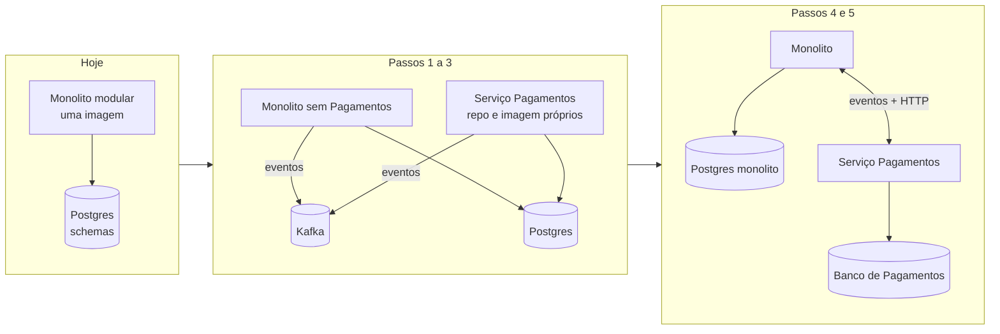

# 8.6 Quando extrair de verdade: critérios e passo a passo

A lição 8.1 mostrou que perfis resolvem escala. Esta lição responde à pergunta seguinte, a que aparece em toda entrevista de staff: **quando, então, um módulo deveria virar um serviço de verdade?** E, se for a hora, como fazer sem parar o sistema.

## Critérios: o que perfis não resolvem

Extrair tem custo fixo alto: rede entre módulos (latência, timeout, retry, circuit breaker), contrato HTTP versionado, pipeline e deploy próprios, banco próprio com migração dos dados, observabilidade distribuída, plantão. Só vale quando um destes problemas existe **de fato**:

| Critério | Sinal concreto | No CreditFlow hoje? |
|---|---|---|
| **Time próprio com ritmo próprio** | O deploy de Pagamentos espera a revisão de Simulação; conflitos de merge entre times toda semana | Não: um time |
| **Ciclo de release incompatível** | Pagamentos precisa de janela de mudança e homologação com o PSP; Simulação faz deploy 5 vezes por dia | Ainda não |
| **Stack diferente** | O motor de crédito vai ser um modelo em Python; o antifraude, Java com uma biblioteca específica | Não |
| **Isolamento de falha que perfis não dão** | Um vazamento de memória numa biblioteca de Simulação derruba o processo, e ele é compartilhado por… nada: perfis já separam processos. Só conta se for **dado** ou **deploy** compartilhado | Não |
| **Escala de dados** | O schema de Pagamentos precisa de outro banco (ledger, outra engine), ou o Postgres compartilhado virou gargalo | Não |
| **Fronteira de segurança/compliance** | PCI-DSS ou auditoria do Bacen exigem que o código e os dados de pagamento estejam isolados, com acesso restrito | **Talvez, no futuro** |

::: porque Por que "escala" não está na lista
Porque perfis já resolvem escala por módulo (lições 8.3 e 8.4). "Precisamos de microsserviços para escalar" é o argumento mais comum e, num monolito modular com perfis, o mais fraco. Os critérios que sobram são quase todos **organizacionais** (times, ritmos, stacks) ou **regulatórios**. A lei de Conway trabalha a favor: a arquitetura acompanha a organização, e extrair antes de o time existir cria um serviço sem dono.
:::

::: entrevista
"Seu monolito está lento. Você quebraria em microsserviços?"
???
Antes de qualquer coisa, eu mediria onde está a lentidão: microsserviços não deixam código mais rápido, e acrescentam rede. Se o problema é uma parte com carga diferente, separo por perfil de execução (a mesma imagem com módulos diferentes, cada uma escalando pelo seu sinal), que dá escala sem o custo de sistema distribuído. Eu extrairia um módulo quando houver um motivo que perfis não resolvem: um time com ritmo próprio, stack diferente, isolamento de dados por compliance. E aí faria a extração aos poucos (strangler), nunca num big bang.
:::

## O monolito modular já pagou metade da conta

A extração de Pagamentos, se um dia vier, é muito mais barata do que num monolito comum, porque as decisões dos módulos anteriores já cortaram os acoplamentos:

| O que já está pronto | Onde | Por que facilita |
|---|---|---|
| Fronteira verificada por teste | `tests/CreditFlow.ArchitectureTests` | Ninguém acessa internals de Pagamentos; o que outros veem está em `Pagamentos.Contracts` |
| Schema próprio | `pagamentos.*` | Nenhum JOIN cruzando schemas: mover para outro banco é `pg_dump --schema=pagamentos` |
| Comunicação assíncrona por eventos | Kafka + outbox | Propostas e Notificações já falam com Pagamentos **só** por eventos; a rede já existe |
| Imagem e perfil próprios | `worker-pagamentos`, `api-pagamentos` | Já roda em pods separados; já tem sondas, escala e ACL no Kafka |
| Rota própria | `/v1/pagamentos` → api-pagamentos | O cliente nem percebe se atrás da rota há outro repositório |

O que falta é o que perfis compartilham: **o código num repositório** e **a imagem**, e o uso de `IConsultaDePagamentos` (chamada in-process) por outros módulos.

## Passo a passo da extração (strangler fig)

1. **Cortar as chamadas síncronas.** Liste quem usa `IConsultaDePagamentos`. Para cada um, decida: vira chamada HTTP para `api-pagamentos` (com timeout e fallback), ou cópia local alimentada por eventos (o ADR 0002 descreve as duas). Faça isso **ainda no monolito**, atrás da mesma interface, com feature flag. Quando ninguém mais chamar in-process, a fronteira está pronta.
2. **Novo repositório, mesma imagem de base.** Copie `Modules/Pagamentos`, `Pagamentos.Contracts` e o pedaço do BuildingBlocks que ele usa (Mensageria, Auth, Observabilidade) para um repositório novo, com um Host mínimo. Publique `Pagamentos.Contracts` como pacote NuGet versionado no Harbor (ou num feed): é o contrato entre os dois repositórios agora.
3. **Trocar os Deployments sem trocar nada mais.** `worker-pagamentos` e `api-pagamentos` passam a usar a imagem nova. Mesmo grupo Kafka (`creditflow-pagamentos`), mesmo schema, mesma rota. Do lado do Kafka e do banco, **nada mudou**: é um deploy, reversível em minutos. Rode os dois testes de carga do módulo e compare com a linha de base.
4. **Tirar Pagamentos do monolito.** Remova o módulo do catálogo do `Program.cs`. O teste de arquitetura garante que nada quebrou silenciosamente.
5. **Mover os dados, por último e só se precisar.** Banco próprio para Pagamentos: réplica lógica do schema `pagamentos` para o banco novo, período em que o serviço lê e escreve no novo com a réplica como rede de segurança, corte. É o passo mais caro e o único irreversível na prática; só faça com o motivo da tabela de critérios (compliance, escala de dados).

::: armadilha Big bang
Reescrever Pagamentos "do jeito certo" num serviço novo, em paralelo, e trocar num fim de semana. O serviço novo nunca alcança o velho (que continua recebendo correções), o corte acumula todo o risco num dia só, e não existe volta fácil. O strangler faz cada passo pequeno, testável e reversível, com o sistema funcionando o tempo todo.
:::

::: armadilha Banco compartilhado entre serviços
Extrair o código e deixar o serviço novo e o monolito lendo as **mesmas tabelas** "temporariamente". Esse temporário vira permanente, e você ganha o pior dos dois mundos: o acoplamento de um monolito (mudar uma coluna exige coordenar dois deploys) com o custo operacional de dois serviços. No CreditFlow o risco é menor porque nenhum módulo lê o schema de outro (regra do ADR 0001); o passo 3 compartilha o **servidor**, não as tabelas.
:::

## Perguntas para responder sem olhar

::: pergunta
Cite três critérios que justificam extrair um módulo e um que não justifica.
???
Justificam: time próprio com ritmo de deploy incompatível; stack diferente; isolamento de dados ou de código exigido por compliance (ou escala de dados que exige outro banco). Não justifica sozinho: "escala", que perfis de execução já resolvem por módulo.
:::

::: pergunta
Qual passo da extração vem primeiro, e por quê?
???
Cortar as chamadas síncronas in-process (trocar por HTTP com fallback ou cópia local por eventos) ainda dentro do monolito. Enquanto houver chamada em memória entre módulos, separar processos quebra o sistema; feito antes, a extração vira só um deploy.
:::

**Próxima:** [Perguntas de entrevista](perguntas-de-entrevista.md).
