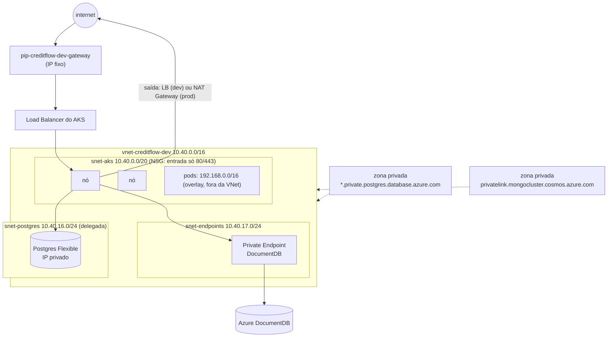

# 9.1 A rede, e por que ela é assim

Antes de qualquer `resource`, a pergunta de arquitetura: **o que precisa ser alcançável da internet?** No CreditFlow, só duas coisas: o Gateway (APIs, Keycloak, Harbor) e, de saída, o que os pods chamam lá fora. Banco, cache, Kafka e o servidor de MongoDB não têm motivo para ter IP público. A rede de [`rede.tf`](https://github.com/JandersonSR/lending-plataform/blob/main/infra/terraform/10-azure/rede.tf) nasce dessa resposta.



## As sub-redes

| Sub-rede | Tamanho | Por quê |
|---|---|---|
| `snet-aks` | /20 (4.096 IPs) | Só os **nós** pegam IP daqui (o CNI Overlay, abaixo). Sobra para centenas de nós e para o "surge" de atualização |
| `snet-postgres` | /24, **delegada** a `Microsoft.DBforPostgreSQL/flexibleServers` | O Flexible Server com acesso privado injeta a placa de rede dele aqui. A delegação reserva a sub-rede para esse serviço: nada mais pode morar nela |
| `snet-endpoints` | /24 | Private Endpoints (DocumentDB hoje; Key Vault e Storage num endurecimento futuro) |

Os blocos saem de `cidrsubnet(var.espaco_vnet, ...)` em [`locals.tf`](https://github.com/JandersonSR/lending-plataform/blob/main/infra/terraform/10-azure/locals.tf). Mudar o espaço da VNet (por exemplo, para não colidir com a rede do escritório numa VPN) é mudar uma variável.

## CNI Overlay: por que os pods não pegam IP da VNet

```hcl
network_profile {
  network_plugin      = "azure"
  network_plugin_mode = "overlay"
  network_data_plane  = "cilium"
  network_policy      = "cilium"
  pod_cidr            = "192.168.0.0/16"
  service_cidr        = "10.41.0.0/16"
  dns_service_ip      = "10.41.0.10"
}
```

::: conceito Três faixas de endereço que não podem colidir
- **VNet** (`10.40.0.0/16`): nós, Postgres, endpoints. Roteável na Azure e por VPN/peering.
- **Pods** (`192.168.0.0/16`, overlay): cada nó recebe um pedaço; o tráfego de pod para fora do cluster sai com o IP do **nó** (SNAT). Não é roteável fora do cluster.
- **Services** (`10.41.0.0/16`): IPs virtuais que só existem nas regras do kube-proxy/Cilium.
:::

No Azure CNI "clássico" (sem overlay), **cada pod** pega um IP da sub-rede. Com 30 pods por nó e 20 nós, são 600 IPs; o surge de atualização dobra isso por alguns minutos. Sub-redes /24 acabam rápido, e aumentar uma sub-rede em uso não é trivial. O overlay elimina o problema. O custo: um pod não é alcançável diretamente de fora do cluster pelo IP dele (quase nunca se quer isso).

O **Cilium** (eBPF) como plano de dados e de NetworkPolicy é o recomendado pela Microsoft para clusters novos: políticas de rede aplicadas no kernel, sem iptables gigantes.

## Entrada: um IP público que não muda

O `azurerm_public_ip.gateway` é criado pelo **Terraform**, não pelo Kubernetes. O Envoy Gateway (módulo 11, chart de plataforma) pede um Service `LoadBalancer` com as anotações:

```yaml
service.beta.kubernetes.io/azure-pip-name: pip-creditflow-dev-gateway
service.beta.kubernetes.io/azure-load-balancer-resource-group: rg-creditflow-dev
```

::: previsao
Qual o problema de deixar o próprio Kubernetes criar o IP público (o comportamento padrão de um Service `LoadBalancer`)?
???
O IP passa a ter o ciclo de vida do **Service**: apagou o Service (reinstalou o Envoy Gateway, recriou o cluster), o IP vai embora e um novo, diferente, é criado. O DNS `api.seudominio` aponta para o IP antigo até alguém perceber. Com o IP no Terraform, ele sobrevive à recriação do cluster inteiro.

Para o AKS conseguir pendurar um IP que ele não criou, a identidade do plano de controle precisa de `Network Contributor` no grupo de recursos onde o IP está: é o `azurerm_role_assignment.aks_rede` em [`aks.tf`](https://github.com/JandersonSR/lending-plataform/blob/main/infra/terraform/10-azure/aks.tf).
:::

## Saída: Load Balancer ou NAT Gateway

| | `outbound_type = loadBalancer` (dev) | `userAssignedNATGateway` (prod) |
|---|---|---|
| IP de saída | O do LB do AKS (pode mudar se o LB for recriado) | O do NAT, fixo e seu |
| Portas SNAT | Divididas entre os nós; muitas conexões de saída esgotam (`SNAT port exhaustion`) | 64 mil por IP, alocadas sob demanda |
| Custo | Incluído | ~US$ 32/mês + dados processados |
| Quando importa | Laboratório | Parceiros que liberam o seu IP no firewall (gateway PIX real, Atlas), volume de conexões de saída |

::: armadilha
`outbound_type` só muda recriando o cluster. Decida antes de ter dados nele. Por isso a variável `saida_por_nat` existe desde o primeiro dia, mesmo desligada em dev.
:::

## DNS privado: o detalhe que faz tudo funcionar

O Postgres com acesso privado tem um nome como `psql-creditflow-dev-a1b2.postgres.database.azure.com`. De dentro da VNet esse nome precisa resolver para o IP **privado** (10.40.16.x). Quem faz isso é a **zona DNS privada** ligada à VNet (`azurerm_private_dns_zone_virtual_network_link`). Sem o link, os pods resolvem pelo DNS público, recebem nada (o servidor não tem registro público) e o erro é um `Name or service not known` que parece problema de rede.

::: dica
`kubectl run dns --rm -it --image=busybox --restart=Never -- nslookup <fqdn-do-postgres>`. Se voltar 10.40.16.x, a zona e o link estão certos. Se não resolver, confira o link da zona com a VNet do AKS.
:::

## Entrada e o NSG

O NSG da `snet-aks` libera 80/443 da internet e nada mais. O tráfego interno da VNet e a sonda do Load Balancer já são permitidos pelas regras padrão (`AllowVnetInBound`, `AllowAzureLoadBalancerInBound`). O kube-apiserver não passa por aqui: é um endpoint gerenciado do AKS, protegido por Entra ID (lição 9.2).

## Por que Gateway API e não ingress-nginx

O ingress-nginx da comunidade Kubernetes foi **aposentado**: a manutenção terminou em março de 2026. O add-on **App Routing** do AKS, que usava NGINX gerenciado, recebe só correções críticas de segurança até novembro de 2026; a Microsoft passou a oferecer Gateway API com uma implementação Istio sem malha ("meshless"), em GA desde abril de 2026. O CreditFlow usa **Gateway API com Envoy Gateway**, instalado por Helm: é a mesma peça no kind e no AKS, e a API (`Gateway`, `HTTPRoute`) é a padrão do Kubernetes, então trocar a implementação depois (por exemplo, pela do App Routing) não muda as rotas.

## Perguntas para responder sem olhar

::: pergunta
Por que usar Azure CNI Overlay em vez do Azure CNI em que cada pod pega IP da VNet?
???
Para os pods não consumirem endereços da sub-rede: com muitos pods por nó e o surge de atualização, sub-redes esgotam. No overlay só os nós usam IP da VNet; os pods saem com o IP do nó.
:::

::: pergunta
Por que o IP público do Gateway é criado pelo Terraform e não pelo Service LoadBalancer?
???
Para sobreviver à recriação do Service ou do cluster e o DNS não quebrar. O Service usa o IP existente pela anotação `azure-pip-name`, e o AKS precisa de Network Contributor no grupo do IP.
:::

::: pergunta
O pod não resolve o FQDN do Postgres privado. O que você confere primeiro?
???
Se a zona DNS privada do Postgres está ligada (virtual network link) à VNet do AKS. Sem o link, o nome resolve pelo DNS público, que não tem o registro.
:::

**Próxima:** [9.2 O AKS, argumento por argumento](02-o-aks.md).
