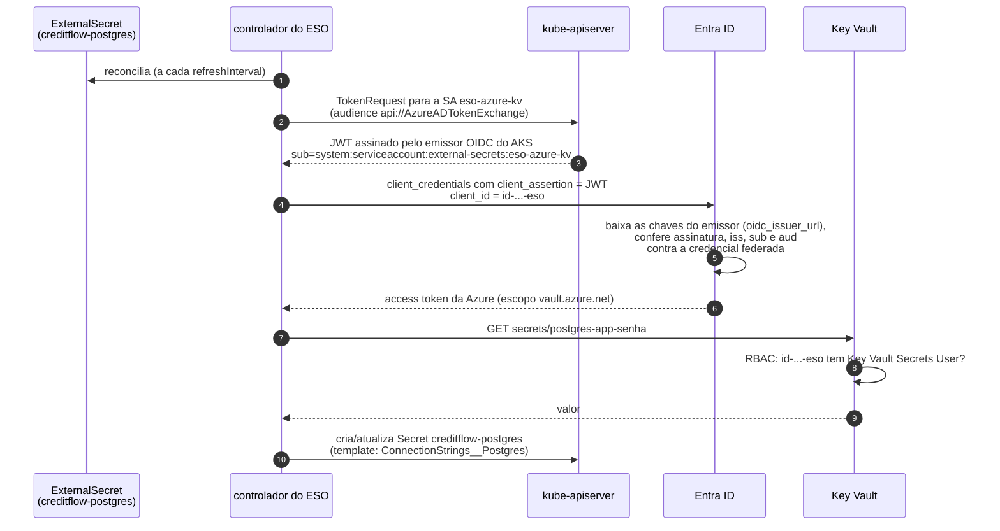

# 9.4 Key Vault e Workload Identity por dentro

A lição [8.3 da Plataforma](../../plataforma-dotnet/docs/modulo-08/03-key-vault-e-identidade.md) explica o problema do "segredo para ler o segredo" e a cadeia de confiança, usando o driver CSI. O CreditFlow usa o mesmo mecanismo de identidade com outra ferramenta (External Secrets) e acrescenta uma segunda metade: as senhas **nascem** no Terraform sem passar pelo estado.

::: video Protecting Secrets in AKS with the Key Vault CSI Driver and Workload Identity (em inglês)
https://www.youtube.com/watch?v=Xr6mHiki9yc
A mesma troca de tokens; o CreditFlow troca o driver CSI pelo External Secrets.
:::

## Os atores

| Ator | Onde está no código | Papel |
|---|---|---|
| Emissor OIDC do AKS | `oidc_issuer_enabled = true` | Assina tokens de ServiceAccount; publica as chaves públicas numa URL |
| Identidade gerenciada `id-creditflow-dev-eso` | [`identidades.tf`](https://github.com/JandersonSR/lending-plataform/blob/main/infra/terraform/10-azure/identidades.tf) | O "quem" na Azure. Tem `Key Vault Secrets User` no cofre e **nenhum** segredo |
| Credencial federada | `azurerm_federated_identity_credential.eso` | A regra de confiança: "tokens do emissor X, para o subject `system:serviceaccount:external-secrets:eso-azure-kv`, valem como esta identidade" |
| ServiceAccount `eso-azure-kv` | [chart de plataforma](https://github.com/JandersonSR/lending-plataform/blob/main/deploy/k8s/plataforma/templates/emissor-e-segredos.yaml) | Anotada com client id e tenant id |
| `ClusterSecretStore azure-kv` | mesmo arquivo | `authType: WorkloadIdentity`, aponta para a ServiceAccount e para o cofre |
| ExternalSecret | chart do CreditFlow | "Quero o segredo `postgres-app-senha` num Secret chamado `creditflow-postgres`" |

## A sequência



::: previsao
Alguém renomeia a ServiceAccount de `eso-azure-kv` para `eso` no chart de plataforma, sem mexer no Terraform. Em qual passo o fluxo quebra, e qual a mensagem que você vai ver no status do `ClusterSecretStore`?
???
No passo 5. O token emitido no passo 3 tem `sub=system:serviceaccount:external-secrets:eso`, e a credencial federada confia em `...:eso-azure-kv`. O Entra ID recusa com um erro `AADSTS70021` ("No matching federated identity record found for presented assertion subject"). Nada muda no cofre nem no RBAC: o "quem" está certo, a **regra de confiança** é que não casa. Subject é comparação exata de texto: namespace e nome da ServiceAccount.
:::

::: porque Por que o ESO, e não o driver CSI
O driver CSI monta o segredo como **arquivo** num volume do pod (e opcionalmente sincroniza para um Secret). O .NET lê configuração de variável de ambiente sem código extra, e o CreditFlow precisa **compor** valores (host + senha numa connection string): o template do ExternalSecret faz isso. O ESO também resolve o caso Kafka (copiar Secrets do Strimzi entre namespaces) com a mesma ferramenta. O custo: o valor fica num Secret do Kubernetes (base64 no etcd, que o AKS criptografa em repouso), e quem pode ler Secrets no namespace pode ler a senha. RBAC do namespace passa a importar.
:::

## A outra metade: senha que não vai para o estado

O estado do Terraform guarda **todos os atributos** de todos os recursos. Um `random_password` comum guarda a senha no estado, e o `azurerm_key_vault_secret` com `value = ...` também. Quem lê o estado lê todas as senhas. O Terraform 1.11 trouxe dois recursos para isso:

```hcl
ephemeral "random_password" "postgres_app" {      # efêmero: existe só durante o plan/apply
  length  = 32
  special = false
}

resource "azurerm_key_vault_secret" "gerados" {
  for_each         = toset(keys(local.nomes_segredos_wo))
  name             = each.key
  value_wo         = local.segredos_wo[each.key]    # write-only: enviado à API, nunca gravado
  value_wo_version = var.versao_senhas              # só reenvia quando este número muda
}
```

| Conceito | O que é |
|---|---|
| Recurso **efêmero** | Produz valores que não vão para o plano nem para o estado. Um `ephemeral "random_password"` gera uma senha nova a **cada execução** |
| Argumento **write-only** (`*_wo`) | O provider envia o valor para a API e descarta. O Terraform não consegue comparar o valor depois (não o tem), então usa o `*_wo_version` para saber quando reenviar |

::: previsao
O `ephemeral "random_password"` gera uma senha **diferente** a cada `plan`. Por que o Postgres e o Key Vault não ficam com senhas trocadas toda vez que alguém roda `terraform apply`?
???
Porque argumento write-only só é reenviado quando o `*_wo_version` muda. Nos applies normais, o provider ignora a senha nova gerada. Quando você incrementa `versao_senhas`, **o mesmo** valor efêmero daquela execução vai para o servidor (`administrator_password_wo`) e para o cofre (`value_wo`), juntos. É a rotação: muda um número, aplica, e no próximo `refreshInterval` o ESO entrega a senha nova aos pods (e o Job de migração atualiza o papel `creditflow_app`, lição 7.4).
:::

::: armadilha `for_each` não aceita valor efêmero
A primeira versão do código fazia `for_each = local.segredos_wo` (o mapa nome → senha). O Terraform recusa: um mapa com valores efêmeros é efêmero, e `for_each` precisa de chaves conhecidas e não efêmeras. A correção é iterar sobre os **nomes** e buscar o valor só dentro do argumento write-only.
:::

A camada 20 usa o mesmo truque ao contrário: lê do cofre com `ephemeral "azurerm_key_vault_secret"` e grava no Secret do Harbor com `data_wo` (provider kubernetes). A senha do admin do Harbor passa do cofre para o cluster sem tocar no estado.

## Uma identidade por perfil?

O `id-creditflow-dev-app` tem **uma** credencial federada para cada ServiceAccount de perfil (`creditflow-api-geral`, `creditflow-api-simulacao`...). Hoje ela não recebe papel nenhum: os segredos vêm pelo ESO. Ela está pronta para o dia em que um perfil acessar a Azure diretamente (Blob para comprovantes, Entra ID no Postgres). Nesse dia, o certo é **uma identidade por perfil** com o papel mínimo, e não um papel na identidade compartilhada: o api-simulacao público não deveria herdar acesso ao Blob dos comprovantes.

## Perguntas para responder sem olhar

::: pergunta
Quais são as três coisas que precisam casar para o Entra ID aceitar o token de uma ServiceAccount?
???
O emissor (URL do OIDC do cluster), o subject (`system:serviceaccount:<namespace>:<nome>`) e a audience (`api://AzureADTokenExchange`), registrados na credencial federada da identidade.
:::

::: pergunta
O que é um argumento write-only no Terraform e por que ele precisa de um campo de versão?
???
Um argumento cujo valor é enviado à API e nunca gravado no plano nem no estado. Como o Terraform não guarda o valor, não consegue detectar mudança; o campo de versão diz quando reenviar.
:::

::: pergunta
Por que o CreditFlow usa External Secrets e não o driver CSI do Key Vault?
???
Para entregar configuração como variável de ambiente, compor valores com template (connection strings) e copiar Secrets do Strimzi entre namespaces com a mesma ferramenta. O custo é o segredo existir como Secret do Kubernetes, protegido pelo RBAC do namespace.
:::

**Próxima:** [9.5 Estado, camadas, ordem de apply e custo](05-estado-camadas-e-custo.md).
