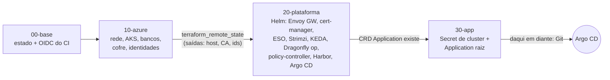

# 9.5 Estado, camadas, ordem de apply e custo

O que é o estado, por que ele fica remoto e por que dividir em camadas está nas lições [9.2](../../plataforma-dotnet/docs/modulo-09/02-estado.md) e [9.3 da Plataforma](../../plataforma-dotnet/docs/modulo-09/03-camadas.md). Aqui: as quatro camadas do CreditFlow, o detalhe técnico que **obriga** a existência da camada 30, a ordem de aplicar e de destruir, e quanto isso custa.

::: video Terraform explained in 15 mins (em inglês)
https://www.youtube.com/watch?v=l5k1ai_GBDE
Revisão de estado e ciclo plan/apply.
:::

## O estado remoto da 00-base

```hcl
resource "azurerm_storage_account" "estado" {
  shared_access_key_enabled       = false   # só Entra ID + RBAC
  default_to_oauth_authentication = true
  blob_properties {
    versioning_enabled = true               # um apply que corrompe o estado tem volta
    delete_retention_policy { days = 30 }
  }
}
resource "azurerm_management_lock" "estado" { lock_level = "CanNotDelete" }
```

| Escolha | Por quê |
|---|---|
| Sem chave de conta | A "connection string do estado" não existe para vazar. Quem lê o estado é quem tem `Storage Blob Data Contributor` |
| Versionamento | O estado é um JSON; um apply interrompido ou um `state rm` errado pode estragá-lo. Com versões, você baixa a anterior |
| Lock de exclusão | Um `terraform destroy` na 00-base, ou um clique no portal, falha |

E o **lock de execução** (dois applies ao mesmo tempo)? O backend `azurerm` usa o **lease** do blob: quem roda pega o lease; o segundo espera `-lock-timeout` e falha. Se um job do CI morrer no meio, o lease fica preso: `terraform force-unlock <id>` com o id da mensagem de erro, **depois** de confirmar que ninguém está aplicando.

A 00-base guarda o próprio estado **localmente** na primeira vez (o Storage ainda não existe). Depois do primeiro apply, migre:

```bash
cd infra/terraform/00-base
cat >> versions.tf <<'EOF'
terraform { backend "azurerm" {} }
EOF
terraform init -migrate-state \
  -backend-config="resource_group_name=rg-creditflow-base" \
  -backend-config="storage_account_name=<saída>" -backend-config="container_name=tfstate" \
  -backend-config="key=00-base.tfstate" -backend-config="use_azuread_auth=true"
```

## Por que a camada 30 existe



::: previsao
Por que não criar a Application raiz (`kubernetes_manifest`) na mesma camada 20 que instala o Argo CD, com `depends_on = [helm_release.argo_cd]`?
???
O `kubernetes_manifest` consulta o servidor **durante o plan** para descobrir o schema do recurso (a CRD `Application`). Num cluster sem Argo CD, a CRD não existe no momento do plan, e o plan falha (`no matches for kind "Application"`), antes de o `depends_on` ter qualquer efeito. Separando em camadas, quando a 30 roda o plan, a 20 já instalou a CRD.
:::

A camada 30 cria **só** a ponte: o Secret de cluster do Argo CD com client ids, FQDN do Postgres, URL do cofre e domínio em **anotações**, e a Application raiz que passa esses valores para o chart `gitops/raiz`. Por que não colocar esses valores no Git? Porque eles mudam quando o ambiente é recriado e não são decisões de versão: são fatos da infraestrutura, e quem conhece os fatos é o Terraform. O módulo 11 mostra o outro lado.

## A ordem

**Criar:** 00 → 10 → 20 → 30, cada uma com `init` do seu backend, `plan -out` e `apply` do plano:

```bash
cd infra/terraform/10-azure
terraform init -backend-config=ambientes/dev.backend.hcl
terraform plan -var-file=ambientes/dev.tfvars -out=plano
terraform apply plano
```

**Destruir:** na ordem **inversa**, 30 → 20 → 10 (a 00 fica). Começar pela 10 apagaria o cluster com o Argo CD e o Harbor dentro; o estado das camadas 20 e 30 ficaria apontando para nada, e o próximo `destroy` delas falharia tentando falar com um cluster que não existe (aí, `terraform state rm` para limpar).

::: armadilha O Key Vault que "já existe"
Em dev, `purge_soft_delete_on_destroy = true` faz o destroy **purgar** o cofre. Sem isso, o cofre apagado fica em soft delete por 7 dias com o mesmo nome reservado, e o próximo apply falha. Em prod, `purge_protection_enabled = true` torna isso impossível de propósito: um cofre de produção apagado precisa poder ser recuperado.
:::

## Plan no PR, apply com aprovação

O [`infra.yml`](https://github.com/JandersonSR/lending-plataform/blob/main/.github/workflows/infra.yml) faz `fmt -check` e `validate` em todo PR, `plan` das três camadas por ambiente, e `apply` só na `main`, em jobs com `environment: dev|prod` (o GitHub pede aprovação de um revisor antes de liberar o token OIDC). A identidade do CI tem `Reader` na assinatura e `Contributor` + `Role Based Access Control Administrator` só no grupo de recursos de cada ambiente: um PR malicioso no plan não consegue criar nada, e um apply aprovado não consegue mexer fora do ambiente. A troca de tokens do GitHub com a Azure é a da lição [8.1 da Plataforma](../../plataforma-dotnet/docs/modulo-08/01-ci-cd-sem-senha.md).

## Quanto custa

Ordem de grandeza com preços de lista em USD (out/2026). **Brazil South costuma ser 30 a 50% mais cara que East US**: faça a sua planilha na calculadora da Azure, com a sua região, antes de aplicar.

| Item | Dev (`dev.tfvars`) | Prod (`prod.tfvars`) |
|---|---|---|
| Plano de controle do AKS | Free: US$ 0 | Standard (SLA): ~US$ 73/mês |
| Pool sistema | 1 × D2ads_v5 | 3 × D2ads_v5 (zonas) |
| Pool apps | 1 a 3 × D4ads_v5 **Spot** (desconto grande, pode ser retomado) | 3 a 9 × D4ads_v5 regulares |
| Postgres Flexible | B1ms, sem HA: dezenas de US$ | D2ds_v5 + HA por zona (o HA **dobra** a computação) + backup geo |
| DocumentDB | M10 sem HA | M30 com HA (o HA dobra os nós) |
| Rede | LB Standard + 1 IP | LB + 2 IPs + NAT Gateway (~US$ 32/mês + dados) |
| Discos dos brokers Kafka | 20 GiB | 3 × 10 GiB (controladores) + 3 × 100 GiB Premium |
| Key Vault, Storage (estado, Harbor) | centavos a poucos US$ | poucos US$ |
| **Total aproximado** | **US$ 250 a 450/mês ligado 24 h** | **US$ 1.500 a 2.500/mês** |

::: dica Cortar o custo de dev pela metade
`az aks stop -g rg-creditflow-dev -n aks-creditflow-dev` desliga os nós (o Postgres Flexible também tem `az postgres flexible-server stop`, por até 7 dias). Estudando 3 horas por dia, dev custa uma fração do valor "24 h". O Terraform não percebe que o cluster está parado; ligue de novo antes do próximo `apply`.
:::

## Perguntas para responder sem olhar

::: pergunta
Como o backend `azurerm` impede dois applies simultâneos, e o que fazer se o lock ficar preso?
???
Pelo lease do blob do estado: o segundo processo espera até o `-lock-timeout` e falha. Lock preso (job morto): confirmar que ninguém está aplicando e rodar `terraform force-unlock <id>`.
:::

::: pergunta
Por que a Application raiz do Argo CD está numa camada separada da instalação do Argo CD?
???
Porque o `kubernetes_manifest` precisa da CRD já instalada durante o plan; numa camada única, o plan falharia antes do `depends_on` agir.
:::

::: pergunta
Em que ordem você destrói as camadas e por quê?
???
30, 20, 10 (inversa). Destruir a de baixo primeiro deixa as de cima com estado apontando para recursos que não existem, e o destroy delas falha.
:::

**Próximo:** [desafio do módulo](desafio.md).
