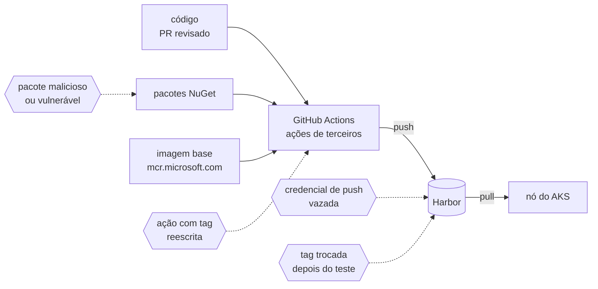
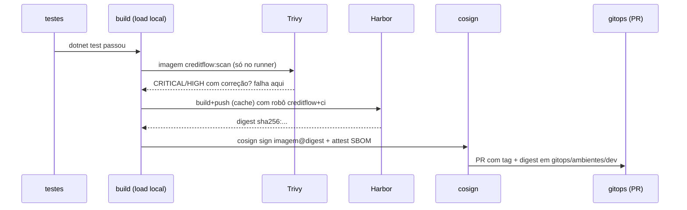

# 10.1 Onde a cadeia é atacada, e o CI que se defende

Uma imagem que chega ao AKS passou por muitas mãos: o código do repositório, os pacotes do NuGet, a imagem base da Microsoft, as ações do GitHub que rodaram no build, o registry, a rede entre o registry e o nó. A **cadeia de suprimentos** é esse caminho, e cada elo é um lugar onde alguém pode colocar o que você não escreveu.



## Um caso de 2026: tags reescritas

Em **20 de março de 2026**, atacantes conseguiram escrever no repositório `aquasecurity/trivy-action`, uma das ações mais usadas para escanear imagens, e **reescreveram 75 das 76 tags** de versão para apontar para um commit malicioso. Todo workflow que usava `uses: aquasecurity/trivy-action@0.28.0` (ou qualquer outra tag) passou a rodar um código que lia a memória e os arquivos do runner, juntava segredos e mandava para um domínio que imitava o da Aqua. A ferramenta de **segurança** era o vetor.

::: conceito Tag x SHA numa ação do GitHub
`uses: dono/acao@v4` resolve a tag `v4` **no momento do job**. Quem pode escrever no repositório da ação pode mover a tag para outro commit, e o seu workflow roda o código novo sem nenhum PR seu. `uses: dono/acao@<sha de 40 caracteres>` aponta para um commit exato; mover tags não muda nada. É o mesmo raciocínio de tag x digest de imagem.
:::

O [`ci.yml`](https://github.com/JandersonSR/lending-plataform/blob/main/.github/workflows/ci.yml) do CreditFlow fixa toda ação por SHA, com a versão num comentário para humanos:

```yaml
- uses: actions/checkout@3d3c42e5aac5ba805825da76410c181273ba90b1 # v7
- uses: docker/build-push-action@c3c9e263c25d99ce0380d002d59b67737d91b0dc # v7
```

E o Trivy nem é usado como ação: o workflow baixa o binário de uma versão fixa e **confere o checksum** publicado antes de instalar.

::: dica Atualizar SHAs sem sofrer
O Dependabot (`.github/dependabot.yml` com `package-ecosystem: github-actions`) entende `@sha # vX` e abre PR trocando os dois. Você revisa o diff da ação como revisaria uma dependência. Para descobrir o SHA de uma tag à mão: `git ls-remote https://github.com/dono/acao refs/tags/v4`.
:::

## Permissões: cada job pede o que usa

```yaml
permissions: {}          # no topo: o GITHUB_TOKEN não pode nada

jobs:
  testes:
    permissions: { contents: read }
  imagem:
    permissions: { contents: read, id-token: write }   # id-token: assinatura keyless (10.4)
  promover-dev:
    permissions: { contents: write, pull-requests: write }
```

Se o código malicioso rodar no job `testes`, ele tem um token que só lê o repositório. O token capaz de abrir PR existe só no último job, que não executa código do projeto (só `yq` e a ação de PR).

## A ordem dos passos, e por que o scan vem antes do push



| Decisão | Por quê |
|---|---|
| Build com `load: true`, scan, **depois** push | Imagem reprovada nunca chega ao registry. Se chegasse, alguém poderia puxá-la por engano antes de o pipeline falhar |
| `--severity CRITICAL,HIGH --ignore-unfixed` | Reprova o que tem **correção disponível**. Uma CVE sem correção publicada não tem ação possível além de registrar; reprovar por ela trava o time sem melhorar nada |
| `--ignorefile deploy/docker/.trivyignore` | Exceção é decisão, com motivo, dono e **data de revisão**. Exceção sem data vira permanente sem ninguém ver |
| SBOM CycloneDX (`trivy image --format cyclonedx`) | A lista de ingredientes da imagem. Quando sair a próxima CVE famosa, você responde "estamos afetados?" consultando os SBOMs, sem reconstruir nada |
| `provenance: mode=max`, `sbom: true` no buildx | O BuildKit anexa à imagem a atestação de **proveniência** (SLSA: qual repositório, commit e workflow geraram a imagem) e o próprio SBOM |
| Em PR: build e scan, sem push | O PR de um colaborador externo não ganha credencial do Harbor |

::: previsao
Um desenvolvedor atualiza o `Npgsql` para uma versão com uma CVE `HIGH` recém-publicada e **sem correção**. O que o CI faz? E se a CVE tivesse correção na versão seguinte?
???
Sem correção: o `--ignore-unfixed` não reprova. O CI passa, e a CVE aparece no relatório e no SBOM; quando a correção sair, o próximo build reprova até alguém atualizar. Com correção disponível: o CI **reprova** com a tabela mostrando a versão instalada e a corrigida. O caminho certo é subir a versão; se não for possível agora, uma linha no `.trivyignore` com motivo e data.
:::

::: armadilha O scan de hoje não vale amanhã
A imagem aprovada hoje pode ter uma CVE publicada amanhã. O scan do CI é uma foto. Quem cobre o depois é o Harbor, que **escaneia de novo** as imagens guardadas (agendado) e pode passar a recusar o pull (lição 10.2). A lição [10.1 da Plataforma](../../plataforma-dotnet/docs/modulo-10/01-cadeia-e-trivy.md) mostra isso com duas imagens.
:::

::: video Security Scans for Docker Images using Trivy! (em inglês)
https://www.youtube.com/watch?v=nXTNEpLT3N4
O Trivy na linha de comando: severidades, `--ignore-unfixed` e formatos de saída.
:::

## Perguntas para responder sem olhar

::: pergunta
Por que fixar ações do GitHub por SHA e não por tag?
???
Tags de repositório são móveis: quem consegue escrever no repositório da ação pode apontá-las para outro commit, e o seu workflow roda o código novo. Foi o que aconteceu com o trivy-action em março de 2026. O SHA aponta para um commit imutável.
:::

::: pergunta
Por que o scan roda antes do push e não depois?
???
Para que uma imagem reprovada nunca exista no registry, onde poderia ser puxada por engano ou por um deploy manual.
:::

::: pergunta
O que `--ignore-unfixed` faz, e por que usar?
???
Ignora vulnerabilidades sem versão corrigida publicada. Reprovar por elas trava o time sem ação possível; elas continuam no relatório e no SBOM.
:::

**Próxima:** [10.2 Harbor: projetos, robôs e política de bloqueio](02-harbor-projetos-e-robos.md).
