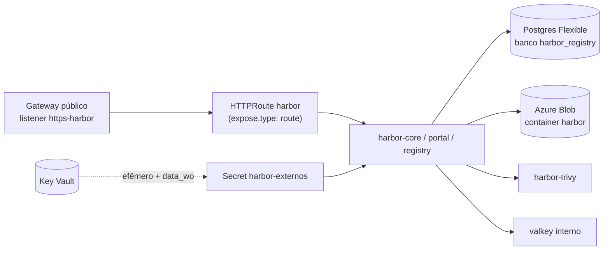

# 10.2 Harbor: projetos, robôs e política de bloqueio

Por que Harbor e não Azure Container Registry está na [ADR 0008](https://github.com/JandersonSR/lending-plataform/blob/main/docs/adr/0008-harbor.md). Nesta lição: como ele está instalado, e como o projeto `creditflow` é organizado para que cada credencial possa o mínimo.

::: video Harbor Private Container Registry Introduction (MultiMagix, em inglês)
https://www.youtube.com/watch?v=vxTs0RvoyW4
A interface do Harbor: projetos, membros, robôs e o scan.
:::

## Como o Harbor está instalado



No [`harbor.tf`](https://github.com/JandersonSR/lending-plataform/blob/main/infra/terraform/20-plataforma/harbor.tf):

| Valor do chart | Por quê |
|---|---|
| `expose.type: route` + `parentRefs` do Gateway `publico`, seção `https-harbor` | O chart 1.19 gera uma `HTTPRoute` da Gateway API. O TLS termina no Gateway (certificado do cert-manager), então `expose.tls.enabled: false` |
| `externalURL: https://harbor.<dominio>` | É o endereço que o Harbor escreve nos tokens e redirecionamentos. Errado aqui = `docker login` funciona e o `push` falha com `unauthorized` |
| `database.type: external` → Postgres Flexible | O estado do Harbor (projetos, robôs, políticas) num banco com backup gerenciado |
| `imageChartStorage.type: azure` | As camadas das imagens num Blob: durável, barato, e o Harbor no cluster fica sem estado próprio |
| `existingSecret*` | Senha do admin, do banco e chave do Storage vêm do Key Vault (efêmero + `data_wo`, lição 9.4): nenhuma passa pelos values do Helm nem pelo estado |

::: armadilha Upload grande atrás de proxy
Uma camada de imagem tem centenas de MB. Proxies reversos com limite de corpo de requisição (o `proxy-body-size` do NGINX, por exemplo) cortam o push no meio com `413` ou `unexpected EOF`. Com Envoy Gateway não há limite padrão de corpo para rotas comuns, mas se você trocar a implementação do Gateway, esse é o primeiro lugar a olhar.
:::

## O projeto `creditflow`

Configure pela interface (ou pela API do Harbor) uma vez:

| Configuração | Valor | Efeito |
|---|---|---|
| Nível de acesso | **Privado** | Pull exige credencial |
| Impedir imagens vulneráveis | Ligado, severidade **High** | O Harbor recusa o **pull** de artefatos com vulnerabilidade High ou Critical no último scan, mesmo que tenham passado no CI semanas atrás |
| Escanear automaticamente no push | Ligado | Cada imagem nova é escaneada pelo Trivy do Harbor |
| Escaneamento agendado (Interrogation Services) | Diário | Reavalia as imagens guardadas contra o banco de CVEs atualizado |
| Impedir imagens não assinadas (cosign) | Ligado | O Harbor recusa o pull de artefato sem assinatura cosign anexada (a verificação de **quem** assinou é do cluster, lição 10.4) |
| Retenção de tags | Manter as 20 mais recentes **e** tudo que bate com `^0\.1\.` dos últimos 30 dias; nunca apagar `sha-*` referenciada | Um registry que só cresce custa e fica lento |
| Imutabilidade de tags | Regra `**` | Uma tag publicada não pode ser sobrescrita por outro push. A mesma tag sempre aponta para o mesmo conteúdo |

::: previsao
O projeto está com "impedir imagens vulneráveis: High". Hoje de manhã saiu uma CVE crítica na glibc, e o scan agendado marcou a imagem que está rodando em produção. O que acontece com os pods que já estão rodando? E com o próximo pod que o HPA criar num nó novo?
???
Os que estão rodando **continuam**: a imagem já está no nó, nada é verificado de novo. O próximo pod num **nó novo** precisa puxar a imagem, e o Harbor recusa: `ImagePullBackOff`. No pior momento possível (um pico que pediu mais pods). É o motivo do runbook [`deploy-e-rollback.md`](https://github.com/JandersonSR/lending-plataform/blob/main/docs/runbooks/deploy-e-rollback.md) listar "imagem barrada pelo Harbor" como causa de `ImagePullBackOff`, e o motivo de reconstruir a imagem com a base corrigida **no mesmo dia** em que o scan agendado acusar. Política de bloqueio exige processo de correção rápido; sem ele, ela vira indisponibilidade.
:::

## Dois robôs, cada um com o mínimo

| Robô | Permissões | Onde vive a credencial |
|---|---|---|
| `robot$creditflow+ci` | push e pull de repositório, criar/ler artefato e assinatura, no projeto `creditflow` | `secrets.HARBOR_ROBO_TOKEN` no GitHub (nome em `vars.HARBOR_ROBO_PUSH`) |
| `robot$creditflow+pull` | **só pull** no projeto `creditflow` | Key Vault (`harbor-robo-pull-usuario`, `harbor-robo-pull-token`) → ExternalSecret `harbor-pull` no namespace `creditflow` |

```bash
# Criar o robô de pull pela API (usuário admin só para isto; o resto do dia, ninguém usa o admin)
curl -s -u admin:"$SENHA_ADMIN" -X POST "https://harbor.$DOMINIO/api/v2.0/robots" \
  -H 'Content-Type: application/json' -d '{
    "name": "pull", "level": "project", "duration": 90,
    "permissions": [{ "kind": "project", "namespace": "creditflow",
                      "access": [{ "resource": "repository", "action": "pull" }] }]
  }' | jq '{name, secret}'
az keyvault secret set --vault-name "$KV" -n harbor-robo-pull-usuario --value 'robot$creditflow+pull'
az keyvault secret set --vault-name "$KV" -n harbor-robo-pull-token   --value '<secret>'
```

::: porque Validade de 90 dias
Um robô com `duration: -1` é uma senha eterna. Com 90 dias, a rotação vira rotina: gera novo segredo pela API (`PATCH /robots/{id}` com `"secret"` ou o botão "Refresh secret"), grava no cofre, e o ESO entrega o Secret novo ao namespace na próxima sincronização, sem deploy. O do CI você troca no GitHub.
:::

O Secret `harbor-pull` é do tipo `kubernetes.io/dockerconfigjson`, montado pelo template do ExternalSecret em [`harbor-pull.yaml`](https://github.com/JandersonSR/lending-plataform/blob/main/deploy/k8s/plataforma/templates/harbor-pull.yaml), e os pods referenciam por `imagem.pullSecrets` no values do ambiente.

## Lab: o robô não pode o que não deve

```bash
echo "$TOKEN_PULL" | docker login "harbor.$DOMINIO" -u 'robot$creditflow+pull' --password-stdin
docker pull "harbor.$DOMINIO/creditflow/creditflow:<tag>"           # funciona
docker tag  "harbor.$DOMINIO/creditflow/creditflow:<tag>" "harbor.$DOMINIO/creditflow/creditflow:teste"
docker push "harbor.$DOMINIO/creditflow/creditflow:teste"           # ?
```

::: solucao
O push falha com `unauthorized: unauthorized to access repository` (ou `denied`): o robô só tem `pull`. Se o token de pull vazar de um nó ou de um namespace, o atacante consegue baixar a imagem (que não deve ter segredo nenhum dentro), mas não consegue substituí-la.
:::

## Perguntas para responder sem olhar

::: pergunta
O que acontece com pods já rodando quando o Harbor passa a bloquear a imagem deles por vulnerabilidade?
???
Nada: a imagem já está no nó. O bloqueio afeta pulls novos, como pods agendados em nós novos, que falham com ImagePullBackOff. Por isso a política exige um processo de reconstrução rápida.
:::

::: pergunta
Por que dois robôs em vez de um?
???
Menor privilégio por lugar: o do CI precisa publicar; o do cluster só baixar. Vazar a credencial do cluster não permite substituir imagens.
:::

::: pergunta
Para que serve a imutabilidade de tags num registry?
???
Garante que uma tag publicada sempre aponta para o mesmo conteúdo: ninguém sobrescreve `0.1.42` com outra imagem. Complementa (não substitui) o uso de digest no deploy.
:::

**Próxima:** [10.3 Cache de proxy](03-cache-de-proxy.md).
