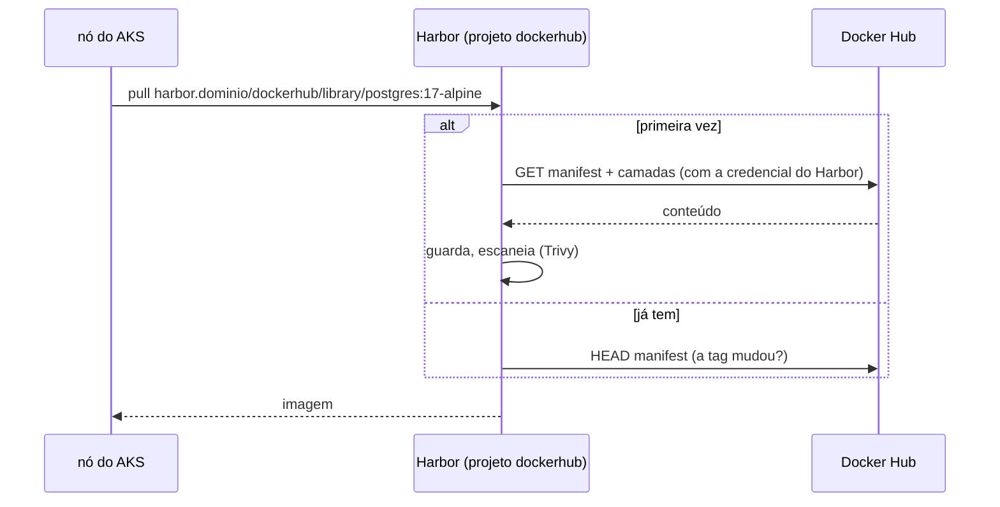

# 10.3 Cache de proxy: o Docker Hub sem o limite do Docker Hub

O CreditFlow não puxa só a própria imagem. O Job de migrações usa `postgres:17-alpine`, o Dragonfly e o Keycloak vêm de registries públicos, o laboratório usa `mongo:8.0` e `busybox`. Três problemas aparecem num cluster de verdade:

1. **Limite de pull** do Docker Hub para usuários anônimos (contado por IP de saída). Todos os nós do AKS saem pelo mesmo IP (o do NAT ou do Load Balancer): um rolling update grande ou o autoescalador criando nós esgota o limite, e os pods novos ficam em `ImagePullBackOff` com `toomanyrequests`.
2. **Disponibilidade**: se o Docker Hub cair, nada novo sobe.
3. **Controle**: você não sabe, nem escaneia, o que o cluster puxa de fora.

## O projeto proxy-cache

O Harbor resolve com um **projeto de cache de proxy**: um projeto que, quando recebe um pull de uma imagem que não tem, busca no registry de origem, guarda, e entrega. Nos pulls seguintes, entrega o que guardou (revalidando o manifesto com a origem quando ela está disponível).



Passos (uma vez, como admin):

1. **Registries → Novo endpoint**: provedor `Docker Hub`, com um usuário e um *access token* de uma conta do Docker Hub (conta autenticada tem limite muito maior que anônimo).
2. **Projetos → Novo projeto** `dockerhub`, marcando **Cache de proxy** e escolhendo o endpoint.
3. Faça o mesmo para `ghcr.io` (Dragonfly), `quay.io` (Strimzi, Keycloak) se quiser cobrir tudo: um projeto de cache por registry de origem.

A referência de imagem muda de `docker.io/library/postgres:17-alpine` para:

```yaml
migracoes:
  imagemPsql: harbor.seudominio.com.br/dockerhub/library/postgres:17-alpine
```

::: armadilha O `library/` das imagens oficiais
`docker pull postgres` é, por extenso, `docker.io/library/postgres`. No cache de proxy, o caminho precisa do `library/`: `harbor.../dockerhub/library/postgres`. Sem ele, o Harbor procura um usuário chamado `postgres` no Docker Hub e responde `not found`.
:::

::: previsao
Você troca `imagemPsql` para o cache de proxy. O Job de migrações agora puxa do Harbor. Ele continua funcionando se o **Harbor** estiver fora do ar? E se o **Docker Hub** estiver fora, mas o Harbor de pé?
???
**Harbor fora:** não. Você trocou uma dependência externa por uma interna; o Harbor virou crítico para subir pods novos (já era, para a imagem do CreditFlow). Os pods em execução não são afetados.
**Docker Hub fora, Harbor de pé:** sim, se a imagem já foi puxada antes: o Harbor entrega a cópia guardada mesmo sem conseguir revalidar com a origem. Numa imagem nunca puxada, falha.
O ganho real está no segundo caso e no limite de pulls; o custo é cuidar da disponibilidade do Harbor (réplicas do core e do registry, banco gerenciado).
:::

## Ir além: o nó já busca no Harbor

Reescrever cada referência de imagem nos charts de terceiros é trabalhoso (e alguns charts não deixam trocar o registry). Duas alternativas, em ordem de esforço:

| Abordagem | Como | Custo |
|---|---|---|
| Valores dos charts | Quase todo chart tem `image.registry` ou `global.imageRegistry`. Aponte para `harbor.../dockerhub` | Um valor por chart; fácil de esquecer num chart novo |
| Política de admissão que reescreve | Um webhook (Kyverno com regra `mutate`) troca `docker.io/` por `harbor.../dockerhub/` em todo pod | Mais uma peça no caminho de todo pod |
| Espelho no runtime do nó | Configurar o containerd dos nós com um *mirror* para `docker.io` | No AKS gerenciado, mexer na configuração do containerd não é suportado de forma direta; evite |

Para o CreditFlow, o primeiro: os valores que importam (Job de migrações, Postgres local) estão no código, e os operadores vêm de registries sem limite agressivo (quay.io, ghcr.io, mcr.microsoft.com).

::: dica
`mcr.microsoft.com` (as imagens do .NET, inclusive a base `aspnet:10.0-noble-chiseled-extra`) não tem limite de pull como o Docker Hub. Cachear ainda ajuda na disponibilidade e no scan, mas não é urgente.
:::

## Perguntas para responder sem olhar

::: pergunta
Qual problema concreto o cache de proxy resolve num AKS?
???
O limite de pulls anônimos do Docker Hub, contado por IP de saída: todos os nós saem pelo mesmo IP e esgotam o limite em rolling updates ou escalas, gerando ImagePullBackOff. Também dá disponibilidade quando a origem cai e permite escanear o que vem de fora.
:::

::: pergunta
Por que o caminho de uma imagem oficial no cache precisa de `library/`?
???
Porque imagens oficiais do Docker Hub ficam no namespace `library`; o nome curto (`postgres`) é um apelido do cliente Docker que o proxy não aplica.
:::

**Próxima:** [10.4 Assinatura keyless e verificação no cluster](04-assinatura-e-verificacao.md).
