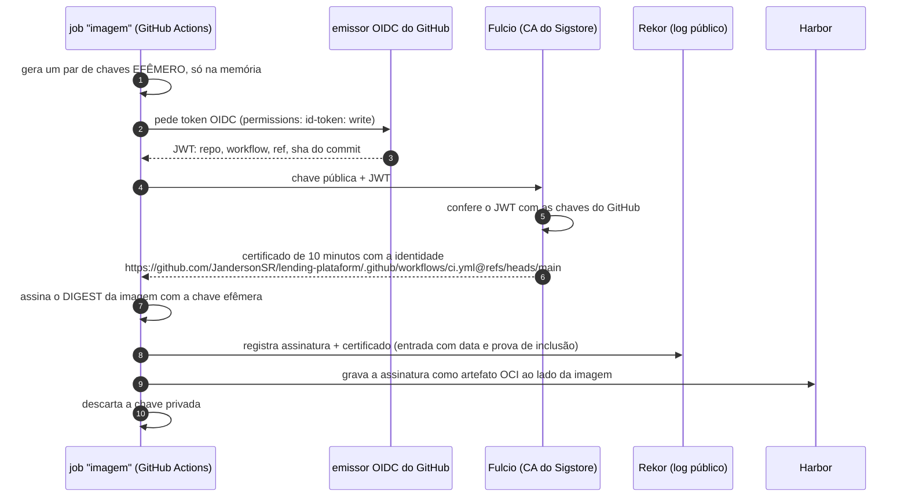
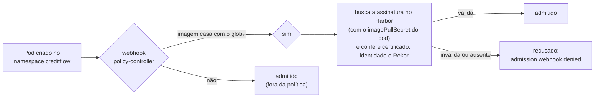

# 10.4 Assinatura keyless e verificação no cluster

Scan responde "a imagem tem vulnerabilidade conhecida?". Não responde "esta imagem foi construída pelo nosso CI, a partir da nossa `main`?". Um token de push vazado permite publicar uma imagem limpa no scan e maliciosa no comportamento. A resposta para a segunda pergunta é **assinatura**, e o cluster só aceitar imagens assinadas por quem deveria.

A base (tag x digest, SBOM, o que é uma assinatura cosign) está na lição [10.3 da Plataforma](../../../plataforma-dotnet/docs/modulo-10/03-alem-do-scan.md).

::: video Signing and Verifying Container Images With Sigstore Cosign and Kyverno (em inglês)
https://www.youtube.com/watch?v=HLb1Q086u6M
Assinatura com cosign e verificação na admissão. O CreditFlow usa o policy-controller do Sigstore no lugar do Kyverno; o conceito é o mesmo.
:::

## Keyless: assinar sem guardar chave

Assinatura tradicional exige uma chave privada, que precisa ser guardada, rotacionada e protegida (e que, vazada, assina qualquer coisa para sempre). O **keyless** do Sigstore troca a chave de longa duração por uma **identidade**:



O que fica, para sempre: a assinatura, o certificado com a **identidade do workflow**, e uma entrada no Rekor provando que a assinatura existiu enquanto o certificado era válido. O que não existe: chave para vazar.

No [`ci.yml`](https://github.com/JandersonSR/lending-plataform/blob/main/.github/workflows/ci.yml):

```yaml
permissions: { contents: read, id-token: write }
...
- run: |
    cosign sign --yes "${IMAGEM}@${{ steps.build.outputs.digest }}"
    cosign attest --yes --type cyclonedx --predicate sbom.cdx.json "${IMAGEM}@${{ steps.build.outputs.digest }}"
```

::: armadilha Sempre por digest
`cosign sign imagem:0.1.42` assina o digest para o qual a tag aponta **naquele instante**, e o cosign avisa. Se alguém mover a tag entre o push e a assinatura, você assina a imagem errada. O workflow usa o digest devolvido pelo próprio push (`steps.build.outputs.digest`).
:::

Verificar à mão:

```bash
cosign verify "harbor.$DOMINIO/creditflow/creditflow@sha256:..." \
  --certificate-oidc-issuer https://token.actions.githubusercontent.com \
  --certificate-identity-regexp '^https://github\.com/JandersonSR/lending-plataform/\.github/workflows/ci\.yml@refs/heads/main$' | jq '.[0].optional'
cosign verify-attestation --type cyclonedx ...mesmos argumentos... | jq -r .payload | base64 -d | jq '.predicate.components | length'
```

::: previsao
Um colega cria um workflow `teste.yml` no mesmo repositório, numa branch `experimento`, que faz build e `cosign sign` da imagem. A assinatura é válida? O `cosign verify` acima aceita?
???
A assinatura é **válida** (o Fulcio emitiu certificado para a identidade real daquele workflow). O `verify` **recusa**, porque a identidade no certificado é `.../.github/workflows/teste.yml@refs/heads/experimento`, e a regra exige `ci.yml@refs/heads/main`. Por isso a política diz **quem** pode assinar, não só "tem assinatura". "Assinado por alguém" vale quase nada; "assinado pelo CI da main deste repositório" é o que dá garantia.
:::

## Verificação na admissão: policy-controller

O Terraform 20-plataforma instala o **policy-controller** do Sigstore (chart 0.10.x), um webhook de admissão. A política vem do chart de plataforma ([`emissor-e-segredos.yaml`](https://github.com/JandersonSR/lending-plataform/blob/main/deploy/k8s/plataforma/templates/emissor-e-segredos.yaml)):

```yaml
apiVersion: policy.sigstore.dev/v1beta1
kind: ClusterImagePolicy
metadata:
  name: creditflow-assinada
spec:
  images:
    - glob: "harbor.seudominio.com.br/creditflow/**"
  authorities:
    - keyless:
        url: https://fulcio.sigstore.dev
        identities:
          - issuer: https://token.actions.githubusercontent.com
            subjectRegExp: '^https://github\.com/JandersonSR/lending-plataform/\.github/workflows/ci\.yml@refs/heads/main$'
      ctlog:
        url: https://rekor.sigstore.dev
```

E vale só nos namespaces que pedem: o namespace `creditflow` tem o rótulo `policy.sigstore.dev/include: "true"` ([`namespaces.yaml`](https://github.com/JandersonSR/lending-plataform/blob/main/deploy/k8s/plataforma/templates/namespaces.yaml)).



::: porque Por que o webhook também troca tag por digest
O policy-controller resolve a tag para o digest no momento da verificação. Se a política aceitou `creditflow:0.1.42` resolvida para `sha256:aaa`, mas o kubelet puxar a tag minutos depois e ela apontar para `sha256:bbb`, a verificação não valeria nada. Por isso o values do ambiente carrega o **digest** (o CI grava) e o chart usa `repositorio@digest` quando ele existe (lição 7.2). Tag no values é para humanos lerem; quem manda é o digest.
:::

## Lab: três tentativas

```bash
# 1) imagem do CI da main: aceita
kubectl -n creditflow run ok --image="harbor.$DOMINIO/creditflow/creditflow@$DIGEST_DA_MAIN" --restart=Never \
  --overrides='{"spec":{"imagePullSecrets":[{"name":"harbor-pull"}]}}' --dry-run=server -o name

# 2) uma imagem que você construiu e empurrou à mão (sem assinatura) para o mesmo projeto
kubectl -n creditflow run nao-assinada --image="harbor.$DOMINIO/creditflow/creditflow:manual" --restart=Never \
  --overrides='{"spec":{"imagePullSecrets":[{"name":"harbor-pull"}]}}' --dry-run=server

# 3) a mesma imagem de (2), assinada por você com cosign no seu laptop (identidade = seu e-mail)
cosign sign "harbor.$DOMINIO/creditflow/creditflow:manual"
kubectl -n creditflow run assinada-errado ... --dry-run=server
```

`--dry-run=server` passa pelos webhooks de admissão sem criar nada.

::: solucao
1. Aceita (`pod/ok created (server dry run)`).
2. Recusada: `admission webhook "policy.sigstore.dev" denied the request: validation failed: ... no signatures found`. (Se o projeto tiver "impedir não assinadas", o próprio Harbor já recusaria o pull.)
3. Recusada: a assinatura existe e é válida, mas o certificado tem a **sua** identidade (o e-mail do login no navegador) e o emissor do seu provedor, que não casam com `issuer`/`subjectRegExp`. É o caso do colega da previsão acima.
:::

::: armadilha O webhook também é dependência
Se o policy-controller estiver fora do ar, o que acontece com a criação de pods nos namespaces incluídos depende da `failurePolicy` do webhook. Com `Fail` (o seguro), nada novo sobe nesses namespaces. Ele roda com réplicas, PDB e fora dos namespaces que ele próprio protege (`cosign-system` não tem o rótulo). Também precisa alcançar o Fulcio/Rekor públicos ou ter o material de confiança (TUF) em cache: num cluster sem saída para a internet, configure o `TrustRoot` local.
:::

## Perguntas para responder sem olhar

::: pergunta
O que é assinatura keyless, e o que garante que ninguém mais assine "como o CI"?
???
O job gera uma chave efêmera, prova sua identidade ao Fulcio com o token OIDC do GitHub, recebe um certificado de minutos com essa identidade, assina e registra no Rekor; a chave é descartada. Ninguém mais consegue um certificado com a identidade `ci.yml@refs/heads/main` deste repositório sem rodar esse workflow nessa branch, e a política exige exatamente essa identidade.
:::

::: pergunta
Por que assinar e implantar por digest e não por tag?
???
Tag é um ponteiro móvel; a assinatura e a verificação se referem a um conteúdo. Implantar por tag permite que o que roda seja diferente do que foi verificado.
:::

::: pergunta
Quais as dependências do policy-controller, e o que acontece se ele cair?
???
Ele precisa do registry (para buscar a assinatura, com o pull secret do pod) e do material de confiança do Sigstore (Fulcio/Rekor ou TUF em cache). Se cair com `failurePolicy: Fail`, pods novos nos namespaces incluídos não sobem; por isso réplicas, PDB e ele mesmo fora desses namespaces.
:::

**Próximo:** [desafio do módulo](desafio.md).
