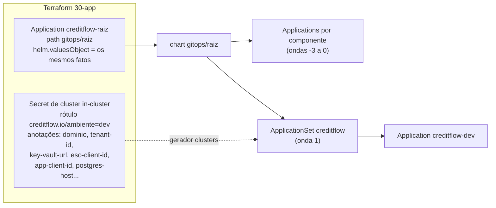

# 11.1 A ponte e a raiz

No fim do módulo 9, o cluster tem operadores, Harbor e um Argo CD vazio. Falta tudo que é do CreditFlow: namespaces com Pod Security, Gateway, emissor de certificados, lojas de segredo, Kafka, Dragonfly, Keycloak, observabilidade, a aplicação. A pergunta desta lição: **como o Argo CD fica sabendo do que precisa saber, sem o Git ter um único dado de infraestrutura?**

::: video ArgoCD Tutorial for Beginners (TechWorld with Nana, em inglês)
https://www.youtube.com/watch?v=MeU5_k9ssrs
Revisão de Application, sincronização e a interface.
:::

## O problema dos dois mundos

| Quem sabe | O quê | Muda quando |
|---|---|---|
| **Git** (`gitops/`, `deploy/`) | Que versão da imagem roda, quantas réplicas, quais tópicos, quais regras de alerta | Alguém decide (PR) |
| **Terraform** (estado da 10-azure) | Client id da identidade do ESO, URL do cofre, FQDN do Postgres, nome do IP público, domínio | O ambiente é recriado |

Colocar os fatos do Terraform no Git ("commit com o client id novo") mistura decisão com fato e quebra no dia em que alguém recria o dev e esquece o commit. Fazer o Argo CD ler o estado do Terraform acopla as duas ferramentas. O CreditFlow usa uma **ponte estreita**: a camada [30-app](https://github.com/JandersonSR/lending-plataform/blob/main/infra/terraform/30-app/main.tf) cria **duas** coisas e para.



## 1. O Secret de cluster

O Argo CD registra clusters como Secrets com o rótulo `argocd.argoproj.io/secret-type: cluster`. O cluster onde ele mesmo roda (`https://kubernetes.default.svc`) é conhecido sem Secret nenhum, mas, criando um Secret explícito para ele, ganhamos onde pendurar **rótulos e anotações**:

```hcl
resource "kubernetes_secret_v1" "cluster" {
  metadata {
    name      = "in-cluster"
    namespace = "argocd"
    labels = {
      "argocd.argoproj.io/secret-type" = "cluster"
      "creditflow.io/ambiente"         = var.ambiente
    }
    annotations = {
      "creditflow.io/dominio"       = local.dominio
      "creditflow.io/app-client-id" = local.azure.app_client_id
      "creditflow.io/harbor-host"   = "harbor.${local.dominio}"
      # ...
    }
  }
  data = { name = "in-cluster", server = "https://kubernetes.default.svc", config = jsonencode({ tlsClientConfig = { insecure = false } }) }
}
```

É o padrão conhecido como **"GitOps bridge"**: a infraestrutura publica fatos como metadados do cluster, e o GitOps os consome por geradores. A lição 11.3 mostra o consumo.

## 2. A Application raiz

```hcl
resource "kubernetes_manifest" "raiz" {
  manifest = {
    apiVersion = "argoproj.io/v1alpha1"
    kind       = "Application"
    metadata   = { name = "creditflow-raiz", namespace = "argocd", finalizers = ["resources-finalizer.argocd.argoproj.io"] }
    spec = {
      source = {
        path = "gitops/raiz"
        helm = { valuesObject = { ambiente = var.ambiente, dominio = local.dominio, azure = { ... } } }
      }
      syncPolicy = { automated = { prune = true, selfHeal = true } }
    }
  }
}
```

::: conceito App-of-apps
Uma Application cujo conteúdo são **outras Applications**. O Argo CD sincroniza a raiz, que cria as filhas, e cada filha sincroniza o seu componente. Para adicionar um componente, você acrescenta uma Application no Git; a raiz cria. Ninguém roda `kubectl apply` de Application na mão.
:::

A raiz do CreditFlow é um **chart Helm** ([`gitops/raiz`](https://github.com/JandersonSR/lending-plataform/blob/main/gitops/raiz/templates/apps.yaml)), e não uma pasta de YAML puro, por um motivo: as filhas precisam dos fatos do ambiente (o domínio para o Gateway, o client id para o ESO, o FQDN do Postgres para o Keycloak), e o chart recebe esses fatos uma vez, em `valuesObject`, e distribui.

| Filha | Onda | Origem | Recebe da raiz |
|---|---|---|---|
| `keycloak-operador` | -3 | `keycloak/keycloak-k8s-resources`, tag `26.8.1`, kustomize | nada |
| `kube-prometheus-stack`, `loki`, `tempo` | -3 | chart oficial + values do nosso repositório (multi-source, `$valores`) | nada |
| `plataforma` | -2 | `deploy/k8s/plataforma` | domínio, ACME, tenant, cofre, client id do ESO, IP |
| `dados`, `otel-collector` | -1 | `deploy/k8s/dados` + `gitops/ambientes/<amb>/dados.yaml` | ambiente |
| `keycloak`, `observabilidade` | 0 | `deploy/k8s/keycloak`, `deploy/k8s/observabilidade` | domínio, host do Postgres |
| ApplicationSet `creditflow` | 1 | `arquivos/applicationset-creditflow.yaml` | (lê do Secret de cluster) |

::: porque Multi-source para charts de terceiros
`kube-prometheus-stack` vem do repositório de charts da comunidade; os **nossos** values estão no nosso Git. Uma Application com duas `sources` resolve: a primeira aponta o chart, a segunda é o nosso repositório com `ref: valores`, e o `valueFiles` usa `$valores/deploy/k8s/observabilidade/valores/kube-prometheus-stack.yaml`. Assim a versão do chart e os values mudam por PR no nosso repositório, sem copiar o chart para cá.
:::

::: previsao
Alguém apaga a Application `loki` direto no cluster (`kubectl -n argocd delete application loki`). O que acontece com o Loki, e com a Application?
???
A Application tem o finalizer `resources-finalizer.argocd.argoproj.io`: apagar a Application **apaga em cascata** o Loki (StatefulSet, PVC conforme a política, Services). Em segundos, a raiz (com `selfHeal`) percebe que a filha sumiu e a **recria**; a filha sincroniza o Loki de novo. Você perdeu os logs que estavam no volume, se o PVC foi junto. Moral: o lugar de remover um componente é o Git; e para dados que não podem sumir (Kafka), a Application `dados` tem `prune: false` (lição 11.4).
:::

## O que o Terraform **não** faz

Depois da 30-app, o Terraform não toca em mais nada dentro do cluster além do que a camada 20 instala. Versão da imagem, réplicas, um tópico novo, um alerta novo: tudo é PR no Git. Se você se pegar escrevendo `kubernetes_manifest` para um recurso do CreditFlow, pare: é um sinal de que o recurso deveria estar em `deploy/` ou `gitops/`.

## Perguntas para responder sem olhar

::: pergunta
Que dados o Terraform passa ao Argo CD, e por quê esses e não outros?
???
Fatos da infraestrutura que mudam quando o ambiente é recriado e que o Git não deve conter: domínio, tenant, URL do cofre, client ids das identidades, FQDN do Postgres, nome do IP público. Decisões de versão e configuração ficam no Git.
:::

::: pergunta
Por que a raiz do app-of-apps é um chart Helm?
???
Para receber os fatos do ambiente uma vez (valuesObject da Application raiz) e distribuí-los para as filhas que precisam deles, sem repetir valores nem colocá-los no Git.
:::

::: pergunta
O que acontece quando uma Application com o finalizer de recursos é apagada?
???
Os recursos que ela gerencia são apagados em cascata. Se ela é filha de um app-of-apps com selfHeal, a raiz a recria em seguida, e os recursos são recriados (sem os dados que estavam em volumes apagados).
:::

**Próxima:** [11.2 Ondas e hooks](02-ondas-e-hooks.md).
