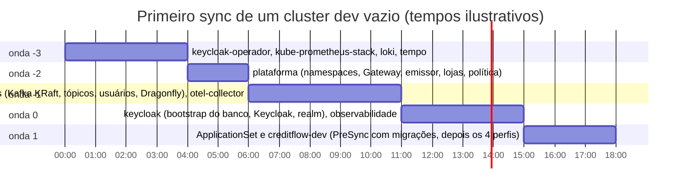

# 11.2 Ondas e hooks: a ordem que espera de verdade

Num cluster vazio, a ordem importa: um `Kafka` aplicado antes do operador do Strimzi existir é recusado (a CRD não existe); um `ExternalSecret` antes da `ClusterSecretStore` fica com erro; a aplicação antes do Kafka e do Keycloak entra em `CrashLoopBackOff` até eles subirem. O Argo CD tem dois mecanismos de ordem: **ondas** e **hooks**. Ambos foram vistos de passagem na lição [11.2 da Plataforma](../../../plataforma-dotnet/docs/modulo-11/02-fluxo-de-deploy.md); aqui está o que não aparece no tutorial.

## Ondas: dentro de UMA sincronização

```yaml
metadata:
  annotations:
    argocd.argoproj.io/sync-wave: "-2"
```

Numa sincronização, o Argo CD aplica os recursos em ordem crescente de onda (e, na mesma onda, por tipo: Namespaces antes de Deployments etc.). Antes de passar para a próxima onda, ele **espera os recursos da onda atual ficarem saudáveis**.

"Saudável" depende de uma verificação de saúde para aquele tipo de recurso. Deployment saudável = réplicas prontas. `Kafka` do Strimzi saudável = condição `Ready` (o Argo CD traz verificações para vários CRDs conhecidos). E uma **Application**?

::: previsao
No app-of-apps do CreditFlow, a raiz contém Applications com ondas -3, -2, -1, 0 e 1. Num Argo CD com a configuração padrão, a raiz espera o Kafka (dentro da Application `dados`, onda -1) ficar pronto antes de criar o ApplicationSet da aplicação (onda 1)?
???
**Não.** Desde o Argo CD 1.8, **a verificação de saúde de `Application` foi removida**: para a raiz, uma Application filha é "saudável" assim que existe. A raiz cria as filhas de todas as ondas em sequência rápida, sem esperar nenhuma sincronizar. As ondas viram enfeite. O resultado é o caos que se queria evitar: a aplicação subindo antes do Kafka, ExternalSecrets antes da loja.

O CreditFlow restaura a verificação no `argocd-cm`, pelos values do chart do Argo CD ([`argocd.yaml`](https://github.com/JandersonSR/lending-plataform/blob/main/infra/terraform/20-plataforma/valores/argocd.yaml)):

```yaml
resource.customizations.health.argoproj.io_Application: |
  hs = {}
  hs.status = "Progressing"
  if obj.status ~= nil and obj.status.health ~= nil then
    hs.status = obj.status.health.status
  end
  return hs
```

Com isso, a saúde de uma filha é a saúde do **conteúdo** dela, e a raiz só passa para a onda seguinte quando o Kafka, o Dragonfly e o OTel Collector da onda -1 estão saudáveis. A própria documentação do Argo CD indica essa customização para quem orquestra app-of-apps com ondas.
:::



## Ondas dentro de uma Application: o Keycloak

O chart [`deploy/k8s/keycloak`](https://github.com/JandersonSR/lending-plataform/blob/main/deploy/k8s/keycloak/templates/keycloak.yaml) usa ondas **internas**:

| Onda | Recurso | Por quê |
|---|---|---|
| -2 | `ExternalSecret keycloak-banco`, `ExternalSecret keycloak-backoffice`, ConfigMap do SQL | Os Secrets precisam existir antes de quem os usa |
| -1 | **Job** `keycloak-banco-bootstrap` (hook `Sync`) | Cria o papel `keycloak` e passa a posse do banco |
| 0 | `Keycloak` | Sobe com banco e credencial prontos |
| 1 | `KeycloakRealmImport` | Precisa do Keycloak de pé |

## Hooks: fases antes e depois

Um hook é um recurso que roda numa **fase** da sincronização, não como estado desejado permanente:

| Fase | Quando roda | Uso no CreditFlow |
|---|---|---|
| `PreSync` | Antes de qualquer recurso normal da Application | Migrações do chart do CreditFlow (vêm dos hooks `pre-install,pre-upgrade` do Helm, que o Argo CD traduz) |
| `Sync` | Junto com os recursos normais, respeitando as ondas | Bootstrap do banco do Keycloak (onda -1) |
| `PostSync` | Depois de tudo saudável | (desafio do módulo: teste de fumaça) |
| `SyncFail` | Se a sincronização falhar | (avisar o time) |

::: previsao
O bootstrap do Keycloak precisa do Secret `keycloak-banco`. Por que ele é um hook **Sync na onda -1**, e não um hook **PreSync** (que parece o natural para "preparar o banco")?
???
Porque `PreSync` roda **antes de qualquer recurso normal**, inclusive do ExternalSecret `keycloak-banco` (onda -2, recurso normal). No primeiro sync de um cluster vazio, o Job PreSync subiria antes de o Secret existir e ficaria em `CreateContainerConfigError` para sempre: o mesmo deadlock do primeiro `helm install` da lição 7.4, só que com nome de Argo CD. Como hook `Sync` na onda -1, ele roda **depois** de a onda -2 (o ExternalSecret) estar saudável e **antes** da onda 0 (o Keycloak).

O chart do CreditFlow resolve o mesmo problema de outro jeito: o ExternalSecret das migrações também é hook (peso -20), então os dois rodam na fase PreSync, em ordem.
:::

| Anotação | Valor no CreditFlow | Efeito |
|---|---|---|
| `argocd.argoproj.io/hook-delete-policy` | `BeforeHookCreation` | O Job da sincronização anterior é apagado só quando o novo vai ser criado: o log do último fica disponível |
| `helm.sh/hook-delete-policy` (no chart da aplicação) | `before-hook-creation` | Mesma coisa, traduzida pelo Argo CD |

::: armadilha Hooks não aparecem como "OutOfSync"
Um recurso de hook não faz parte do estado desejado: mudar o Job de migrações no Git não deixa a Application `OutOfSync` por causa dele. Ele roda de novo na **próxima** sincronização, que acontece quando qualquer outra coisa da Application mudar (normalmente a imagem). Se você precisa rodar o hook sem mudar mais nada, sincronize manualmente (`argocd app sync creditflow-dev`).
:::

## Duas opções de sincronização que o CreditFlow liga

| Opção | Por quê |
|---|---|
| `ServerSideApply=true` | Os CRDs do kube-prometheus-stack são maiores que o limite da anotação `last-applied-configuration` do apply do lado do cliente (256 KB). Com apply do lado do servidor, o problema some, e os campos ganham dono (`managedFields`), o que reduz conflito com outros controladores |
| `CreateNamespace=true` só na onda -3 | Os componentes da onda -3 precisam de namespaces (`keycloak`, `observabilidade`) antes de a onda -2 criá-los com os rótulos de Pod Security. Eles criam sem rótulo, e a Application `plataforma` aplica o `Namespace` completo por cima |

## Perguntas para responder sem olhar

::: pergunta
Por que as ondas de um app-of-apps não esperam nada num Argo CD com configuração padrão?
???
Porque a verificação de saúde de Application foi removida no Argo CD 1.8: a raiz considera uma filha saudável assim que ela existe. É preciso restaurar a verificação no argocd-cm.
:::

::: pergunta
Qual a diferença entre um hook PreSync e um hook Sync com onda negativa?
???
PreSync roda antes de qualquer recurso normal da Application. Um hook Sync roda junto dos recursos normais, respeitando as ondas: pode depender de recursos de ondas anteriores.
:::

::: pergunta
Por que ligar ServerSideApply no CreditFlow?
???
CRDs grandes (kube-prometheus-stack) estouram o limite da anotação de last-applied do apply do lado do cliente; o apply do lado do servidor não usa essa anotação e registra donos por campo.
:::

**Próxima:** [11.3 ApplicationSet e ambientes](03-applicationset-e-ambientes.md).
