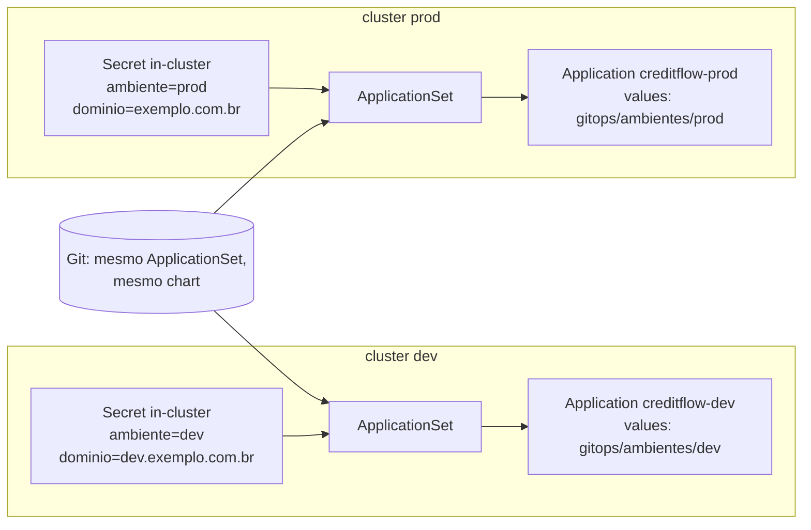

# 11.3 ApplicationSet e ambientes

O CreditFlow tem dois ambientes, cada um num AKS com o **próprio** Argo CD (a lição [11.3 da Plataforma](../../../plataforma-dotnet/docs/modulo-11/03-operacao.md) discute um Argo CD central x um por cluster). A aplicação é a mesma; mudam os valores. Uma Application escrita à mão por ambiente funcionaria, mas cada ambiente novo (um `homolog`, um ambiente por PR) seria cópia. O **ApplicationSet** gera Applications a partir de um **gerador** e um **modelo**.

::: conceito Geradores
O ApplicationSet produz uma lista de conjuntos de parâmetros e aplica o modelo a cada um. Geradores comuns: `list` (lista fixa no YAML), `clusters` (um conjunto por cluster registrado no Argo CD, com os rótulos e anotações do Secret dele), `git` (um por pasta ou arquivo num repositório), `pullRequest` (um por PR aberto), e `matrix`/`merge` para combinar.
:::

## O gerador `clusters` e a ponte

O [ApplicationSet do CreditFlow](https://github.com/JandersonSR/lending-plataform/blob/main/gitops/raiz/arquivos/applicationset-creditflow.yaml):

```yaml
spec:
  goTemplate: true
  goTemplateOptions: ["missingkey=error"]
  generators:
    - clusters:
        selector:
          matchExpressions:
            - { key: creditflow.io/ambiente, operator: In, values: [dev, prod] }
  template:
    metadata:
      name: 'creditflow-{{ index .metadata.labels "creditflow.io/ambiente" }}'
    spec:
      source:
        path: deploy/helm/creditflow
        helm:
          valueFiles:
            - '../../../gitops/ambientes/{{ index .metadata.labels "creditflow.io/ambiente" }}/creditflow.yaml'
          parameters:
            - name: workloadIdentity.clientId
              value: '{{ index .metadata.annotations "creditflow.io/app-client-id" }}'
            - name: rotas.hosts[0]
              value: 'api.{{ index .metadata.annotations "creditflow.io/dominio" }}'
            - name: configuracao.Auth__Authority
              value: 'https://auth.{{ index .metadata.annotations "creditflow.io/dominio" }}/realms/creditflow'
      destination:
        server: '{{ .server }}'
        namespace: creditflow
```

O Secret de cluster que o Terraform criou (lição 11.1) é o que o gerador lê: o rótulo escolhe o ambiente, as anotações viram parâmetros do Helm.



| Detalhe | Por quê |
|---|---|
| `goTemplate: true` | Templates Go com funções (`index`, `printf`...) em vez do formato antigo `{{name}}`. Necessário para ler chaves com ponto e barra, como `creditflow.io/ambiente` |
| `missingkey=error` | Um cluster sem a anotação `creditflow.io/dominio` gera **erro** no ApplicationSet, em vez de uma Application com `api.` como host. Falha alto e cedo |
| `index .metadata.labels "creditflow.io/ambiente"` | `.metadata.labels.creditflow.io/ambiente` não é sintaxe válida em template Go (o ponto e a barra quebram o caminho); `index` busca pela chave literal |
| `valueFiles` com `../../../gitops/...` | O caminho é relativo ao `path` do chart; o Argo CD permite arquivos de fora da pasta do chart desde que no mesmo repositório |
| Parâmetros só para **fatos** | Domínio, client id, host do Harbor. Tudo que é **decisão** (tag, réplicas, recursos) vem do arquivo de valores do ambiente, versionado |

## Dois motores de template no mesmo lugar

O ApplicationSet usa `{{ ... }}` do **Go template do Argo CD**. Mas ele é criado pela raiz, que é um chart **Helm**, que também usa `{{ ... }}`. Se o arquivo estivesse em `gitops/raiz/templates/`, o Helm tentaria resolver `{{ index .metadata.labels ... }}`, não acharia `.metadata` nos values e quebraria a renderização (ou pior, renderizaria vazio).

::: previsao
Três jeitos de resolver. Qual o CreditFlow usa, e por quê os outros dois são piores?
1. Escapar cada abertura: `{{ "{{" }} index .metadata.labels ... {{ "}}" }}`.
2. Guardar o ApplicationSet num arquivo fora de `templates/` e incluir com `{{ .Files.Get "arquivos/applicationset-creditflow.yaml" }}`.
3. Não usar Helm na raiz.
???
O CreditFlow usa **2**. O `.Files.Get` devolve o conteúdo como texto, e o Helm **não** interpreta texto que veio de `.Files.Get`. O ApplicationSet fica legível, igual ao que o Argo CD vai receber.
O **1** funciona (o chart do Keycloak e as regras de alerta usam para casos pontuais), mas num arquivo com dez templates o YAML fica ilegível e um escape esquecido só aparece em produção.
O **3** perde o motivo de a raiz ser Helm (distribuir os fatos para as filhas, lição 11.1).
:::

## O que muda entre dev e prod

```bash
diff <(yq -P gitops/ambientes/dev/creditflow.yaml) <(yq -P gitops/ambientes/prod/creditflow.yaml)
```

| Arquivo | dev | prod |
|---|---|---|
| `creditflow.yaml` | `ASPNETCORE_ENVIRONMENT=Development`, HPA 1 a 3/4, PDB `maxUnavailable: 1`, imagem escrita pelo CI | `Production`, os padrões do chart (2 a 12 na simulação), imagem escrita **só** pelo PR de promoção |
| `dados.yaml` | Um nó KRaft com os dois papéis, replicação 1, Dragonfly com 1 réplica | `{}`: os padrões do chart (3 controladores + 3 brokers por zona, replicação 3, min ISR 2) |
| `keycloak.yaml` | 1 instância, usuários de teste | 2 instâncias, sem dados de teste |

::: porque Os padrões do chart são os de produção
Quem esquece de sobrescrever um valor em prod recebe o valor seguro (3 réplicas do Kafka, HA). Quem esquece em dev recebe um ambiente mais caro, que alguém vai notar na fatura. O inverso (padrões de dev) deixa a falha **silenciosa** em produção.
:::

## Ver o que o ApplicationSet gerou

```bash
kubectl -n argocd get applicationset creditflow -o jsonpath='{.status.conditions}' | jq
kubectl -n argocd get applications -l argocd.argoproj.io/application-set-name=creditflow
kubectl -n argocd get application creditflow-dev -o jsonpath='{.spec.source.helm}' | jq
```

O `status.conditions` do ApplicationSet é o primeiro lugar quando "a Application não aparece": erro de template (`missingkey`), cluster sem o rótulo, ou o seletor não casando.

## Perguntas para responder sem olhar

::: pergunta
O que o gerador `clusters` entrega ao modelo de um ApplicationSet?
???
Um conjunto de parâmetros por cluster registrado que casa com o seletor: nome, server, e os rótulos e anotações do Secret de cluster.
:::

::: pergunta
Por que `missingkey=error` no ApplicationSet?
???
Para que um parâmetro ausente (uma anotação que o Terraform não criou) gere erro visível no ApplicationSet, em vez de uma Application com valores vazios.
:::

::: pergunta
Como colocar um ApplicationSet (template Go) dentro de um chart Helm sem o Helm interpretá-lo?
???
Guardar o YAML num arquivo fora de `templates/` e incluí-lo com `.Files.Get`, cujo conteúdo o Helm não interpreta; ou escapar cada `{{` com `{{ "{{" }}`.
:::

**Próxima:** [11.4 Promoção, rollback e drift](04-promocao-rollback-e-drift.md).
