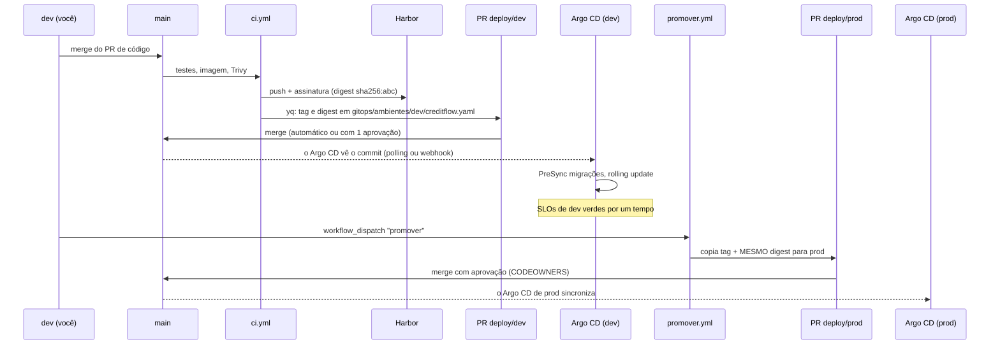

# 11.4 Promoção, rollback e drift

## O caminho de uma mudança até produção



| Decisão | Por quê |
|---|---|
| O CI **abre PR** em vez de dar push no `main` | O commit de deploy passa pela proteção de branch, aparece no histórico com autor (o bot) e pode ser revertido como qualquer outro |
| O PR grava **tag e digest** | A tag é para humanos; o chart usa o digest (lição 7.2) e o policy-controller verifica o digest (lição 10.4) |
| Prod recebe o **mesmo digest** de dev | Não se reconstrói para prod. O artefato testado é o artefato implantado |
| O workflow de promoção é manual | Promover é uma decisão (horário, SLOs de dev, mudança de banco compatível?). O corpo do PR lembra as perguntas |

::: armadilha O bot e a proteção de branch
Um `GITHUB_TOKEN` que abre PR **não** dispara workflows nesse PR (proteção do GitHub contra laços). Se a proteção da `main` exige uma verificação que roda em PR, o PR de deploy fica esperando para sempre. Saídas: as verificações obrigatórias ignoram caminhos `gitops/**` (o `ci.yml` já tem `paths-ignore: gitops/**`), ou o PR é aberto com o token de um GitHub App. A lição [11.2 da Plataforma](../../../plataforma-dotnet/docs/modulo-11/02-fluxo-de-deploy.md) discute isso no caso do push direto.
:::

## Voltar uma versão

```bash
git log --oneline -- gitops/ambientes/prod/creditflow.yaml | head -3
git revert <sha do "deploy(prod): creditflow 0.1.87">
# PR -> merge -> Argo CD de prod sincroniza a 0.1.86
```

::: previsao
A 0.1.87 trouxe um `002_schema_propostas.sql` que adiciona a coluna `canal_origem` (idempotente, com `IF NOT EXISTS`) e o código que a usa. Você reverte o deploy para a 0.1.86. O que acontece com a coluna? E se o `002_` tivesse **renomeado** uma coluna que a 0.1.86 usa?
???
**Adicionar coluna:** a coluna fica (o revert volta a **imagem**; o DDL não é desfeito). O Job de migrações da 0.1.86 roda os arquivos que ela conhece (sem o `002_`) e não toca na coluna. A 0.1.86 ignora a coluna nova. Rollback seguro: é a fase **expandir** do expandir/contrair.
**Renomear coluna:** a 0.1.86 procura a coluna com o nome antigo e falha em toda consulta. O rollback não salva você. Por isso a regra da lição 7.4: nenhum DDL quebra a versão anterior. Renomear vira três deploys: adicionar a nova e escrever nas duas; migrar os dados e ler da nova; só então remover a antiga.
:::

::: dica Por que não "Rollback" na interface do Argo CD
O Argo CD **não permite** rollback de uma Application com sincronização automática ligada: é preciso desligar o automático e então sincronizar uma revisão antiga do histórico. O Git continua dizendo 0.1.87; assim que alguém religar o automático, a 0.1.87 volta. Em emergência, pode ser o caminho mais rápido, desde que o revert no Git venha logo em seguida e o automático seja religado.
:::

## Drift: quando o cluster diverge do Git

Com `selfHeal: true`, uma mudança feita direto no cluster é desfeita na próxima comparação (segundos). Três situações em que o "drift" não é o que parece:

| Sintoma | Causa | Correção |
|---|---|---|
| `creditflow-dev` sempre `OutOfSync` em `spec.replicas` de um Deployment | Alguém declarou `replicas` com HPA ligado, ou o chart de outro componente faz isso | O chart do CreditFlow não declara `replicas` com autoescala; o ApplicationSet ainda ignora `/spec/replicas` com `ignoreDifferences` como rede de segurança |
| `OutOfSync` eterno em `caBundle` de um webhook | O cert-manager/ESO/policy-controller injeta o CA depois do apply | `resource.customizations.ignoreDifferences` para `MutatingWebhookConfiguration`/`ValidatingWebhookConfiguration` (está no `argocd.yaml` da camada 20) |
| `kubectl edit configmap creditflow-config` "não pega" | O `selfHeal` reaplicou o valor do Git em segundos | Correção também é PR. Em emergência real: desligue o automático **daquela** Application, corrija, abra o PR, religue |

::: armadilha `prune` e dados
A Application `dados` tem `prune: false`. Se alguém remover o `Kafka` do Git por engano (um refactor que muda o nome do recurso), com `prune: true` o Argo CD apagaria o cluster Kafka; os PVCs têm `deleteClaim: false` e sobreviveriam, mas o serviço cairia. Com `prune: false`, o recurso órfão aparece na interface como "requer poda", e uma pessoa decide. Para o que é estado, a decisão de apagar é humana.
:::

## Diagnóstico rápido

```bash
kubectl -n argocd get applications                       # SYNC STATUS e HEALTH de todas
kubectl -n argocd get application creditflow-dev \
  -o jsonpath='{.status.operationState.phase}{"\n"}{.status.operationState.message}{"\n"}'
kubectl -n argocd get application creditflow-dev -o jsonpath='{.status.conditions}' | jq
```

| Estado | Leitura |
|---|---|
| `Synced` + `Progressing` | Aplicou; esperando pods/rollout |
| `OutOfSync` + `Healthy` | O Git mudou e ainda não sincronizou (ou drift ignorado faltando) |
| `Synced` + `Degraded` | Aplicou, mas algo não fica saudável: pods em crash, Job falhou |
| Operação presa em `Running` na fase `PreSync` | O Job de migrações não terminou: runbook [`migracao-travada.md`](https://github.com/JandersonSR/lending-plataform/blob/main/docs/runbooks/migracao-travada.md) |
| `ComparisonError` | O chart não renderiza com aqueles valores: rode `helm template` local com o mesmo values |

## Perguntas para responder sem olhar

::: pergunta
Como uma versão vai de dev para prod no CreditFlow, e o que garante que é o mesmo artefato?
???
Um workflow manual copia tag e digest do values de dev para o de prod e abre um PR que exige aprovação; o Argo CD de prod sincroniza após o merge. É o mesmo digest, verificado pela assinatura no cluster; nada é reconstruído.
:::

::: pergunta
Por que o rollback por `git revert` é seguro para o código mas não necessariamente para o banco?
???
O revert volta a imagem e os manifestos; o DDL aplicado não é desfeito. Só é seguro se toda mudança de schema for compatível com a versão anterior (expandir/contrair).
:::

::: pergunta
Por que a Application dos dados tem `prune: false`?
???
Para que a remoção de um recurso com estado (o cluster Kafka) do Git não apague o recurso automaticamente; ele fica marcado como órfão e uma pessoa decide.
:::

**Próximo:** [desafio do módulo](desafio.md).
