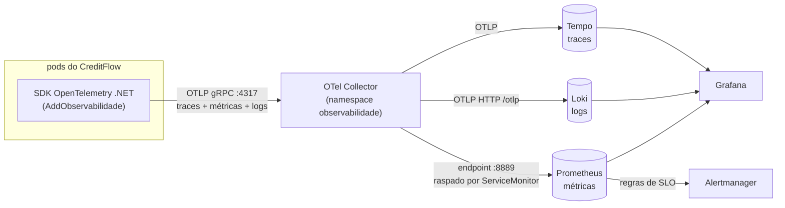
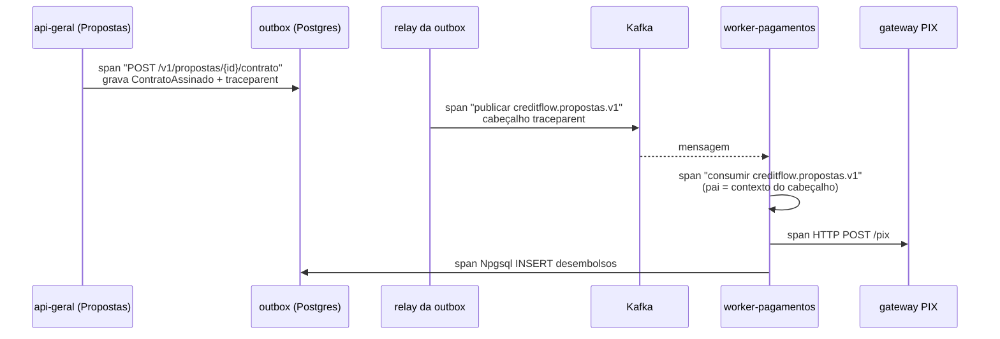

# 12.1 OpenTelemetry nas jornadas de crédito

Os três sinais (logs, métricas, traces) e por que log estruturado importa estão na lição [8.4 da Plataforma](../../../plataforma-dotnet/docs/modulo-08/04-observabilidade.md), que termina com "o que falta: traces exportados". O CreditFlow começa daí: os três sinais saem por **OTLP**, o protocolo do OpenTelemetry, para um coletor, e um trace atravessa HTTP, Postgres, Kafka e o worker.

::: video OpenTelemetry Course - Understand Software Performance (freeCodeCamp, em inglês)
https://www.youtube.com/watch?v=r8UvWSX3KA8
Curso de uma hora: spans, contexto, exportadores e coletor. Veja os primeiros 25 minutos antes desta lição.
:::

## O caminho dos dados



::: porque Por que um coletor no meio
A aplicação só conhece um endereço (`OTEL_EXPORTER_OTLP_ENDPOINT`) e um protocolo. Trocar o Tempo por outro backend, mandar uma cópia para o Azure Monitor, filtrar spans de health check, acrescentar atributos do Kubernetes (`k8s.pod.uid`) ou segurar dados quando o backend está lento: tudo isso é configuração do **coletor** ([`otel-collector.yaml`](https://github.com/JandersonSR/lending-plataform/blob/main/deploy/k8s/observabilidade/valores/otel-collector.yaml)), sem deploy da aplicação. No kind, o `grafana/otel-lgtm` faz o papel do coletor e dos três backends num contêiner só.
:::

## `AddObservabilidade`, bloco a bloco

[`ObservabilidadeExtensions.cs`](https://github.com/JandersonSR/lending-plataform/blob/main/src/BuildingBlocks/CreditFlow.BuildingBlocks/Observabilidade/ObservabilidadeExtensions.cs):

```csharp
var otel = builder.Services.AddOpenTelemetry()
    .ConfigureResource(r => r
        .AddService(serviceName: nomeDoServico, serviceNamespace: "creditflow", serviceVersion: Telemetria.Versao)
        .AddAttributes([ new("creditflow.papel", papel), new("creditflow.modulos", modulos), ... ]))
```

O **recurso** descreve quem emite: todo span, métrica e log do processo carrega `service.name` (`creditflow-api-simulacao`, vindo de `OTEL_SERVICE_NAME` que o chart define por perfil), a versão da imagem, e os atributos do pod que o chart passa em `OTEL_RESOURCE_ATTRIBUTES`. É por isso que, no Grafana, "a latência do api-simulacao" é uma consulta, mesmo sendo a mesma imagem nos quatro perfis.

```csharp
    .WithTracing(t => t
        .AddSource(Telemetria.NomeDaFonte)        // "CreditFlow.Credito": spans das jornadas
        .AddSource(Rastreamento.NomeDaFonte)      // "CreditFlow.Mensageria": publicar/consumir no Kafka
        .AddSource("Npgsql")                      // o Npgsql emite spans nativamente
        .AddSource("MongoDB.Driver")              // o driver 3.13 também (MongoTelemetry.ActivitySourceName)
        .AddAspNetCoreInstrumentation(o => o.Filter = c => !Ignorado(c.Request.Path))
        .AddHttpClientInstrumentation())
```

::: conceito ActivitySource e AddSource
No .NET, um span é uma `Activity`, criada por um `ActivitySource` com nome. O SDK só **escuta** as fontes registradas com `AddSource`. Uma biblioteca pode emitir spans o dia inteiro: se ninguém registrou o nome dela, `StartActivity` devolve `null` e o custo é praticamente zero. É por isso que o código da Mensageria usa `Rastreamento.Fonte.StartActivity(...)` com `?.` em seguida.
:::

```csharp
    .WithMetrics(m => m
        .AddMeter(Telemetria.NomeDaFonte).AddMeter(Rastreamento.NomeDaFonte).AddMeter("Npgsql")
        .AddAspNetCoreInstrumentation()           // http.server.request.duration (base do SLO da simulação)
        .AddRuntimeInstrumentation()              // GC, heap, pool de threads
        .AddView("creditflow.desembolso.duracao",
            new ExplicitBucketHistogramConfiguration { Boundaries = MetricasDeCredito.LimitesDesembolsoSegundos }));

builder.Logging.AddOpenTelemetry(o => { o.IncludeScopes = true; o.IncludeFormattedMessage = true; });
if (!string.IsNullOrWhiteSpace(cfg["OTEL_EXPORTER_OTLP_ENDPOINT"])) otel.UseOtlpExporter();
```

| Trecho | Por quê |
|---|---|
| `AddView` com limites próprios | O histograma padrão do .NET vai de 5 ms a 10 s: inútil para "do contrato ao desembolso" (minutos). Os limites do desembolso incluem **300 s**, porque o SLO é "em até 5 minutos" (lição 12.2) |
| `Logging.AddOpenTelemetry` | Cada log sai com `TraceId` e `SpanId` do span ativo. No Grafana, do log para o trace é um clique (o `derivedFields` do datasource Loki) |
| `UseOtlpExporter()` só com endpoint | Testes e `dotnet run` sem coletor não tentam exportar nem geram erro de conexão |
| Filtro de `/healthz` | As sondas chamam a cada poucos segundos em cada pod: milhares de spans inúteis por hora |

## Métricas de negócio: `MetricasDeCredito`

CPU e latência dizem se o **sistema** está bem. Não dizem se o **negócio** está funcionando. Uma API que responde 200 rápido e aprova zero propostas desde as 14h está "saudável" em todos os painéis técnicos.

| Instrumento | Quem registra | Pergunta que responde |
|---|---|---|
| `creditflow.simulacoes` (contador) e `creditflow.simulacao.duracao` (histograma) | handler da Simulação | Quantas simulações por sistema (Price/SAC) e faixa de prazo; quanto custa o cálculo em CPU |
| `creditflow.propostas` | Propostas | Criadas, aprovadas, recusadas por motivo: a taxa de aprovação caiu? |
| `creditflow.desembolsos` + `creditflow.desembolso.duracao` | worker-pagamentos, ao fechar o desembolso | Concluídos x falhos por motivo; tempo do contrato ao dinheiro na conta (base do SLO) |
| `creditflow.valor.contratado` | Propostas, no `ContratoAssinado` | Volume financeiro contratado por faixa de valor |

::: armadilha Cardinalidade
Cada combinação de valores de atributos é uma **série** no Prometheus. `creditflow.desembolsos` com atributos `resultado` (2 valores) e `motivo` (4 valores) gera 8 séries. Com `proposta_id` como atributo, geraria uma série por proposta, para sempre: o Prometheus fica lento e caro e cai. Por isso `Telemetria.Atributos` só tem atributos de baixa cardinalidade (faixas de prazo e valor, não o valor; código de motivo, não a mensagem de erro), e `creditflow.proposta.id` existe **só para spans**, onde cada trace é um registro independente.
:::

## Um trace através do Kafka

O contexto de um trace viaja dentro do processo pela `Activity.Current`. Entre processos, viaja num **cabeçalho**: em HTTP, o `traceparent` (W3C Trace Context), que a instrumentação do ASP.NET Core e do `HttpClient` propaga sozinha. No Kafka, ninguém propaga por você: a Mensageria (módulo 6) grava o `traceparent` nos cabeçalhos da mensagem ao publicar, e ao consumir lê o cabeçalho e inicia o span de consumo como **filho** daquele contexto.



No Tempo, busque um trace pelo atributo `creditflow.proposta.id` e veja a jornada inteira: quanto tempo a mensagem ficou na outbox, quanto ficou no tópico (o "buraco" entre o span de publicação e o de consumo **é o lag**), quanto o gateway demorou.

::: previsao
O relay da outbox publica em lote, segundos depois da transação. No trace, o span "publicar" é filho do span HTTP que já terminou. Isso é um problema? E se a mensagem ficar 10 minutos no tópico por causa de lag?
???
Não é problema: span filho que começa depois de o pai terminar é normal em fluxos assíncronos, e mostra exatamente a espera. Com 10 minutos de lag, o trace fica longo e o buraco entre "publicar" e "consumir" mostra os 10 minutos: é a evidência visual do incidente 1 do game day. Para fluxos muito longos (dias), o padrão é usar **links** de span em vez de pai-filho, para não ter traces de dias; no CreditFlow, minutos são aceitáveis.
:::

## Perguntas para responder sem olhar

::: pergunta
Por que exportar para um OTel Collector e não direto para o Tempo/Prometheus?
???
A aplicação conhece um endereço e um protocolo; roteamento, filtragem, enriquecimento com atributos do Kubernetes, retenção em memória quando o backend está lento e troca de backend ficam no coletor, sem deploy da aplicação.
:::

::: pergunta
Como o contexto de um trace atravessa o Kafka?
???
O produtor grava o `traceparent` W3C nos cabeçalhos da mensagem; o consumidor lê o cabeçalho e inicia o span de consumo com aquele contexto como pai. Nenhuma instrumentação automática faz isso pelo Confluent.Kafka: é código da Mensageria.
:::

::: pergunta
Por que `proposta_id` pode ser atributo de span mas não de métrica?
???
Cada combinação de atributos de métrica vira uma série temporal que o Prometheus guarda para sempre; um id único explode a cardinalidade. Span é registro individual: atributo de alta cardinalidade é justamente o que permite achá-lo.
:::

**Próxima:** [12.2 SLOs e error budget](02-slos-e-error-budget.md).
