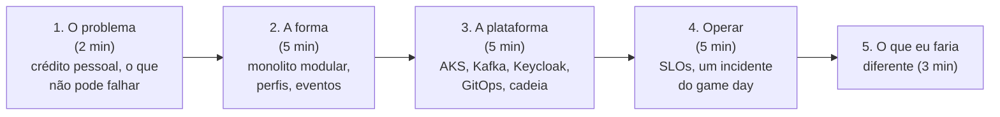

# 12.5 Post-mortem, ADRs e a apresentação ao time

O game day produziu quatro linhas do tempo. Esta lição transforma uma delas em aprendizado escrito, revisa as decisões de arquitetura do projeto e fecha o curso com a apresentação que você faria a um time (ou numa entrevista de arquiteto).

## O post-mortem

Use o modelo da lição [12.2 da Plataforma](../../../plataforma-dotnet/docs/modulo-12/02-post-mortem.md): resumo, impacto, linha do tempo, causa raiz e fatores que contribuíram, o que funcionou, ações. Para o CreditFlow, três cuidados a mais:

| Seção | O que o CreditFlow acrescenta |
|---|---|
| Impacto | Em **unidades de negócio** e de **budget**: "17 contratos com desembolso atrasado entre 14h02 e 14h41; p95 do contrato ao PIX foi a 38 min; 23% do budget mensal do SLO de desembolso". As métricas de negócio da lição 12.1 dão os números |
| Linha do tempo | Separe **detecção** (alerta tocou), **reconhecimento** (alguém olhou), **estancamento** e **resolução**. O tempo entre eles é o que as ações vão atacar |
| Ações | Cada ação com **dono e data**, e classificada: detectar mais cedo, estancar mais rápido, impedir. "Tomar mais cuidado" não é ação |

::: previsao
No cenário 1, a causa "raiz" foi alguém ter pausado o ScaledObject. Um post-mortem que conclui "erro humano: a pessoa pausou o worker" está bom?
???
Não. "Erro humano" é onde a investigação deve **começar**. Perguntas que levam a ações úteis: por que pausar o worker em produção era possível sem PR (o Argo CD não considera a anotação como drift)? Por que o alerta que disparou foi o de SLO (sintoma) e não um de "grupo sem consumidores" (causa direta)? Quanto tempo levou do alerta à primeira olhada no lag, e por quê? Post-mortem sem culpados não é post-mortem sem responsabilidade: é procurar o que no **sistema** permitiu o erro e o deixou durar.
:::

## As ADRs do projeto

O CreditFlow tem onze ADRs em [`docs/adr/`](https://github.com/JandersonSR/lending-plataform/blob/main/docs/adr/0001-monolito-modular.md). As quatro deste bloco de módulos:

| ADR | Decisão | A pergunta que ela precisa aguentar |
|---|---|---|
| [0008](https://github.com/JandersonSR/lending-plataform/blob/main/docs/adr/0008-harbor.md) | Harbor e não ACR | "Por que operar um registry se a Azure tem um gerenciado?" |
| [0009](https://github.com/JandersonSR/lending-plataform/blob/main/docs/adr/0009-argo-cd.md) | Argo CD (pull), app-of-apps com ondas, ApplicationSet | "O que acontece se o Argo CD cair? E o que ele resolve que o pipeline não resolvia?" |
| [0010](https://github.com/JandersonSR/lending-plataform/blob/main/docs/adr/0010-mongodb-na-azure.md) | Azure DocumentDB e não Atlas nem operador | "E a compatibilidade? E a senha no estado?" |
| [0011](https://github.com/JandersonSR/lending-plataform/blob/main/docs/adr/0011-terraform-em-camadas.md) | Terraform em quatro camadas | "Não é burocracia demais para um projeto deste tamanho?" |

O formato e o teste de qualidade de uma ADR estão na lição [12.3 da Plataforma](../../../plataforma-dotnet/docs/modulo-12/03-adrs.md). O exercício aqui é **discordar**: escolha uma das quatro, escreva a ADR que você teria escrito se o contexto fosse outro (um time de 3 pessoas sem plantão; uma empresa já padronizada em ACR e Azure Monitor; um banco com exigência de dados on-premises), e diga o que mudou na decisão e por quê. Uma ADR boa deixa claro **em que contexto** ela deixaria de valer: as quatro têm a seção "Quando revisar" ou equivalente.

## A apresentação ao time

Vinte minutos, para um público misto (devs, produto, um gestor). A estrutura que funciona para arquitetura:

| Parte | O que mostrar | Erro comum |
|---|---|---|
| O problema | A jornada simular → propor → contratar → desembolsar, e os dois SLOs | Começar pela tecnologia |
| A forma | Um diagrama C4 de contêineres: uma imagem, quatro perfis; por que não microsserviços (ADR 0001) e como escalar sem eles (ADR 0007) | Mostrar o código antes do diagrama |
| A plataforma | O caminho de um commit até o pod (CI → Harbor → assinatura → PR → Argo CD → PreSync → rolling update) num slide só | Listar 20 ferramentas sem dizer o que cada uma resolve |
| Operar | O dashboard de SLO e **um** incidente do game day contado como história: sintoma, investigação, correção, ação | Mostrar só o dashboard bonito |
| Diferente | Duas decisões que você mudaria, com o motivo e o custo | "Faria tudo igual" |

::: dica Para a entrevista de arquiteto
A parte 5 é a que mais diferencia sênior de pleno numa entrevista. Exemplos honestos do próprio CreditFlow: "a senha do DocumentDB fica no estado do Terraform; eu migraria para Entra ID quando o provider suportar usuário não-root"; "o Job de migrações aplica DDL idempotente com psql: simples, mas não detecta drift de schema; num time maior eu adotaria uma ferramenta de migração versionada"; "Kafka no cluster me deu aprendizado, mas para um time sem plantão eu iria de gerenciado".
:::

A entrevista simulada e a autoavaliação final seguem o roteiro da lição [12.4 da Plataforma](../../../plataforma-dotnet/docs/modulo-12/04-apresentacao-e-autoavaliacao.md), usando as perguntas de entrevista dos módulos 7 a 12 deste curso.

## Perguntas para responder sem olhar

::: pergunta
O que separa um post-mortem útil de um que conclui "erro humano"?
???
Ele pergunta o que no sistema permitiu o erro e o deixou durar (falta de controle, de alerta, de runbook), e termina com ações com dono e data que detectam mais cedo, estancam mais rápido ou impedem.
:::

::: pergunta
Como medir o impacto de um incidente do CreditFlow?
???
Em unidades de negócio (contratos atrasados, simulações perdidas) e em budget do SLO consumido, com as métricas de negócio e as regras de SLO; não só em minutos de "fora do ar".
:::

**Próximo:** [desafio do módulo](desafio.md).
