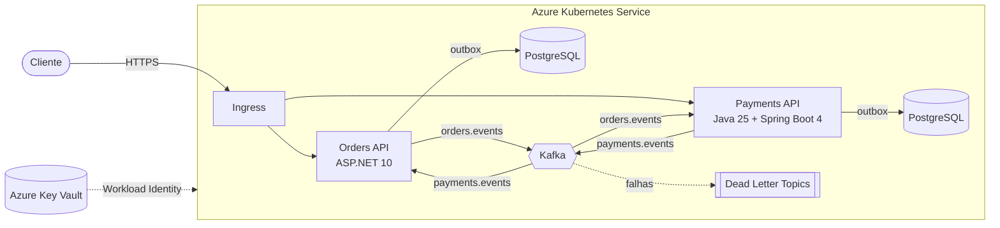

# OrderFlow

Sistema de pedidos e pagamentos **orientado a eventos e poliglota**: o serviço de pedidos em
**ASP.NET 10** e o de pagamentos em **Java 25 + Spring Boot 4**, desenhados para rodar no
**Azure Kubernetes Service** integrados por **Apache Kafka**.

É um projeto de estudo e portfólio, construído em módulos, que mostra os problemas reais de produção
de um sistema distribuído e como resolvê-los: idempotência sob concorrência, ordem de eventos,
falha parcial (dual write), desligamento gracioso no Kubernetes, health checks, contratos entre
serviços em linguagens diferentes.

> **English summary.** OrderFlow is a polyglot, event-driven order and payment system (ASP.NET 10 +
> Java 25/Spring Boot 4), built module by module toward production on AKS with Kafka. It focuses on
> real distributed-systems problems: idempotency under concurrency, event ordering, the dual-write
> problem, graceful shutdown and Kubernetes probes. Docs are in Portuguese.

## Status

| Parte | Situação |
|---|---|
| **Orders** (.NET 10) | ✅ API completa com fila de eventos em memória |
| **Payments** (Java 25 + Spring Boot 4) | ✅ API completa com fila de eventos em memória (domínio e casos de uso testados; rode `./mvnw verify` para validar a camada Spring) |
| Kafka entre os serviços | 🔜 Módulo 2 |
| Postgres, outbox, Schema Registry | 🔜 Módulo 3 |
| Docker, Kubernetes, AKS, observabilidade, CI/CD | 🔜 Módulos 4 a 7 |

O roteiro completo está em [`docs/README.md`](docs/README.md).

## Arquitetura

Hoje cada serviço roda sozinho, com uma fila em memória no lugar do Kafka. Esta é a arquitetura-alvo:



Os dois serviços **nunca se chamam diretamente**. O contrato entre eles é o formato das mensagens no
Kafka, com o `orderId` como chave (mesma partição, ordem garantida por pedido).

Os dois serviços seguem a mesma organização em camadas:

```
Api / api            HTTP: endpoints, DTOs, tratamento de erro (RFC 9457)
Application          casos de uso + interfaces (portas)
Domain               regras de negócio puras, sem framework
Infrastructure       implementações (memória hoje; Kafka e Postgres depois)
```

## Decisões de engenharia que valem a leitura

- **Domínio sem framework.** O domínio e os casos de uso não importam ASP.NET nem Spring; as mesmas
  regras servem a HTTP hoje e a consumers Kafka amanhã, e os testes rodam sem subir nada.
- **Idempotência à prova de concorrência.** `POST` com header `Idempotency-Key`: retry devolve o
  resultado original (200) em vez de duplicar. Verificado com 50 requisições simultâneas com a mesma
  chave: um único registro.
- **Bugs de corrida encontrados e documentados.** Um `KeyNotFoundException` sob carga no repositório
  do Orders (corrigido); no Payments, um teste de estresse mostrou que 50 requisições concorrentes
  gravavam um único pagamento, mas chamavam o gateway até 50 vezes. A análise está em
  [`docs/modulo-01j/07-threads-virtuais.md`](docs/modulo-01j/07-threads-virtuais.md) e a correção é
  um exercício do curso.
- **Erros padronizados entre as stacks.** Os dois serviços respondem erros no mesmo formato
  ProblemDetails (RFC 9457), com um `code` estável e erros de validação por campo.
- **Prontos para Kubernetes.** Liveness sem dependências externas; readiness que tira o pod do
  balanceamento quando a fila interna passa de 90%; configuração validada na subida (o pod não sobe
  com configuração inválida); desligamento gracioso que respeita o SIGTERM.
- **Dinheiro sem arredondamento silencioso.** `decimal` no .NET e `BigDecimal` normalizado em 2 casas
  no Java; valores com mais casas são recusados, não arredondados.
- **Threads virtuais no Java, async/await no .NET.** Comparação medida, não decorada: 10.000 tarefas
  de I/O em 189 ms com threads virtuais contra 5.199 ms com um pool de 200 threads.

## Stack

| | Orders | Payments |
|---|---|---|
| Linguagem | C# 14 / .NET 10 | Java 25 (LTS) |
| Framework | ASP.NET Core Minimal APIs | Spring Boot 4.1 (Spring MVC) |
| Validação | DataAnnotations nativas do .NET 10 | Bean Validation (Jakarta) |
| Concorrência | `async/await`, `Channel<T>` | threads virtuais, `BlockingQueue` |
| Testes | xUnit + `WebApplicationFactory` | JUnit 5 + AssertJ + `@SpringBootTest` |
| Build | `dotnet` CLI | Maven |

## Como rodar

### Orders (.NET 10), porta 5279

Requer o [.NET 10 SDK](https://dotnet.microsoft.com/download/dotnet/10.0).

```bash
dotnet build
dotnet test
dotnet run --project src/OrderFlow.Orders.Api
```

### Payments (Java 25), porta 8081

Requer o [JDK 25](https://adoptium.net) e o Maven. Na primeira vez, gere o Maven Wrapper
(detalhes em [`docs/modulo-01j/01-anatomia-maven-e-spring.md`](docs/modulo-01j/01-anatomia-maven-e-spring.md)).

```bash
cd java/payments
mvn -N wrapper:wrapper     # só na primeira vez
./mvnw verify
./mvnw spring-boot:run
```

### Testando a API

Há requisições prontas em [`requests.http`](requests.http) (Orders) e
[`java/payments/requests.http`](java/payments/requests.http) (Payments), que abrem direto no
Visual Studio, Rider e IntelliJ (no VS Code, com a extensão REST Client). Exemplo com `curl`:

```bash
# cria um pedido (201 + Location)
curl -i -X POST http://localhost:5279/orders \
  -H 'Content-Type: application/json' -H 'Idempotency-Key: pedido-001' \
  -d '{"customerId":"cli-001","items":[{"sku":"TECLADO-01","quantity":2,"unitPrice":150.50}]}'

# registra um pagamento (201; repita com a mesma chave para receber 200 e o mesmo pagamento)
curl -i -X POST http://localhost:8081/payments \
  -H 'Content-Type: application/json' -H 'Idempotency-Key: pagamento-001' \
  -d '{"orderId":"01a150ba-9a94-7e1d-a2f4-88d24a31db9a","customerId":"cli-001","amount":301.00,"cardToken":"tok_visa_4242"}'
```

O gateway de pagamento é simulado e determinístico: um `cardToken` começando com `tok_decline` é
recusado, e valores acima de 5000,00 são recusados por limite.

## Endpoints

**Orders** (`http://localhost:5279`)

| Método | Rota | Descrição |
|---|---|---|
| `POST` | `/orders` | Cria um pedido (aceita `Idempotency-Key`) |
| `GET` | `/orders/{id}` | Busca um pedido |
| `GET` | `/orders?status=&page=&pageSize=` | Lista com filtro e paginação |
| `POST` | `/orders/{id}/cancel` | Cancela um pedido pendente |
| `POST` | `/orders/{id}/simulate-payment` | Marca como pago (temporário, até o Kafka) |
| `GET` | `/health/live`, `/health/ready` | Probes do Kubernetes |

**Payments** (`http://localhost:8081`)

| Método | Rota | Descrição |
|---|---|---|
| `POST` | `/payments` | Registra uma tentativa de pagamento (aceita `Idempotency-Key`) |
| `GET` | `/payments/{id}` | Busca um pagamento |
| `GET` | `/payments?orderId=` | Lista as tentativas de um pedido |
| `POST` | `/payments/{id}/refund` | Estorna um pagamento aprovado |
| `GET` | `/actuator/health/liveness`, `/actuator/health/readiness` | Probes do Kubernetes |

## Testes

| Serviço | O que cobre |
|---|---|
| Orders | unidade do domínio (regras, idempotência, relógio controlado) e integração HTTP (status codes, ProblemDetails, `Location`, health) |
| Payments | unidade do domínio, do caso de uso (inclusive concorrência com 50 threads virtuais) e integração HTTP com a aplicação inteira numa porta aleatória |

## Estrutura do repositório

```
OrderFlow.slnx                  solução .NET
Directory.Build.props           regras de build compartilhadas (nullable, warnings como erro, analisadores)
src/OrderFlow.Orders.Api/       serviço Orders
tests/OrderFlow.Orders.Tests/   testes do Orders
java/payments/                  serviço Payments (Maven)
docs/                           lições, exercícios e perguntas de entrevista de cada módulo
```

## Licença

[MIT](LICENSE)
