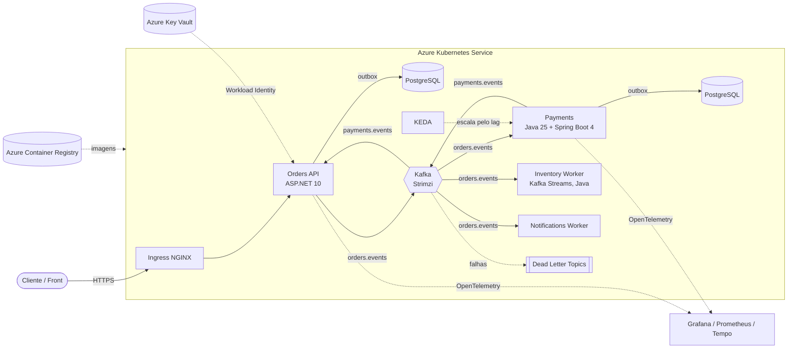

# Módulo 0: Ambiente e visão geral

## 0.1 O que vamos construir

O **OrderFlow** é um sistema de pedidos de e-commerce. Ele é pequeno o bastante para caber na sua
cabeça e grande o bastante para ter os problemas reais de produção: mensagens duplicadas, ordem de
eventos, falha parcial, escala por carga, deploy sem derrubar nada.

Arquitetura no final do curso (Módulo 7):



O fluxo principal, em português:

1. O cliente cria um pedido na **Orders API**. Ela grava no Postgres e, **na mesma transação**,
   grava o evento `OrderCreated` numa tabela outbox (Módulo 3).
2. Um processo publica o evento no tópico `orders.events` do **Kafka**, usando o `OrderId` como chave.
3. O **Payments** (Java + Spring Boot) consome, processa o pagamento e publica `PaymentApproved` em
   `payments.events`. Repare: Java e .NET nunca se chamam diretamente; o contrato entre eles é o formato
   da mensagem no Kafka (Módulo 3: Schema Registry).
4. A Orders API consome `payments.events` e marca o pedido como pago.
5. **Inventory** e **Notifications** reagem aos mesmos eventos, cada um no seu consumer group.
6. Mensagem que falha repetidamente vai para um **Dead Letter Topic** em vez de travar a fila.
7. Se o lag do consumer crescer, o **KEDA** sobe mais pods do Payments automaticamente.

No Módulo 1 você constrói o passo 1 em .NET, e no Módulo 1-J a lógica de pagamento em Java, cada um
com uma fila em memória no lugar do Kafka. Cada módulo
seguinte troca uma peça "de brinquedo" por uma de produção, **sem reescrever o domínio**. Essa
troca sem dor é a prova de que a arquitetura está certa.

## 0.2 Ferramentas

Instale agora só o bloco do Módulo 1. Os outros você instala quando chegar lá.

### Agora (Módulos 1 a 3)

| Ferramenta | Para quê | Instalação |
|---|---|---|
| **.NET 10 SDK** | compilar e rodar | https://dotnet.microsoft.com/download/dotnet/10.0 (Windows: `winget install Microsoft.DotNet.SDK.10`) |
| **Git** | versionar cada exercício | https://git-scm.com |
| **Editor** | escrever C# | **VS Code + extensão C# Dev Kit** (grátis), ou **JetBrains Rider** (grátis para uso não comercial), ou Visual Studio 2026 Community |
| **JDK 25** (Eclipse Temurin) | compilar e rodar o Payments (Módulo 1-J) | https://adoptium.net (Windows: `winget install EclipseAdoptium.Temurin.25.JDK`) |
| **IntelliJ IDEA** | escrever Java (o VS Code com "Extension Pack for Java" também serve) | https://www.jetbrains.com/idea/ |
| **Docker Desktop** | Kafka e Postgres locais (Módulo 2) | https://www.docker.com/products/docker-desktop |

Confira:

```bash
dotnet --version     # deve começar com 10.
git --version
docker --version     # só precisa no Módulo 2
```

### Depois (Módulos 4 a 7)

`kubectl`, `kind` (Kubernetes local dentro do Docker), `helm`, `k9s` (painel de terminal),
`az` (Azure CLI) e `terraform` ou `bicep`. O Módulo 4 traz o passo a passo.

### Custos

Os Módulos 1 a 5 rodam **100% na sua máquina, de graça**. O AKS só aparece nos Módulos 6 e 7,
e lá a regra é: cria o cluster, faz o laboratório, **destrói o cluster no mesmo dia**. O Módulo 6
traz os comandos e um alerta de orçamento na Azure para você nunca levar susto na fatura.

## 0.3 Como estudar este curso

Para cada lição:

1. **Leia a lição** inteira antes de abrir o código.
2. **Digite o código** num repositório seu (não copie e cole). Use o deste curso só para conferir.
3. **Quebre de propósito.** Remova uma linha, mude um tempo de vida da DI, veja o erro. Você
   aprende mais com o erro do que com o código funcionando.
4. **Faça os exercícios** do fim do módulo. Cada um é um commit.
5. **Responda as perguntas de entrevista em voz alta**, como se estivesse numa entrevista.
   Você estudou oratória: use isso. Explicar em voz alta revela o que você ainda não entendeu.

Sugestão de ritmo: 1 a 1h30 por dia, um módulo a cada 1 a 2 semanas. Os Módulos 1 a 3
concentram o que mais cai em entrevista técnica de backend .NET; os Módulos 4 a 7 são o
diferencial para vagas sênior e staff.

## 0.4 Mapa para as certificações

| Certificação | Formato | Onde este curso cobre |
|---|---|---|
| **CCDAK** (Confluent Certified Developer for Apache Kafka) | prova teórica, múltipla escolha | Módulos 2, 3 e 5. Complemente com um simulado. |
| **CKAD** (Certified Kubernetes Application Developer) | prova **prática** no terminal, com tempo | Módulos 4 e 6. O segredo é velocidade com `kubectl`; o Módulo 4 tem treino cronometrado. |
| **AZ-104** (Azure Administrator) | prova teórica + laboratórios | Módulo 6 cobre a parte de AKS, rede, identidade e Key Vault. O resto você estuda à parte. |
| **AI-200** (Azure AI Cloud Developer, substituta da AZ-204) | prova teórica | Módulo 6 e 7 cobrem a parte de containers, identidade e mensageria. |
| **Oracle Certified Professional: Java SE 21 Developer** (1Z0-830) | prova teórica, múltipla escolha, muito detalhista na linguagem | Módulo 1-J cobre a parte moderna (records, sealed, pattern matching, threads virtuais, concorrência). A prova vai além: estude com um guia específico e simulados. Usamos Java 25; o que a prova cobra do 21 continua valendo. Confira se já existe versão da prova para Java 25. |

Para Spring existe a **Spring Certified Professional** (hoje da Broadcom); confira formato, preço e
versão do Spring cobrada na página oficial antes de investir nela, porque o mercado pesa mais um
portfólio com Spring Boot atual do que o certificado.

Não existe certificação oficial de ASP.NET hoje. O que comprova esse conhecimento é este
repositório no seu GitHub, com histórico de commits mostrando a evolução.

## 0.5 Checklist antes do Módulo 1

- [ ] `dotnet --version` mostra 10.x
- [ ] `java -version` mostra 25 (necessário a partir do Módulo 1-J)
- [ ] Editor com suporte a C# instalado e funcionando (abra um `.cs` e veja se o autocomplete aparece)
- [ ] Repositório vazio criado no seu GitHub (ex.: `orderflow`) para ir subindo seus exercícios
- [ ] Clonou/abriu este repositório do curso e rodou `dotnet build` com sucesso

Próximo: [Módulo 1: C# e ASP.NET 10 para quem vem de Node/TS](modulo-01/README.md)
