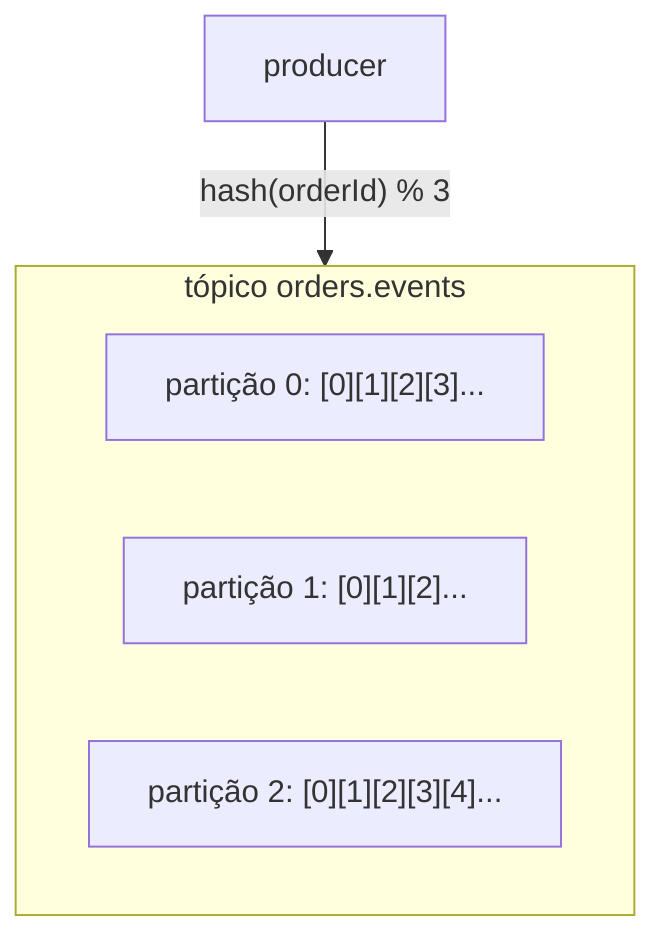

# 2.1 Kafka por dentro: log, tópico, partição, offset

Arquivo: `deploy/local/docker-compose.yml`

No Módulo 1 o `Channel<T>` resolveu "um produz, outro consome" dentro de um processo. Ele tinha três
limites que a lição 1.7 deixou anotados: some quando o pod reinicia, não escala para vários pods e não
deixa reprocessar. O Kafka resolve os três com uma ideia só, e entender essa ideia é o que separa quem
"usa Kafka" de quem consegue diagnosticar Kafka.

## A ideia: um log que ninguém apaga ao ler

::: conceito Log (commit log)
Um arquivo onde só se acrescenta no fim (*append-only*). Cada registro ganha uma posição crescente, o
**offset**: 0, 1, 2... Ler **não remove** nada. Quem lê guarda, separadamente, até onde já leu.
:::

É essa última frase que muda tudo em relação a uma fila tradicional (RabbitMQ, SQS, o seu `Channel`):

| | Fila (RabbitMQ, SQS, Channel) | Log (Kafka) |
|---|---|---|
| Ao consumir | a mensagem sai da fila | a mensagem **fica**; o consumidor avança um ponteiro |
| Dois sistemas querem o mesmo evento | precisa de uma fila por sistema (fan-out) | cada um lê o mesmo log com seu ponteiro |
| Reprocessar ontem | impossível, já saiu | volta o ponteiro |
| Quando apaga | quando alguém consumiu | por **retenção** (tempo ou tamanho), independente de quem leu |

::: analogia
Um livro-caixa de papel. O contador escreve linhas novas no fim e nunca rasga páginas. O auditor, o
fiscal e o dono leem o mesmo livro, cada um com o seu marcador de página. O livro é jogado fora depois
de sete anos (retenção), tenha alguém lido ou não.
:::

## Tópico e partição

Um **tópico** (`orders.events`) é um nome lógico. Fisicamente, ele é dividido em **partições**, e
**cada partição é um log independente**, com seus próprios offsets.



Por que dividir? Porque uma partição é a **unidade de paralelismo**. Num consumer group (lição 2.3),
cada partição é lida por no máximo um consumidor. Três partições = até três consumidores trabalhando ao
mesmo tempo. Um tópico de uma partição só nunca terá mais de um consumidor ativo por grupo, não importa
quantos pods você suba.

::: armadilha A ordem só existe DENTRO da partição
O Kafka garante ordem por partição, nunca entre partições. Se o `OrderCreated` do pedido X cair na
partição 0 e o `OrderCancelled` do mesmo pedido cair na 2, um consumidor pode ver o cancelamento antes
da criação. Por isso o OrderFlow usa o **orderId como chave**: mesma chave, mesmo hash, mesma partição,
ordem garantida **por pedido**. Pedidos diferentes podem (e devem) ser processados em paralelo.
:::

## Onde ficam os dados: broker, réplicas, ISR

Um **broker** é um servidor Kafka. Cada partição tem um **líder** (num broker) e zero ou mais
**seguidores** (réplicas em outros brokers). Producers escrevem no líder; seguidores copiam.

::: conceito ISR (in-sync replicas)
O conjunto de réplicas que está em dia com o líder. Se o líder cai, um membro do ISR vira líder sem
perder nada. Com `acks=all` (lição 2.2), o líder só confirma a escrita depois que todo o ISR gravou.
`min.insync.replicas=2` faz o broker **recusar** escritas se sobrar só uma réplica em dia: prefere ficar
indisponível a aceitar dado que pode sumir.
:::

O compose local tem **um broker só**, então fator de replicação 1 e nenhuma dessas garantias. Em
produção (Módulo 5), 3 brokers, replicação 3 e `min.insync.replicas=2` é o ponto de partida comum.

## KRaft: o fim do ZooKeeper

Até o Kafka 3.x, os metadados do cluster (que tópicos existem, quem é líder de quê) moravam num sistema
à parte, o ZooKeeper. O **Kafka 4.0 removeu o ZooKeeper**: o próprio Kafka guarda os metadados num log
interno replicado por um protocolo de consenso chamado KRaft (Kafka + Raft). Alguns nós têm o papel de
**controller**. No compose, um nó só faz os dois papéis:

```yaml
KAFKA_PROCESS_ROLES: broker,controller
KAFKA_CONTROLLER_QUORUM_VOTERS: 1@kafka:29093
```

::: dica
Tutorial que manda subir um container `zookeeper` está desatualizado. Útil para filtrar material de estudo.
:::

## Os listeners: o erro número 1 do Kafka em Docker

```yaml
KAFKA_LISTENERS: PLAINTEXT://:29092,PLAINTEXT_HOST://:9092,CONTROLLER://:29093
KAFKA_ADVERTISED_LISTENERS: PLAINTEXT://kafka:29092,PLAINTEXT_HOST://localhost:9092
```

O cliente Kafka não usa o endereço que você passou em `bootstrap.servers` para tudo. Ele usa esse
endereço só para a **primeira** conversa, em que pergunta "quem são os brokers e quem lidera cada
partição?". O broker responde com o **endereço anunciado** (*advertised*) do listener em que a
pergunta chegou, e o cliente passa a usar **esse** endereço.

::: previsao
Imagine que o compose tivesse um listener só, anunciado como `PLAINTEXT://kafka:29092`, publicado na
porta 9092 do host. Você roda o Orders na sua máquina com `BootstrapServers=localhost:9092`. O que acontece?
???
A primeira conexão funciona (`localhost:9092` chega no container). O broker responde "o líder está em
`kafka:29092`". Sua máquina tenta resolver o nome `kafka`, não consegue, e o producer fica em timeout com
mensagens como `Failed to resolve 'kafka:29092'`. O sintoma confunde porque "conectou": o problema não é
a porta, é o endereço anunciado. Por isso dois listeners: um anunciado como `kafka:29092` para quem está
dentro da rede do compose (Schema Registry, Kafka UI), outro como `localhost:9092` para a sua máquina.
:::

## Retenção e compactação

`retention.ms` (padrão 7 dias) e `retention.bytes` decidem quando segmentos antigos do log são
apagados. Um consumidor parado por 8 dias perde mensagens: o offset dele aponta para algo que não
existe mais, e o `auto.offset.reset` (lição 2.3) decide de onde ele recomeça.

Existe também a **compactação** (`cleanup.policy=compact`): o Kafka guarda só a **última** mensagem de
cada chave. Serve para tópicos que representam estado ("o endereço atual do cliente X"), não para
eventos como os nossos, em que o histórico importa.

## Lab: o Kafka pela linha de comando

::: checkpoint
Suba a infra e confira os tópicos criados pelo `kafka-init`:

```bash
docker compose -f deploy/local/docker-compose.yml up -d
docker compose -f deploy/local/docker-compose.yml logs kafka-init
docker compose -f deploy/local/docker-compose.yml exec kafka \
  /opt/kafka/bin/kafka-topics.sh --bootstrap-server localhost:9092 --describe --topic orders.events
```

O `--describe` mostra `PartitionCount: 3`, e para cada partição o `Leader`, as `Replicas` e o `Isr`
(todos `1`, o único broker).
:::

::: quebra Lab: chave decide a partição
Produza mensagens com chave pelo console e veja onde caem:

```bash
docker compose -f deploy/local/docker-compose.yml exec kafka bash -c \
  'printf "pedido-A:1\npedido-B:1\npedido-A:2\npedido-A:3\n" | /opt/kafka/bin/kafka-console-producer.sh \
   --bootstrap-server localhost:9092 --topic orders.events --property parse.key=true --property key.separator=:'

docker compose -f deploy/local/docker-compose.yml exec kafka /opt/kafka/bin/kafka-console-consumer.sh \
  --bootstrap-server localhost:9092 --topic orders.events --from-beginning --timeout-ms 5000 \
  --property print.key=true --property print.partition=true --property print.offset=true
```

Antes de rodar: as três mensagens de `pedido-A` caem na mesma partição? Em que ordem aparecem?
:::

::: solucao
As três de `pedido-A` aparecem na **mesma** partição, com offsets crescentes, na ordem em que foram
enviadas. `pedido-B` pode cair em outra. Se você rodar o consumer de novo com `--from-beginning`, vê
tudo outra vez: ler não apagou nada. (Essas mensagens não são eventos válidos; os consumers do Orders e
do Payments vão mandá-las para o DLT quando subirem. Bom aquecimento para a lição 3.4.)
:::

## Vídeos

::: video Apache Kafka 101: Introduction (Confluent, em inglês)
https://www.youtube.com/watch?v=qu96DFXtbG4
Tim Berglund apresentando eventos, tópicos e o modelo de log.
:::

::: video Apache Kafka 101: Topics (Confluent, em inglês)
https://www.youtube.com/watch?v=kj9JH3ZdsBQ
Partições, segmentos, retenção e compactação, com diagramas.
:::

## Perguntas para responder sem olhar

::: pergunta
Qual a diferença fundamental entre o Kafka e uma fila como o RabbitMQ?
???
No Kafka a mensagem não sai ao ser lida: o log é imutável e cada consumidor guarda o próprio offset.
Isso permite vários sistemas lerem o mesmo evento, reprocessar o passado e desacoplar no tempo. A
remoção é por retenção, não por consumo.
:::

::: pergunta
Por que o orderId é a chave das mensagens?
???
Mesma chave → mesmo hash → mesma partição → ordem garantida. Todos os eventos de um pedido chegam em
ordem ao consumidor, e pedidos diferentes se espalham pelas partições para processamento em paralelo.
:::

::: pergunta
Para que servem dois listeners no compose?
???
O cliente usa o endereço anunciado pelo broker depois da primeira conexão. Quem está na rede do compose
precisa de `kafka:29092`; quem está no host precisa de `localhost:9092`. Um listener para cada público.
:::

**Próxima:** [2.2 O producer](02-producer.md).
