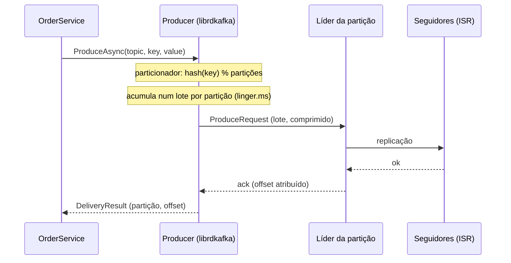

# 2.2 O producer: acks, idempotência, chave e particionador

Arquivos: `Infrastructure/Messaging/KafkaClientFactory.cs`, `KafkaOrderEventPublisher.cs` (.NET);
`application.yml` (`spring.kafka.producer`) e `KafkaPaymentEventPublisher.java` (Java)

## O que acontece num `ProduceAsync`



Três coisas importantes nesse desenho:

1. **O envio é assíncrono e em lote.** O `ProduceAsync` coloca a mensagem num buffer em memória; uma
   thread do librdkafka manda lotes por partição. O `await` termina quando chega o ack.
2. **Quem decide a partição é o cliente**, não o broker.
3. **Quando o ack chega depende de `acks`.**

## `acks`: quanto de durabilidade você compra

| `acks` | O líder confirma quando... | Se o líder cair logo depois do ack |
|---|---|---|
| `0` | nem espera resposta | pode ter perdido |
| `1` | ele mesmo gravou | perde se nenhum seguidor copiou ainda |
| `all` (ou `-1`) | todo o ISR gravou | não perde (com `min.insync.replicas` ≥ 2) |

O OrderFlow usa `acks=all` nos dois serviços. O custo é alguns milissegundos de latência; o benefício é
que o `201 Created` só sai depois que o evento está replicado.

## Producer idempotente: retry sem duplicata

Redes falham. O producer manda um lote, o broker grava, o ack se perde. O producer, por timeout,
manda **de novo**. Sem proteção, o lote fica gravado duas vezes.

::: conceito Producer idempotente
Cada producer recebe um id do broker e numera as mensagens por partição. O broker lembra o último
número de cada producer e **descarta** um reenvio que já gravou. Também recusa um número fora de
ordem, o que mantém a ordem mesmo com até 5 requisições em voo por conexão.
:::

::: armadilha O padrão é diferente nas duas stacks
No cliente **Java**, `enable.idempotence=true` é o padrão desde o Kafka 3.0. No **librdkafka** (a
biblioteca C por baixo do `Confluent.Kafka`), o padrão é `false`. Quem escreve o mesmo producer nas duas
linguagens e confia no padrão tem um serviço com duplicata e outro sem. Por isso o `KafkaClientFactory`
diz `EnableIdempotence = true` em voz alta, e o `application.yml` também, mesmo sendo redundante no Java.
:::

Idempotência do **producer** evita duplicata causada pelo **retry do producer**. Ela não evita a
duplicata do seu código chamar `ProduceAsync` duas vezes, nem a do consumidor reprocessar. Essas são
assunto do Módulo 3 (outbox e inbox).

## A chave e o particionador: a pegadinha entre linguagens

```csharp
// CRÍTICO entre linguagens: o particionador padrão do librdkafka é "consistent_random"
// (CRC32) e o do Java é murmur2.
Partitioner = Partitioner.Murmur2Random,
```

O particionador transforma a chave em um número de partição. O cliente Java usa **murmur2**. O
librdkafka usa **CRC32** por padrão. A mesma chave `"01a150ba-..."` pode ir para a partição 0 se o
producer for Java e para a 2 se for .NET.

::: previsao
No OrderFlow cada tópico tem um producer só (Orders em `orders.events`, Payments em
`payments.events`). Então tanto faz o particionador? Pense em dois cenários: (a) um script de
reprocessamento em Java que republica mensagens do DLT em `orders.events`; (b) o Módulo 5, em que um
Kafka Streams em Java junta `orders.events` e `payments.events` por orderId.
???
**Importa nos dois.** (a) O script em Java manda o evento do pedido X para outra partição; agora há
eventos de X em duas partições e a ordem por pedido acabou. (b) Um *join* em Kafka Streams exige que os
dois tópicos estejam **co-particionados**: o pedido X na mesma partição dos dois lados. Com
particionadores diferentes isso falha de um jeito silencioso: o join simplesmente não encontra os pares.
`Murmur2Random` deixa o .NET compatível com o Java ("Random" é só para chave nula).
:::

## Lote, compressão, backpressure

| Configuração | No OrderFlow | O que faz |
|---|---|---|
| `linger.ms` | 5 | espera até 5 ms juntando mensagens antes de mandar o lote |
| `compression.type` | zstd | comprime o **lote** (quanto maior o lote, melhor a taxa) |
| `message.timeout.ms` (.NET) / `delivery.timeout.ms` (Java) | 30 s | prazo total para uma mensagem, incluindo retries |
| `queue.buffering.max.kbytes` (.NET) / `buffer.memory` (Java) | padrão | tamanho do buffer em memória |

Quando o broker está lento e o buffer enche, o cliente Java **bloqueia** o `send` por até
`max.block.ms`; o librdkafka **lança** `Local: Queue full`. É o mesmo backpressure do `Channel` com
`BoundedChannelFullMode.Wait` da lição 1.7, com comportamentos diferentes por stack.

## O código, nas duas linguagens

.NET (`KafkaOrderEventPublisher.cs`):

```csharp
var message = OrderEventMapping.ToMessage(orderEvent, Guid.CreateVersion7(clock.GetUtcNow()));
var value = await codec.EncodeAsync(message, topic);
using var activity = KafkaTracing.StartSend(topic, message.OrderId);
await producer.ProduceAsync(topic, KafkaMessages.Create(message.OrderId, value, message.EventType, message.EventId, activity), ct);
```

Java (`KafkaPaymentEventPublisher.java`):

```java
template.send(record(topic, message.orderId(), codec.encode(topic, message), message.eventType(), message.eventId())).join();
```

::: porque Por que `byte[]` e não um serializador no producer
Os dois producers são `<string, byte[]>`, e a conversão para JSON (ou Avro, no Módulo 3) acontece no
nosso `EventCodec`. Três motivos: (1) do lado do consumidor, um erro de formato acontece no **nosso**
código, onde viramos ele em "mensagem envenenada" e mandamos para o DLT; com o desserializador
configurado no cliente, o erro estoura dentro do `Consume()`/`poll()`; (2) o DLT recebe os bytes
**originais**; (3) trocar JSON por Avro é trocar um bean, e mais nada.
:::

::: porque Por que um producer só por processo
O `IProducer` é registrado como **singleton** (`DependencyInjection.cs`); o `KafkaTemplate` do Spring
também é um bean singleton. Um producer mantém conexões TCP com os brokers, buffers e uma thread de
envio. Criar um por requisição é como abrir um pool de conexões de banco por requisição: funciona no
teste manual e derruba o broker com conexões em produção.
:::

::: quebra Lab: Kafka fora do ar
Com o Orders rodando no modo do Módulo 2 (`Orders__Persistence=InMemory`), pare o broker e crie um pedido:

```bash
docker compose -f deploy/local/docker-compose.yml stop kafka
curl -i -X POST http://localhost:5279/orders -H 'Content-Type: application/json' \
  -d '{"customerId":"cli-001","items":[{"sku":"TECLADO-01","quantity":1,"unitPrice":10}]}'
```

Quanto tempo a requisição demora? Que status volta? E o pedido, existe (`GET /orders?status=Pending`)?
:::

::: solucao
A requisição fica pendurada por cerca de **30 s** (`MessageTimeoutMs`) e volta **500**: o
`ProduceAsync` lançou `ProduceException` com `Local: Message timed out`. E o pedido **existe**: o
repositório em memória guardou **antes** de publicar. Pedido sem evento: o Payments nunca vai saber dele.
É o *dual write problem* da lição 1.7, agora com um broker de verdade. O Módulo 3 resolve com o outbox,
e o mesmo teste passa a responder 201 em milissegundos.
:::

## Vídeo

::: video Apache Kafka 101: Producers (Confluent, em inglês)
https://www.youtube.com/watch?v=I7zm3on_cQQ
Chave, particionamento, lotes e acks em 7 minutos.
:::

## Perguntas para responder sem olhar

::: pergunta
O que o producer idempotente garante, e o que ele NÃO garante?
???
Garante que um retry do próprio producer (ack perdido, timeout) não grava a mensagem duas vezes e não
inverte a ordem na partição. Não garante nada sobre a aplicação chamar `send` duas vezes, nem sobre o
consumidor processar duas vezes. Para isso: outbox com eventId estável e consumidor idempotente.
:::

::: pergunta
Por que o .NET precisa de `Partitioner = Murmur2Random`?
???
O padrão do librdkafka é CRC32 e o do Java é murmur2: a mesma chave cai em partições diferentes
conforme a linguagem do producer. Isso quebra a ordem por chave quando dois producers escrevem no mesmo
tópico e quebra joins entre tópicos co-particionados.
:::

**Próxima:** [2.3 O consumer](03-consumer-e-grupos.md).
