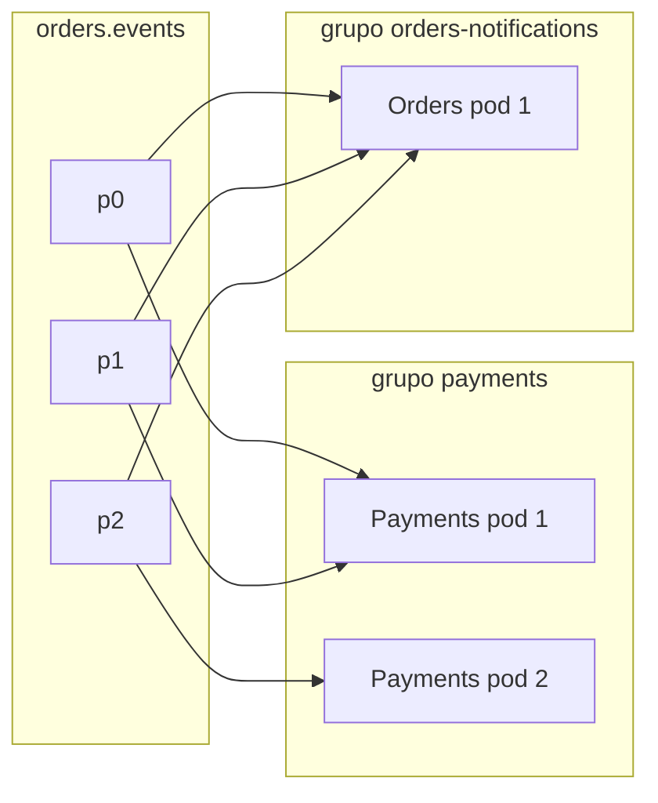

# 2.3 O consumer: laço, offsets e consumer groups

Arquivos: `Infrastructure/Messaging/KafkaConsumerWorker.cs`, `PaymentEventsConsumer.cs`,
`OrderNotificationsConsumer.cs` (.NET); `infrastructure/kafka/OrderEventsListener.java` (Java)

## Consumer group: como o Kafka divide o trabalho

::: conceito Consumer group
Um conjunto de consumidores com o mesmo `group.id`. O Kafka distribui as **partições** do tópico entre
os membros: cada partição tem **exatamente um** dono dentro do grupo. O offset confirmado também é
guardado **por grupo** (no tópico interno `__consumer_offsets`).
:::

Daí saem as duas regras que você usa para dimensionar qualquer sistema com Kafka:

- **Dentro de um grupo, as partições são divididas.** 3 partições e 2 pods do Orders no grupo
  `orders`: um pod fica com 2 partições, o outro com 1. Um terceiro pod pega 1 de quem tinha 2. Um
  **quarto** pod fica **parado**: não há partição para ele.
- **Grupos diferentes recebem tudo.** O grupo `payments` (Java) e o grupo `orders-notifications`
  (.NET) leem `orders.events` inteiro, cada um com seus offsets, sem saber um do outro.



::: porque Por que o Orders lê o próprio tópico
O `OrderNotificationsConsumer` é o `OrderEventsWorker` do Módulo 1 ("notificação simulada"), agora
lendo do Kafka. Ele está ali para você **ver** o publish/subscribe: crie um pedido e os logs dos dois
serviços mostram o mesmo evento. Em produção, faria sentido um serviço de notificações separado. Ler o
próprio tópico também é um padrão com nome (*listen to yourself*), que a pergunta 5 do Módulo 1 cita.
:::

## O laço no .NET

O `Confluent.Kafka` dá o cliente e mais nada. O laço é seu:

```csharp
using var consumer = clients.CreateConsumer(GroupId);
consumer.Subscribe(Topic);
try
{
    while (!ct.IsCancellationRequested)
    {
        var result = consumer.Consume(ct);   // bloqueia; também faz heartbeat e rebalance
        await ProcessAsync(result, ct);
        consumer.StoreOffset(result);        // só DEPOIS de processar
    }
}
finally
{
    consumer.Close();                        // confirma offsets e sai do grupo na hora
}
```

::: porque Por que o `Consume()` bloqueante pode ficar dentro do `ExecuteAsync`
Até o .NET 9, o trecho **antes do primeiro `await`** do `ExecuteAsync` rodava na thread de
inicialização e segurava a subida dos outros serviços: um `Consume()` ali travava o host inteiro, e o
truque era envolver tudo num `Task.Run`. No **.NET 10** isso mudou (breaking change documentado): o
`ExecuteAsync` inteiro roda numa thread de segundo plano. O código fica direto. Se você mantiver um
projeto em .NET 8, o `Task.Run` volta a ser necessário.
:::

## Offsets: o que "confirmar" quer dizer

O offset confirmado (*committed*) é "a **próxima** mensagem que este grupo deve ler". Quando um
consumidor reinicia, ou quando a partição muda de dono, a leitura recomeça dali.

| Momento do commit | Garantia | Risco |
|---|---|---|
| Antes de processar | no máximo uma vez | crash depois do commit = mensagem perdida |
| **Depois de processar** | **pelo menos uma vez** | crash entre processar e commitar = mensagem repetida |

O OrderFlow escolhe **pelo menos uma vez** nas duas stacks. A mensagem repetida é tratada pela
idempotência do domínio (Módulo 1) e pelo Inbox (Módulo 3).

No .NET, a configuração que implementa isso é sutil:

```csharp
EnableAutoCommit = true,        // um timer confirma em segundo plano (a cada 5 s)...
EnableAutoOffsetStore = false,  // ...mas só o que NÓS guardamos com StoreOffset
```

::: armadilha O "auto commit" padrão do librdkafka
Com os padrões (`EnableAutoOffsetStore = true`), o cliente guarda o offset no momento em que **entrega**
a mensagem ao seu código. O timer confirma esse offset mesmo que o seu processamento ainda esteja
rodando ou tenha falhado. Crash no meio = mensagem perdida, em silêncio. É o erro mais comum em
consumers .NET em produção, e não aparece em teste nenhum. A alternativa `consumer.Commit(result)` a cada
mensagem é correta, mas faz uma ida e volta ao broker por mensagem.
:::

## O mesmo consumer no Java: o listener container

```java
@KafkaListener(
        id = "payments-orders-events",
        topics = "${payments.kafka.orders-events-topic}",
        groupId = "${payments.kafka.consumer-group}",
        concurrency = "${payments.kafka.consumer-concurrency}")
public void onMessage(ConsumerRecord<String, byte[]> record) { ... }
```

Não tem laço, nem commit. O Spring Kafka cria um **listener container** com uma thread por
`concurrency`, cada uma com o seu `KafkaConsumer` fazendo `poll()`. Quando o método retorna **sem
exceção**, o container marca o offset; com `ack-mode: batch` (o padrão), confirma depois que todas as
mensagens daquele `poll()` foram processadas. Exceção vai para o `DefaultErrorHandler` (lição 3.4).

| | .NET (Confluent.Kafka) | Java (Spring Kafka) |
|---|---|---|
| Laço de leitura | você escreve | o container |
| Threads | 1 por BackgroundService | `concurrency` threads por listener |
| Commit | `StoreOffset` + auto commit | `AckMode` (BATCH, RECORD, MANUAL...) |
| Retry e DLT | você escreve (Módulo 3) | `DefaultErrorHandler` + `DeadLetterPublishingRecoverer` |
| Desligar | `Close()` no `finally` | o container faz no shutdown do contexto |

::: armadilha `concurrency` maior que o número de partições
`consumer-concurrency: 4` com 3 partições cria 4 consumidores no grupo, e um fica sem partição. E isso é
**por pod**: 2 pods com `concurrency: 3` são 6 membros para 3 partições, metade parada. Paralelismo
máximo de um grupo = número de partições. Para crescer além disso, aumente as partições (o que muda o
mapeamento chave → partição das mensagens **novas**, cuidado com a ordem).
:::

## `auto.offset.reset`

Vale quando o grupo **não tem** offset confirmado (primeira vez) ou quando o offset confirmado já foi
apagado pela retenção. `earliest` começa do mais antigo retido; `latest` começa do fim e ignora o que já
estava lá. O OrderFlow usa `earliest`: o primeiro deploy do Payments aprende todos os pedidos já criados.

## Lag: a métrica que importa

::: conceito Consumer lag
Para cada partição: offset da última mensagem gravada menos offset confirmado pelo grupo. É quantas
mensagens o grupo ainda não processou. Lag crescendo sem parar = consumidor mais lento que o produtor,
ou travado numa mensagem.
:::

::: quebra Lab: lag, e nada se perde
Com a infra de pé e os dois serviços rodando:

```bash
# 1. pare o Payments (Ctrl+C) e crie 5 pedidos pelo requests.http
# 2. veja o lag do grupo payments
docker compose -f deploy/local/docker-compose.yml exec kafka /opt/kafka/bin/kafka-consumer-groups.sh \
  --bootstrap-server localhost:9092 --describe --group payments
# 3. suba o Payments de novo e rode o describe outra vez
```

Antes de rodar: com o Payments parado, a API de pedidos funciona? Qual o `LAG` total? Ao voltar, o
Payments aprende os 5 pedidos?
:::

::: solucao
O Orders funciona normalmente: ele não sabe, nem precisa saber, se alguém está lendo. O `LAG` soma 5,
espalhado pelas partições conforme o hash dos orderIds. Com o `describe`, o grupo aparece sem membros
(`Consumer group 'payments' has no active members`), mas os offsets confirmados continuam lá. Quando o
Payments volta, ele retoma do offset confirmado, processa os 5, e o `LAG` volta a 0. **Desacoplamento no
tempo**: produtor e consumidor não precisam estar de pé ao mesmo tempo, algo que uma chamada HTTP
entre os dois serviços nunca daria.
:::

::: dica
O Kafka UI mostra o mesmo em *Consumers → payments*: partição, offset atual, offset final e lag.
:::

## Vídeo

::: video Apache Kafka 101: Consumers (Confluent, em inglês)
https://www.youtube.com/watch?v=Z9g4jMQwog0
Grupos, offsets e o tópico `__consumer_offsets`.
:::

## Perguntas para responder sem olhar

::: pergunta
Você tem 6 partições e sobe 8 pods do consumidor no mesmo grupo. Quantos trabalham?
???
6. Cada partição tem um dono no grupo; 2 pods ficam ociosos (servem de reserva num rebalance). Para usar
os 8, precisa de pelo menos 8 partições.
:::

::: pergunta
Por que `EnableAutoOffsetStore = false` no .NET?
???
Com o padrão, o offset é guardado ao entregar a mensagem ao código, e o auto commit o confirma mesmo se
o processamento falhar ou o processo morrer no meio. Guardando à mão depois de processar, o auto commit
só confirma o que de fato foi processado: pelo menos uma vez.
:::

::: pergunta
Dois sistemas precisam de todos os eventos de pedido. Mesmo grupo ou grupos diferentes?
???
Grupos diferentes. No mesmo grupo eles dividiriam as partições, e cada um veria só parte dos eventos.
:::

**Próxima:** [2.4 Rebalance](04-rebalance.md).
