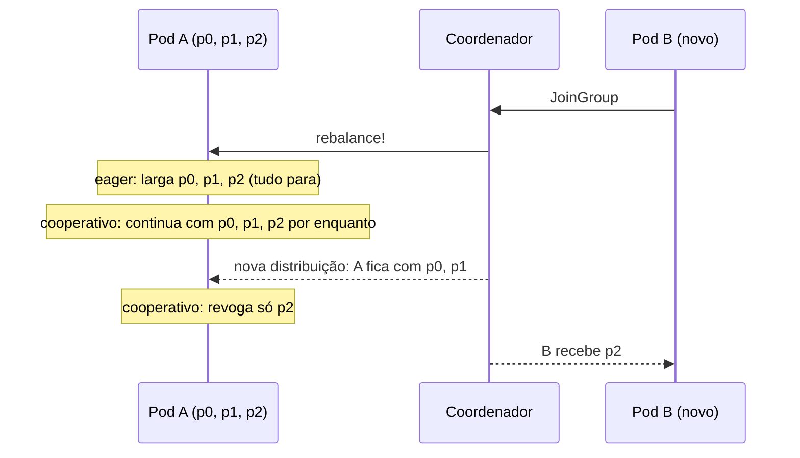

# 2.4 Rebalance: quando o grupo muda

Arquivos: `KafkaClientFactory.cs` (`CreateConsumer`), `KafkaErrorHandling.java` (`rebalanceLogger`),
`application.yml` (`partition.assignment.strategy`)

## O que é e quando acontece

::: conceito Rebalance
A redistribuição das partições entre os membros de um consumer group. Acontece quando um membro
**entra** (deploy, scale out, KEDA), **sai** (`Close()` no shutdown), **morre** (para de mandar
heartbeat por `session.timeout.ms`) ou **trava** (não chama `poll()`/`Consume()` por
`max.poll.interval.ms`), e quando o número de partições do tópico muda.
:::

Num cluster Kubernetes, rebalance não é exceção: todo deploy com rolling update gera vários. Um consumer
que se comporta mal no rebalance vira latência a cada deploy.

## Quem decide: o coordenador

Cada grupo tem um broker **coordenador**. No protocolo clássico, o coordenador escolhe um dos membros
como **líder do grupo**, e é esse cliente que calcula a distribuição usando a
`partition.assignment.strategy` e devolve ao coordenador, que repassa a todos.

## Eager vs cooperativo

**Eager** (os `range` e `roundrobin` clássicos): no rebalance, **todos** os membros largam **todas** as
partições, esperam a nova distribuição e retomam. O grupo inteiro para, mesmo que só uma partição mude
de dono. É o famoso *stop-the-world*.

**Cooperativo** (`CooperativeStickyAssignor` no Java, `cooperative-sticky` no librdkafka): o rebalance
acontece em duas rodadas e só as partições que **mudam de dono** são revogadas. As outras continuam
sendo processadas durante o rebalance. "Sticky" = tenta manter cada partição com o dono anterior.



| | .NET (librdkafka) | Java (cliente oficial) |
|---|---|---|
| Padrão | `range,roundrobin` (eager) | `[RangeAssignor, CooperativeStickyAssignor]` (começa eager) |
| No OrderFlow | `PartitionAssignmentStrategy.CooperativeSticky` | `CooperativeStickyAssignor` no `application.yml` |

::: armadilha Mudar a estratégia com o grupo rodando
Membros de um mesmo grupo precisam concordar numa estratégia comum. Trocar de eager para cooperativo
num grupo em produção exige um rolling update em duas etapas (primeiro os dois na lista, depois só o
cooperativo). Num grupo novo, como os nossos, é só configurar desde o início.
:::

## O protocolo novo: KIP-848

O Kafka 4.0 tornou estável um **protocolo novo de grupo** (KIP-848, `group.protocol=consumer`). A
diferença de arquitetura: o **broker** calcula a distribuição (não mais um cliente líder), e o
rebalance é incremental por natureza, sem a "barreira" em que todos param para sincronizar. Rebalances
ficam mais rápidos e um membro lento não segura o grupo inteiro.

No cliente, ele está **desligado por padrão** nas duas stacks. O OrderFlow deixa preparado:
`Kafka:UseConsumerGroupProtocol=true` no .NET (estável no Confluent.Kafka desde a 2.12) e, no Java,
trocar as linhas de `partition.assignment.strategy` por `group.protocol: consumer`. Com ele,
`session.timeout.ms` e a estratégia passam a ser configuração do **broker**, e o cliente recusa se
você os passar; por isso o `if` no `KafkaClientFactory`.

::: porque Por que não ligar o KIP-848 por padrão já
Porque ele muda o comportamento de quem opera o cluster (as configs migram para o broker, as
ferramentas de diagnóstico mostram outras coisas), e a primeira vez que você o encontra não deveria ser
num incidente. Ligue no laboratório (Exercício 2.3), compare os logs de rebalance, e decida com dado.
:::

## Os três timeouts que você precisa saber de cor

| Configuração | Padrão | Pergunta que responde |
|---|---|---|
| `heartbeat.interval.ms` | 3 s | de quanto em quanto tempo o cliente diz "estou vivo" |
| `session.timeout.ms` | 45 s | quanto tempo sem heartbeat até o membro ser dado como morto |
| `max.poll.interval.ms` | 5 min | quanto tempo o **código** pode ficar sem chamar `poll()`/`Consume()` |

O heartbeat roda numa thread de segundo plano. Por isso um pod pode estar "vivo" (heartbeat ok) e
"travado" (seu handler preso há 6 minutos num `SELECT` sem timeout): é o `max.poll.interval.ms` que
pega esse caso, tira o membro do grupo e entrega as partições a outro. Quando o código travado
finalmente termina e tenta confirmar o offset, recebe erro: a partição não é mais dele.

::: previsao
Um handler do Orders demora 6 minutos numa mensagem (banco travado). O que acontece com essa mensagem?
???
Depois de 5 minutos sem `Consume()`, o cliente sai do grupo e a partição vai para outro pod, que
**reprocessa a mesma mensagem** a partir do último offset confirmado. Se o primeiro handler terminar
depois, as duas execuções aconteceram: é a duplicata que o Inbox (Módulo 3) existe para absorver. Por
isso o retry do `KafkaConsumerWorker` é curto (centenas de milissegundos) e, se a falha persistir, ele
fecha o consumer de propósito em vez de segurar a partição.
:::

## Shutdown limpo: `Close()`

Sem `Close()`, o membro só sai do grupo quando o `session.timeout.ms` (45 s) expira, e as partições dele
ficam **paradas** esse tempo todo. Com `Close()`, o cliente avisa o coordenador e o rebalance é
imediato. No Kubernetes, o SIGTERM cancela o `stoppingToken`, o `Consume` lança
`OperationCanceledException` e o `finally` chama `Close()`. No Java, o container faz isso no shutdown
do contexto Spring.

::: dica Static membership
Com `group.instance.id` fixo por pod (no Kubernetes, o nome do pod de um StatefulSet), um membro que
reinicia rápido volta com as mesmas partições **sem** rebalance, desde que volte antes do
`session.timeout.ms`. Útil para consumers com estado local (caches, Kafka Streams).
:::

## Lab: veja o rebalance acontecer

::: quebra Lab: dois Payments no mesmo grupo
Suba dois Payments em portas diferentes e acompanhe os logs de `Rebalance:`:

```bash
cd java/payments
SERVER_PORT=8081 PAYMENTS_PERSISTENCE=in-memory PAYMENTS_KAFKA_FORMAT=json ./mvnw spring-boot:run   # terminal 1
SERVER_PORT=8082 PAYMENTS_PERSISTENCE=in-memory PAYMENTS_KAFKA_FORMAT=json ./mvnw spring-boot:run   # terminal 2
docker compose -f ../../deploy/local/docker-compose.yml exec kafka /opt/kafka/bin/kafka-consumer-groups.sh \
  --bootstrap-server localhost:9092 --describe --group payments --members --verbose
```

Antes: quantas partições cada um recebe? O terminal 1 para de processar enquanto o 2 entra? Depois, dê
Ctrl+C no 2 e conte quanto tempo até o 1 receber as partições de volta. Repita matando com
`kill -9` (sem `Close()`).
:::

::: solucao
Um fica com 2 partições e o outro com 1. Com o cooperativo, o terminal 1 registra só a **revogação** da
partição que mudou de dono; as outras duas não param. No Ctrl+C, o 1 recebe a partição de volta em
menos de um segundo (`Close()`). Com `kill -9`, leva por volta de 45 s, o `session.timeout.ms`: durante
esse tempo, os pedidos cujo hash cai naquela partição ficam sem processamento. É o argumento para
desligamento gracioso que o Módulo 4 retoma com `terminationGracePeriodSeconds`.
:::

## Vídeo

::: video "The Magical Rebalance Protocol of Apache Kafka", Gwen Shapira (Strange Loop, em inglês)
https://www.youtube.com/watch?v=MmLezWRI3Ys
Como o protocolo clássico funciona por dentro e por que ele é desenhado assim. Base para entender o que
o KIP-848 mudou.
:::

## Perguntas para responder sem olhar

::: pergunta
Qual a diferença entre `session.timeout.ms` e `max.poll.interval.ms`?
???
O primeiro detecta processo morto (sem heartbeat, que roda em segundo plano). O segundo detecta código
travado (sem chamar poll/Consume). Um pod pode passar no primeiro e falhar no segundo.
:::

::: pergunta
Por que o rebalance cooperativo é melhor num cluster Kubernetes?
???
Porque deploys e autoscaling geram rebalances o tempo todo. No eager, cada um para o grupo inteiro; no
cooperativo, só as partições que mudam de dono param.
:::

**Próxima:** [2.5 Orders ↔ Payments por eventos](05-orders-payments-por-eventos.md).
