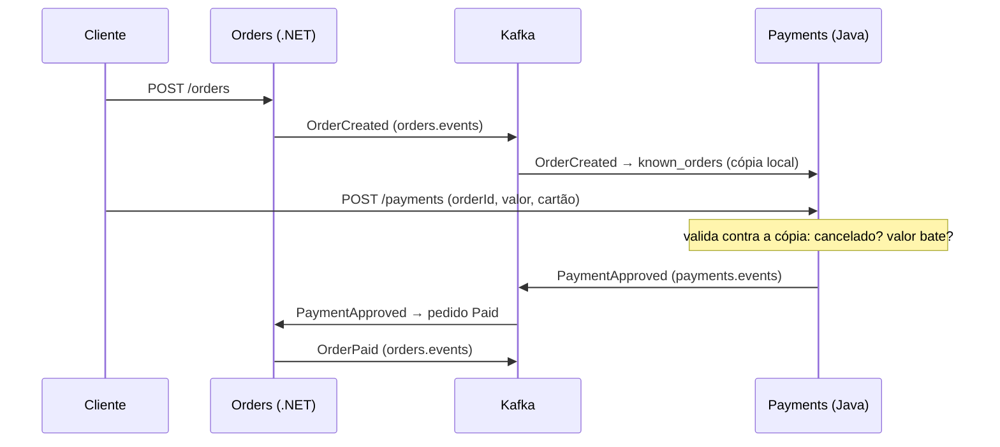
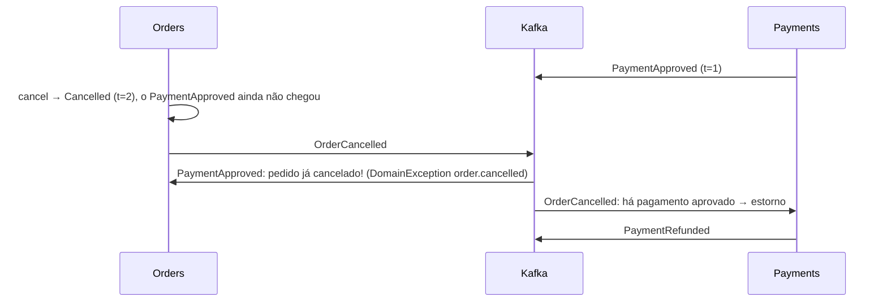

# 2.5 Orders ↔ Payments por eventos: contrato, portas e saga

Arquivos: `Infrastructure/Messaging/EventContracts.cs`, `infrastructure/kafka/EventContracts.java`,
`Infrastructure/DependencyInjection.cs`, `config/PaymentsConfiguration.java`,
`Application/PaymentEventsHandler.cs`, `application/OrderEventHandler.java`

## O fluxo completo



Repare no que **não** existe: nenhuma chamada HTTP entre os serviços. O Payments não pergunta ao
Orders "esse pedido existe?"; ele **já sabe**, porque escutou o `OrderCreated`.

## O contrato: o que viaja no fio

Os dois serviços não compartilham nenhuma classe. O contrato é o formato da mensagem, escrito duas vezes:
`OrderEventMessage`/`PaymentEventMessage` em C# e em Java. Um evento de pedido criado, em JSON:

```json
{
  "eventId": "01a150ba-9a94-7e1d-a2f4-88d24a31db00",
  "eventType": "OrderCreated",
  "orderId": "01a150ba-9a94-7e1d-a2f4-88d24a31db9a",
  "occurredAt": "2026-10-30T12:00:00.1234567Z",
  "customerId": "cli-001",
  "total": "301.00"
}
```

Cada decisão ali tem um bug evitado atrás:

| Decisão | O bug que ela evita |
|---|---|
| `total` como **texto** `"301.00"` | Um consumidor em JavaScript (ou um `double` em qualquer lugar) lê `301.0` ou `0.30000000000000004`. Texto chega exato em qualquer linguagem |
| `ToString(CultureInfo.InvariantCulture)` | Num servidor pt-BR, `301.5m.ToString()` dá `"301,5"`, e o Java não lê |
| `toPlainString()` no Java | `new BigDecimal("1E+3").toString()` é `"1E+3"`; o .NET não lê notação científica |
| data ISO-8601 em **UTC** com `Z` | fuso do servidor vazando para o dado; `Instant.parse` do Java e `DateTimeOffset.Parse` do .NET leem os dois |
| microssegundos no Java | o `Instant` pode ter 9 casas; o .NET guarda 7 |
| `eventId` | o consumidor deduplica por ele (Inbox, Módulo 3) |
| envelope plano + `eventType` | polimorfismo em JSON (`$type`, `@JsonTypeInfo`) é diferente em cada biblioteca; um campo de texto é igual em todas |
| camelCase | padrão do Jackson e do `JsonSerializerDefaults.Web`; ninguém precisa configurar nada |

::: armadilha Serializar o domínio direto
O atalho tentador: `JsonSerializer.Serialize(orderCreated)`. Funciona no primeiro dia. No dia em que
alguém renomeia `Total` para `TotalAmount` no domínio (refatoração inocente, o compilador aprova), o
Payments para de receber o total, em produção, sem nenhum teste vermelho no Orders. A camada de
contrato (`OrderEventMapping.ToMessage`) é o lugar onde um rename **quebra o build ou o teste de
contrato**, e não a integração.
:::

::: conceito Leitor tolerante (tolerant reader)
Quem lê ignora o que não conhece: campos novos (`@JsonIgnoreProperties(ignoreUnknown = true)` no Java;
o System.Text.Json já ignora por padrão) e tipos de evento novos (o `default` do `switch` registra e
segue). É o que deixa o produtor **acrescentar** coisas sem coordenar deploy com todos os consumidores.
Remover ou mudar o tipo de um campo continua sendo quebra: o Módulo 3 põe isso sob controle com o
Schema Registry.
:::

## Mesmas portas, adaptadores novos

O pedido do curso para este módulo era "trocar a fila em memória pelo Kafka atrás das mesmas portas".
No .NET, a porta é `IOrderEventPublisher`; o Módulo 1 tinha `ChannelOrderEventPublisher`, o Módulo 2
acrescenta `KafkaOrderEventPublisher`. Quem escolhe é a configuração:

```csharp
// DependencyInjection.cs
if (orders.Messaging == MessagingMode.Kafka)
    AddKafka(services, publishDirectly: orders.Persistence == PersistenceMode.InMemory);
else
    AddInMemoryMessaging(services);
```

No Java, a mesma escolha é feita com `@ConditionalOnProperty` em classes de configuração internas da
`PaymentsConfiguration`. O `OrderService` e o `PaymentService` não mudaram para ganhar Kafka. Isso é a
arquitetura em camadas do Módulo 1 pagando a conta: o domínio e os casos de uso não importam nada de
infraestrutura, então trocar a infraestrutura não toca neles.

::: porque Por que manter o modo em memória
Três motivos práticos: os testes de API do Módulo 1 continuam rodando em milissegundos, sem Docker
(`InMemoryOrdersApiFactory` e o perfil `lab` do Java); dá para depurar a regra de negócio sem subir
infraestrutura; e cada módulo do curso continua executável. O custo é manter dois adaptadores por porta.
Num produto real, você provavelmente manteria só o de produção e usaria Testcontainers (Módulo 3) nos testes.
:::

## Consistência eventual: a cópia local dos pedidos

O Payments guarda, em `KnownOrderRepository`, o que aprendeu sobre cada pedido: cliente, total e status.
Com isso, `PaymentService.process` passa a recusar:

- pagamento de pedido **cancelado** → 409 `payment.order_cancelled`;
- valor diferente do total → 422 `payment.amount_mismatch`.

::: previsao
O cliente cria o pedido e, 5 ms depois, o app dele manda `POST /payments`. O `OrderCreated` ainda não foi
consumido pelo Payments (lag). O que o Payments deveria fazer: recusar ("pedido desconhecido") ou aceitar?
???
O código **aceita** pedido desconhecido. Recusar faria a disponibilidade do pagamento depender do lag do
consumer: um Payments atrasado 2 minutos recusaria todos os pagamentos desses 2 minutos. O preço de
aceitar: a validação de valor não roda para pedidos que o Payments ainda não viu. Alternativas, com
custos diferentes: o front mandar o total junto e o Payments validar depois (ao receber o
`OrderCreated`, compara e estorna se não bater), ou um `409` com `Retry-After` e o cliente tentando de
novo. Não existe resposta grátis; existe escolher sabendo. É o Exercício 2.4.
:::

## A corrida entre serviços e a compensação

O cliente clica em "cancelar" no mesmo instante em que o Payments aprova o cartão:



Nenhum dos dois serviços errou; não existe transação entre eles. A solução é uma **compensação**: uma
ação que desfaz o efeito de outra. O `OrderEventHandler.onOrderCancelled` do Payments estorna qualquer
pagamento aprovado de um pedido cancelado; o `PaymentEventsHandler` do Orders, ao receber um
`PaymentApproved` de pedido cancelado, **não lança exceção** (que viraria retry e DLT): registra e
segue, porque quem compensa é o outro lado.

::: conceito Saga
Uma transação de negócio que atravessa vários serviços, feita como uma sequência de passos locais, cada
um com sua compensação. Aqui é uma saga **coreografada**: ninguém coordena, cada serviço reage aos
eventos do outro. A alternativa é a **orquestrada**, com um coordenador central (um "processo de
pedido") mandando comandos. Coreografia é simples com 2 serviços; com 6, ninguém mais sabe o fluxo
inteiro, e é aí que um orquestrador (ou uma ferramenta como Temporal) se paga.
:::

::: armadilha O que ainda está quebrado neste módulo
Todo `save` seguido de `publish` (nos dois serviços) é um *dual write*. O lab da lição 2.2 mostrou o
pedido salvo sem evento. E o consumidor, com "pelo menos uma vez", pode aplicar o mesmo evento duas vezes;
hoje só a idempotência do domínio protege. O Módulo 3 fecha essas duas portas: outbox na saída, inbox
na entrada.
:::

::: checkpoint
Com tudo rodando no modo do Módulo 2, execute o roteiro do `requests.http` (seção "Fluxo por eventos")
e confira, no Kafka UI, as mensagens em `orders.events` e `payments.events`, com a mesma chave (orderId)
e os headers `event-type` e `event-id`. O `GET /orders/{id}` final deve mostrar `"status": "Paid"` sem
que você tenha chamado o `simulate-payment`.
:::

## Perguntas para responder sem olhar

::: pergunta
Por que o dinheiro viaja como texto?
???
Para chegar exato em qualquer linguagem. Número JSON vira `double` em muitos leitores (JavaScript
sempre), e `double` não representa centavos com exatidão. Texto com ponto decimal e cultura invariante
é lido por `decimal.Parse` e `new BigDecimal` sem perda.
:::

::: pergunta
O que é uma compensação, e onde o OrderFlow tem uma?
???
Uma ação que desfaz o efeito de um passo anterior, no lugar do rollback que não existe entre serviços.
O Payments estorna o pagamento aprovado quando recebe o cancelamento do pedido.
:::

**Próximo:** [Exercícios](exercicios.md).
