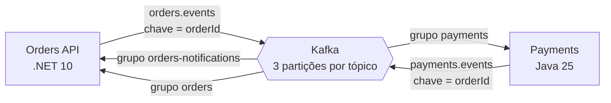

# Módulo 2: Kafka do zero, em .NET e Java

**Objetivo:** trocar a fila em memória dos Módulos 1 e 1-J pelo Apache Kafka, **atrás das mesmas
portas**, e fazer o Orders (.NET) e o Payments (Java) conversarem só por eventos. No fim você explica
partição, offset, consumer group e rebalance com o seu próprio sistema como exemplo, e não com um
diagrama de tutorial.

**Pré-requisitos:** Módulos 1 e 1-J. Docker Desktop (ou Docker Engine + plugin compose) instalado.

**Tempo estimado:** 8 a 10 horas, mais os exercícios.

## O que você constrói



- Producer e consumer nas duas linguagens: `Confluent.Kafka` no .NET, Spring for Apache Kafka no Java.
- O mesmo contrato de mensagem (JSON neste módulo) lido e escrito pelas duas stacks.
- O fluxo de negócio inteiro por eventos: pedido criado → Payments aprende o pedido → pagamento
  aprovado → Orders marca como pago. E a compensação quando o cliente cancela no meio.
- Infra local com `docker compose`: Kafka 4.3 em modo KRaft, Kafka UI, Schema Registry e Postgres
  (os dois últimos você usa no Módulo 3).

## Como rodar

```bash
docker compose -f deploy/local/docker-compose.yml up -d
# Módulo 2 = sem Postgres, contrato em JSON:
Orders__Persistence=InMemory Kafka__Format=Json dotnet run --project src/OrderFlow.Orders.Api
cd java/payments && PAYMENTS_PERSISTENCE=in-memory PAYMENTS_KAFKA_FORMAT=json ./mvnw spring-boot:run
```

Abra o Kafka UI em http://localhost:8080. O [`requests.http`](../../requests.http) tem o roteiro do
fluxo completo.

## Lições

| # | Lição | Código |
|---|---|---|
| 2.1 | [Kafka por dentro: log, tópico, partição, offset](01-kafka-por-dentro.md) | `deploy/local/docker-compose.yml` |
| 2.2 | [O producer: acks, idempotência, chave e particionador](02-producer.md) | `KafkaClientFactory.cs`, `KafkaOrderEventPublisher.cs`, `application.yml` |
| 2.3 | [O consumer: laço, offsets e consumer groups](03-consumer-e-grupos.md) | `KafkaConsumerWorker.cs`, `OrderEventsListener.java` |
| 2.4 | [Rebalance: quando o grupo muda](04-rebalance.md) | `KafkaClientFactory.cs`, `KafkaErrorHandling.java` |
| 2.5 | [Orders ↔ Payments por eventos: contrato, portas e saga](05-orders-payments-por-eventos.md) | `EventContracts.cs/.java`, `DependencyInjection.cs`, `PaymentsConfiguration.java` |
| ✍️ | [Exercícios e desafio](exercicios.md) | |
| 🎤 | [Perguntas de entrevista](perguntas-de-entrevista.md) | |

## Uma nota sobre o código que você vai ler

O repositório está no estado do **Módulo 3** (Postgres, outbox, Avro). O código do Módulo 2 continua
lá, inteiro, e é selecionado por configuração: `Orders:Persistence=InMemory` e `Kafka:Format=Json` no
.NET, `payments.persistence=in-memory` e `payments.kafka.format=json` no Java. Cada módulo é uma
combinação de adaptadores atrás das mesmas portas, e essa é a lição de arquitetura que atravessa os dois
módulos.

## O que foi verificado (e o que não foi)

- Lógica de aplicação do Payments (cópia local dos pedidos, compensação, inbox em memória): compilada
  com JDK 21 em modo estrito e exercitada por um roteiro de verificação.
- Compose validado com `docker compose config` e `yamllint`.
- **Não executado** no ambiente onde o curso foi escrito: `dotnet build/test`, `./mvnw verify` e o
  compose de pé (não havia SDK .NET, Maven Central nem Docker daemon). Rodar tudo é o Exercício 2.1.

Próximo módulo: [3. Kafka em produção](../modulo-03/README.md).
