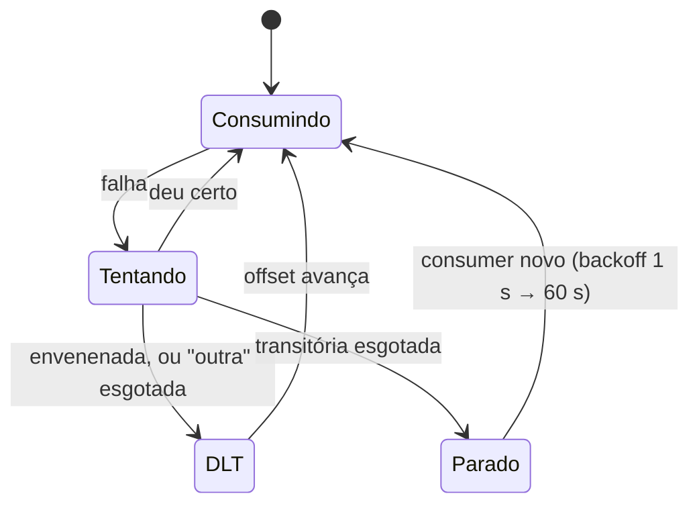

# 3.4 Retry, backoff e Dead Letter Topic

Arquivos: `Messaging/KafkaConsumerWorker.cs`, `DeadLetterPublisher.cs` (.NET);
`kafka/KafkaErrorHandling.java` (Java)

## A pergunta certa não é "quantas vezes tentar"

É "**de quem é a culpa**?". Uma mensagem falha por motivos de naturezas diferentes, e cada natureza pede
uma reação diferente:

| Tipo | Exemplos | Tentar de novo resolve? | Reação |
|---|---|---|---|
| **Envenenada** (*poison*) | bytes que não são Avro, campo obrigatório ausente, UUID inválido | nunca | DLT **na hora** |
| **Transitória** | Postgres reiniciando, timeout de rede, registry fora | sim, quando a infra voltar | tentar **sem limite**, sem DLT |
| **Outra** | bug (`NullReferenceException` num tipo novo), conflito de concorrência | talvez | poucas tentativas, depois DLT |

::: porque Por que a transitória não vai para o DLT
Com o Postgres fora, **toda** mensagem falha. Se o consumidor manda cada uma para o DLT depois de 4
tentativas, em 10 minutos de banco fora o tópico inteiro foi parar no DLT, uma mensagem boa de cada vez,
e alguém vai ter que reprocessar tudo à mão. Quando o problema é a infraestrutura, o certo é **parar e
esperar**: a partição acumula lag (o alerta de lag avisa), e nada se perde.
:::

::: porque Por que a envenenada não tem retry
Ela trava a partição. Kafka é ordenado: enquanto a mensagem do offset 42 não passa, a 43 não é
processada. Uma única mensagem quebrada com retry infinito para **todos os pedidos daquela partição**
(um terço do sistema, com 3 partições). O DLT existe para tirar a mensagem do caminho, sem perdê-la.
:::

## Java: o Spring Kafka faz quase tudo

```java
var recoverer = new DeadLetterPublishingRecoverer(template,
        (record, ex) -> new TopicPartition(deadLetterTopic(record.topic(), group), -1));

var bounded = new ExponentialBackOff(200L, 2.0);   // 200 ms, 400 ms, 800 ms...
bounded.setMaxInterval(5_000L);
bounded.setMaxAttempts(maxAttempts - 1);

var handler = new DefaultErrorHandler(recoverer, bounded);
handler.addNotRetryableExceptions(PoisonMessageException.class);   // poison: DLT na hora
handler.setBackOffFunction((record, ex) ->
        isTransient(ex) ? unboundedBackOff() : null);                // transitória: sem fim
```

O `DefaultErrorHandler` recebe a exceção do listener, consulta o backoff, faz *seek* para a mesma
mensagem (ela volta no próximo `poll()`) e, esgotadas as tentativas, chama o *recoverer*, que publica
no DLT com os bytes originais e headers `kafka_dlt-original-topic`, `-partition`, `-offset`,
`kafka_dlt-exception-fqcn`, `-message`... Depois disso, o offset é confirmado e a partição segue.

O Boot associa sozinho um bean `CommonErrorHandler` ao container dos `@KafkaListener` (lição 2.3).

## .NET: as mesmas regras, escritas à mão

O `Confluent.Kafka` não tem um equivalente ao `DefaultErrorHandler`. O `KafkaConsumerWorker`
implementa a mesma política:

```csharp
catch (PoisonMessageException ex) { await SendToDeadLetterAsync(result, ex, ct); return; }
catch (Exception ex) when (ex is not OperationCanceledException)
{
    var transient = ErrorClassifier.IsTransient(ex);
    if (attempt >= Options.MaxAttempts)
    {
        if (transient) throw new TransientConsumerException("Falha transitória persistente", ex);
        await SendToDeadLetterAsync(result, ex, ct);
        return;
    }
    await Task.Delay(RetryBackoff.Compute(attempt, ...), ct);
}
```

A diferença está no "sem fim" da transitória. O Spring consegue esperar 30 s entre tentativas porque o
container volta a chamar `poll()` entre elas. No .NET, um `Task.Delay` longo dentro do handler deixaria o
consumer sem chamar `Consume()` e estouraria o `max.poll.interval.ms` (lição 2.4). Então o worker faz
algumas tentativas curtas e, se a falha continua, **fecha o consumer de propósito** (`Close()` confirma
os offsets das mensagens anteriores, que deram certo), espera com backoff crescente até 1 minuto, e
abre um consumer novo, que recomeça da mensagem que falhou.



::: conceito Backoff exponencial com jitter
Espera `base × 2^(tentativa−1)`, com teto, multiplicada por um fator sorteado (0,8 a 1,2). O exponencial
dá tempo para a dependência se recuperar. O sorteio (*jitter*) evita que 30 pods que falharam juntos
tentem de novo **juntos** e derrubem a dependência outra vez no instante em que ela volta
(*thundering herd*).
:::

## Classificar exige olhar a causa

```csharp
for (var current = ex; current is not null; current = current.InnerException)
    if (current is TimeoutException or HttpRequestException or SocketException or DbException { IsTransient: true })
        return true;
```

O EF embrulha a `NpgsqlException` numa `DbUpdateException`; o Spring embrulha a exceção do listener
numa `ListenerExecutionFailedException`. Classificar pela exceção de fora erra quase sempre. O
`DbException.IsTransient` (desde o .NET 6) é preenchido pelo Npgsql com o código de erro do Postgres.

::: armadilha Tratar toda exceção como transitória
O caminho mais curto ("qualquer erro, tenta de novo para sempre") transforma um bug num incidente: um
`NullReferenceException` para um tipo de evento novo trava a partição até alguém fazer deploy de uma
correção. Classificar dá trabalho, e esse trabalho é o que separa um consumer de produção de um de demo.
:::

## O DLT: nome, conteúdo, e o que fazer com ele

**Um DLT por grupo:** `orders.events.payments.dlt`, `payments.events.orders.dlt`... Dois grupos leem
`orders.events` por motivos diferentes; a mensagem que quebrou o Payments pode estar ótima para as
notificações. Com um DLT só, reprocessar fica ambíguo (reprocessar para quem?).

**Conteúdo:** os bytes originais, a chave original (ordem por pedido preservada dentro do DLT) e
headers com origem e erro. Partição `-1` no Spring = o producer escolhe pela chave.

**O que fazer com ele:** um DLT que ninguém olha é uma lixeira com outro nome. No mínimo:

1. alerta quando o DLT recebe mensagem (é sempre um bug ou um contrato quebrado);
2. um procedimento de reprocessamento (*replay*): corrigido o bug, republicar do DLT no tópico de
   origem. Com o Inbox, republicar uma mensagem que por acaso já tinha sido processada é seguro;
3. retenção longa no DLT (semanas), para dar tempo de investigar.

## Retry bloqueante vs retry topics

Tudo acima é **retry bloqueante**: a partição espera a mensagem. O Spring Kafka também oferece
**retry não bloqueante** (`@RetryableTopic`): a mensagem que falha vai para `orders.events-retry-0`,
`-retry-1`... com atrasos crescentes, e a partição original segue.

| | Bloqueante (o nosso) | Retry topics |
|---|---|---|
| Ordem por chave | preservada | **quebrada**: o evento 43 do pedido X passa à frente do 42 que está no retry |
| Uma mensagem lenta atrasa as outras | sim, as da mesma partição | não |
| Peças | nenhuma | N tópicos a mais por tópico |

Para eventos de um agregado (Created → Paid → Cancelled), ordem é correção, e o bloqueante é a escolha.
Retry topics servem para mensagens independentes entre si (notificações, por exemplo).

::: quebra Lab: as três naturezas de falha
Com os dois serviços no modo padrão:

```bash
# 1. Envenenada: bytes que não são Avro em payments.events
docker compose -f deploy/local/docker-compose.yml exec kafka bash -c \
  'echo "chave-x:isto nao e avro" | /opt/kafka/bin/kafka-console-producer.sh --bootstrap-server localhost:9092 \
   --topic payments.events --property parse.key=true --property key.separator=:'

# 2. Transitória: pare o Postgres, faça um pagamento pelo requests.http, espere 30 s, suba o Postgres
docker compose -f deploy/local/docker-compose.yml stop postgres
docker compose -f deploy/local/docker-compose.yml start postgres
```

Para cada caso: o que aparece no log do Orders? Onde a mensagem termina? Quanto tempo até o pedido
ficar `Paid` no caso 2?
:::

::: solucao
**Caso 1:** um único log `enviada ao DLT payments.events.orders.dlt` (sem tentativas: o decodificador
lança `PoisonMessageException`). No Kafka UI, a mensagem está no DLT com os headers `dlt-*`. As
mensagens seguintes da partição são processadas normalmente.

**Caso 2:** no Payments, a `POST /payments` falha com 500 (sem banco não há onde gravar). Se você parar
o Postgres **depois** do pagamento aprovado, o lado interessante é o Orders: o consumer tenta 4 vezes
(`ProcessingFailed ... transitória: True`), depois `Consumer do grupo orders parado por falha
transitória; reinicia em 1000 ms`, e repete com espera dobrando. Nada vai para o DLT. Com o Postgres de
volta, o consumer seguinte processa, e o pedido fica `Paid` em segundos.
:::

## Perguntas para responder sem olhar

::: pergunta
Por que uma falha transitória não deve mandar mensagens para o DLT?
???
Porque o problema não é a mensagem. Com o banco fora, todas falham, e mandar cada uma para o DLT
esvaziaria o tópico dentro do DLT. O certo é parar, deixar o lag crescer (e alertar) e retomar quando a
dependência voltar.
:::

::: pergunta
Quando você usaria retry topics em vez de retry bloqueante?
???
Quando as mensagens são independentes entre si e a ordem por chave não importa (notificações, por
exemplo): uma mensagem lenta não atrasa as outras. Para eventos de um mesmo agregado, retry topics
quebram a ordem, então o retry é bloqueante.
:::

**Próxima:** [3.5 Schema Registry e Avro](05-schema-registry-avro.md).
