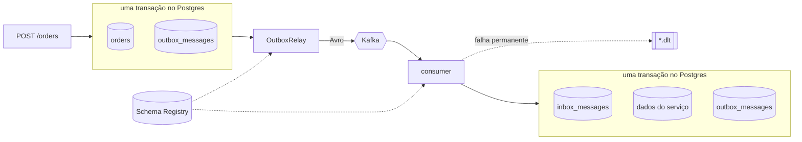

# Módulo 3: Kafka em produção

**Objetivo:** fechar os buracos que o Módulo 2 deixou abertos de propósito. Ao fim, nenhum evento se
perde quando o Kafka cai, nenhum evento é aplicado duas vezes quando volta repetido, uma mensagem
quebrada não trava uma partição, e o contrato entre Java e .NET é verificado por uma máquina, não pela
boa vontade de quem faz o PR.

**Pré-requisitos:** Módulo 2. Docker.

**Tempo estimado:** 10 a 12 horas, mais os exercícios.

## Os quatro problemas e as quatro soluções

| Problema (visto no Módulo 2) | Solução neste módulo | Lição |
|---|---|---|
| Dados somem quando o processo reinicia | PostgreSQL com EF Core (Orders) e JPA (Payments), concorrência otimista | 3.1 |
| Salvar e publicar não são atômicos (*dual write*) | **Transactional Outbox** + relay | 3.2 |
| Kafka entrega a mesma mensagem mais de uma vez | **Inbox**: consumidor idempotente | 3.3 |
| Uma mensagem ruim trava a partição para sempre | **Retry com backoff** classificado + **Dead Letter Topic** | 3.4 |
| O contrato entre as linguagens é só documentação | **Schema Registry + Avro**, compatibilidade `FULL_TRANSITIVE` | 3.5 |
| "Funciona no meu teste" com banco e broker falsos | **Testcontainers**: Postgres, Kafka e Schema Registry reais | 3.6 |



## Como rodar

```bash
docker compose -f deploy/local/docker-compose.yml up -d     # Kafka, Schema Registry, Postgres, UI
dotnet run --project src/OrderFlow.Orders.Api                # padrão: Postgres + Kafka + Avro
cd java/payments && ./mvnw spring-boot:run                   # idem
```

Testes de integração (precisam de Docker):

```bash
dotnet test --filter "Category=Integration"
cd java/payments && ./mvnw verify
```

## Lições

| # | Lição | Código |
|---|---|---|
| 3.1 | [Postgres com EF Core e JPA: mapear agregados sem sujar o domínio](01-postgres-ef-core-e-jpa.md) | `Infrastructure/Persistence/`, `infrastructure/persistence/` |
| 3.2 | [Transactional Outbox e o relay](02-outbox.md) | `EfOrderRepository.cs`, `OutboxRelay.cs`, `OutboxRelay.java` |
| 3.3 | [Inbox: o consumidor idempotente](03-inbox.md) | `EfInbox.cs`, `JdbcInbox.java` |
| 3.4 | [Retry, backoff e Dead Letter Topic](04-retry-e-dlt.md) | `KafkaConsumerWorker.cs`, `KafkaErrorHandling.java` |
| 3.5 | [Schema Registry e Avro: o contrato entre Java e .NET](05-schema-registry-avro.md) | `*.avsc`, `EventCodecs.cs`, `AvroEventCodec.java`, `register.sh` |
| 3.6 | [Testes com Testcontainers](06-testcontainers.md) | `tests/.../Persistence`, `PaymentsKafkaPostgresIT.java` |
| ✍️ | [Exercícios e desafio](exercicios.md) | |
| 🎤 | [Perguntas de entrevista](perguntas-de-entrevista.md) | |

## O que foi verificado (e o que não foi)

- **SQL** dos dois serviços aplicado num PostgreSQL 16 real, junto com as consultas que o código usa
  (`FOR UPDATE SKIP LOCKED`, `pg_try_advisory_xact_lock`, `ON CONFLICT DO NOTHING`, `xmin`, os índices
  únicos parciais).
- **Schemas Avro** validados com `fastavro`, inclusive os casos de evolução da lição 3.5 (que versões
  são compatíveis para trás, para frente e nos dois sentidos).
- **Lógica de aplicação do Payments** (compensação, cópia local, inbox) compilada com JDK 21 em modo
  estrito e exercitada.
- **Não executado** aqui: `dotnet build/test`, `./mvnw verify`, Testcontainers e o compose de pé. O
  Exercício 3.1 começa por isso.

Próximo módulo: 4. Kubernetes local.
