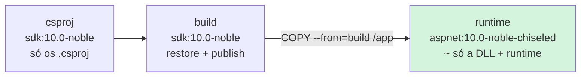

# 4.1 A imagem do Orders: multi-stage, cache e chiseled

Arquivos: [`deploy/docker/orders.Dockerfile`](../../deploy/docker/orders.Dockerfile), [`orders.Dockerfile.dockerignore`](../../deploy/docker/orders.Dockerfile.dockerignore)

Antes do Kubernetes existe a imagem. Tudo o que o cluster faz depois (baixar, iniciar, reiniciar, escalar) depende de três propriedades dela: **tamanho**, **o que tem dentro** e **como o processo principal se comporta**. Esta lição monta a imagem do Orders e explica cada linha.

```bash
# sempre da RAIZ do repositório: ela é o "contexto" do build
docker build -f deploy/docker/orders.Dockerfile -t orderflow/orders:dev .
docker run --rm -p 8080:8080 orderflow/orders:dev
curl -i localhost:8080/health/live
```

## O que é uma imagem, de verdade

::: conceito Imagem e camada
Uma imagem é uma **pilha de camadas** (cada uma é um `.tar` com os arquivos que mudaram) mais um **manifesto** JSON com a ordem das camadas e a configuração: usuário, variáveis, `ENTRYPOINT`, porta. Cada instrução `COPY`/`RUN` do Dockerfile gera uma camada. Na hora de rodar, o containerd empilha as camadas com um sistema de arquivos de união (overlayfs) e o container vê um diretório só.
:::

Duas consequências práticas, que guiam o resto da lição:

1. **Camada é identificada pelo hash do conteúdo.** Se a camada já existe no nó ou no registry, ninguém baixa nem envia de novo. Um deploy que muda só a última camada transfere kilobytes.
2. **Camada não se apaga.** `RUN apt-get install ... && rm -rf ...` em duas instruções separadas deixa o arquivo na camada de baixo: some da vista, não do tamanho. Por isso se usa *multi-stage*.

## Multi-stage: compilar num lugar, rodar em outro

O SDK do .NET tem compilador, MSBuild, NuGet: perto de 900 MB. Para **rodar** a API, basta o runtime do ASP.NET. O Dockerfile tem três estágios (`FROM ... AS nome`) e só o último vira a imagem final:



O que fica para trás (SDK, código-fonte, `obj/`) nunca chega ao cluster. É o equivalente a rodar `npm ci && npm run build` numa imagem `node` e copiar só o `dist/` para uma imagem enxuta.

## O cache do restore: o truque dos .csproj

Em Node você aprendeu a copiar o `package.json` antes do código:

```dockerfile
COPY package*.json ./
RUN npm ci          # só reexecuta se package*.json mudar
COPY . .
```

No .NET o equivalente é copiar os `.csproj` antes. O problema: num repositório com vários projetos, listar cada `.csproj` à mão quebra quando alguém cria um projeto novo (e o Módulo 3 cria). O Dockerfile resolve com um estágio só para isso:

```dockerfile
FROM mcr.microsoft.com/dotnet/sdk:${DOTNET_VERSION}-noble AS csproj
WORKDIR /src
COPY src/ src/
RUN find src -type f ! -name '*.csproj' -delete
```

::: porque Por que isso não invalida o cache a cada commit
O `COPY src/ src/` desse estágio **é** invalidado a cada mudança de código, e o `find` roda de novo. Mas o estágio seguinte faz `COPY --from=csproj /src/ ./`, e o BuildKit decide o cache de um `COPY` pelo **conteúdo** dos arquivos copiados. Mudou só um `.cs`? Os `.csproj` resultantes são idênticos byte a byte, o `COPY --from` é um acerto de cache, e o `dotnet restore` (a etapa lenta, que baixa pacotes) não roda.
:::

O restore ainda usa um **cache montado**:

```dockerfile
RUN --mount=type=cache,id=nuget,target=/root/.nuget/packages \
    dotnet restore src/OrderFlow.Orders.Api/OrderFlow.Orders.Api.csproj -a $TARGETARCH
```

`--mount=type=cache` é um diretório que o BuildKit guarda **entre builds, fora da imagem**. Se você adicionar um pacote, o restore roda, mas só baixa o pacote novo. Os outros 80 já estão no cache.

::: armadilha O `publish` também precisa do mount
Com o cache montado, os pacotes **não estão na camada** do restore. Se o `dotnet publish` rodar sem o mesmo `--mount`, ele não acha os pacotes e (com `--no-restore`) falha com `NETSDK1004` ou `assets file not found`. Por isso as duas instruções montam o mesmo `id=nuget`.
:::

::: video Using .NET with Chiseled Ubuntu Containers (em inglês)
https://www.youtube.com/watch?v=FLGFzlWF4Gs
O que são as imagens chiseled, o que fica de fora delas e por que isso reduz a superfície de ataque.
:::

## `--platform=$BUILDPLATFORM` e o Mac com Apple Silicon

```dockerfile
FROM --platform=$BUILDPLATFORM mcr.microsoft.com/dotnet/sdk:10.0-noble AS build
ARG TARGETARCH
RUN dotnet restore ... -a $TARGETARCH
```

Os nós do AKS são `amd64`. Se você builda num Mac M (arm64) com `--platform linux/amd64`, sem essa linha o SDK inteiro roda **emulado** pelo QEMU: o build fica de 3 a 10 vezes mais lento e às vezes trava. Com ela, o SDK roda nativo (`$BUILDPLATFORM`) e **gera** binários para a arquitetura de destino (`-a $TARGETARCH`). Funciona porque o .NET compila para IL, que é igual em qualquer arquitetura; só o host de execução muda.

::: dica
O estágio final (`runtime`) não tem `--platform`: ele herda a plataforma pedida no `docker build --platform`, que é o que você quer.
:::

## Chiseled: o que tem (e o que não tem) na imagem final

```dockerfile
FROM mcr.microsoft.com/dotnet/aspnet:10.0-noble-chiseled AS runtime
```

::: conceito Imagem chiseled
Ubuntu 24.04 ("noble") "esculpido" pela ferramenta `chisel` da Canonical: em vez de instalar pacotes `.deb` inteiros, copia só as **fatias** de que o .NET precisa (libc, libssl, libstdc++, certificados de CA). Não tem shell, não tem `apt`, não tem `curl`. Roda como o usuário `app` (UID 1654), não root.
:::

Lendo o Dockerfile oficial da imagem base (no repositório `dotnet/dotnet-docker`), ela define:

| Variável | Valor | O que significa para você |
|---|---|---|
| `APP_UID` | `1654` | o usuário não-root; o `USER $APP_UID` do nosso Dockerfile só deixa isso explícito |
| `ASPNETCORE_HTTP_PORTS` | `8080` | o Kestrel escuta na 8080, não na 80 (porta < 1024 exige root) |
| `DOTNET_SYSTEM_GLOBALIZATION_INVARIANT` | `true` | não há ICU: culturas viram "invariante" |
| `DOTNET_RUNNING_IN_CONTAINER` | `true` | o runtime ajusta GC e detecção de CPU/memória |

::: porque Por que chiseled e não `aspnet:10.0` (Ubuntu completo) ou Alpine
**Superfície de ataque.** Um scanner de vulnerabilidades (Trivy, Defender for Containers) acusa CVEs dos pacotes **presentes** na imagem, usados ou não. Menos pacotes, menos CVEs para triar toda semana. Sem shell, uma falha de execução remota na aplicação não vira um terminal para o atacante.

**Alpine** usa musl em vez de glibc. O .NET suporta, mas bibliotecas nativas (como a `librdkafka` do cliente Kafka do Módulo 2) precisam de build específico para musl, e diferenças de DNS e de alocador de memória do musl já causaram incidentes difíceis de diagnosticar. Chiseled é glibc, igual à sua máquina e ao CI.
:::

::: armadilha Globalização invariante
Sem ICU, `DateTime.Now.ToString("D", new CultureInfo("pt-BR"))` não formata em português: a cultura vira invariante. Para o Orders isso é irrelevante (a API devolve ISO 8601 e `decimal` em JSON, que já é invariante). Se um serviço precisar de culturas ou fusos reais, troque por `10.0-noble-chiseled-extra`, que traz ICU e `tzdata`.
:::

## `ENTRYPOINT` em forma exec, e por que isso importa no Kubernetes

```dockerfile
ENTRYPOINT ["dotnet", "OrderFlow.Orders.Api.dll"]
```

Com colchetes (forma *exec*), o processo `dotnet` é o **PID 1** do container. Quando o Kubernetes manda parar o pod, o kubelet envia `SIGTERM` ao PID 1. O host do .NET captura o sinal, dispara o `ApplicationStopping`, para de aceitar conexões, espera as requisições em andamento e para os `BackgroundService` (o `OrderEventsWorker` da lição 1.7) com o `CancellationToken`.

Na forma *shell* (`ENTRYPOINT dotnet Orders.dll`), o PID 1 seria `/bin/sh -c`, que **não repassa** o `SIGTERM` ao filho. A aplicação nunca saberia que vai morrer: após o prazo, `SIGKILL`, requisições cortadas no meio. Na chiseled nem há `/bin/sh`, então a forma shell simplesmente não sobe.

::: previsao
Você roda `docker run --rm orderflow/orders:dev` e, em outro terminal, `docker stop <id>`. Quanto tempo o `docker stop` demora? E se o `ENTRYPOINT` estivesse em forma shell numa imagem com shell?
???
Com a forma exec: menos de 1 segundo. O `dotnet` recebe o `SIGTERM`, o host encerra (não há requisição em andamento) e o processo sai com código 0.

Com a forma shell: o `sh` recebe o `SIGTERM` e o ignora (o PID 1 no Linux não tem tratadores padrão de sinal). O `docker stop` espera os 10 segundos padrão e manda `SIGKILL`. Você vê exatamente 10 s. No Kubernetes, seriam os 30 s (ou o que estiver em `terminationGracePeriodSeconds`) de cada pod, em cada deploy.
:::

## O `.dockerignore` por Dockerfile

O contexto do build é a raiz do repositório, que tem `java/`, `docs/`, `bin/`, `obj/`. O BuildKit aceita um arquivo `<nome-do-Dockerfile>.dockerignore` **ao lado do Dockerfile**: `orders.Dockerfile.dockerignore`. Ele começa com `**` (ignora tudo) e libera só o necessário.

Dois motivos, nessa ordem de importância:

1. **Segurança**: um `.env` ou `appsettings.Development.local.json` com senha copiado por `COPY src/ src/` vira camada da imagem, e camada vai para o registry. Quem puxa a imagem tem a senha.
2. **Corretude**: `bin/` e `obj/` gerados no Windows ou no macOS têm caminhos e assets de outra plataforma; copiados para dentro do build Linux, o restore usa o `project.assets.json` errado e o erro é confuso.

## Diagnosticando uma imagem sem shell

`docker exec -it <id> sh` não funciona: não existe `sh`. Três alternativas:

```bash
# o que tem dentro, sem rodar nada
docker image inspect orderflow/orders:dev --format '{{json .Config}}'
docker history orderflow/orders:dev          # cada camada e seu tamanho

# no Kubernetes: um container efêmero COM ferramentas, compartilhando o namespace de processos
kubectl -n orderflow debug -it deploy/orders --image=busybox:1.37 --target=orders -- sh
# dentro dele: ls /proc/1/root/app   (o sistema de arquivos do container alvo)
```

::: quebra Lab: quanto pesa cada escolha
1. Builde e anote o tamanho: `docker images orderflow/orders`.
2. Troque a base do estágio `runtime` por `mcr.microsoft.com/dotnet/aspnet:10.0-noble` e builde com outra tag.
3. Troque por `mcr.microsoft.com/dotnet/sdk:10.0-noble` (sim, rodar com o SDK) e builde de novo.
4. Mude uma linha de um `.cs` e rode o build original com `time`. Depois mude o `.csproj` (acrescente um `<Description>`) e rode de novo.

Antes de rodar: qual a ordem de tamanho de cada imagem? Qual dos dois rebuilds do passo 4 é mais lento, e por quê?
:::

::: solucao
Os números exatos dependem da versão, mas a ordem é sempre: chiseled (a menor, perto de 100 MB descompactada) < Ubuntu completo (perto do dobro) < SDK (perto de 1 GB). Rode `docker history` para ver de onde vem cada MB.

No passo 4, mudar o `.cs` reaproveita o restore (cache) e só refaz o publish: segundos. Mudar o `.csproj` muda o conteúdo copiado do estágio `csproj`, invalida o restore e tudo depois. Com o cache montado do NuGet, o restore não baixa nada de novo, mas ainda resolve o grafo inteiro: mais lento. É a prova de que o truque do estágio `csproj` funciona.
:::

## Perguntas para responder sem olhar

::: pergunta
Por que a imagem final não tem o SDK, e o que se perde com isso?
???
Multi-stage: o SDK só existe no estágio de build; o estágio final copia apenas a saída do `publish`. Ganha-se tamanho (pull mais rápido em cada nó, deploy e escala mais rápidos) e superfície de ataque menor. Perde-se a possibilidade de compilar ou usar ferramentas do SDK dentro do container (como `dotnet-trace`); para diagnóstico, usa-se um container efêmero com `kubectl debug` ou se instala a ferramenta num volume.
:::

::: pergunta
O que acontece com o `SIGTERM` se o `ENTRYPOINT` estiver em forma shell?
???
O PID 1 vira o `/bin/sh`, que não repassa o sinal ao processo filho e, sendo PID 1, também não morre com ele. A aplicação não faz desligamento gracioso; depois do período de carência leva `SIGKILL`, e requisições em andamento são cortadas.
:::

::: pergunta
O que muda para o .NET numa imagem chiseled sem ICU?
???
A globalização fica em modo invariante (`DOTNET_SYSTEM_GLOBALIZATION_INVARIANT=true`): formatação, comparação e conversão de textos usam a cultura invariante. Para APIs que trocam JSON é irrelevante; se precisar de culturas ou fusos, usa-se a variante `-chiseled-extra`.
:::

**Próxima:** [4.2 A imagem do Payments: camadas do Spring Boot, jlink e distroless](02-imagem-java.md)
