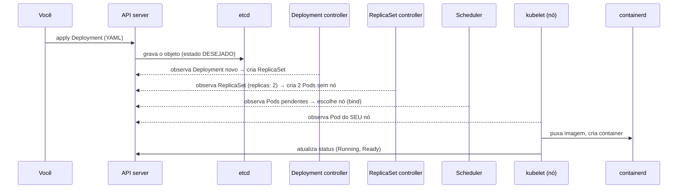
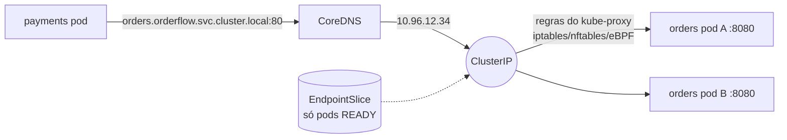

# 4.3 Kubernetes por dentro: do `kubectl apply` ao pod rodando

Arquivos: [`deploy/k8s/kind/kind-config.yaml`](../../deploy/k8s/kind/kind-config.yaml), [`deploy/k8s/kind/up.sh`](../../deploy/k8s/kind/up.sh)

## O cluster local: kind

::: conceito kind
*Kubernetes IN Docker*: cada **nó** do cluster é um container Docker rodando `kubelet` e `containerd`. O control plane (API server, etcd, scheduler, controller manager) roda dentro do container do nó `control-plane`. É o Kubernetes de verdade (os mesmos binários do upstream), não um simulador. Por isso o que funciona no kind costuma funcionar no AKS, com as diferenças de rede, disco e identidade que o Módulo 6 trata.
:::

```bash
kind create cluster --config deploy/k8s/kind/kind-config.yaml
kubectl get nodes -o wide
docker ps --format '{{.Names}}'     # orderflow-control-plane, orderflow-worker, orderflow-worker2
```

Usamos 1 control plane + 2 workers. Com um nó só, você nunca veria o espalhamento de réplicas, um PDB segurando um `drain` ou um pod sendo reagendado quando o nó some.

::: dica Ferramentas
`kind`, `kubectl`, `helm` (v3.18+ ou v4) e `k9s` (painel no terminal). No Windows, use WSL2 com o Docker Desktop integrado. Confira as versões com `kind version`, `kubectl version --client`, `helm version`.
:::

## O que acontece num `kubectl apply`

Este diagrama é a coisa mais importante do módulo. Quase todo problema de deploy é uma seta dele falhando.



Ninguém "executa" o seu YAML. Ele é gravado no etcd, e **controladores** independentes, cada um num laço "observar → comparar com o desejado → agir", fazem o mundo convergir. É o mesmo padrão dos operadores (Strimzi, Módulo 5).

::: porque Por que Deployment → ReplicaSet → Pod (três níveis)
O **Pod** é a unidade que roda (um ou mais containers com a mesma rede e volumes). O **ReplicaSet** garante "N pods iguais a este molde". O **Deployment** gerencia ReplicaSets ao longo do tempo: num deploy, cria um ReplicaSet novo (molde com a imagem nova) e vai aumentando ele enquanto diminui o antigo. O antigo fica com 0 réplicas, guardado (`revisionHistoryLimit`), e é isso que permite `kubectl rollout undo` em segundos.
:::

## Comandos de diagnóstico que você vai usar todo dia

| Pergunta | Comando |
|---|---|
| Por que o pod não sobe? | `kubectl -n orderflow describe pod <pod>` (leia os **Events** no fim) |
| O que a aplicação disse? | `kubectl -n orderflow logs <pod>` e, se reiniciou, `--previous` |
| Em que nó está, qual IP? | `kubectl -n orderflow get pods -o wide` |
| O Service tem pods atrás? | `kubectl -n orderflow get endpointslices -l kubernetes.io/service-name=orders` |
| O rollout terminou? | `kubectl -n orderflow rollout status deploy/orders` |
| O que mudou no cluster? | `kubectl -n orderflow get events --sort-by=.lastTimestamp` |

E os estados que você vai encontrar:

| Estado | Significa | Primeiro lugar para olhar |
|---|---|---|
| `Pending` | o scheduler não achou nó | `describe`: requests maiores que o livre, PVC sem volume |
| `ImagePullBackOff` / `ErrImagePull` | o nó não conseguiu a imagem | nome/tag errados; no kind, imagem não carregada; no AKS, falta `AcrPull` |
| `CrashLoopBackOff` | o container sobe e morre, repetidamente | `logs --previous`; configuração inválida (o `ValidateOnStart` da lição 1.5!) |
| `Running` mas `0/1 READY` | a readiness falha | `describe` mostra a probe; chame o endpoint com `port-forward` |
| `OOMKilled` | passou do limite de memória | lição 4.2 |

## Imagens no kind: não há registry

O kind não enxerga as imagens do seu Docker local. Ou você publica num registry, ou **carrega** a imagem dentro dos nós:

```bash
docker build -f deploy/docker/orders.Dockerfile -t orderflow/orders:dev .
kind load docker-image orderflow/orders:dev --name orderflow
```

::: armadilha A tag `latest` e o `imagePullPolicy`
Se a tag for `latest` (ou não tiver tag), o padrão do `imagePullPolicy` vira `Always`: o kubelet **sempre** tenta baixar do registry, ignora a imagem carregada pelo `kind load`, e você ganha um `ErrImagePull` de um `docker.io/orderflow/orders` que não existe. Com uma tag explícita (`dev`), o padrão é `IfNotPresent`.

Em produção o problema é outro: `latest` não diz **qual** código está rodando, dois nós podem ter `latest`s diferentes e um rollback para "a anterior" não tem para onde voltar. Use a tag do commit (ou o digest `sha256:`). Os charts deste módulo aceitam `image.digest`.
:::

## Service, DNS e kube-proxy

O pod tem IP próprio, mas efêmero: ele morre, outro nasce com outro IP. O **Service** dá um nome e um IP virtual estáveis:



- O **EndpointSlice** lista os IPs dos pods que casam com o `selector` do Service **e estão Ready**. A readiness probe controla essa lista: é assim que "tirar do balanceamento" funciona.
- O **kube-proxy** de cada nó transforma o EndpointSlice em regras de rede. O IP do Service não existe em nenhuma interface: é uma regra de NAT.
- O nome DNS completo é `<service>.<namespace>.svc.cluster.local`. Dentro do mesmo namespace, `orders` basta; entre namespaces, use pelo menos `orders.orderflow`. Os values deste módulo usam o nome completo (`kafka.infra.svc.cluster.local`) para não depender do `search` do `resolv.conf`.

::: quebra Lab: o Service sem pods
Com o ambiente no ar (`./deploy/k8s/kind/up.sh`):

```bash
kubectl -n orderflow get endpointslices -l kubernetes.io/service-name=orders
kubectl -n orderflow patch svc orders -p '{"spec":{"selector":{"app.kubernetes.io/name":"ordrs"}}}'
kubectl -n orderflow get endpointslices -l kubernetes.io/service-name=orders
kubectl -n orderflow run curl --rm -it --image=curlimages/curl:8.11.1 --restart=Never -- \
  curl -sS -m 3 http://orders.orderflow.svc.cluster.local/health/live
```

O que o `curl` mostra? O Service "existe"? Os pods do Orders estão bem?
:::

::: solucao
O Service existe e o DNS resolve, mas o EndpointSlice fica **sem endereços**: nenhum pod casa com o selector com erro de digitação. O `curl` falha com conexão recusada ou timeout. Os pods estão perfeitos, `Running` e `Ready`. É um dos incidentes mais comuns depois de alguém "renomear um label": tudo verde no painel de pods e nenhum tráfego chegando. O comando que entrega o diagnóstico é o do EndpointSlice. Desfaça com `helm upgrade` (o Helm reaplica o selector correto) e repare que o Helm é a fonte da verdade, não o `kubectl patch`.
:::

## `enableServiceLinks: false`

Por herança do Docker antigo, o kubelet injeta em cada pod variáveis com o endereço de **todos** os Services do namespace: `ORDERS_SERVICE_HOST`, `ORDERS_PORT=tcp://10.96.12.34:80`... Ninguém deveria usá-las (use DNS). E elas atrapalham: num namespace com um Service chamado `kafka`, o pod recebe `KAFKA_PORT=tcp://...`, e a imagem oficial do Kafka transforma **toda** variável `KAFKA_*` em configuração do broker. O Lab de quebra 2 da lição 4.5 mostra o resultado. Todos os charts e manifestos deste curso desligam isso.

## Perguntas para responder sem olhar

::: pergunta
O que acontece entre o `kubectl apply` de um Deployment e o container rodando?
???
O API server grava o objeto no etcd. O Deployment controller cria um ReplicaSet; o ReplicaSet controller cria os Pods; o scheduler escolhe um nó para cada um; o kubelet do nó vê o pod, pede ao containerd para baixar a imagem e criar os containers, e reporta o status. Tudo por controladores que observam o estado desejado e convergem, não por um comando imperativo.
:::

::: pergunta
Os pods estão Running e Ready, mas o Service não responde. Onde você olha?
???
No EndpointSlice do Service: se está vazio, o selector não casa com os labels dos pods (ou a porta-alvo está errada). Depois, `targetPort` contra a porta em que o container realmente escuta, e NetworkPolicies que bloqueiem o tráfego.
:::

::: pergunta
Por que não usar a tag `latest` no Kubernetes?
???
Muda o `imagePullPolicy` padrão para `Always`, não identifica o código que está rodando, permite nós com versões diferentes da "mesma" tag e torna o rollback impreciso. Usa-se a tag do commit ou o digest.
:::

**Próxima:** [4.4 Probes, recursos e desligamento sem perder requisição](04-probes-recursos-e-desligamento.md)
