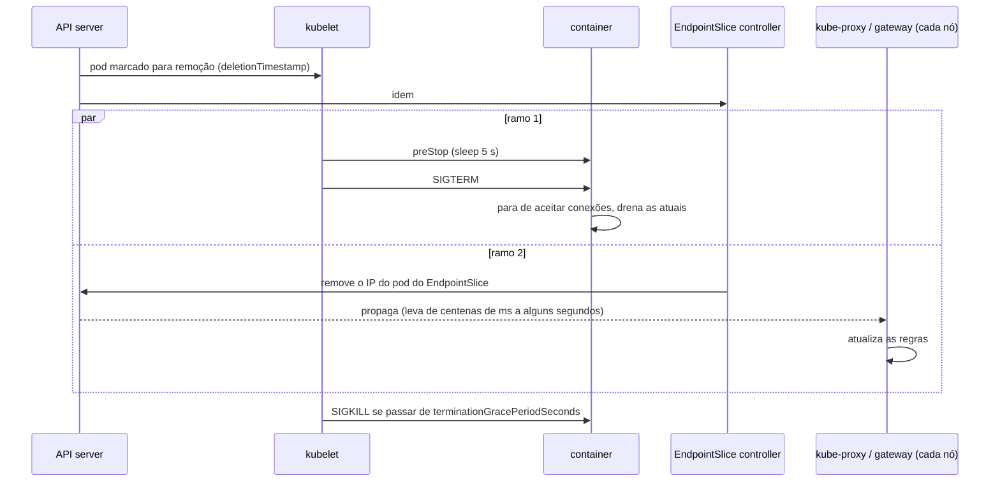

# 4.4 Probes, recursos e desligamento sem perder requisição

Arquivos: [`deploy/helm/orders/templates/deployment.yaml`](../../deploy/helm/orders/templates/deployment.yaml), os `values.yaml` dos charts

No Módulo 1 você criou `/health/live` e `/health/ready` (lição 1.9) e no 1-J os equivalentes do Actuator (lição 1J.8). Aqui eles ganham dono: o **kubelet**, que os chama a cada poucos segundos e age sobre a resposta.

## As três probes

| Probe | Pergunta | Se falhar `failureThreshold` vezes seguidas | No Orders | No Payments |
|---|---|---|---|---|
| **startup** | "já terminou de subir?" | reinicia o container | `/health/live` | `/actuator/health/liveness` |
| **liveness** | "travou?" | **reinicia** o container | `/health/live` | `/actuator/health/liveness` |
| **readiness** | "posso receber tráfego agora?" | tira o pod do EndpointSlice, **sem reiniciar** | `/health/ready` | `/actuator/health/readiness` |

Enquanto a startup não passa, liveness e readiness nem rodam.

::: porque Por que uma startupProbe, se a liveness tem `initialDelaySeconds`
Sem startup probe, você teria de escolher um `initialDelaySeconds` na liveness. Curto demais: uma JVM fria num nó com pouca CPU leva 40 s para subir, a liveness falha, o kubelet reinicia, ela sobe de novo do zero, falha de novo... `CrashLoopBackOff` de uma aplicação saudável. Longo demais: depois que a aplicação está no ar, um travamento real leva o tempo do delay a mais para ser detectado. A startup probe separa as duas fases: **paciência só na subida** (Payments: até 30 × 2 s = 60 s), **rigor depois** (liveness: 3 × 10 s).
:::

Os números do chart do Orders, e o raciocínio:

```yaml
probes:
  startup:   { periodSeconds: 2,  failureThreshold: 10, timeoutSeconds: 2 }   # até 20 s para subir
  liveness:  { periodSeconds: 10, failureThreshold: 3,  timeoutSeconds: 2 }   # ~30 s travado → restart
  readiness: { periodSeconds: 5,  failureThreshold: 2,  timeoutSeconds: 2 }   # ~10 s ruim → sai do balanceamento
```

Readiness é mais agressiva que liveness de propósito: tirar do balanceamento é barato e reversível; reiniciar não é.

::: armadilha O `timeoutSeconds` padrão é 1 segundo
Sob carga, um GC mais longo ou um pool de threads ocupado faz o `/health/live` demorar 1,2 s. A probe conta como **falha**. Três seguidas e o kubelet reinicia um pod que estava só ocupado, jogando a carga dele nos outros, que ficam mais ocupados... O chart usa 2 s. A regra da lição 1.9 continua valendo e é a mais importante: **nada externo na liveness**. Banco ou Kafka lentos na liveness reiniciam **todos** os pods ao mesmo tempo.
:::

::: video Kubernetes - Liveness, readiness and startup probes (em inglês)
https://www.youtube.com/watch?v=FAMmbzHm_kg
As três probes, quando cada uma roda e o que o kubelet faz quando elas falham.
:::

## Requests, limits e o que o scheduler e o kernel fazem com eles

```yaml
resources:
  requests: { cpu: 100m, memory: 128Mi }
  limits:   { memory: 256Mi }
```

| | `requests` | `limits` |
|---|---|---|
| Quem usa | o **scheduler**, para escolher o nó (soma dos requests ≤ capacidade alocável) | o **kernel** (cgroups), em tempo de execução |
| CPU | garantia mínima de tempo de CPU sob disputa; base do HPA (`averageUtilization`) | teto: passou, o processo é **pausado** até a próxima janela (throttling) |
| Memória | reserva para o agendamento | teto: passou, **OOMKilled** |

::: porque Por que limite de memória sim, de CPU não
Memória não é compressível: se um pod sem limite vaza memória, o nó inteiro entra em pressão e o kubelet começa a despejar pods de outros serviços. O limite isola o problema no pod culpado.

CPU é compressível: sem limite, um pod usa núcleos ociosos do nó e devolve quando outro precisa (os `requests` garantem a fatia de cada um). Com limite, o cgroup aplica uma **cota por janela de 100 ms**: um pod com `limits.cpu: 500m` que usa 4 threads ao mesmo tempo gasta a cota em 12,5 ms e fica **parado** os 87,5 ms restantes, com CPU sobrando no nó. Isso aparece como latência p99 alta sem CPU alta nos gráficos. Há times que exigem limite de CPU por política (custo previsível, multi-tenant); se for o seu caso, deixe o limite bem acima do request e meça o `container_cpu_cfs_throttled_periods_total`.
:::

A combinação requests = limits (para CPU e memória) dá ao pod a classe **Guaranteed**, a última a ser despejada sob pressão. A nossa (requests < limits) é **Burstable**. Sem nenhum dos dois, **BestEffort**: o primeiro a morrer.

## Desligamento: a corrida que perde requisições

Quando um pod vai morrer (deploy, scale down, drain do nó), duas coisas começam **ao mesmo tempo**, sem coordenação:



Sem o `preStop`, o ramo 1 costuma ganhar: a aplicação recebe o `SIGTERM` e fecha o listener **antes** de todos os kube-proxies e o gateway saberem. Durante esse intervalo, conexões novas chegam a um pod que não aceita mais: **502/connection refused** em todo deploy, em poucas requisições, intermitente, impossível de reproduzir na sua máquina.

O `preStop` com `sleep` atrasa o `SIGTERM` alguns segundos, tempo de o ramo 2 terminar:

```yaml
lifecycle:
  preStop:
    sleep:
      seconds: 5
```

::: armadilha `exec: ["sleep", "5"]` numa imagem chiseled
A receita antiga é `preStop: exec: command: ["sleep", "5"]`. Nas nossas imagens **não existe** `/bin/sleep` (nem shell). O hook falha, o kubelet registra um evento `FailedPreStopHook` e manda o SIGTERM na hora: você volta a perder requisições achando que está protegido. A ação `sleep` nativa do kubelet resolve sem binário nenhum (beta e ligada por padrão desde o Kubernetes 1.30, estável no 1.34; o chart declara `kubeVersion: ">=1.34.0-0"`).
:::

### O orçamento do desligamento

O `terminationGracePeriodSeconds` conta **a partir do início do preStop**. Tudo tem de caber nele:

| | Orders (.NET) | Payments (Spring) |
|---|---|---|
| preStop | 5 s | 5 s |
| drenar HTTP | até 30 s (`HostOptions.ShutdownTimeout`, padrão do .NET 8+) | até 20 s (`spring.lifecycle.timeout-per-shutdown-phase`) |
| parar o worker | dentro dos 30 s acima | até 10 s (`payments.worker-shutdown-timeout`) |
| **total** | 35 s | 35 s |
| `terminationGracePeriodSeconds` | **40** | **45** |

Repare que o padrão do Kubernetes (30 s) **não cabe** em nenhum dos dois. A lição 1J.8 dizia "mantenha abaixo de 30 s": isso valia sem preStop e sem worker. Agora que você somou as fases, o número mudou. Esse é o raciocínio que se espera de um sênior: os tempos estão em três lugares (imagem/aplicação, chart, Kubernetes) e precisam concordar.

::: previsao
Você muda o Payments para `terminationGracePeriodSeconds: 20` e faz um deploy enquanto o worker está processando um evento que demora 15 s. O que acontece com esse evento?
???
O preStop consome 5 s, o SIGTERM chega, o Spring começa a drenar HTTP (pode levar até 20 s) e depois para o worker. Aos 20 s do início, o kubelet manda **SIGKILL**: o worker é morto no meio do evento. Com a fila em memória do Módulo 1, o evento **se perde**. Com o Kafka do Módulo 2, o offset não foi confirmado e outro consumidor o reprocessa (pelo menos uma vez), por isso o processamento precisa ser idempotente. Em nenhum dos casos você vê um erro no log: o processo simplesmente sumiu.
:::

## O rollout seguro

```yaml
strategy:
  rollingUpdate:
    maxUnavailable: 0
    maxSurge: 1
```

Sobe 1 pod novo, espera ele ficar **Ready**, derruba 1 antigo, repete. Se o pod novo nunca fica Ready (configuração errada, migration quebrada), o rollout **para** com os pods antigos atendendo. O `helm upgrade --wait --atomic` (lição 4.6) percebe e faz rollback sozinho. A readiness probe é, portanto, também o **portão de qualidade do deploy**.

::: quebra Lab: desligamento com carga
Com o ambiente no ar, em um terminal:

```bash
kubectl -n orderflow port-forward svc/orders 5279:80 &
while true; do curl -s -o /dev/null -w '%{http_code}\n' localhost:5279/health/live; sleep 0.05; done | sort | uniq -c
```

Em outro, force um rollout duas vezes: `kubectl -n orderflow rollout restart deploy/orders`. Pare o laço e veja a contagem. Depois rode `helm upgrade ... --set preStopSleepSeconds=0` e repita.
:::

::: solucao
O `port-forward` fala com **um pod** escolhido na hora em que foi criado (ele não passa pelo Service a cada requisição); quando esse pod morre, o port-forward cai e todo o resto falha. Ou seja: o laboratório como está mede o port-forward, não o Service. Esse é o aprendizado: para medir o efeito do preStop, gere carga **de dentro** do cluster, pelo nome do Service:

```bash
kubectl -n orderflow run carga --rm -it --image=curlimages/curl:8.11.1 --restart=Never -- \
  sh -c 'while true; do curl -s -o /dev/null -w "%{http_code}\n" -m 2 http://orders/health/live; done' | sort | uniq -c
```

Com preStop de 5 s, os rollouts passam com zero ou quase zero erros. Com 0 s, aparecem algumas falhas (000 = conexão recusada) a cada pod substituído. No kind, com poucos nós e kube-proxy rápido, a diferença pode ser pequena; num cluster grande com gateway, é bem maior.
:::

## Perguntas para responder sem olhar

::: pergunta
Qual a diferença entre liveness e readiness, e o que nunca deve ir na liveness?
???
Liveness falhando reinicia o container; readiness falhando só tira o pod do balanceamento. Dependência externa (banco, Kafka, outro serviço) nunca vai na liveness: uma lentidão dela reiniciaria todos os pods ao mesmo tempo e transformaria degradação em indisponibilidade.
:::

::: pergunta
Por que pods perdem requisições durante um deploy mesmo com desligamento gracioso, e como resolver?
???
A remoção do pod dos endpoints e o SIGTERM acontecem em paralelo; os kube-proxies e o gateway levam alguns segundos para atualizar, e a aplicação já parou de aceitar conexões. Resolve-se com um preStop que espera alguns segundos antes do SIGTERM (ação `sleep` nativa em imagens sem shell), e com `terminationGracePeriodSeconds` maior que preStop + tempo de drenagem.
:::

::: pergunta
Por que muitos times não colocam limite de CPU?
???
Porque o limite é aplicado como cota por janela de 100 ms: um processo com várias threads gasta a cota e fica pausado mesmo com CPU livre no nó, o que aparece como latência. Os requests já garantem a fatia de cada pod sob disputa. Memória, ao contrário, sempre tem limite, porque não é compressível.
:::

**Próxima:** [4.5 Configuração, segredos e as dependências no cluster](05-config-segredos-e-dependencias.md)
