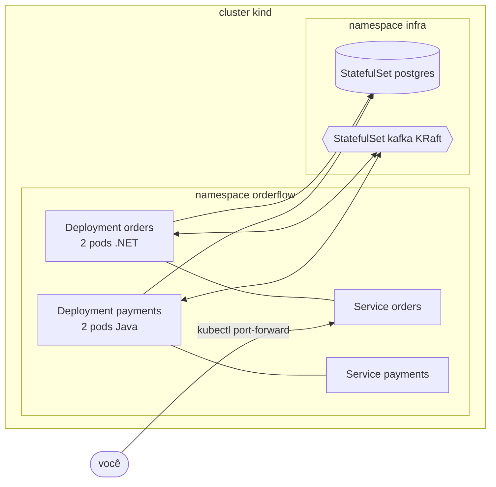

# Módulo 4: Kubernetes local: imagens, Deployments, probes e Helm

**Objetivo:** levar o Orders (.NET) e o Payments (Java) para dentro de um cluster Kubernetes de
verdade na sua máquina, entendendo o que cada linha do Dockerfile e de cada manifesto faz, o que
quebra e como diagnosticar. É a base prática da **CKAD**.

**Pré-requisitos:** Módulos 1, 1-J (e, idealmente, 2 e 3: os charts já esperam Kafka e Postgres).
Docker Desktop (ou Docker Engine) com BuildKit, `kind`, `kubectl`, `helm`. `k9s` ajuda muito.

**Tempo estimado:** 10 a 14 horas, mais os exercícios.

## O que você constrói

- Imagens multi-stage para os dois serviços: .NET em Ubuntu **chiseled**; Java com camadas do
  Spring Boot, **jlink** e **distroless**. Ambas não-root, sem shell.
- Um cluster **kind** com 3 nós, Postgres e Kafka de laboratório (`deploy/k8s/dev/`).
- Um **chart Helm por serviço** com probes ligadas aos health checks que você já escreveu,
  ConfigMap/Secret, desligamento gracioso calculado, PDB, espalhamento entre nós, e os ganchos
  (desligados) que o Módulo 6 liga no AKS: Key Vault, Workload Identity, KEDA, Gateway API.



Tudo sobe com um script (que você deve conseguir reproduzir comando a comando):

```bash
./deploy/k8s/kind/up.sh
```

## Lições

| # | Lição | Arquivos | Tempo |
|---|---|---|---|
| 4.1 | [A imagem do Orders: multi-stage, cache e chiseled](01-imagem-dotnet.md) | `deploy/docker/orders.Dockerfile` | 75 min |
| 4.2 | [A imagem do Payments: camadas do Spring Boot, jlink e distroless](02-imagem-java.md) | `deploy/docker/payments.Dockerfile` | 75 min |
| 4.3 | [Kubernetes por dentro: do `kubectl apply` ao pod rodando](03-kubernetes-por-dentro.md) | `deploy/k8s/kind/` | 90 min |
| 4.4 | [Probes, recursos e desligamento sem perder requisição](04-probes-recursos-e-desligamento.md) | `templates/deployment.yaml` | 90 min |
| 4.5 | [Configuração, segredos e as dependências no cluster](05-config-segredos-e-dependencias.md) | `deploy/k8s/dev/` | 75 min |
| 4.6 | [Helm: um chart por serviço](06-helm.md) | `deploy/helm/` | 75 min |
| ✍️ | [Exercícios e desafio](exercicios.md) | | 4 a 6 h |
| 🎤 | [Perguntas de entrevista](perguntas-de-entrevista.md) | | 40 min |

## O que você terá no fim

- Capacidade de explicar, sem consultar, o caminho de um `kubectl apply` até o container rodando,
  e de diagnosticar `Pending`, `ImagePullBackOff`, `CrashLoopBackOff`, `OOMKilled` e Service sem
  endpoints.
- Um deploy que não perde requisições: probes certas, preStop, carência calculada, rollout com
  `maxUnavailable: 0` e `helm --atomic`.
- Clareza sobre o que o kind **não** resolve, e que os próximos módulos resolvem:
  1. Kafka de um nó, sem autenticação, criado à mão (→ Strimzi, Módulo 5);
  2. segredo em values versionado, imagem carregada à mão (→ Key Vault e ACR, Módulo 6);
  3. ninguém de fora do cluster acessa (→ Gateway API, Módulo 6).

## Sobre o que foi validado

Os Dockerfiles não foram construídos no ambiente onde o curso foi escrito (sem Docker daemon nem
acesso aos registries), e os charts foram renderizados por um renderizador mínimo, não pelo Helm.
Os manifestos renderizados e os de `deploy/k8s/` passaram no `kubeconform -strict` (Kubernetes
1.34 + CRDs) e no `yamllint`; os comandos `jdeps`/`jlink` foram testados com o JDK 21. O
Exercício 1 é justamente rodar tudo de verdade e corrigir o que divergir.

Próximo módulo: [5: Kafka no Kubernetes](../modulo-05/README.md).
