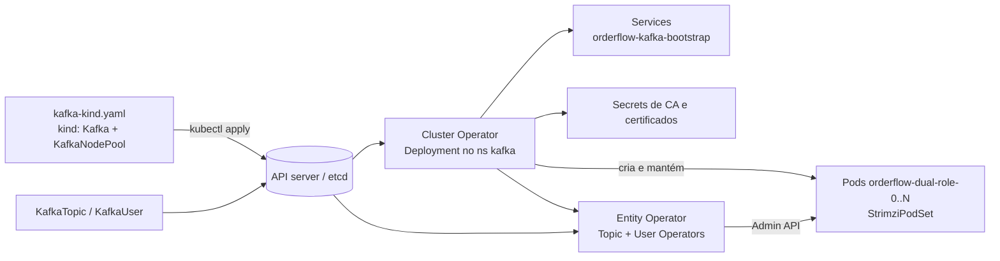

# 5.1 Operadores e o Strimzi: Kafka declarado como recurso

Arquivos: [`deploy/k8s/strimzi/kafka-kind.yaml`](../../deploy/k8s/strimzi/kafka-kind.yaml), [`kafka-aks.yaml`](../../deploy/k8s/strimzi/kafka-aks.yaml), [`README.md`](../../deploy/k8s/strimzi/README.md)

No Módulo 4 o Kafka era um StatefulSet escrito à mão. Funciona para um nó. Para três, com TLS, usuários, ACLs, upgrade de versão sem parar e troca de certificados, você precisaria de um administrador de Kafka de plantão. O Strimzi é esse administrador, em forma de programa.

## O padrão operador

::: conceito Operador
Um controlador (como os da lição 4.3) que conhece uma aplicação específica. Você declara o que quer num **recurso customizado** (`kind: Kafka`, `kind: KafkaTopic`), definido por uma **CRD** (*CustomResourceDefinition*), e o operador cria e mantém os objetos de baixo nível (pods, Services, Secrets, certificados, configuração do broker), observando e corrigindo diferenças para sempre.
:::



Três operadores trabalham juntos:

| Operador | Observa | Faz |
|---|---|---|
| **Cluster Operator** | `Kafka`, `KafkaNodePool` (e Connect, MirrorMaker...) | pods dos brokers e controllers, Services, certificados, rolling restart quando a configuração muda |
| **Topic Operator** | `KafkaTopic` | cria/altera tópicos pelo Admin API do Kafka |
| **User Operator** | `KafkaUser` | cria usuários SCRAM ou certificados, ACLs e o Secret com a credencial |

::: porque Por que o Strimzi usa StrimziPodSet e não StatefulSet
Um StatefulSet trata todas as réplicas como iguais e reinicia na ordem dos índices. Brokers Kafka não são iguais: reiniciar o controller ativo ou um broker que é o único em sincronia de uma partição derruba disponibilidade. O Strimzi usa o próprio recurso (`StrimziPodSet`) para escolher **qual** pod reiniciar e **quando**, consultando o Kafka antes: só reinicia um broker se todas as partições dele continuarem com réplicas em sincronia suficientes. É o conhecimento operacional que o operador empacota.
:::

## Instalando

```bash
kubectl create namespace kafka
kubectl create -f 'https://strimzi.io/install/latest?namespace=kafka' -n kafka
kubectl -n kafka rollout status deploy/strimzi-cluster-operator
kubectl get crd | grep strimzi
```

A URL instala as CRDs, o RBAC e o Deployment do Cluster Operator. Em produção, fixe a versão (o Helm chart oficial ou o YAML da release, versionado no seu repositório), porque `latest` muda e um operador novo pode fazer rolling restart de todos os brokers ao subir.

::: armadilha A API `v1` e os tutoriais antigos
Desde o **Strimzi 1.0** a única versão suportada das CRDs é `kafka.strimzi.io/v1`. Tutoriais (e respostas de IA) com `apiVersion: kafka.strimzi.io/v1beta2`, `spec.zookeeper` ou a anotação `strimzi.io/node-pools: enabled` são do mundo anterior: o apply é recusado ou o recurso é ignorado. Este curso usa o Strimzi 1.3 com Kafka 4.3.1. Antes de subir de versão, confira a tabela de compatibilidade em strimzi.io/downloads.
:::

## O cluster do kind, linha a linha

```yaml
apiVersion: kafka.strimzi.io/v1
kind: KafkaNodePool
metadata:
  name: dual-role
  labels:
    strimzi.io/cluster: orderflow
spec:
  replicas: 1
  roles: [controller, broker]
  storage:
    type: jbod
    volumes:
      - id: 0
        type: persistent-claim
        size: 5Gi
        deleteClaim: false
        kraftMetadata: shared
```

::: conceito KRaft e os dois papéis
Desde o Kafka 4.0 não existe ZooKeeper: os metadados do cluster (tópicos, partições, quem lidera cada uma) ficam num **log replicado pelo protocolo Raft** entre os nós com papel **controller**. Os **brokers** guardam os dados e atendem os clientes. Um nó pode ter os dois papéis (bom para laboratório) ou só um (produção: controllers pequenos e estáveis, brokers grandes que você escala).
:::

O `KafkaNodePool` é **um grupo de nós com a mesma configuração** (papéis, disco, recursos). O rótulo `strimzi.io/cluster` o liga ao recurso `Kafka` de mesmo nome. Com pools, dá para migrar brokers para máquinas novas criando um pool novo e esvaziando o antigo, sem recriar o cluster.

O recurso `Kafka` define o que vale para o cluster todo:

```yaml
spec:
  kafka:
    version: 4.3.1
    metadataVersion: 4.3-IV0
    listeners:
      - name: plain
        port: 9092
        type: internal
        tls: false
        authentication:
          type: scram-sha-512
    authorization:
      type: simple
```

- **`version` e `metadataVersion`**: a versão dos binários e a versão do formato de metadados. Num upgrade, você sobe a `version` primeiro (o operador faz rolling restart), confirma que está tudo bem, e só depois sobe a `metadataVersion`. Até lá dá para voltar; depois, não.
- **`listeners`**: cada um vira uma porta e um Service. `type: internal` = só dentro do cluster (`orderflow-kafka-bootstrap.kafka.svc:9092`). Para fora do cluster existem `loadbalancer`, `nodeport`, `route` e `ingress`.
- **`authentication: scram-sha-512`**: o cliente prova que sabe a senha sem enviá-la (desafio-resposta). Sem TLS, os **dados** trafegam abertos, mas a senha não. No listener `tls` (9093) tudo vai cifrado.
- **`authorization: simple`**: ACLs do próprio Kafka. Autenticado não basta: sem ACL que permita, a operação é negada.

## Do laboratório à produção: `kafka-aks.yaml`

| | kind | AKS |
|---|---|---|
| Pools | 1 nó dual-role | 3 controllers + 3 brokers |
| Fator de replicação | 1 | 3, com `min.insync.replicas: 2` |
| Disco | 5 Gi, StorageClass padrão | 100 Gi `managed-csi-premium` por broker |
| Zonas | — | `rack.topologyKey: topology.kubernetes.io/zone` |

::: porque 3 controllers, RF 3 e min ISR 2
**Controllers**: Raft precisa de maioria. Com 3, a maioria é 2: um pode cair. Com 2, a maioria também é 2: nenhum pode cair (pior que 1, e mais caro). Por isso números ímpares.

**Brokers**: com fator de replicação 3 e `min.insync.replicas: 2`, um produtor com `acks=all` (o padrão dos clientes modernos, configurado no Módulo 2) só recebe confirmação quando **2 cópias** gravaram. Um broker pode estar fora (falha ou rolling restart do operador) e as escritas continuam. Com `min.insync.replicas: 3`, qualquer manutenção pararia as escritas; com 1, um broker que morre logo após confirmar pode levar o dado junto.

**Rack**: as 3 cópias de cada partição ficam em zonas diferentes. Uma zona da Azure caindo não leva todas.
:::

::: armadilha O custo do "rack" na Azure
Tráfego entre zonas de disponibilidade é cobrado. Com réplicas em três zonas, cada escrita cruza zonas duas vezes. O `replica.selector.class: RackAwareReplicaSelector` deixa o consumidor ler da réplica da **própria** zona (KIP-392), se ele declarar a zona em `client.rack`, cortando o tráfego de leitura entre zonas. Num sistema de alto volume, essa linha é dinheiro.
:::

::: previsao
No AKS, um dos 3 brokers cai e não volta (o disco gerenciado foi corrompido). O tópico `orders.events` tem RF 3 e `min.insync.replicas: 2`. O Orders continua publicando? E se um segundo broker cair?
???
Com um broker fora, cada partição tem 2 réplicas em sincronia: `acks=all` exige 2, então **as escritas continuam**. Os líderes das partições que estavam no broker caído são eleitos entre as outras réplicas em segundos, e os clientes descobrem pelos metadados.

Com dois fora, as partições ficam com 1 réplica em sincronia, abaixo do mínimo: o broker recusa escritas com `NotEnoughReplicasException`. **Leituras continuam** (o líder ainda existe). É a escolha de consistência sobre disponibilidade: melhor recusar do que confirmar algo que existe em uma só máquina. No Orders, o outbox do Módulo 3 segura os eventos no Postgres até o Kafka voltar.
:::

::: video Strimzi: Data Streaming on Kubernetes with Apache Kafka (em inglês)
https://www.youtube.com/watch?v=q6WYs8AEEDk
Jakub Scholz, mantenedor do Strimzi, mostra a arquitetura do operador, node pools e o que ele automatiza.
:::

## Observando o operador trabalhar

```bash
kubectl apply -f deploy/k8s/strimzi/kafka-kind.yaml
kubectl -n kafka get kafka,kafkanodepool,strimzipodset,pods -w
kubectl -n kafka logs deploy/strimzi-cluster-operator -f | grep -i orderflow
kubectl -n kafka get kafka orderflow -o jsonpath='{.status.conditions}'
```

O `status` do recurso `Kafka` é onde o operador conta o que está fazendo. `Ready=True` quer dizer: todos os pods de pé, listeners publicados, entity operator rodando.

::: quebra Lab: o operador desfaz o seu "conserto"
Com o cluster `Ready`, edite à mão o ConfigMap de configuração que o operador gerou para o broker (`kubectl -n kafka get cm` para achar) e mude `num.partitions`. Espere um minuto e confira o ConfigMap de novo. Depois apague o pod do broker com `kubectl delete pod`. O que acontece com a sua mudança, e com o pod?
:::

::: solucao
O operador reconcilia: o ConfigMap volta ao que o recurso `Kafka` declara, porque **ele** é o dono. O pod apagado é recriado pelo operador (via StrimziPodSet), com o mesmo nome e o mesmo PVC. A lição é a mesma do Helm com `kubectl patch` (lição 4.3): num sistema declarativo, a mudança tem de ir na **fonte** (aqui, `spec.kafka.config` do `kafka-kind.yaml`), senão o controlador apaga o seu ajuste. Isso é uma vantagem: ninguém "conserta" produção à mão sem deixar rastro no Git.
:::

## Perguntas para responder sem olhar

::: pergunta
O que é um operador e o que ele faz que um Helm chart não faz?
???
Um controlador que roda no cluster e conhece a aplicação: observa recursos customizados e mantém o estado real igual ao declarado, continuamente. O Helm aplica manifestos uma vez, no deploy. O operador age depois: rolling restart seguro consultando o Kafka, renovação de certificados, criação de usuários e tópicos, recriação de pods.
:::

::: pergunta
Por que 3 controllers KRaft e não 2 ou 4?
???
Raft precisa de maioria para decidir. Com 3, tolera 1 falha; com 2, nenhuma; com 4, também só 1 (maioria de 4 é 3), pagando por um nó a mais. Ímpares dão a melhor tolerância por custo.
:::

::: pergunta
Explique `acks=all` com `min.insync.replicas: 2` e RF 3.
???
O líder só confirma a escrita quando ela está em pelo menos 2 réplicas em sincronia. Um broker pode cair sem parar as escritas; dois caídos fazem o broker recusar escritas em vez de confirmar dado com uma cópia só. Consistência sobre disponibilidade.
:::

**Próxima:** [5.2 Tópicos, usuários e ACLs como código](02-topicos-usuarios-e-acls.md)
