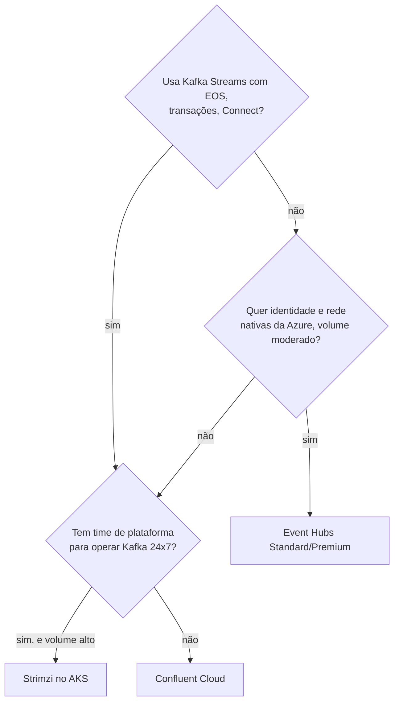

# 5.3 Strimzi, Confluent Cloud ou Event Hubs?

Esta é uma lição de **decisão**, não de código. É a pergunta que um tech lead ouve na primeira reunião sobre Kafka numa empresa que está no Azure: "a gente roda o Kafka ou compra?". A resposta de sênior não é um nome; é um conjunto de critérios, os números que pesam em cada um, e a escolha para **este** contexto.

## As três opções, o que cada uma é de verdade

::: conceito Strimzi no AKS
Apache Kafka de verdade, rodando nos **seus** nós, operado por um operador open source (CNCF). Você paga as VMs e os discos; o trabalho de operação (capacidade, upgrades, incidentes de disco, rebalanceamento de partições) é do seu time, com o operador automatizando a parte mecânica.
:::

::: conceito Confluent Cloud
Kafka gerenciado pela empresa fundada pelos criadores do Kafka, disponível no Azure (também pelo Azure Marketplace). Tipos de cluster com SLA e limites diferentes: **Basic** (99,5%, até 1.500 partições), **Standard** (99,9%; 99,99% com 2 eCKU; só rede pública), **Enterprise** (rede privada, até 96.000 partições), **Dedicated** (capacidade reservada em CKU) e **Freight** (alto volume com latência maior, só em algumas regiões AWS). Vem com Schema Registry, conectores e Flink gerenciados.
:::

::: conceito Azure Event Hubs com endpoint Kafka
Um serviço **nativo da Azure** de ingestão de eventos que **fala o protocolo do Kafka** (a partir do tier Standard; Basic não tem). Não é Kafka por baixo: é outra implementação, com o mapeamento namespace = cluster, event hub = tópico. Integra com Entra ID (OAuth, sem senha), Private Link, Capture para Storage e o resto da Azure.
:::

## A tabela de decisão

| Critério | Strimzi no AKS | Confluent Cloud | Event Hubs (Kafka) |
|---|---|---|---|
| **Compatibilidade com Kafka** | total (é o Apache Kafka) | total, com recursos extras | protocolo do cliente; **Kafka Streams e transações em preview só no Premium/Dedicated**; compressão só gzip (Premium/Dedicated) |
| **Quem opera** | você (com o operador) | Confluent | Microsoft |
| **Custo em volume baixo** | alto: 3+3 nós mínimos para HA, ligados 24 h | baixo (Basic/Standard por uso) | baixo (Standard por unidade de throughput) |
| **Custo em volume alto e estável** | o mais baixo por MB, se o time já existe | o mais alto, tipicamente | intermediário (Premium/Dedicated) |
| **Identidade sem senha** | SCRAM/mTLS (OAuth possível, com mais trabalho) | chaves de API ou OAuth | **Entra ID nativo**, Workload Identity |
| **Rede privada** | é o seu cluster | Enterprise/Dedicated (Private Link) | Private Link (Premium) |
| **Schema Registry** | separado (Apicurio, ou Confluent SR autogerenciado) | incluso, gerenciado | Azure Schema Registry (API própria) |
| **Retenção longa / reprocessar meses** | limitada só pelo seu disco (e tiered storage) | configurável, com storage infinito | limites por tier (confira as quotas) |
| **Upgrade de versão do Kafka** | você agenda (o operador executa) | automático | não se aplica |
| **Saída do fornecedor** | nenhuma amarra | média (recursos proprietários: ksqlDB, Flink, conectores gerenciados) | maior (semântica e limites próprios) |

::: armadilha "Compatível com Kafka" não é "é Kafka"
A página da própria Microsoft diz: Kafka Streams e transações Kafka estão em **preview pública** e só nos tiers Premium e Dedicated; compressão só `gzip`. O payments-streams deste módulo usa `exactly_once_v2`, que depende de transações. No Event Hubs Standard ele **não funciona**; no Premium, funciona em preview, sem SLA de recurso GA. Esse tipo de detalhe é o que transforma "migrar para gerenciado" numa reescrita. Antes de escolher, liste os recursos do Kafka que o seu código usa (transações, compactação, headers, Streams, cotas) e confira cada um na documentação do serviço, na data da decisão.
:::

## Como um sênior decide

Três perguntas, nesta ordem:

1. **O código depende de algo que só o Kafka real tem?** Kafka Streams com EOS, transações, compactação para tabelas, ferramentas do ecossistema (Connect, MirrorMaker). Se sim, Event Hubs sai da lista (ou entra com risco aceito e escrito).
2. **Existe um time para operar Kafka, de plantão?** Kafka bem operado exige alguém que entenda ISR, rebalanceamento, disco cheio, upgrade com `metadataVersion`. Se a resposta é "o dev que configurou da última vez", o custo real do Strimzi inclui o incidente de sábado.
3. **Qual o volume, e ele é estável?** Gerenciado cobra por uso: barato no começo, caro em escala. Autogerenciado é caro no começo (cluster mínimo de HA) e barato por MB em escala.

### A decisão do OrderFlow

- **Desenvolvimento e este curso: Strimzi.** Você aprende Kafka de verdade (o que cai na CCDAK), roda no kind de graça, e o payments-streams usa EOS sem restrição.
- **Produção hipotética de uma empresa do tamanho da sua (18 devs, sem time de plataforma dedicado):** **Confluent Cloud** (Standard ou Enterprise, conforme a exigência de rede privada). O sistema usa Kafka Streams com EOS (descarta o Event Hubs como alvo principal), e não há quem opere Kafka de madrugada. O custo extra por MB é menor que o custo de um incidente de disco cheio sem ninguém que saiba resolver.
- **Quando mudaria:** volume alto e estável e um time de plataforma formado → Strimzi. Mensageria simples de ingestão, sem Streams, com exigência forte de Entra ID e Private Link → Event Hubs.

::: porque Por que o código não muda (quase) entre as três
Os serviços só conhecem `bootstrap.servers` e as propriedades de segurança (lição 5.2), que vêm do ambiente. Trocar Strimzi por Confluent Cloud é trocar `SASL_PLAINTEXT`+`SCRAM-SHA-512` por `SASL_SSL`+`PLAIN` com chave de API; por Event Hubs, `SASL_SSL`+`OAUTHBEARER` com um callback do Entra ID (ou `PLAIN` com connection string, menos seguro). Isso é configuração, não código, **desde que** o código não use recursos que o destino não tem. É por isso que a pergunta 1 vem primeiro.
:::

## O que fica fora da conta (e não deveria)

- **Tráfego de rede**: entre zonas (Strimzi com `rack`, lição 5.1) e de saída (Confluent em outra rede, sem Private Link) é cobrado.
- **Ambientes**: dev, homologação e prod. Strimzi em dev pode ser 1 nó; gerenciado em dev é mais um cluster pago, ou um compartilhado com prefixos.
- **Schema Registry**: indispensável no contrato entre .NET e Java (Módulo 3). Gerenciado na Confluent; à parte nos outros dois.

::: dica
Preços mudam e dependem de região e contrato. Monte a comparação com a calculadora de cada fornecedor, com o **seu** volume (MB/s de entrada e saída, retenção, partições), e registre como um ADR (Módulo 8): o documento sobrevive à sua memória e à próxima reunião.
:::

## Perguntas para responder sem olhar

::: pergunta
O Event Hubs fala o protocolo Kafka. Por que não é sempre a escolha óbvia no Azure?
???
Porque é compatível com o protocolo do cliente, não com todo o Kafka: Kafka Streams e transações estão em preview e só nos tiers Premium/Dedicated, compressão só gzip, e há limites e semântica próprios. Se o sistema usa esses recursos, a migração vira reescrita. Ele é ótimo para ingestão com identidade e rede nativas da Azure.
:::

::: pergunta
Quais as três perguntas que você faz antes de escolher entre Kafka autogerenciado e gerenciado?
???
Se o código usa recursos que só o Kafka real tem (Streams com EOS, transações, Connect); se existe um time para operar Kafka 24x7; e qual o volume e se ele é estável (gerenciado é barato em pouco volume e caro em muito; autogerenciado é o contrário).
:::

**Próxima:** [5.4 Kafka Streams: tabelas, janelas e tempo](04-kafka-streams-conceitos.md)
