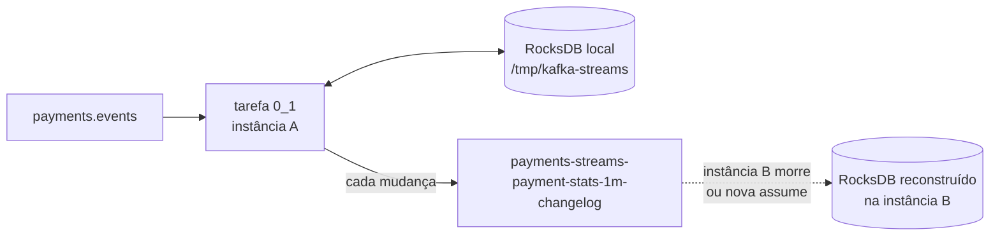

# 5.4 Kafka Streams: tabelas, janelas e tempo

Antes do código (lição 5.5), os conceitos. Kafka Streams é a parte do Kafka que mais cai na CCDAK e a que mais engana quem vem de "consumidor que processa mensagem".

::: conceito Kafka Streams
Uma **biblioteca Java** (não um cluster, não um serviço) para escrever aplicações que leem tópicos, transformam, agregam e escrevem em tópicos. Você descreve uma **topologia** (um grafo de operações) e a biblioteca cuida de particionamento, estado local, tolerância a falhas e escala. A aplicação é um processo comum: um JAR, um container, um Deployment. Escalar é rodar mais instâncias com o mesmo `application.id`.
:::

## KStream e KTable: o mesmo tópico, duas leituras

| | **KStream** | **KTable** |
|---|---|---|
| Cada registro é | um **fato** novo ("pagamento X aprovado") | uma **atualização** do valor de uma chave ("o total de APPROVED agora é 15") |
| Dois registros com a mesma chave | dois eventos | o segundo **substitui** o primeiro |
| Análogo | um log de auditoria | uma tabela de banco com `UPSERT` |

A dualidade: um stream de mudanças, aplicado em ordem, **é** uma tabela; uma tabela, observada ao longo do tempo, **é** um stream de mudanças. Um `aggregate` transforma um KStream numa KTable (cada evento atualiza o agregado); um `toStream()` devolve as mudanças da KTable como stream.

## Onde mora o estado

Um agregado precisa lembrar o valor atual. O Kafka Streams guarda isso num **state store** local (RocksDB, um banco chave-valor embutido, em disco) e, a cada atualização, grava também num tópico de **changelog** compactado no Kafka:



Se a instância morre, outra assume a tarefa e **reconstrói** o RocksDB lendo o changelog do começo. Com muito estado, isso leva minutos, e durante esse tempo a tarefa não processa. Daí o `num.standby.replicas: 1` do `application.yml`: uma segunda instância mantém uma **cópia quente** do estado, já lendo o changelog, e assume quase na hora.

::: porque Por que o estado fica num `emptyDir` e não num PVC
O changelog no Kafka já é a cópia durável. O disco local é um cache para acelerar. Com `emptyDir`, um pod novo começa vazio e restaura do changelog (ou a standby assume); com PVC, um pod reiniciado no mesmo volume restauraria só o que faltou, mais rápido. Para o payments-streams (estado pequeno: 3 chaves × janelas abertas) o `emptyDir` basta e evita a complexidade de StatefulSet com volumes. Para estado de gigabytes, StatefulSet com PVC passa a valer a pena.
:::

## Reparticionamento: quando a chave muda

O `payments.events` tem como chave o `orderId` (Módulo 2, para ordem por pedido). Para somar **por resultado** (APPROVED, DECLINED, REFUNDED), todos os aprovados precisam chegar na **mesma tarefa**, mas eles estão espalhados pelas 6 partições. O `groupBy` com uma chave nova faz o Kafka Streams:

1. escrever cada evento, com a chave nova, num tópico interno `payments-streams-por-resultado-repartition`;
2. ler esse tópico de volta, agora particionado pelo resultado.

Isso custa uma escrita e uma leitura a mais no Kafka por evento. É inevitável quando a chave do agregado é diferente da chave de origem, e é o motivo do ACL `All` em tópicos `payments-streams-*` (lição 5.2).

::: armadilha Chave de baixa cardinalidade
Depois do `groupBy`, só existem 3 chaves. Mesmo com 6 partições no repartition, no máximo 3 tarefas têm trabalho, e cada resultado é somado por **uma** só. Para estatísticas de pagamento isso sobra; para um agregado com milhões de eventos por segundo e poucas chaves, vira gargalo. A solução clássica é agregar em dois passos (por resultado + um sufixo aleatório de 0 a N, depois somar os N parciais). Saber explicar esse trade-off cai em entrevista.
:::

## Tempo: de evento, de ingestão, de processamento

| Tempo | O que é | Onde vem |
|---|---|---|
| **De evento** | quando o fato aconteceu | o `occurredAt` do payload |
| **De ingestão / do registro** | quando o produtor gravou no Kafka | o timestamp do registro (CreateTime) |
| **De processamento** | quando esta aplicação leu | o relógio da máquina |

O payments-streams usa **tempo de evento**, com o `OccurredAtTimestampExtractor`. Se o outbox do Payments (Módulo 3) ficar parado uma hora e depois publicar tudo, os pagamentos caem nas janelas em que **aconteceram**, não todos na janela de "agora".

::: conceito Stream time
O Kafka Streams não usa o relógio de parede para decidir janelas. Cada tarefa mantém o **stream time**: o **maior** timestamp de evento que já viu. As janelas "fecham" quando o stream time passa do fim delas mais a carência. Consequência: **sem eventos novos, o tempo não anda** e a última janela nunca fecha. Num tópico com pouco tráfego de madrugada, o resumo das 23:59 pode só sair quando o primeiro pagamento do dia seguinte chegar.
:::

## Janelas, carência e o resultado final

```java
.windowedBy(TimeWindows.ofSizeAndGrace(Duration.ofMinutes(1), Duration.ofSeconds(30)))
```

- **Janela de tamanho fixo** (*tumbling*): [12:00, 12:01), [12:01, 12:02)... cada evento cai em exatamente uma.
- **Carência** (*grace*) de 30 s: um evento com `occurredAt` 12:00:50 que chega quando o stream time já é 12:01:20 ainda entra na janela [12:00, 12:01). Se chegar com stream time 12:01:31 ou depois, é **descartado** (e contado na métrica `dropped-records`).

Sem mais nada, cada evento emitiria o agregado **parcial** atualizado (1, depois 2, depois 3...). O `suppress(untilWindowCloses(...))` segura as atualizações e emite **uma** mensagem por janela, quando ela fecha. O preço: o resultado sai com atraso de pelo menos a carência, e o buffer do suppress ocupa memória.

::: previsao
Janela de 1 min, carência de 30 s. Chegam, nesta ordem, eventos APPROVED com `occurredAt`: 12:00:10, 12:01:15, 12:00:50, 12:01:35, 12:00:20. Quantas mensagens o payments-streams publica, com que contagem, e o que acontece com o último evento?
???
- 12:00:10 → janela [12:00,12:01), stream time 12:00:10.
- 12:01:15 → janela [12:01,12:02), stream time 12:01:15.
- 12:00:50 → atrasado, mas 12:01:15 < 12:01:30 (fim + carência): **entra** na [12:00,12:01).
- 12:01:35 → stream time 12:01:35 ≥ 12:01:30: a janela [12:00,12:01) **fecha** e é publicada com **count 2**.
- 12:00:20 → a janela dele já fechou: **descartado**.

Uma mensagem publicada (count 2); a janela [12:01,12:02) segue aberta até o stream time passar de 12:02:30. É exatamente o segundo teste do `PaymentStatsTopologyTest`.
:::

::: video Kafka Streams 101: Windowing (Confluent, em inglês)
https://www.youtube.com/watch?v=7eO1toucB74
Janelas tumbling, hopping, session e sliding, carência e o `suppress`, com diagramas.
:::

## Exatamente uma vez, de verdade (dentro do Kafka)

Com `processing.guarantee: exactly_once_v2`, cada ciclo "ler offsets → atualizar estado (changelog) → escrever saída → confirmar offsets" vira **uma transação Kafka**. Se a instância morre no meio, a transação aborta: a saída parcial fica invisível para consumidores com `isolation.level=read_committed`, o estado é restaurado do changelog confirmado e os eventos são reprocessados. Nenhum evento conta duas vezes **no resultado**.

::: armadilha O "exatamente uma vez" termina na borda do Kafka
A garantia vale para o ciclo Kafka → Kafka. Se a topologia chamasse uma API HTTP ou gravasse num banco no meio, essas chamadas **não** fazem parte da transação e podem acontecer duas vezes. E consumidores do `payments.stats.1m` com `read_uncommitted` (o padrão do cliente Java é `read_uncommitted`!) podem ler saídas de transações abortadas. Quem consome um tópico escrito com EOS deve usar `read_committed`.
:::

## Perguntas para responder sem olhar

::: pergunta
Qual a diferença entre KStream e KTable?
???
KStream é uma sequência de fatos independentes; KTable é o valor mais recente por chave, em que um registro novo substitui o anterior. Um agregado transforma stream em tabela; `toStream()` transforma as mudanças da tabela em stream.
:::

::: pergunta
O que acontece com o estado de uma aplicação Kafka Streams quando a instância morre?
???
O estado local (RocksDB) é só um cache; a cópia durável é o tópico de changelog. Outra instância assume a tarefa e reconstrói o estado lendo o changelog, o que pode demorar. Com standby replicas, uma instância já mantém a cópia atualizada e assume quase na hora.
:::

::: pergunta
Por que uma janela pode nunca fechar num tópico com pouco tráfego?
???
Porque as janelas fecham pelo stream time, o maior timestamp de evento visto, e não pelo relógio. Sem eventos novos, o stream time não avança e a última janela segue aberta até chegar um evento posterior ao fim mais a carência.
:::

**Próxima:** [5.5 O payments-streams por dentro](05-payments-streams.md)
